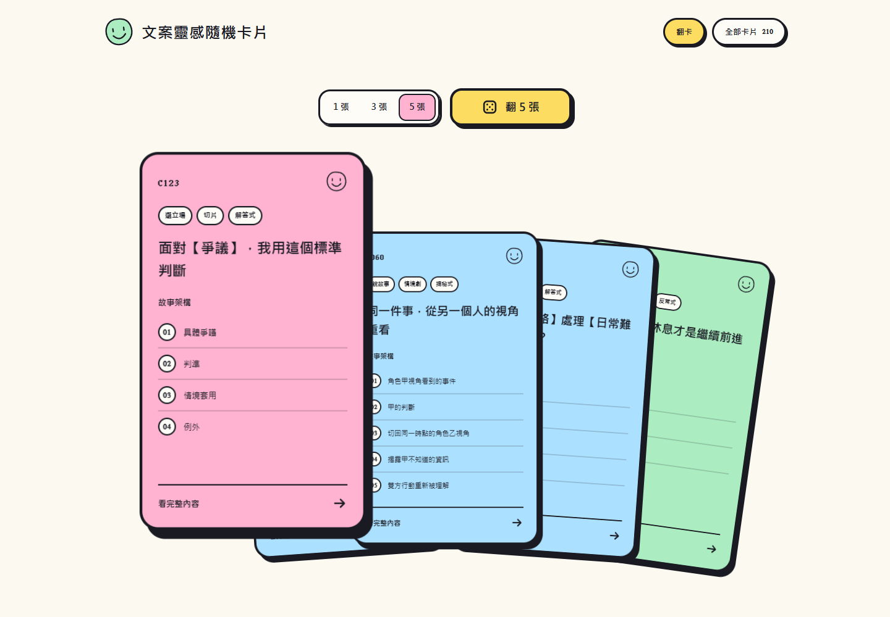

# 文案靈感隨機卡片

抽幾張，找到下一支短影音的起點。

- **1／3／5 張抽選**：卡片聚攏、翻面，再像遊戲手牌般展開。
- **挑一張看看**：滑鼠移到卡片就會放大；手機可用編號切換，點卡面直接看詳情。
- **完整架構**：卡片沒有內部捲動條，點卡面任何位置可進入詳情看兩個示例與拍攝提醒，也能複製架構。
- **全部卡片**：搜尋 210 種架構，依主題找到想要的切角。

免註冊，支援桌機、手機、鍵盤和減少動態設定。

案例皆為虛構示例，創作時請換成自己的真實素材與經歷。
