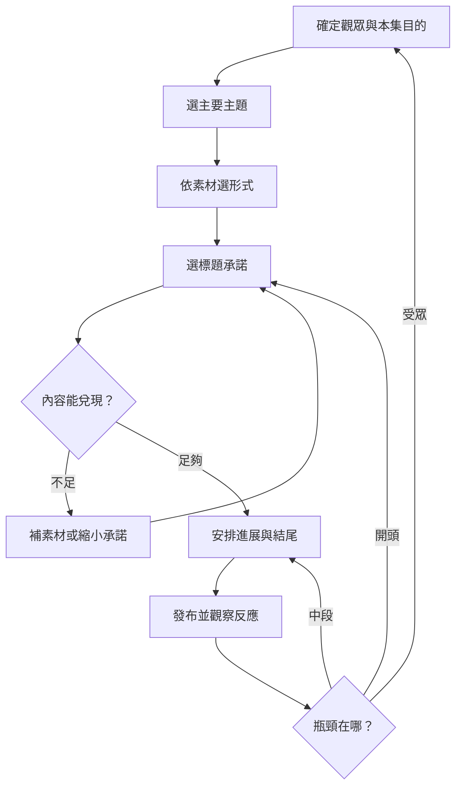

# 第一章：理論、分類與使用範圍

## 本章索引

- [用途與資料性質](#用途與資料性質)
- [完整組合範圍](#完整組合範圍)
- [三層分類](#三層分類)
- [承諾與交付](#承諾與交付)
- [選擇流程](#選擇流程)
- [泛用改寫方式](#泛用改寫方式)

## 用途與資料性質

本資料庫同時供人類學習與 AI 改稿使用。內容不依賴特定講師、品牌、產業或平台；來源另以中性代碼記錄在來源章。一般情境包含生活整理、手作、技能學習、服務流程、團隊協作、商品選擇與虛構短劇。

分類名稱屬公開框架；每筆概念、強化點、鏡頭安排與雙範例屬分析整理。具體範例是虛構教學示例，不是已拍紀錄、實際測試、顧客見證或成效證據。使用第一人稱文案前，需確認使用者有相應經歷；沒有時改成待拍測試、假設情境或虛構角色。

示例中的方括號、角色名與鏡頭提示用來標示素材性質或演出安排，不一定需要念出口。交付使用者文案時，將分析與可用台詞分開，並依素材確認事實。

## 完整組合範圍

```text
7 種主要內容主題 × 5 種主要呈現形式 × 6 種主要標題切角
＝ 210 個可查找的企劃格

每格：概念＋腳本公式＋強化點＋預期效果＋呈現建議＋2 則完整文案
```

210 是本版本的索引範圍，不是影片創意的總數，也不是互斥分類。切片描述素材來源，口播描述表現方式，因此同一作品可能同時成立；說故事與演劇情、提問與解答也可能重疊。使用時為它們指定主要功能。

時間長短、人物數量、產業、場景、情緒與鏡頭語言都可延伸。本資料庫不把無界變項相乘成「保證有效的公式數」。尚未取得完整內容的其他分類，不補入推測名稱。

## 三層分類

### 主題：觀眾拿走什麼

| 主題 | 核心價值 | 基本進展 | 常見失效 |
|---|---|---|---|
| 曬過程 | 看見變化與完成 | 起點、限制、操作、結果 | 沒明顯變化，只剪動作 |
| 說故事 | 理解人物與選擇 | 目標、阻礙、選擇、後果 | 只有時間順序，沒有因果 |
| 教知識 | 學會操作或判斷 | 問題、解釋、示範、檢查 | 只有名詞，沒有例子 |
| 熬雞湯 | 被理解並得到支持 | 處境、感受、新理解、小行動 | 只有抽象鼓勵 |
| 選立場 | 有理由的判斷 | 爭點、標準、理由、例外 | 只有站隊，沒有判準 |
| 賣商品 | 判斷是否適合 | 需求、展示、證據、取捨 | 只有優點，沒適用條件 |
| 演劇情 | 衝突與收束 | 角色、目標、障礙、升級、結果 | 為反轉突然改設定 |

同一素材可有不同主要價值。修理抽屜，拍卡住到滑順是曬過程；解釋滑軌判斷是教知識；描寫兩人互相誤會是劇情。只換標題不等於完成不同主題。

### 形式：證據與敘事如何被看見

| 形式 | 材料 | 最需要處理的事 |
|---|---|---|
| 切片 | 原始直播、訪談、長片、長劇 | 保留原意，補最少必要背景 |
| 口播 | 人物說明、實物、一人分飾多角 | 白話、具體，聲音表情有目的 |
| 圖片旁白 | 照片、截圖、圖解、比較表 | 每張提供新資訊且對齊旁白 |
| 影片旁白 | 操作、現場、實驗、觀察 | 動作提供證據，旁白解釋判斷 |
| 情境劇 | 角色、台詞、互動、道具 | 人物有動機，衝突有後果 |

有照片、無操作錄影時，圖片旁白通常較符合素材。已有訪談時，可找完整知識或故事單元。使用者只要求口播改稿時，保留口播限制，不擅自改成交付多人短劇。

### 標題：觀看承諾

| 切角 | 通用句型 | 需兌現的內容 | 適合素材 |
|---|---|---|---|
| 新知式 | 原來【事物】還有【新理解】 | 可解釋的新資訊 | 原理、細節、不同視角 |
| 提問式 | 為什麼【現象】／能否【任務】？ | 回答問題 | 謎題、困惑、測試 |
| 解答式 | 遇到【問題】，可以【做法】 | 可操作或判斷的方法 | 步驟、檢查、決策 |
| 反常式 | 以為【A】，在【條件】卻是【B】 | 反差及成立條件 | 對照、例外、認知落差 |
| 佔便宜 | 少花【成本】／省去【試錯】 | 具體利益與限制 | 清單、比較、整理 |
| 揭秘式 | 【結果】背後的【原因】 | 可支持的深層解釋 | 工序、判準、伏筆 |

新知可以是對目標觀眾而言的新理解。揭秘不等於陰謀，流程與機制拆解也成立。反常需要真實條件差異，不能為吸睛否定所有常識。

## 承諾與交付

標題、第一畫面、第一句話應指向同一問題。中段每段推進至少一件事：操作狀態、人物選擇、證據、理解或衝突。結尾完成主要承諾；是否要求收藏、留言或購買，取決於觀眾下一步需求。

資訊密度是有用進展相對於觀看負擔，不是每秒塞更多字。停頓、連續操作與結果對照在有作用時都可保留。沒有通用的每幾秒必剪、固定完播率必爆或固定長度最優規則。

## 選擇流程



- 確定本支最重要的一個目的。
- 依素材選形式，保留使用者製作限制。
- 承諾超過證據時，縮小承諾或補取材計畫。
- 依實際瓶頸修正；題材需求與受眾差異也會影響結果。

## 泛用改寫方式

```text
素材：整理抽屜的前後照片，沒有操作錄影。
目的：學會把常用物放到容易拿的位置。
選擇：教知識＋圖片旁白＋解答式。
證據：照片與可指出的拿取動線。
限制：不能寫成已證明效率提升某百分比。
交付：標示三個位置、解釋調整理由、給可照做的檢查。
```

```text
素材：角色誤會的對話草稿，沒有真實客戶紀錄。
目的：理解確認需求的重要性。
選擇：教知識＋情境劇＋提問式。
證據：虛構角色呈現兩種溝通方式，不作真實成效宣稱。
限制：不把演員台詞包裝成顧客見證。
交付：演出誤會與釐清問題，解釋改變了哪個資訊缺口。
```
