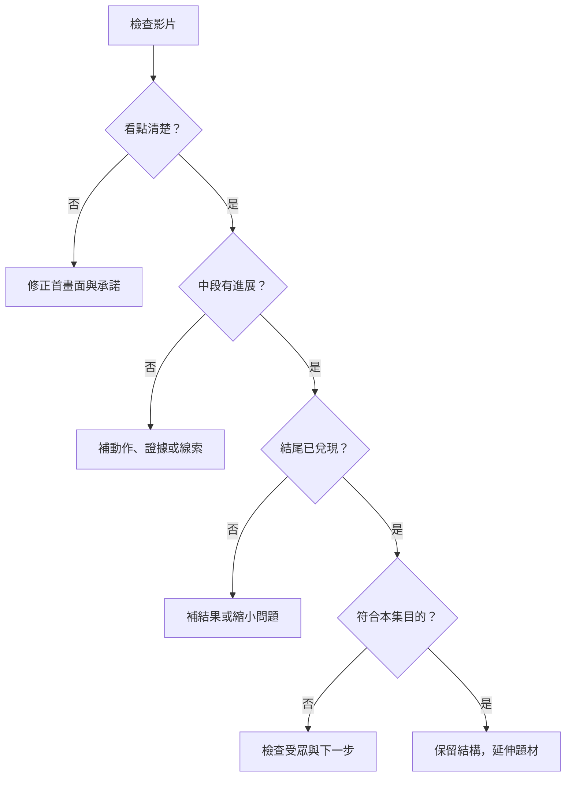

# 第十二章：預期效果、呈現方式與驗證

## 本章索引

- [效果不是保證](#效果不是保證)
- [不同主題的預期作用](#不同主題的預期作用)
- [不同形式的呈現方法](#不同形式的呈現方法)
- [不同標題的承諾驗證](#不同標題的承諾驗證)
- [診斷流程](#診斷流程)
- [指標與計算邊界](#指標與計算邊界)
- [兩個完整改善情境](#兩個完整改善情境)

## 效果不是保證

本章描述的是可提出、可觀察的設計假設。某段有反轉，不等於必定增加觀看；有人停留，也不等於信任或購買。題材需求、既有受眾、分發位置、季節、競爭與素材品質都可能影響結果。單支作品只能提供線索，不能隔離所有因果。

## 不同主題的預期作用

| 主題 | 預期改善 | 為什麼可能有效 | 最該呈現 | 可觀察線索 | 常見反作用 |
|---|---|---|---|---|---|
| 曬過程 | 持續關注、理解能力 | 下一步會造成可見變化 | 起點、限制、關鍵動作、結果 | 觀眾是否跟到結果、是否問操作細節 | 冗長重複動作使人離開 |
| 說故事 | 情緒投入、記住人物 | 觀眾理解選擇的難處 | 目標、代價、關鍵選擇 | 觀眾能否說出人物為何那樣做 | 過度煽情或省略背景降低可信度 |
| 教知識 | 理解、保存、實作 | 把模糊問題變成能處理的步驟 | 例子、示範、檢查標準 | 問題是否更精確、是否能照做 | 術語堆疊或過度簡化 |
| 熬雞湯 | 被理解、願意繼續 | 精確說中處境並降低下一步負擔 | 具體困難、可選的小行動 | 回應是否談自己的相似處境 | 口號、責備或假裝理解所有人 |
| 選立場 | 形成判斷、辨識價值觀 | 理由讓人能同意或具體反駁 | 判準、證據、例外 | 討論是否圍繞理由而非只有罵戰 | 情緒對立引來錯誤受眾 |
| 賣商品 | 降低選購疑惑、增加合適詢問 | 展示適用範圍與取捨 | 需求、功能、實際限制、下一步 | 問題是否更接近用途、規格、交付 | 過度承諾增加失望與售後成本 |
| 演劇情 | 期待、娛樂、記憶 | 角色行動與懸念帶動觀看 | 規則、衝突、線索、收束 | 觀眾是否理解笑點與伏筆 | 反轉不合理、演出難辨識 |

## 不同形式的呈現方法

### 切片

- 選擇可獨立理解的單元，不只挑情緒最高的一句。
- 缺背景時用短字幕補人物、問題或時間條件；字幕不可改變原意。
- 保留限定語、操作關鍵段、必要反例。沒有原素材時交付「選段需求」，不要聲稱完成真實剪輯。
- 聲音接點自然；若不同時間片段合併可能改變因果，明示整理方式。

### 口播

- 第一個畫面讓人知道正在談哪個具體問題，可用實物或簡短文字協助。
- 一段負責一個意思；用生活例子承接概念，不用跳剪掩蓋邏輯缺口。
- 表情、音量與停頓服務意思，不把持續激昂當通用需求。
- 關鍵證據放畫面或可查來源；只說「我很專業」不是證明。

### 圖片旁白

- 圖片順序對應推理或事件順序；每張都增加資訊。
- 一次突出一個比較位置、數字或操作區域，保留讀圖時間。
- 使用相同尺度、版本、日期或拍攝角度比較；畫面條件不同時說清楚。
- 旁白解釋圖片關係，不逐字朗讀整頁字卡。

### 影片旁白

- 關鍵動作拍到起點與完成狀態；需要理解的操作不要剪沒。
- 旁白補判斷、限制與原因，讓畫面負責可見動作。
- 實測要說明條件；縮時不等於實際耗時，補拍不等於事件當時紀錄。
- 環境音能提供操作質感時保留；音樂不蓋住重要資訊。

### 情境劇

- 先讓觀眾分清角色、目的與資訊差；可用位置、服裝或聲線辨識。
- 每個角色有合理需求，反方不只是陪襯。
- 笑點、解法與反轉要回應先前設定；把必要線索放在觀眾看得到的地方。
- 教學演出與真實見證區分；不能把角色台詞當實測證據。

## 不同標題的承諾驗證

| 類型 | 審查問題 | 常見修正 |
|---|---|---|
| 新知式 | 對這個受眾究竟新增哪個理解？ | 把「你一定不知道」改成具體發現 |
| 提問式 | 結尾是否真正回答？ | 縮小問題、移除與答案無關的背景 |
| 解答式 | 觀眾知道第一步及完成標準嗎？ | 補動作、位置、條件與檢查 |
| 反常式 | 差異成立的條件是什麼？ | 補比較基準，不全面否定常識 |
| 佔便宜 | 省了什麼、代價是什麼？ | 交付清單或比較，說清楚限制 |
| 揭秘式 | 哪些是觀察，哪些是推論？ | 補來源或改成待驗證問題 |

## 診斷流程



- 沒停下來：可能是題材、首畫面或承諾不清，不能單靠低觀看就判定標題錯。
- 中段離開：找實際流失位置，檢查鋪陳、重複、理解負擔與承諾偏移。
- 看完沒詢問：可能本集目的只是教學；若目的是合適詢問，再看受眾與下一步是否清楚。
- 有詢問沒成交：檢查需求匹配、交付、價格或流程，不必把所有問題歸因於文案。
- 一次優先改一個主要變項，對照相近題材與發布條件；這仍是觀察比較，不等於嚴格實驗。

## 指標與計算邊界

觀察時同時記錄指標定義、期間、分母、樣本數、流量來源與片長。曝光、開始播放、有效觀看、獨立觀眾與完整觀看不是同一件事，各平台定義需查當期文件。

```text
觀看轉詢問率 = 同一批可追蹤觀看所帶來的詢問數 / 對應觀看數
詢問轉成交率 = 同一批詢問的成交數 / 該批詢問數
```

無法可靠歸因時，只報期間數字與限制，不把不同來源相除當作精確轉換率。

過去常見的「業績＝流量×轉換率×客單價×回購率」是經營提醒，不是普遍成立的會計等式；首次購買存在時，回購率為零不代表營收為零。

```text
同一期間營收
= 購買客戶數 × 每位購買客戶的平均訂單數 × 平均每筆訂單金額

假設例一：10 位客戶 × 1.2 筆 × 200 元 = 2,400 元。
假設例二：20 位客戶 × 1 筆 × 150 元 = 3,000 元。
```

以上只是算術示例，不是實際業績案例。退貨、折讓與稅費是否計入，應與選用的營收口徑一致。

## 兩個完整改善情境

### 情境一：圖解教學有人點開，卻說看不懂

- 原內容：首圖承諾「教你整理文件」，後面快速展示六個資料夾名稱。
- 診斷：問題不在分類數量，而在觀眾不知道檔案要放哪裡。
- 修正：拿一個具體文件演示「目前進行／完成歸檔」的判斷，再給一張查找表。
- 預期：降低選擇負擔，讓觀眾能自行處理下一個文件。
- 驗證：觀察回問是否從「怎麼分類」變成具體例外；不因收藏增加就斷言人人學會。

### 情境二：商品劇情很有趣，詢問卻不相關

- 原內容：兩個角色為座位爭吵，桌燈只在背景出現，結尾突然要求購買。
- 診斷：笑點吸引的關注沒有連到照明需求。
- 修正：把衝突改成桌面反光與照射範圍，展示燈臂調整和使用限制。
- 預期：使討論更接近商品用途，提升詢問的相關性。
- 驗證：記錄詢問內容與後續適配性；不只比較觀看總量。
