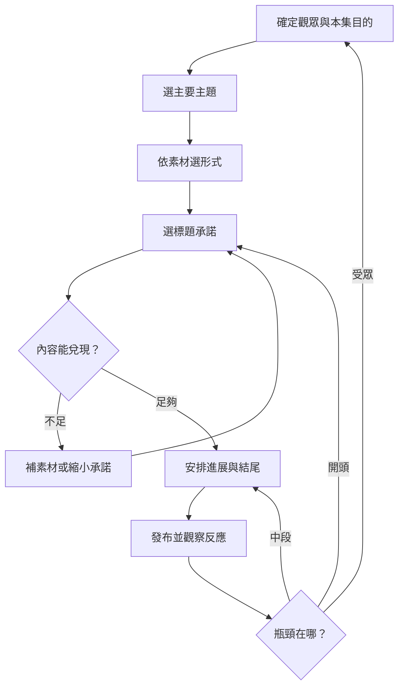
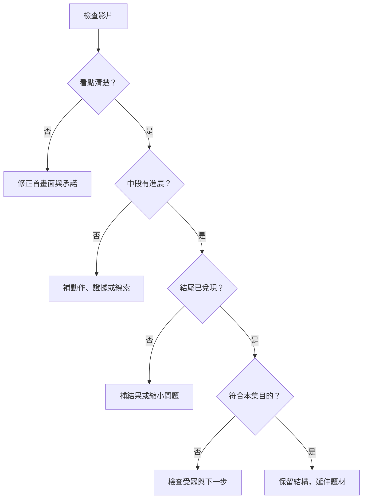

# 短影音通用公式、組合模板與 AI 改稿資料庫

版本：1.0｜整理日期：2026-09-10｜語言：繁體中文

完整包含 **210 種核心組合、420 則核心文案、12 種通用公式、31 種混搭配對，共 506 則編目示例**。另附完整改稿前後案例、效果與呈現章、資料結構與來源界線。正文去除具體品牌、人名與平台名稱，來源追溯集中於末章。

所有示例均是虛構教學設定，不能直接當成使用者經歷、實測、顧客見證或商品事實。文件用於理解與改稿，不保證流量或成交。

## 閱讀與使用

- 人類：先看第一、二章，再從第三章索引選組合，最後讀效果、呈現與改稿章。
- AI：若使用技能包，先讀技能入口，再按需檢索 JSON 或對應 Markdown，無需載入整本報告。
- 直接提供本報告給 AI 時，要求它按編號定位相關紀錄，保留使用者事實與製作限制。

## 章節索引

- [第一章：理論、分類與使用範圍](#file-01-theory)
- [第二章：12 種通用公式與 24 則完整範例](#file-02-formulas)
- [第三章：210 種組合總索引](#file-index)
- [第四章：曬過程——30 種組合與 60 則文案](#file-catalog-process)
- [第五章：說故事——30 種組合與 60 則文案](#file-catalog-story)
- [第六章：教知識——30 種組合與 60 則文案](#file-catalog-knowledge)
- [第七章：熬雞湯——30 種組合與 60 則文案](#file-catalog-emotion)
- [第八章：選立場——30 種組合與 60 則文案](#file-catalog-stance)
- [第九章：賣商品——30 種組合與 60 則文案](#file-catalog-product)
- [第十章：演劇情——30 種組合與 60 則文案](#file-catalog-drama)
- [第十一章：21 種主題混搭與 10 種形式混搭](#file-05-mixes)
- [第十二章：預期效果、呈現方式與驗證](#file-03-effects-presentation)
- [第十三章：AI 改稿與提案流程](#file-04-rewrite-workflow)
- [第十四章：資料結構、索引與擴充](#file-06-schema-extension)
- [第十五章：來源與資料界線](#file-07-evidence)
- [附錄一：跨情境案例索引](#file-scenario-index)

---

<a id="file-01-theory"></a>

# 第一章：理論、分類與使用範圍

## 本章索引

- [用途與資料性質](#用途與資料性質)
- [完整組合範圍](#完整組合範圍)
- [三層分類](#三層分類)
- [承諾與交付](#承諾與交付)
- [選擇流程](#選擇流程)
- [泛用改寫方式](#泛用改寫方式)

## 用途與資料性質

本資料庫同時供人類學習與 AI 改稿使用。內容不依賴特定講師、品牌、產業或平台；來源另以中性代碼記錄在來源章。一般情境包含生活整理、手作、技能學習、服務流程、團隊協作、商品選擇與虛構短劇。

分類名稱屬公開框架；每筆概念、強化點、鏡頭安排與雙範例屬分析整理。具體範例是虛構教學示例，不是已拍紀錄、實際測試、顧客見證或成效證據。使用第一人稱文案前，需確認使用者有相應經歷；沒有時改成待拍測試、假設情境或虛構角色。

示例中的方括號、角色名與鏡頭提示用來標示素材性質或演出安排，不一定需要念出口。交付使用者文案時，將分析與可用台詞分開，並依素材確認事實。

## 完整組合範圍

```text
7 種主要內容主題 × 5 種主要呈現形式 × 6 種主要標題切角
＝ 210 個可查找的企劃格

每格：概念＋腳本公式＋強化點＋預期效果＋呈現建議＋2 則完整文案
```

210 是本版本的索引範圍，不是影片創意的總數，也不是互斥分類。切片描述素材來源，口播描述表現方式，因此同一作品可能同時成立；說故事與演劇情、提問與解答也可能重疊。使用時為它們指定主要功能。

時間長短、人物數量、產業、場景、情緒與鏡頭語言都可延伸。本資料庫不把無界變項相乘成「保證有效的公式數」。尚未取得完整內容的其他分類，不補入推測名稱。

## 三層分類

### 主題：觀眾拿走什麼

| 主題 | 核心價值 | 基本進展 | 常見失效 |
|---|---|---|---|
| 曬過程 | 看見變化與完成 | 起點、限制、操作、結果 | 沒明顯變化，只剪動作 |
| 說故事 | 理解人物與選擇 | 目標、阻礙、選擇、後果 | 只有時間順序，沒有因果 |
| 教知識 | 學會操作或判斷 | 問題、解釋、示範、檢查 | 只有名詞，沒有例子 |
| 熬雞湯 | 被理解並得到支持 | 處境、感受、新理解、小行動 | 只有抽象鼓勵 |
| 選立場 | 有理由的判斷 | 爭點、標準、理由、例外 | 只有站隊，沒有判準 |
| 賣商品 | 判斷是否適合 | 需求、展示、證據、取捨 | 只有優點，沒適用條件 |
| 演劇情 | 衝突與收束 | 角色、目標、障礙、升級、結果 | 為反轉突然改設定 |

同一素材可有不同主要價值。修理抽屜，拍卡住到滑順是曬過程；解釋滑軌判斷是教知識；描寫兩人互相誤會是劇情。只換標題不等於完成不同主題。

### 形式：證據與敘事如何被看見

| 形式 | 材料 | 最需要處理的事 |
|---|---|---|
| 切片 | 原始直播、訪談、長片、長劇 | 保留原意，補最少必要背景 |
| 口播 | 人物說明、實物、一人分飾多角 | 白話、具體，聲音表情有目的 |
| 圖片旁白 | 照片、截圖、圖解、比較表 | 每張提供新資訊且對齊旁白 |
| 影片旁白 | 操作、現場、實驗、觀察 | 動作提供證據，旁白解釋判斷 |
| 情境劇 | 角色、台詞、互動、道具 | 人物有動機，衝突有後果 |

有照片、無操作錄影時，圖片旁白通常較符合素材。已有訪談時，可找完整知識或故事單元。使用者只要求口播改稿時，保留口播限制，不擅自改成交付多人短劇。

### 標題：觀看承諾

| 切角 | 通用句型 | 需兌現的內容 | 適合素材 |
|---|---|---|---|
| 新知式 | 原來【事物】還有【新理解】 | 可解釋的新資訊 | 原理、細節、不同視角 |
| 提問式 | 為什麼【現象】／能否【任務】？ | 回答問題 | 謎題、困惑、測試 |
| 解答式 | 遇到【問題】，可以【做法】 | 可操作或判斷的方法 | 步驟、檢查、決策 |
| 反常式 | 以為【A】，在【條件】卻是【B】 | 反差及成立條件 | 對照、例外、認知落差 |
| 佔便宜 | 少花【成本】／省去【試錯】 | 具體利益與限制 | 清單、比較、整理 |
| 揭秘式 | 【結果】背後的【原因】 | 可支持的深層解釋 | 工序、判準、伏筆 |

新知可以是對目標觀眾而言的新理解。揭秘不等於陰謀，流程與機制拆解也成立。反常需要真實條件差異，不能為吸睛否定所有常識。

## 承諾與交付

標題、第一畫面、第一句話應指向同一問題。中段每段推進至少一件事：操作狀態、人物選擇、證據、理解或衝突。結尾完成主要承諾；是否要求收藏、留言或購買，取決於觀眾下一步需求。

資訊密度是有用進展相對於觀看負擔，不是每秒塞更多字。停頓、連續操作與結果對照在有作用時都可保留。沒有通用的每幾秒必剪、固定完播率必爆或固定長度最優規則。

## 選擇流程



- 確定本支最重要的一個目的。
- 依素材選形式，保留使用者製作限制。
- 承諾超過證據時，縮小承諾或補取材計畫。
- 依實際瓶頸修正；題材需求與受眾差異也會影響結果。

## 泛用改寫方式

```text
素材：整理抽屜的前後照片，沒有操作錄影。
目的：學會把常用物放到容易拿的位置。
選擇：教知識＋圖片旁白＋解答式。
證據：照片與可指出的拿取動線。
限制：不能寫成已證明效率提升某百分比。
交付：標示三個位置、解釋調整理由、給可照做的檢查。
```

```text
素材：角色誤會的對話草稿，沒有真實客戶紀錄。
目的：理解確認需求的重要性。
選擇：教知識＋情境劇＋提問式。
證據：虛構角色呈現兩種溝通方式，不作真實成效宣稱。
限制：不把演員台詞包裝成顧客見證。
交付：演出誤會與釐清問題，解釋改變了哪個資訊缺口。
```


---

<a id="file-02-formulas"></a>

# 第二章：12 種通用公式與 24 則完整範例

公式描述敘事關係，不是成功機率或演算法權重。可先選公式，再到 C 索引找指定主題、形式與標題的完整變體。所有例子為虛構教學示例。

## 本章索引

- [F01 承諾—證據—交付](#f01)
- [F02 過程與結果](#f02)
- [F03 人物選擇與後果](#f03)
- [F04 知識轉譯與操作](#f04)
- [F05 具體共鳴與小行動](#f05)
- [F06 立場與判準](#f06)
- [F07 商品適配與選擇](#f07)
- [F08 角色衝突與合理收束](#f08)
- [F09 固定系列與替換題材](#f09)
- [F10 錯誤—改變—方法—證據](#f10)
- [F11 保留意圖的改稿](#f11)
- [F12 同條件比較與分流](#f12)

---

<a id="f01"></a>

## F01｜承諾—證據—交付

**概念：**全片用一個主要問題串起來，標題、畫面與結尾一致。

**公式：**

```text
明確受眾＋一個問題→提出可兌現承諾→展示支持內容→交付答案→相關下一步
```

**優先強化：**

- 把問題縮到一支能回答
- 每項重要主張有對應材料
- 結尾回到原承諾

**預期效果：**

- 降低理解負擔
- 減少標題與內容落差

<a id="f01-1"></a>

### 範例 1：桌面整理

**資料性質：**虛構教學示例。文案中的事件與數值需依實際素材確認。

**標題：**找不到剪刀，先別急著買新收納盒

```text
每次找剪刀都要翻整張桌子？先把今天用過的東西留下，其他移到旁邊。接著替剪刀選一個伸手就能拿到的位置，用完就放回同一處。今天先不處理整間房間，只檢查一件事：下次需要剪刀時，你知不知道去哪裡拿？找到固定位置，再決定要不要加收納工具。
```

**為什麼這樣組合：**開頭只承諾改善剪刀查找，操作與結尾都在同一範圍；不能宣稱已節省特定時間。


<a id="f01-2"></a>

### 範例 2：讀書筆記

**資料性質：**虛構教學示例。文案中的事件與數值需依實際素材確認。

**標題：**筆記很多卻找不到重點，可以先改這一頁

```text
筆記越寫越多，下次卻不知道從哪裡讀？挑一頁，把你要回答的問題寫在最上面，再圈出真正能回答它的句子。剩下的資料先保留，但不用全部當重點。翻頁前用自己的話說一次答案；說不清楚的地方，就是下次要補的資料。先讓一頁能使用，再考慮做更漂亮的分類。
```

**為什麼這樣組合：**以能回答問題作完成標準，避免只靠增加分類或裝飾假裝提高理解。

---

<a id="f02"></a>

## F02｜過程與結果

**概念：**讓操作產生可見進展，觀眾知道每一步改變了什麼。

**公式：**

```text
起點→任務與限制→關鍵動作→卡關與調整→前後對照→限制
```

**優先強化：**

- 保留操作連續性
- 比較條件一致
- 解釋為什麼調整

**預期效果：**

- 建立進展期待
- 展示工作能力

<a id="f02-1"></a>

### 範例 1：手作包裝

**資料性質：**虛構教學示例。文案中的事件與數值需依實際素材確認。

**標題：**一張包裝紙，怎麼包好形狀不規則的禮物

```text
這份禮物凸出一角，直接折紙就會破。這次先不多拿一張紙，試著把禮物轉個方向，讓凸出的地方落在折線之外。底部固定後，再把多餘紙面向兩側收。最後先輕輕拿起來檢查，不靠外觀就判定包好了。若紙張太薄或尺寸不夠，就需要換材料，不能硬折。
```

**為什麼這樣組合：**限制推動操作選擇，結果有檢查而非只有美觀成品。


<a id="f02-2"></a>

### 範例 2：衣櫥整理

**資料性質：**虛構教學示例。文案中的事件與數值需依實際素材確認。

**標題：**這層衣架老是卡住，先改哪裡

```text
衣架每次拉出來都勾到旁邊，這次先不把整櫃清空。我先移出最長的兩件外套，再把常穿的上衣集中到前段。拉動時發現袖子仍會互相壓住，所以保留一點間距。最後用平常拿衣服的方式再試一次。這是針對這層空間的調整，其他櫃子要先看深度和衣物長度。
```

**為什麼這樣組合：**起點、修改、再測形成完整過程，結果不擴大成所有衣櫥的通則。

---

<a id="f03"></a>

## F03｜人物選擇與後果

**概念：**故事由人物的選擇推進，而非只羅列日期。

**公式：**

```text
人物與目標→阻礙→兩難與代價→選擇→行動→結果與理解
```

**優先強化：**

- 交代當時資訊
- 讓代價具體
- 保留選擇到結果的因果

**預期效果：**

- 增加人物投入
- 讓觀點更容易記住

<a id="f03-1"></a>

### 範例 1：社區活動

**資料性質：**虛構教學示例。文案中的事件與數值需依實際素材確認。

**標題：**負責人為什麼取消了最好看的布置

```text
活動前一天，布置還沒完成，志工也快走了。負責人可以留下大家趕工，也可以取消入口的大型裝飾。她最後選了後者，先把指引牌和報到動線做好。隔天入口沒有想像中華麗，但新來的人知道該往哪裡走。這是虛構的活動故事：她放棄的不是用心，而是把有限的人力先放在參加者真正需要的地方。
```

**為什麼這樣組合：**兩個選項都有成本，後果對應優先順序；明示虛構避免當真實活動成效。


<a id="f03-2"></a>

### 範例 2：創作合作

**資料性質：**虛構教學示例。文案中的事件與數值需依實際素材確認。

**標題：**搭檔說要重做時，我先問了一個問題

```text
我們排好故事，搭檔卻說想全部重來。我本來想立刻反駁，最後先問：你最不滿意的是哪一幕？他指出結尾看不出主角為什麼離開。我們沒有重寫全部，而是把前面一次猶豫補清楚。這段是模擬合作經歷。關鍵不是每次都妥協，而是先把不同意見變成可以修改的具體問題。
```

**為什麼這樣組合：**以一個提問改變行動，結尾不把個案經驗寫成萬能溝通術。

---

<a id="f04"></a>

## F04｜知識轉譯與操作

**概念：**把概念轉成可操作的判斷，不靠術語堆疊。

**公式：**

```text
具體困惑→區分條件→生活例子→操作方法→檢查標準→例外
```

**優先強化：**

- 一個例子承接一個概念
- 說清楚第一步
- 補適用範圍

**預期效果：**

- 提高理解與可用性
- 減少模糊追問

<a id="f04-1"></a>

### 範例 1：檔案整理

**資料性質：**虛構教學示例。文案中的事件與數值需依實際素材確認。

**標題：**資料夾越分越細，為什麼還是找不到

```text
找不到檔案時，先看你平常是用日期、專案還是文件用途來找。假如你總是先想起專案名稱，就把同一專案的資料放在一起，再區分進行中與已完成。不要每出現一個檔案就新增分類。拿昨天用過的文件試找一次，看看路徑是否符合自己的習慣；多人共用時，還要確認大家理解相同。
```

**為什麼這樣組合：**先分查找方式再給分類方法，避免推薦唯一正確資料夾結構。


<a id="f04-2"></a>

### 範例 2：手作工具

**資料性質：**虛構教學示例。文案中的事件與數值需依實際素材確認。

**標題：**選尺之前，先看你要量哪一種東西

```text
量紙張邊線和量圓形物件，用到的方式不一樣。平直邊緣可以用硬尺對齊，弧面則要先確認工具能不能貼合。重點不是刻度越多越好，而是起點、單位和接觸面是否清楚。先用你要量的物件試一次，再決定工具；需要更高精度的工作，還要查看量具本身的規格。
```

**為什麼這樣組合：**用不同物件說明適配條件，避免把簡單示範當精密量測標準。

---

<a id="f05"></a>

## F05｜具體共鳴與小行動

**概念：**鼓勵先讓人被理解，再提供低負擔選擇。

**公式：**

```text
具體處境→承接感受→替代理解→可選小行動→留有餘地的收尾
```

**優先強化：**

- 避免保證成功
- 不用責備催促
- 行動具體且可選

**預期效果：**

- 增進共鳴
- 降低開始的負擔

<a id="f05-1"></a>

### 範例 1：繪畫練習

**資料性質：**虛構教學示例。文案中的事件與數值需依實際素材確認。

**標題：**今天畫不好，不必替整本練習本下結論

```text
畫了幾次都不像，你可能已經不想再翻那本練習本。今天先不用證明自己進步了，挑一個願意重畫的小地方就好，可能是一條線，也可能是一片葉子。如果現在很累，先把日期寫下來，留給下次再看。這次沒有完成一張作品，不代表之前的練習都不算數，你可以自己決定下一步。
```

**為什麼這樣組合：**承認處境並提供小選擇，不用單一成功標準要求觀眾。


<a id="f05-2"></a>

### 範例 2：寫作中斷

**資料性質：**虛構教學示例。文案中的事件與數值需依實際素材確認。

**標題：**文章停在第二段，也還有下一步

```text
你不是每次坐下來都能寫出完整文章。如果今天只知道自己想說什麼，先留下一句最接近的話，再記下卡住的問題。下次回來時，不用重新猜昨天在想什麼。那句話可能還很粗糙，也不必現在就公開。先替未完成的自己留下線索，休息或繼續，都可以是你安排創作的方法。
```

**為什麼這樣組合：**把支持連到可做的筆記行動，沒有把休息或持續其中一種當唯一答案。

---

<a id="f06"></a>

## F06｜立場與判準

**概念：**用理由與可修正的條件支持立場。

**公式：**

```text
爭點→自己的選擇→判準→具體例子→例外→邀請討論條件
```

**優先強化：**

- 準確呈現不同需求
- 分清事實與偏好
- 說明何時改變判斷

**預期效果：**

- 提高討論品質
- 建立可辨認的價值觀

<a id="f06-1"></a>

### 範例 1：團隊分工

**資料性質：**虛構教學示例。文案中的事件與數值需依實際素材確認。

**標題：**我支持分工，但不支持把責任分到沒人知道全貌

```text
分工能讓每個人專心，但如果所有人都只知道自己的小段，交接就容易失去背景。我傾向每件事有執行者，也有一個能說清楚整體目標的人。這不代表所有決定都要同一人批准。簡單任務可以更輕量，跨多人、跨時間的工作則更需要清楚交代誰負責串起來。你會用什麼條件決定分工的細度？
```

**為什麼這樣組合：**立場區分分工與資訊斷裂，例外讓討論能落在條件。


<a id="f06-2"></a>

### 範例 2：共用空間

**資料性質：**虛構教學示例。文案中的事件與數值需依實際素材確認。

**標題：**安靜區不一定要完全禁止交談

```text
我會先問這個空間主要給誰使用。如果是需要長時間專注的區域，短暫交談也可能打斷別人；如果本來就是協作桌，完全禁談又失去用途。與其把整層樓設成同一種規則，不如先區分區域，讓人進來就知道可以做什麼。我支持清楚的使用約定，具體規則則應依這裡的人與工作方式調整。
```

**為什麼這樣組合：**用使用目的判斷規則，不把個人偏好包成普遍道理。

---

<a id="f07"></a>

## F07｜商品適配與選擇

**概念：**銷售的重點是讓合適的人做判斷，而非堆疊所有優點。

**公式：**

```text
使用情境→需求→功能展示→支持資料→不適合條件→合理下一步
```

**優先強化：**

- 功能翻成用途
- 確認規格與條件
- 給不適合的情況

**預期效果：**

- 減少選購疑惑
- 提高詢問相關性

<a id="f07-1"></a>

### 範例 1：桌燈選購

**資料性質：**虛構教學示例。文案中的事件與數值需依實際素材確認。

**標題：**挑桌燈，先看它要照哪一塊桌面

```text
如果桌上同時放著書和手作材料，先確認你需要照亮的範圍，再看燈臂能不能移到合適位置。示範時可以把物品放回平常的位置，檢查有沒有遮擋或明顯反光。這裡不先承諾某款一定適合，也不把外觀當作照明表現。把桌面尺寸、使用方式和實際規格對上，再決定要比較哪些產品。
```

**為什麼這樣組合：**以需求引導選購，不虛構任何產品功能或效果。


<a id="f07-2"></a>

### 範例 2：課程服務

**資料性質：**虛構教學示例。文案中的事件與數值需依實際素材確認。

**標題：**這門入門工作坊，適不適合現在的你

```text
先看你想完成什麼。如果你希望有人帶著做出第一件簡單作品，就確認工作坊是否包含示範、練習與回饋；如果你已經熟悉基礎，只想解決特定難題，就要看課綱有沒有對應內容。這段是服務介紹的通用示例，課程時數、材料與回饋方式都要依實際方案填入確認，不能只靠名稱判斷。
```

**為什麼這樣組合：**先分能力與目的，具體服務內容保留確認要求。

---

<a id="f08"></a>

## F08｜角色衝突與合理收束

**概念：**反轉與解法從先前設定長出來，人物行動有理由。

**公式：**

```text
角色目標→阻礙→嘗試→代價升級→已埋線索發揮作用→收束
```

**優先強化：**

- 角色可辨識
- 規則先建立
- 結尾回扣前段

**預期效果：**

- 增加期待與娛樂
- 形成可回想的記憶點

<a id="f08-1"></a>

### 範例 1：室友短劇

**資料性質：**虛構教學示例。文案中的事件與數值需依實際素材確認。

**標題：**誰把鑰匙藏起來了

```text
甲：誰又把我的鑰匙拿走？乙：你先看看桌上。甲翻完桌面：沒有！乙指著門口的袋子。甲：你怎麼知道在那裡？乙：因為你剛才說要替明天的自己做好準備。甲從袋子拿出鑰匙，停了一下：準備得很好，下次記得通知今天的我。開頭先拍到甲收袋子的動作，結尾才能讓觀眾回想起來。
```

**為什麼這樣組合：**虛構對話用先前動作支持揭曉，笑點不是突然新增人物。


<a id="f08-2"></a>

### 範例 2：工作交接短劇

**資料性質：**虛構教學示例。文案中的事件與數值需依實際素材確認。

**標題：**每個人都說已經完成了

```text
甲：海報做好了。乙：文字也確認了。丙：那為什麼門口還是空的？三個人互看。甲：我以為乙會印。乙：我以為丙會貼。丙拿出清單：我們每項都有寫完成，只有最後一格沒有名字。畫面停在「送到現場」。三人重新分工，最後一起看向門口：這次先確認誰真的把它帶出去。
```

**為什麼這樣組合：**衝突來自責任空白，結尾使用前面已出現的清單解決。

---

<a id="f09"></a>

## F09｜固定系列與替換題材

**概念：**保留觀眾可辨認的結構，每集替換對象、問題與發現。

**公式：**

```text
固定角色＋固定受眾＋固定任務＋可替換素材＋固定結果呈現
```

**優先強化：**

- 固定的是觀看理由
- 每集有獨立結果
- 題材延伸仍連到同一受眾

**預期效果：**

- 提高系列辨識
- 降低重複企劃成本

<a id="f09-1"></a>

### 範例 1：生活改造系列

**資料性質：**虛構教學示例。文案中的事件與數值需依實際素材確認。

**標題：**每集只改一個難拿的位置

```text
這個系列每次只處理家裡一個不好拿的位置。今天是玄關抽屜：鑰匙、紙袋和零錢都混在一起。先把每天出門會用到的東西挑出來，再依拿取順序安排位置。最後照平常出門的動作走一遍，看看哪裡還會卡住。下一集可以換成廚房或工作桌，但每次都用「能不能順手拿到」來檢查結果。
```

**為什麼這樣組合：**固定任務與檢查方式，替換場景而非每次重新定義系列。


<a id="f09-2"></a>

### 範例 2：技能探索系列

**資料性質：**虛構教學示例。文案中的事件與數值需依實際素材確認。

**標題：**每次請一位熟手教我一個入門動作

```text
每一集，我都請一位熟手教一個初學者最容易忽略的動作。這次練的是紙張對折：先看示範，再說出自己以為的做法，接著實際試一次。最後請對方指出最需要調整的地方。這是待拍系列提案，未宣稱已採訪任何人。下次能換技能，但仍保留示範、嘗試與回饋，讓觀眾知道每集會得到什麼。
```

**為什麼這樣組合：**固定互動步驟與收穫，未拍內容明示待拍。

---

<a id="f10"></a>

## F10｜錯誤—改變—方法—證據

**概念：**適合介紹方法或教學內容；先交付可理解的差異，再提供延伸。

**公式：**

```text
常見錯誤→具體調整→方法框架→可核對示例→低門檻下一步
```

**優先強化：**

- 錯誤有具體情境
- 框架不當成功保證
- 延伸資源確實存在

**預期效果：**

- 提高方法理解
- 讓相關觀眾願意繼續了解

<a id="f10-1"></a>

### 範例 1：簡報教學

**資料性質：**虛構教學示例。文案中的事件與數值需依實際素材確認。

**標題：**第一頁放滿背景，觀眾還不知道你想說什麼

```text
這是一個模擬簡報修改例：原本第一頁放了整段背景，讀完仍不知道要做什麼決定。先把本次要回答的問題移到最前面，再把支持判斷的資料放在後面。方法只有三步：先提出問題，再比較選項，最後說明建議。你可以拿自己的第一页試改，但要保留真正影響決策的背景，不能為了短就刪掉必要條件。
```

**為什麼這樣組合：**用具體改變介紹方法，交付自查動作而非不存在的免費資源。


<a id="f10-2"></a>

### 範例 2：手作教學

**資料性質：**虛構教學示例。文案中的事件與數值需依實際素材確認。

**標題：**成品很好看，教學卻讓人跟不上，少了哪一段

```text
這段是模擬教學案例：原稿先展示成品，接著快速切過所有步驟。改版後把最容易失手的折角保留完整，旁白說明手指固定的位置，再用成品檢查折線是否對齊。可以把教學分成目標、關鍵動作和檢查三段。若要提供延伸圖解，先把圖解做好並確認取得方式，再寫進結尾。
```

**為什麼這樣組合：**方法與可見證據配對，避免先承諾未存在的交付。

---

<a id="f11"></a>

## F11｜保留意圖的改稿

**概念：**修改服務使用者的原意，幅度依請求與證據決定。

**公式：**

```text
確認目的與事實→找主要瓶頸→保留有效段落→選組合重排→補必要素材→解釋修改
```

**優先強化：**

- 不擅自換受眾
- 不添加成果
- 分析與可用文案分開

**預期效果：**

- 提高改稿適配
- 降低新增不實資訊的風險

<a id="f11-1"></a>

### 範例 1：工作筆記改稿

**資料性質：**虛構教學示例。文案中的事件與數值需依實際素材確認。

**標題：**把「超有效」改成看得見的方法

```text
原句是「這個筆記法超有效，大家都應該用」。如果沒有比較資料，可以改成：開會記下很多話，卻不知道散會後要做什麼？先把行動、負責人與時間分開記，其他背景仍保留在下面。會議結束前，請相關的人確認自己負責哪一項。這是整理責任的一種方式，不一定適合所有筆記，先拿一場會議試用看看。
```

**為什麼這樣組合：**保留分享方法目的，移除無證據的普遍成效宣稱。


<a id="f11-2"></a>

### 範例 2：作品介紹改稿

**資料性質：**虛構教學示例。文案中的事件與數值需依實際素材確認。

**標題：**把「歡迎欣賞」改成觀眾能看的細節

```text
原句是「這是我最新的作品，歡迎欣賞」。若想保留平實語氣，可以改成：這次我把注意力放在邊緣的線條。遠看它像是一整片，靠近時才看得出每個轉角都用不同方式收尾。你可以先看左下角，再對照右側，找找哪種線條讓畫面更安定。這段以作品確有這些細節為前提，沒有的部分應依實物重寫。
```

**為什麼這樣組合：**保留作品介紹，增加具體觀看路徑，不捏造創作故事。

---

<a id="f12"></a>

## F12｜同條件比較與分流

**概念：**讓觀眾做適合自己的選擇，不把比較變成單一排名。

**公式：**

```text
明確需求→一致比較基準→逐項差異→代價與限制→依情境分流
```

**優先強化：**

- 比較單位一致
- 保留不利條件
- 結論回到需求

**預期效果：**

- 提高選擇清晰度
- 減少錯誤期待

<a id="f12-1"></a>

### 範例 1：包袋選擇

**資料性質：**虛構教學示例。文案中的事件與數值需依實際素材確認。

**標題：**同樣裝得下，為什麼拿取感覺不同

```text
比較包袋時，先放入你每天真的會帶的物品，而不是只看空包尺寸。把鑰匙放進去、拿出來，再試拿較大的物件，看看開口、分隔和背負方式是否符合習慣。口袋多可能方便分類，也可能讓你忘記放在哪裡。這是比較方法示例，不替任何商品排名；最後依你最常做的動作選擇。
```

**為什麼這樣組合：**同一物品與動作建立基準，結論依習慣分流。


<a id="f12-2"></a>

### 範例 2：學習方式選擇

**資料性質：**虛構教學示例。文案中的事件與數值需依實際素材確認。

**標題：**跟課程學，還是自己練，先看卡在哪裡

```text
如果你已知道下一步要練什麼，只是需要時間，自己安排練習可能足夠。如果你一直分不清錯在哪裡，就要看看是否需要能提供回饋的人。先把目標、目前卡點與可投入時間列出來，再比較不同方式的費用與支持內容。不要只因為某個方案看起來完整就選它，先確認它能處理你現在的問題。
```

**為什麼這樣組合：**用目前瓶頸比較學習方式，沒有宣稱單一方法對所有人最佳。

---


---

<a id="file-index"></a>

# 第三章：210 種組合總索引

每筆連結通往同編號的完整概念、公式、強化、效果、拍法及兩則文案。編號沿用原清單；索引不把同一標題的不同措辭算成新組合。

## 曬過程

| 編號 | 形式 | 標題 | 通用題型 |
|---|---|---|---|
| [C001](#c001) | 切片 | 新知式 | 原來【工作】還有這個步驟 |
| [C002](#c002) | 切片 | 提問式 | 【原始狀態】真的能變成【成果】嗎？ |
| [C003](#c003) | 切片 | 解答式 | 【問題】卡住時，我這樣完成 |
| [C004](#c004) | 切片 | 反常式 | 少做【步驟】，結果反而更好？ |
| [C005](#c005) | 切片 | 佔便宜 | 這段示範，幫你少走【冤枉路】 |
| [C006](#c006) | 切片 | 揭秘式 | 【成品】完成前，還經過這些事 |
| [C007](#c007) | 口播 | 新知式 | 做完【任務】，我才發現【細節】 |
| [C008](#c008) | 口播 | 提問式 | 為什麼我做【任務】一直卡在這一步？ |
| [C009](#c009) | 口播 | 解答式 | 我的【任務】流程，拆成這幾步 |
| [C010](#c010) | 口播 | 反常式 | 我先停下來，才把【任務】做快 |
| [C011](#c011) | 口播 | 佔便宜 | 重做【次數】後，整理出這份避坑清單 |
| [C012](#c012) | 口播 | 揭秘式 | 外行看成果，內行會先檢查這裡 |
| [C013](#c013) | 圖片旁白 | 新知式 | 用幾張照片，看懂【事物】怎麼形成 |
| [C014](#c014) | 圖片旁白 | 提問式 | 這兩張照片之間，究竟做了什麼？ |
| [C015](#c015) | 圖片旁白 | 解答式 | 【改造／整理】步驟圖解 |
| [C016](#c016) | 圖片旁白 | 反常式 | 看起來更亂，其實是完成前的必要階段 |
| [C017](#c017) | 圖片旁白 | 佔便宜 | 照著這張流程清單，少漏掉關鍵步驟 |
| [C018](#c018) | 圖片旁白 | 揭秘式 | 成品照片沒拍到的【工序】 |
| [C019](#c019) | 影片旁白 | 新知式 | 近看【工序】，才知道它這麼講究 |
| [C020](#c020) | 影片旁白 | 提問式 | 只用【限制資源】，能完成【任務】嗎？ |
| [C021](#c021) | 影片旁白 | 解答式 | 【問題】的完整處理示範 |
| [C022](#c022) | 影片旁白 | 反常式 | 看起來做錯了，為什麼結果才對？ |
| [C023](#c023) | 影片旁白 | 佔便宜 | 我實測【做法】，哪些步驟可以省？ |
| [C024](#c024) | 影片旁白 | 揭秘式 | 【產業／工作】一天真正花時間的地方 |
| [C025](#c025) | 情境劇 | 新知式 | 第一次做【工作】，才知道還要這一步 |
| [C026](#c026) | 情境劇 | 提問式 | 新手照這樣做，最後會發生什麼？ |
| [C027](#c027) | 情境劇 | 解答式 | 師傅如何救回這次【失誤】 |
| [C028](#c028) | 情境劇 | 反常式 | 客人以為我在偷懶，其實正在做關鍵工作 |
| [C029](#c029) | 情境劇 | 佔便宜 | 早知道這個做法，就不用重做 |
| [C030](#c030) | 情境劇 | 揭秘式 | 客人走後，這件工作才真正開始 |

## 說故事

| 編號 | 形式 | 標題 | 通用題型 |
|---|---|---|---|
| [C031](#c031) | 切片 | 新知式 | 聽完他的經歷，才知道【行業】還有這一面 |
| [C032](#c032) | 切片 | 提問式 | 他為什麼放棄【看似好的選擇】？ |
| [C033](#c033) | 切片 | 解答式 | 他怎麼走出【一次困境】？ |
| [C034](#c034) | 切片 | 反常式 | 大家以為那是成功，他卻說是轉折 |
| [C035](#c035) | 切片 | 佔便宜 | 這次失敗，能讓後來的人少犯什麼錯？ |
| [C036](#c036) | 切片 | 揭秘式 | 那個決定背後，他當時沒有說出口的原因 |
| [C037](#c037) | 口播 | 新知式 | 遇到【事件】後，我才理解【事情】 |
| [C038](#c038) | 口播 | 提問式 | 如果回到那一天，我還會選【A】嗎？ |
| [C039](#c039) | 口播 | 解答式 | 我從【困境】走出來，真正做了哪些事 |
| [C040](#c040) | 口播 | 反常式 | 我最慶幸的，竟然是那次【失敗】 |
| [C041](#c041) | 口播 | 佔便宜 | 如果你也準備【行動】，先聽我的這次教訓 |
| [C042](#c042) | 口播 | 揭秘式 | 我當時選【A】，真正考慮的是【B】 |
| [C043](#c043) | 圖片旁白 | 新知式 | 從這些舊照片，重新認識【人物／地方】 |
| [C044](#c044) | 圖片旁白 | 提問式 | 這張照片裡的人，後來怎麼了？ |
| [C045](#c045) | 圖片旁白 | 解答式 | 用一條時間線，看懂他怎麼完成【轉變】 |
| [C046](#c046) | 圖片旁白 | 反常式 | 最風光的照片，拍在我最艱難的時候 |
| [C047](#c047) | 圖片旁白 | 佔便宜 | 我留下的這些紀錄，能幫你少踩哪些坑？ |
| [C048](#c048) | 圖片旁白 | 揭秘式 | 看懂這張截圖，才知道事情為何轉向 |
| [C049](#c049) | 影片旁白 | 新知式 | 跟著【人物】一天，才看見他的另一面 |
| [C050](#c050) | 影片旁白 | 提問式 | 這趟【旅程／任務】，會改變什麼？ |
| [C051](#c051) | 影片旁白 | 解答式 | 他如何一步步處理【困境】 |
| [C052](#c052) | 影片旁白 | 反常式 | 目的地沒到，卻完成了另一件更重要的事 |
| [C053](#c053) | 影片旁白 | 佔便宜 | 跟著這次經歷，學會判斷【情境】 |
| [C054](#c054) | 影片旁白 | 揭秘式 | 鏡頭外的一件事，改變了整個結果 |
| [C055](#c055) | 情境劇 | 新知式 | 換到【另一個角色】的位置，才看懂這件事 |
| [C056](#c056) | 情境劇 | 提問式 | 收到這個【要求／消息】，你會怎麼選？ |
| [C057](#c057) | 情境劇 | 解答式 | 一次【衝突】如何被化解 |
| [C058](#c058) | 情境劇 | 反常式 | 以為他在阻止我，後來才知道原因 |
| [C059](#c059) | 情境劇 | 佔便宜 | 這種【誤會】，其實可以早一步避免 |
| [C060](#c060) | 情境劇 | 揭秘式 | 同一件事，從另一個人的視角重看 |

## 教知識

| 編號 | 形式 | 標題 | 通用題型 |
|---|---|---|---|
| [C061](#c061) | 切片 | 新知式 | 【熟悉事物】還有這個你可能沒注意的原理 |
| [C062](#c062) | 切片 | 提問式 | 為什麼【常見現象】會發生？ |
| [C063](#c063) | 切片 | 解答式 | 【問題】的處理方法，看這一段 |
| [C064](#c064) | 切片 | 反常式 | 【常見做法】不一定有效，差別在這個條件 |
| [C065](#c065) | 切片 | 佔便宜 | 把【長內容】最實用的判斷方法整理給你 |
| [C066](#c066) | 切片 | 揭秘式 | 專業人士判斷【問題】時，先看哪裡？ |
| [C067](#c067) | 口播 | 新知式 | 【概念】用這個生活例子就能懂 |
| [C068](#c068) | 口播 | 提問式 | 為什麼你做了【A】，還是沒有【B】？ |
| [C069](#c069) | 口播 | 解答式 | 遇到【問題】，先做這幾個檢查 |
| [C070](#c070) | 口播 | 反常式 | 【常識】在這個情況下，可能剛好相反 |
| [C071](#c071) | 口播 | 佔便宜 | 記住這個判斷法，省下反覆查找的時間 |
| [C072](#c072) | 口播 | 揭秘式 | 【表面現象】背後，其實有這個運作機制 |
| [C073](#c073) | 圖片旁白 | 新知式 | 一張圖看懂【概念】的結構 |
| [C074](#c074) | 圖片旁白 | 提問式 | 【A】與【B】看起來一樣，差在哪？ |
| [C075](#c075) | 圖片旁白 | 解答式 | 【任務】的圖解操作指南 |
| [C076](#c076) | 圖片旁白 | 反常式 | 這張圖，為什麼跟直覺不同？ |
| [C077](#c077) | 圖片旁白 | 佔便宜 | 把【資訊】整理成一張查找表 |
| [C078](#c078) | 圖片旁白 | 揭秘式 | 拆開【結構】，看懂它如何運作 |
| [C079](#c079) | 影片旁白 | 新知式 | 用一次實驗，看懂【原理】 |
| [C080](#c080) | 影片旁白 | 提問式 | 同樣操作，為什麼這次失敗？ |
| [C081](#c081) | 影片旁白 | 解答式 | 跟著畫面完成【任務】 |
| [C082](#c082) | 影片旁白 | 反常式 | 我把【慣例】反過來測試，結果如何？ |
| [C083](#c083) | 影片旁白 | 佔便宜 | 【工具／功能】這樣用，可以少做哪些重複工作？ |
| [C084](#c084) | 影片旁白 | 揭秘式 | 【故障／現象】的原因，藏在這個細節 |
| [C085](#c085) | 情境劇 | 新知式 | 原來【日常行為】還有這種用法 |
| [C086](#c086) | 情境劇 | 提問式 | 兩個人做一樣的事，為什麼結果不同？ |
| [C087](#c087) | 情境劇 | 解答式 | 遇到【情境】，可以這樣說／這樣做 |
| [C088](#c088) | 情境劇 | 反常式 | 最像正確答案的選項，為什麼在這裡不適合？ |
| [C089](#c089) | 情境劇 | 佔便宜 | 新手最容易白忙的一段，怎麼省掉？ |
| [C090](#c090) | 情境劇 | 揭秘式 | 專家與新手，看同一件事時在想什麼？ |

## 熬雞湯

| 編號 | 形式 | 標題 | 通用題型 |
|---|---|---|---|
| [C091](#c091) | 切片 | 新知式 | 原來【挫折】也可以這樣理解 |
| [C092](#c092) | 切片 | 提問式 | 已經很努力，卻沒有結果，還能怎麼辦？ |
| [C093](#c093) | 切片 | 解答式 | 當你陷入【自我否定】，先試這個小行動 |
| [C094](#c094) | 切片 | 反常式 | 有時候，先休息才是繼續前進的方法 |
| [C095](#c095) | 切片 | 佔便宜 | 少一點【無效比較】，可以把力氣留給什麼？ |
| [C096](#c096) | 切片 | 揭秘式 | 那句「沒事」，背後真正難的是什麼？ |
| [C097](#c097) | 口播 | 新知式 | 你可以用另一個角度理解【一次失敗】 |
| [C098](#c098) | 口播 | 提問式 | 如果今天只能做一件小事，你會先做什麼？ |
| [C099](#c099) | 口播 | 解答式 | 覺得【事情太多】時，先把下一步縮到這麼小 |
| [C100](#c100) | 口播 | 反常式 | 今天沒有做到全部，也可能已經有進展 |
| [C101](#c101) | 口播 | 佔便宜 | 把這段話留給下次【受挫】的自己 |
| [C102](#c102) | 口播 | 揭秘式 | 我不再用【外在標準】衡量自己，是因為這件事 |
| [C103](#c103) | 圖片旁白 | 新知式 | 回看這些照片，才發現自己已經走了這麼遠 |
| [C104](#c104) | 圖片旁白 | 提問式 | 這張普通照片，為什麼對我很重要？ |
| [C105](#c105) | 圖片旁白 | 解答式 | 狀態不好時，我會翻這份小清單 |
| [C106](#c106) | 圖片旁白 | 反常式 | 最不起眼的紀錄，反而最能看見改變 |
| [C107](#c107) | 圖片旁白 | 佔便宜 | 收藏這張提醒卡，下次卡住時可以直接看 |
| [C108](#c108) | 圖片旁白 | 揭秘式 | 那張笑著的照片背後，我當時正在經歷什麼 |
| [C109](#c109) | 影片旁白 | 新知式 | 從【日常工作】裡，我學到另一種進步方式 |
| [C110](#c110) | 影片旁白 | 提問式 | 沒有人看見時，你還會繼續做什麼？ |
| [C111](#c111) | 影片旁白 | 解答式 | 今天很難開始，所以我先完成這一小步 |
| [C112](#c112) | 影片旁白 | 反常式 | 看起來沒有前進的一天，其實在準備什麼？ |
| [C113](#c113) | 影片旁白 | 佔便宜 | 給忙亂的一天，一個不用額外花錢的小整理 |
| [C114](#c114) | 影片旁白 | 揭秘式 | 大家只看到完成，我想留下重新開始的那一刻 |
| [C115](#c115) | 情境劇 | 新知式 | 同一句話，換個方式說，對方感受差多少？ |
| [C116](#c116) | 情境劇 | 提問式 | 朋友說「我不行」，你會怎麼回？ |
| [C117](#c117) | 情境劇 | 解答式 | 當對方受挫時，可以先做的這件事 |
| [C118](#c118) | 情境劇 | 反常式 | 最有幫助的人，反而沒有說「加油」 |
| [C119](#c119) | 情境劇 | 佔便宜 | 少說這句話，可能讓一次安慰更有效 |
| [C120](#c120) | 情境劇 | 揭秘式 | 他看起來很冷淡，其實只是不知道怎麼求助 |

## 選立場

| 編號 | 形式 | 標題 | 通用題型 |
|---|---|---|---|
| [C121](#c121) | 切片 | 新知式 | 討論【議題】時，還有這個容易被忽略的角度 |
| [C122](#c122) | 切片 | 提問式 | 【A】與【B】，什麼情況下該選哪個？ |
| [C123](#c123) | 切片 | 解答式 | 面對【爭議】，我用這個標準判斷 |
| [C124](#c124) | 切片 | 反常式 | 我支持【目標】，卻不支持這種做法 |
| [C125](#c125) | 切片 | 佔便宜 | 先問這個問題，少陷入無效爭論 |
| [C126](#c126) | 切片 | 揭秘式 | 這場爭論表面在談【A】，實際分歧在哪？ |
| [C127](#c127) | 口播 | 新知式 | 談【議題】，我想補上一個被忽略的條件 |
| [C128](#c128) | 口播 | 提問式 | 你支持【A】，是因為哪一個理由？ |
| [C129](#c129) | 口播 | 解答式 | 遇到【兩難】，可以用這幾個標準判斷 |
| [C130](#c130) | 口播 | 反常式 | 我做【行業】，但不建議每個人都選【產品／方法】 |
| [C131](#c131) | 口播 | 佔便宜 | 別急著跟風，先做這個判斷 |
| [C132](#c132) | 口播 | 揭秘式 | 我為什麼從支持【A】改成支持【B】？ |
| [C133](#c133) | 圖片旁白 | 新知式 | 把【議題】拆成這幾個面向，結論會不同 |
| [C134](#c134) | 圖片旁白 | 提問式 | 這兩種說法，真正矛盾嗎？ |
| [C135](#c135) | 圖片旁白 | 解答式 | 一張比較表，幫你決定【A／B】 |
| [C136](#c136) | 圖片旁白 | 反常式 | 換一個比較基準，結果為什麼反過來？ |
| [C137](#c137) | 圖片旁白 | 佔便宜 | 收藏這張判斷表，下次不用重新吵一輪 |
| [C138](#c138) | 圖片旁白 | 揭秘式 | 把原始資料攤開，爭議到底出在哪？ |
| [C139](#c139) | 影片旁白 | 新知式 | 到現場看過，才知道【議題】還有這個面向 |
| [C140](#c140) | 影片旁白 | 提問式 | 【兩種做法】，實際差異有多大？ |
| [C141](#c141) | 影片旁白 | 解答式 | 我為什麼選【A】？用實際情境說明 |
| [C142](#c142) | 影片旁白 | 反常式 | 我原本支持【A】，實測後調整了看法 |
| [C143](#c143) | 影片旁白 | 佔便宜 | 我先比較【選項】，你可以少做哪些功課？ |
| [C144](#c144) | 影片旁白 | 揭秘式 | 【規則／做法】落到現場，會產生什麼影響？ |
| [C145](#c145) | 情境劇 | 新知式 | 同一個決定，兩個角色為什麼感受不同？ |
| [C146](#c146) | 情境劇 | 提問式 | 如果你是【角色】，會選哪一邊？ |
| [C147](#c147) | 情境劇 | 解答式 | 兩邊都覺得自己有理，怎麼找到判斷標準？ |
| [C148](#c148) | 情境劇 | 反常式 | 看似不近人情的決定，為什麼反而公平？ |
| [C149](#c149) | 情境劇 | 佔便宜 | 這場爭吵，早問一句話就能省掉 |
| [C150](#c150) | 情境劇 | 揭秘式 | 把身分交換後，立場還會一樣嗎？ |

## 賣商品

| 編號 | 形式 | 標題 | 通用題型 |
|---|---|---|---|
| [C151](#c151) | 切片 | 新知式 | 【商品】除了【常見用途】，還能這樣用 |
| [C152](#c152) | 切片 | 提問式 | 【這類使用者】適合買這個嗎？ |
| [C153](#c153) | 切片 | 解答式 | 想解決【需求】，這個功能怎麼用？ |
| [C154](#c154) | 切片 | 反常式 | 買高階款之前，先確認你需不需要這個功能 |
| [C155](#c155) | 切片 | 佔便宜 | 【方案】到底包含什麼，怎麼選比較省？ |
| [C156](#c156) | 切片 | 揭秘式 | 大家問【價格】，其實最容易忽略的是這項成本 |
| [C157](#c157) | 口播 | 新知式 | 如果你有【需求】，這個功能值得先了解 |
| [C158](#c158) | 口播 | 提問式 | 【A 款／B 款】，哪個比較適合你？ |
| [C159](#c159) | 口播 | 解答式 | 解決【問題】，挑選時先看這幾項 |
| [C160](#c160) | 口播 | 反常式 | 我賣【商品】，但這些人可以先不要買 |
| [C161](#c161) | 口播 | 佔便宜 | 【預算】怎麼花，才能少買不需要的功能？ |
| [C162](#c162) | 口播 | 揭秘式 | 這個價格，實際包含哪些服務？ |
| [C163](#c163) | 圖片旁白 | 新知式 | 放大這個設計，才看懂它解決什麼問題 |
| [C164](#c164) | 圖片旁白 | 提問式 | 看起來差不多，這兩款差在哪？ |
| [C165](#c165) | 圖片旁白 | 解答式 | 用這張表，找到適合你的【商品／方案】 |
| [C166](#c166) | 圖片旁白 | 反常式 | 單價較低，為什麼總花費可能較高？ |
| [C167](#c167) | 圖片旁白 | 佔便宜 | 【組合方案】省在哪，一張圖看懂 |
| [C168](#c168) | 圖片旁白 | 揭秘式 | 拆開【產品結構／服務流程】，錢花在哪？ |
| [C169](#c169) | 影片旁白 | 新知式 | 【商品】這個不顯眼的功能，實際用起來如何？ |
| [C170](#c170) | 影片旁白 | 提問式 | 面對【具體需求】，它真的做得到嗎？ |
| [C171](#c171) | 影片旁白 | 解答式 | 用【商品】處理【問題】的實際流程 |
| [C172](#c172) | 影片旁白 | 反常式 | 規格較高，實際使用一定比較好嗎？ |
| [C173](#c173) | 影片旁白 | 佔便宜 | 用了【商品】，哪些工作真的變少？ |
| [C174](#c174) | 影片旁白 | 揭秘式 | 【商品】交到你手上之前，會做哪些檢查？ |
| [C175](#c175) | 情境劇 | 新知式 | 原來遇到【生活情境】，還能這樣處理 |
| [C176](#c176) | 情境劇 | 提問式 | 兩個人需求不同，為什麼買同一款會後悔？ |
| [C177](#c177) | 情境劇 | 解答式 | 下次遇到【麻煩】，可以怎麼選？ |
| [C178](#c178) | 情境劇 | 反常式 | 客人想買最貴的，店員卻推薦另一款 |
| [C179](#c179) | 情境劇 | 佔便宜 | 以為買便宜賺到了，後來多付了什麼？ |
| [C180](#c180) | 情境劇 | 揭秘式 | 售前沒問清楚的一件事，會造成什麼落差？ |

## 演劇情

| 編號 | 形式 | 標題 | 通用題型 |
|---|---|---|---|
| [C181](#c181) | 切片 | 新知式 | 這個角色，原來還有另一個身分 |
| [C182](#c182) | 切片 | 提問式 | 門打開之後，他會看見什麼？ |
| [C183](#c183) | 切片 | 解答式 | 他怎麼化解眼前這個危機？ |
| [C184](#c184) | 切片 | 反常式 | 以為他輸了，真正的計畫才剛揭曉 |
| [C185](#c185) | 切片 | 佔便宜 | 【長篇故事】這段精華，把關鍵衝突一次看懂 |
| [C186](#c186) | 切片 | 揭秘式 | 回看這個小動作，才知道他早有準備 |
| [C187](#c187) | 口播 | 新知式 | 當【角色】第一次發現【新規則】 |
| [C188](#c188) | 口播 | 提問式 | 如果【荒謬設定】發生在你身上？ |
| [C189](#c189) | 口播 | 解答式 | 用【角色風格】處理【日常難題】會怎樣？ |
| [C190](#c190) | 口播 | 反常式 | 嘴上說【A】，內心卻在想【B】 |
| [C191](#c191) | 口播 | 佔便宜 | 【角色】想省一點，結果付出更大代價 |
| [C192](#c192) | 口播 | 揭秘式 | 【角色】那句話，真正想表達什麼？ |
| [C193](#c193) | 圖片旁白 | 新知式 | 看到最後一張，才知道角色真正的身分 |
| [C194](#c194) | 圖片旁白 | 提問式 | 這段對話，哪一句開始不對勁？ |
| [C195](#c195) | 圖片旁白 | 解答式 | 角色如何破解【謎題／困境】？ |
| [C196](#c196) | 圖片旁白 | 反常式 | 同一張圖，換個角度，故事完全不同 |
| [C197](#c197) | 圖片旁白 | 佔便宜 | 用幾張圖，看完這個完整小故事 |
| [C198](#c198) | 圖片旁白 | 揭秘式 | 第一張就藏著答案，你注意到了嗎？ |
| [C199](#c199) | 影片旁白 | 新知式 | 在這個世界，【普通事物】竟有另一套規則 |
| [C200](#c200) | 影片旁白 | 提問式 | 他只剩【限制】，能完成【任務】嗎？ |
| [C201](#c201) | 影片旁白 | 解答式 | 面對【危機】，他想到這個辦法 |
| [C202](#c202) | 影片旁白 | 反常式 | 旁白說一切順利，畫面卻完全不是這回事 |
| [C203](#c203) | 影片旁白 | 佔便宜 | 為了省下【小成本】，他繞了多大的路？ |
| [C204](#c204) | 影片旁白 | 揭秘式 | 故事一直沒拍到的另一邊，才是關鍵 |
| [C205](#c205) | 情境劇 | 新知式 | 【角色】第一次遇到【陌生規則】 |
| [C206](#c206) | 情境劇 | 提問式 | 兩個人都藏著秘密，誰會先露餡？ |
| [C207](#c207) | 情境劇 | 解答式 | 這個【誤會／難題】，最後怎麼收拾？ |
| [C208](#c208) | 情境劇 | 反常式 | 最像壞人的人，反而做了最關鍵的好事 |
| [C209](#c209) | 情境劇 | 佔便宜 | 為了搶到【好處】，兩個人把事情搞成怎樣？ |
| [C210](#c210) | 情境劇 | 揭秘式 | 最後一句話，揭開整場戲真正的目的 |


---

<a id="file-catalog-process"></a>

# 第四章：曬過程——30 種組合與 60 則文案

本章全部操作建議為分析整理，全部範例為虛構教學示例。先選同一形式，再比較六種標題承諾。

## 本章索引

- [C001｜切片 × 新知式](#c001)
- [C002｜切片 × 提問式](#c002)
- [C003｜切片 × 解答式](#c003)
- [C004｜切片 × 反常式](#c004)
- [C005｜切片 × 佔便宜](#c005)
- [C006｜切片 × 揭秘式](#c006)
- [C007｜口播 × 新知式](#c007)
- [C008｜口播 × 提問式](#c008)
- [C009｜口播 × 解答式](#c009)
- [C010｜口播 × 反常式](#c010)
- [C011｜口播 × 佔便宜](#c011)
- [C012｜口播 × 揭秘式](#c012)
- [C013｜圖片旁白 × 新知式](#c013)
- [C014｜圖片旁白 × 提問式](#c014)
- [C015｜圖片旁白 × 解答式](#c015)
- [C016｜圖片旁白 × 反常式](#c016)
- [C017｜圖片旁白 × 佔便宜](#c017)
- [C018｜圖片旁白 × 揭秘式](#c018)
- [C019｜影片旁白 × 新知式](#c019)
- [C020｜影片旁白 × 提問式](#c020)
- [C021｜影片旁白 × 解答式](#c021)
- [C022｜影片旁白 × 反常式](#c022)
- [C023｜影片旁白 × 佔便宜](#c023)
- [C024｜影片旁白 × 揭秘式](#c024)
- [C025｜情境劇 × 新知式](#c025)
- [C026｜情境劇 × 提問式](#c026)
- [C027｜情境劇 × 解答式](#c027)
- [C028｜情境劇 × 反常式](#c028)
- [C029｜情境劇 × 佔便宜](#c029)
- [C030｜情境劇 × 揭秘式](#c030)

---

<a id="c001"></a>

## C001｜曬過程 × 切片 × 新知式

**通用題型：**原來【工作】還有這個步驟

**組合概念：**從長紀錄抽出容易被省略的工序，以新資訊吸引觀看，再用操作前後的差異說明該步驟的價值。

**腳本公式：**

```text
熟悉成果→陌生工序→工序作用→完成檢查
```

**優先強化點：**

- 選出平常看不到的動作
- 保留工序前後的接續
- 說清楚省略後可能出現的具體問題

**預期效果（設計假設）：**

- 可能增加對工序細節的好奇
- 有助觀眾理解品質如何形成

**建議呈現：**

- 先剪出陌生操作的近景
- 補上原素材中一句功能解釋
- 接回成品與檢查畫面

**避免事項：**

- 只留下工匠金句而沒有操作
- 把少見步驟說成所有工作都必要

<a id="c001-1"></a>

### 範例 1：木盒製作紀錄切片

**資料性質：**虛構教學示例。文案中的事件與數值需依實際素材確認。

**標題：**原來木盒上色前，還要先讓它沾水

```text
【模擬原素材台詞】這塊木板明明磨平了，為什麼我又拿濕布擦它？先別急著上色，你看，表面的小纖維又站起來了。我等它乾，再順著紋路輕磨，摸起來才不會一邊滑、一邊刺。這只是這次木料的處理示範，換材料要先試小片。最後把處理前後放一起，這一步的差別就看得見。
```

**鏡頭與聲音：**

- 濕布擦過木板近景
- 乾燥後纖維與輕磨畫面
- 兩塊試片並排

**為什麼這樣組合：**新知來自上色前的準備工序；成品前後對照兌現開頭。


<a id="c001-2"></a>

### 範例 2：植物拓印長紀錄切片

**資料性質：**虛構教學示例。文案中的事件與數值需依實際素材確認。

**標題：**原來葉子壓下去以前，要先處理背面

```text
【模擬原素材台詞】大家都在看最後的葉脈，但我想先留住這一段。這片葉子背面有水珠，直接沾顏料，印出來容易糊成一塊。我先吸掉表面水分，再用薄薄一層顏料試印。這張太厚，這張線條比較清楚。正式印之前多留一張測試紙，才知道手上的葉子和顏料適不適合這個壓法。
```

**鏡頭與聲音：**

- 葉背水珠特寫
- 吸水與薄塗連續片段
- 兩張試印並排

**為什麼這樣組合：**從成品回到少見準備動作，將新發現接到可見結果。

---

<a id="c002"></a>

## C002｜曬過程 × 切片 × 提問式

**通用題型：**【原始狀態】真的能變成【成果】嗎？

**組合概念：**利用任務能否完成形成懸念，從原紀錄保留限制、進度與結果，讓觀眾自行判斷轉變幅度。

**腳本公式：**

```text
展示起點→提出任務與限制→留下卡關→完成或未完成→回答問題
```

**優先強化點：**

- 原始狀態要完整可辨
- 限制需真的影響操作
- 同支影片回答是否達標

**預期效果（設計假設）：**

- 可能支持觀眾追看成果
- 有助建立對轉變幅度的具體理解

**建議呈現：**

- 開頭固定角度拍起點
- 中段用進度標示連接切片
- 結尾回到相同角度

**避免事項：**

- 只剪最好看的成品
- 把未完成的任務剪成成功

<a id="c002-1"></a>

### 範例 1：舊紙箱改收納盒切片

**資料性質：**虛構教學示例。文案中的事件與數值需依實際素材確認。

**標題：**這個歪掉的紙箱，還能放進抽屜嗎？

```text
【模擬原素材台詞】這個紙箱已經歪了，今天只用現有的紙板和膠帶，試著把它改成抽屜隔盒。第一版太高，抽屜關不上，我先量內部空間，再把邊緣修低。角落還會鬆，就補一片折成直角的紙板。現在放進去試：能關，也能取物。外觀不算漂亮，但這次收納任務完成了，承重還要另外測。
```

**鏡頭與聲音：**

- 歪紙箱與抽屜起點
- 卡住後重新量尺寸
- 完成盒放入抽屜

**為什麼這樣組合：**問題由尺寸限制推動，中段失敗讓成果判斷更可信。


<a id="c002-2"></a>

### 範例 2：練習繩結紀錄切片

**資料性質：**虛構教學示例。文案中的事件與數值需依實際素材確認。

**標題：**一根散繩，能在這次練習裡變成掛飾嗎？

```text
【模擬原素材台詞】桌上只有這根繩和一個環，我想把它編成可以掛在門邊的小飾物。第一排鬆緊差很多，圖案整個偏掉了。我拆回交叉的位置，左右各拉一次，再繼續往下編。你看，後面幾排終於對齊。今天完成的是裝飾掛件，不拿來承重；把最初那排和最後一排放一起，就能看到這次練習的改變。
```

**鏡頭與聲音：**

- 繩與環的起點
- 偏斜拆結到重新拉緊
- 首排末排對比

**為什麼這樣組合：**以能否完成建立懸念，明確限定成果是裝飾而非承重物。

---

<a id="c003"></a>

## C003｜曬過程 × 切片 × 解答式

**通用題型：**【問題】卡住時，我這樣完成

**組合概念：**將完整排查過程濃縮成可理解的解法單元，讓觀眾看到問題辨識與修正之間的因果。

**腳本公式：**

```text
失敗症狀→判斷原因→針對性調整→再試→確認結果
```

**優先強化點：**

- 保留辨識問題的線索
- 修正動作不可被轉場省掉
- 結尾用同一標準重試

**預期效果（設計假設）：**

- 可能提高解法的可理解性
- 有助觀眾辨識相似問題的處理起點

**建議呈現：**

- 先用失敗片段定位症狀
- 保留修正步驟的連續畫面
- 用重試片段交付答案

**避免事項：**

- 把所有失敗歸因同一因素
- 只放成功瞬間沒有修正

<a id="c003-1"></a>

### 範例 1：相片牆排版直播切片

**資料性質：**虛構教學示例。文案中的事件與數值需依實際素材確認。

**標題：**相框越貼越歪，我這樣把位置排回來

```text
【模擬原素材台詞】我明明照著眼睛覺得平的地方貼，為什麼這排越來越斜？先把相框拿下來，問題不是每張照片，而是第一條基準就歪了。我用可移除的紙膠帶標出水平線，先排中間，再往兩側放。現在退到門口看，間距也一起調整。這次先用紙樣確認位置，滿意後才正式固定，少一次反覆拆貼。
```

**鏡頭與聲音：**

- 斜排相框的失敗畫面
- 標基準與排列紙樣
- 門口視角重看

**為什麼這樣組合：**將歪斜線索、基準修正與重看連成解法，不只給美化結果。


<a id="c003-2"></a>

### 範例 2：黏土小盤製作切片

**資料性質：**虛構教學示例。文案中的事件與數值需依實際素材確認。

**標題：**小盤邊緣一直裂，這次先改這一步

```text
【模擬原素材台詞】這個小盤一彎邊就出現裂口，我先停下來看：中間很厚，邊緣卻已經壓得太薄。我把材料重新揉合，墊著等高木條擀開，再慢慢托起邊緣。這次裂口少了，還有一處需要修整。你遇到相似情況，可以先檢查厚薄和材料狀態；這段只是本次風乾黏土的示範，不代表所有材質都用同一做法。
```

**鏡頭與聲音：**

- 邊緣裂口特寫
- 等厚擀平與托邊
- 修正後裂口檢查

**為什麼這樣組合：**解答集中在厚度判斷，保留尚待修整處與材料限制。

---

<a id="c004"></a>

## C004｜曬過程 × 切片 × 反常式

**通用題型：**少做【步驟】，結果反而更好？

**組合概念：**以減法帶來改善的反差開場，保留原做法、新做法及比較條件，避免把省步驟變成無條件捷徑。

**腳本公式：**

```text
原本做很多→發現干擾→減少一項→同條件比較→限定結論
```

**優先強化點：**

- 只突出一個被減少的因素
- 同時交代保留的必要步驟
- 比較要用相同標準

**預期效果（設計假設）：**

- 可能吸引觀眾重新檢視習慣
- 有助理解哪些步驟在特定條件下多餘

**建議呈現：**

- 並排原版與減法版
- 剪出決定刪減的原因
- 保留同角度比較

**避免事項：**

- 為了反常刪去必要檢查
- 不同條件的成果硬作優劣比較

<a id="c004-1"></a>

### 範例 1：桌面整理長紀錄切片

**資料性質：**虛構教學示例。文案中的事件與數值需依實際素材確認。

**標題：**少放兩個收納盒，桌面反而比較好用？

```text
【模擬原素材台詞】我先固定常用工具的位置，照同一順序拿剪刀、膠帶和尺。第一次旁邊放著兩個空收納盒，手每次都得繞過去。第二次只撤掉這兩個空盒，其餘物品不動，再做相同的包裝動作。這次路線比較直接；不是盒子一定不好，而是這兩個目前沒放東西，卻擋在拿取路徑上。用品變多時，仍要重新安排。
```

**鏡頭與聲音：**

- 固定工具位置並記錄拿取順序
- 只移除兩個空盒，其餘位置不動
- 同角度比較相同包裝動作

**為什麼這樣組合：**在示例設定中固定工具與動作，只移除阻礙路徑的空盒；結果不外推到所有桌面。


<a id="c004-2"></a>

### 範例 2：水彩練習紀錄切片

**資料性質：**虛構教學示例。文案中的事件與數值需依實際素材確認。

**標題：**少補幾筆，這片葉子反而更清楚？

```text
【模擬原素材台詞】這次示例先把兩片葉子的輪廓、第一層顏色和葉脈位置畫成相同。第一片在紙面仍濕時反覆補筆，第二片到相同階段就停手，等兩片都乾後再並排看。示例裡，停手那片的邊界比較容易辨認。要檢查是否真的因為補筆方式，還得重複比較紙材、顏料與濕度；一次試畫不能證明所有畫法都該少畫。
```

**鏡頭與聲音：**

- 同紙材、顏料、輪廓與第一層的準備畫面
- 一片反覆補筆，另一片在相同階段停手
- 兩片乾後對照並列出仍需控制的條件

**為什麼這樣組合：**示例突出反覆補筆的差異，同時承認一次試畫的因果限制，不把多項流程改動歸因於單一動作。

---

<a id="c005"></a>

## C005｜曬過程 × 切片 × 佔便宜

**通用題型：**這段示範，幫你少走【冤枉路】

**組合概念：**從長示範提取能降低試錯的動作與檢查點，讓省下的成本對應到可採取的行動。

**腳本公式：**

```text
常見繞路→指出浪費→可模仿做法→檢查清單→適用範圍
```

**優先強化點：**

- 說明省下哪一類成本
- 關鍵參數與動作要留在片段內
- 提供可複查的完成標準

**預期效果（設計假設）：**

- 可能提升保存或重看示範的意願
- 有助減少同類操作的重複試錯

**建議呈現：**

- 開頭展示多餘重做
- 近拍可模仿動作
- 結尾一張清單整理

**避免事項：**

- 以未測量數字宣稱省時
- 剪掉最需要模仿的操作

<a id="c005-1"></a>

### 範例 1：手工信封教學切片

**資料性質：**虛構教學示例。文案中的事件與數值需依實際素材確認。

**標題：**摺信封前先做這個記號，少拆一次重來

```text
【模擬原素材台詞】別急著把四邊全部摺死，這是我前面重做的那張，卡片根本塞不進去。先把卡片放在中央，用鉛筆輕點出四角，再留一點活動空間，試摺後放進去確認。能順利抽取，才壓實摺線和黏邊。最後記三件事：先量內容物、先試摺、最後才黏。紙張厚度不同，留下的空間也要跟著調整。
```

**鏡頭與聲音：**

- 卡片放不進舊信封
- 定位試摺與試放
- 三項順序字卡

**為什麼這樣組合：**觀眾得到的是減少重做的順序，不是未驗證的省時比例。


<a id="c005-2"></a>

### 範例 2：旅行行李整理切片

**資料性質：**虛構教學示例。文案中的事件與數值需依實際素材確認。

**標題：**先把這一類分開，出門前少翻一次整箱

```text
【模擬原素材台詞】剛才我找充電線，把衣服又翻了一遍，所以這次先把到站就要用的東西集中在同一個小袋。線材、筆和交通資料各自放好，收進容易拿的位置，再開始排衣服。最後關箱前做一次模擬：只拿這個袋，能不能完成眼前的事？這個方法省的是尋找與重收，不是讓所有物品都變少，行李內容仍要按旅程調整。
```

**鏡頭與聲音：**

- 翻亂衣物找線材
- 小袋分類到放置
- 只取小袋的模擬

**為什麼這樣組合：**具體利益是少翻找，完成標準是情境模擬能否取到所需。

---

<a id="c006"></a>

## C006｜曬過程 × 切片 × 揭秘式

**通用題型：**【成品】完成前，還經過這些事

**組合概念：**將成品背後被忽略的返工、準備與檢查剪成完整脈絡，揭露可觀察的工作成本。

**腳本公式：**

```text
成品表象→隱藏工序→工序成本→檢查→重新理解成果
```

**優先強化點：**

- 選真有紀錄的隱藏工序
- 標明返工與正式操作的關係
- 用可見細節支持品質解釋

**預期效果（設計假設）：**

- 可能加深對工作量的理解
- 有助建立對製作過程的信任

**建議呈現：**

- 先放成品短鏡頭
- 依準備返工檢查排列切片
- 最後回到成品對照細節

**避免事項：**

- 用神祕語氣代替工序資料
- 暗示看不到的步驟都代表更高品質

<a id="c006-1"></a>

### 範例 1：手作筆記本紀錄切片

**資料性質：**虛構教學示例。文案中的事件與數值需依實際素材確認。

**標題：**一本整齊的筆記本，封面黏好還沒完成

```text
【模擬原素材台詞】你看到的是封面貼好的樣子，但我還不能把它收起來。先翻開每一頁，確認沒有黏住，再把書脊輕輕彎折，看線孔會不會拉扯。這本有一角翹起來，我補黏後重新壓平，等穩定再檢查。剛才這些畫面不太華麗，卻決定它能不能順手使用。最後再看成品，注意的不只圖案，還有翻頁和邊角。
```

**鏡頭與聲音：**

- 完成封面短鏡頭
- 逐頁檢查與補黏
- 翻頁及邊角對照

**為什麼這樣組合：**揭秘的是交付前的功能檢查，讓品質有具體依據。


<a id="c006-2"></a>

### 範例 2：活動布置紀錄切片

**資料性質：**虛構教學示例。文案中的事件與數值需依實際素材確認。

**標題：**大家看到的是布置完成，沒看到這輪重排

```text
【模擬原素材台詞】這張完成照裡，每張椅子都排得很整齊。但第一次排完，我們拿著托盤走一遍，轉角根本過不去，所以整排往旁邊退，再試著讓兩個人交錯通過。接著才調桌牌和裝飾。這段返工沒有出現在漂亮照片裡，卻改變了現場的使用感受。以後看布置，不妨多問一句：人真正走進來時，動線順不順？
```

**鏡頭與聲音：**

- 整齊完成照或完成鏡頭
- 托盤卡住與重排
- 兩人交錯通過

**為什麼這樣組合：**用重排過程揭示動線需求，避免只用完成美照證明工作品質。

---

<a id="c007"></a>

## C007｜曬過程 × 口播 × 新知式

**通用題型：**做完【任務】，我才發現【細節】

**組合概念：**由執行者直接說出新發現，再用實物與紀錄將心得綁回某次操作。

**腳本公式：**

```text
完成任務→意外發現→指出實物細節→解釋作用→下一次調整
```

**優先強化點：**

- 新發現要對應具體位置
- 說明發現之前的假設
- 提供下一次可採取的調整

**預期效果（設計假設）：**

- 可能提高觀眾對細節的注意
- 有助形成實作者的可信形象

**建議呈現：**

- 人物手持實物開場
- 指向關鍵部位補近景
- 收尾展示下次調整筆記

**避免事項：**

- 只說做過才知道而沒有內容
- 把個人體驗說成普遍定律

<a id="c007-1"></a>

### 範例 1：刺繡初學心得

**資料性質：**虛構教學示例。文案中的事件與數值需依實際素材確認。

**標題：**繡完這朵花，我才發現背面也會影響正面

```text
我本來一直盯著花瓣正面，覺得線條順就好了。完成後拿起布，才發現背面這一段線拉得太緊，正面也被扯出小皺褶。你看，我鬆開那一段，再把布重新展平，花瓣的位置就比較自然。下一次我會每完成一小區就翻面檢查。這次的發現不是背面一定要多漂亮，而是藏在後面的拉力，也會改變眼前的效果。
```

**鏡頭與聲音：**

- 人物拿起刺繡布
- 指向背面拉線與正面皺褶
- 展示分區檢查筆記

**為什麼這樣組合：**口播用實物指認支撐新知，將背面狀態與正面結果連接。


<a id="c007-2"></a>

### 範例 2：書架整理心得

**資料性質：**虛構教學示例。文案中的事件與數值需依實際素材確認。

**標題：**排完一整架書，我才發現最重要的是這個空位

```text
我原本把書架塞到完全沒有縫，拍照很好看，真正抽一本書卻要把旁邊一起拉出來。整理到最後，我才發現需要保留的不是某個固定數量，而是手能伸進去的空間。你看這兩格，一格塞滿，一格留了取書的位置，拿起來就不同。下一次我先試取再補書，讓書架跟閱讀習慣配合，而不只是在照片裡整齊。
```

**鏡頭與聲音：**

- 人物對鏡展示兩格書架
- 抽取擁擠與留空書格
- 手指比出取書位置

**為什麼這樣組合：**新知落在使用空間而非裝飾，口播同時完成可見比較。

---

<a id="c008"></a>

## C008｜曬過程 × 口播 × 提問式

**通用題型：**為什麼我做【任務】一直卡在這一步？

**組合概念：**用執行者的困惑提出問題，說明症狀、排查與修正，讓觀眾跟隨思路。

**腳本公式：**

```text
卡關提問→症狀紀錄→排除原因→找到調整點→重試結果
```

**優先強化點：**

- 問題要指向明確症狀
- 交代如何排除其他原因
- 結尾回答這次卡關原因

**預期效果（設計假設）：**

- 可能提升對排查過程的代入感
- 有助觀眾判斷自身問題是否相似

**建議呈現：**

- 人物提出卡關問題
- 拿紀錄或實物逐項排查
- 展示修正後的同一任務

**避免事項：**

- 用標題提問卻不回答
- 把單次推測包裝成確診原因

<a id="c008-1"></a>

### 範例 1：拍攝定格動畫卡關

**資料性質：**虛構教學示例。文案中的事件與數值需依實際素材確認。

**標題：**為什麼我的定格動畫，每次都在這裡跳一下？

```text
我拍完才發現，小紙人走到中間就突然跳了一格，是手移得太多嗎？我先看相鄰照片，紙人的位置其實接得上，但背景也一起移了。原來這次碰到的是手機支架。我在桌面標出腳座位置，重拍時先固定支架，再只動角色。現在把前後兩段放一起看，跳動變少了；如果只有角色不順，就要回頭檢查每次移動的距離。
```

**鏡頭與聲音：**

- 人物播放跳動畫面
- 相鄰照片背景對照
- 固定支架後重拍對比

**為什麼這樣組合：**問題透過背景線索定位，不把所有動畫不順都說成同一原因。


<a id="c008-2"></a>

### 範例 2：手寫卡片卡關

**資料性質：**虛構教學示例。文案中的事件與數值需依實際素材確認。

**標題：**為什麼我的卡片，最後一行總是擠不下？

```text
這張卡片我已經重寫兩次，前面都很鬆，最後祝福卻擠到邊上。原本以為是字太大，拿草稿一比才發現，我沒有先算行數，換行的位置也一直變。這次先把文字分成四段，在廢紙上試排，再用淡淡的定位點開始寫。你看，最後還留得下落款。下次遇到這種卡關，先查版面安排，再決定要不要縮小字。
```

**鏡頭與聲音：**

- 人物展示兩張擁擠卡片
- 草稿分段定位
- 完成卡片與落款留白

**為什麼這樣組合：**口播排查由字體猜測轉為版面配置，回答具體卡關問題。

---

<a id="c009"></a>

## C009｜曬過程 × 口播 × 解答式

**通用題型：**我的【任務】流程，拆成這幾步

**組合概念：**將個人操作流程用輸入、動作與完成標準說清楚，讓觀眾知道每一步何時能往下走。

**腳本公式：**

```text
任務與輸入→分步操作→每步完成標準→成果核對→調整條件
```

**優先強化點：**

- 每步都有明確動作
- 交代轉到下一步的判準
- 拿真實物件或紀錄支援解說

**預期效果（設計假設）：**

- 可能提升跟做與重用流程的意願
- 有助減少只有步驟名卻不會執行的困惑

**建議呈現：**

- 人物展示起始材料
- 一個步驟搭一個編號字幕
- 結尾實際核對完成標準

**避免事項：**

- 把複雜任務只列口號
- 省掉會影響成果的準備條件

<a id="c009-1"></a>

### 範例 1：家庭照片整理

**資料性質：**虛構教學示例。文案中的事件與數值需依實際素材確認。

**標題：**整理一盒舊照片，我把流程拆成四步

```text
如果桌上有一盒混在一起的照片，我會先做四件事。第一步只分出重複和不清楚的照片，暫時不丟；第二步依事件分小堆；第三步在紙套寫日期線索，記不清就標待確認；第四步才決定哪些要掃描。每堆都有標籤，才算整理完成。這樣不是一次解決所有回憶，而是讓下一次找照片時，知道從哪個紙套開始。
```

**鏡頭與聲音：**

- 人物展示混合照片盒
- 依四步拿取小堆與標籤
- 依事件抽出紙套

**為什麼這樣組合：**解答提供動作及完成標準，避免編造不確定的日期。


<a id="c009-2"></a>

### 範例 2：窗邊香草換盆紀錄

**資料性質：**虛構教學示例。文案中的事件與數值需依實際素材確認。

**標題：**這次換盆，我先按這個順序確認

```text
我這次替窗邊這盆香草換盆，先看根部和原盆空間，再準備有排水孔的新盆。取出植株後，我先鬆開外圍糾纏的根，放入新盆試高度，再補入適合這盆植物的介質。最後慢慢澆水，看看排水是否順暢，並記下換盆日期。不同植物的需求不一樣，這份流程是本次紀錄；你可以先確認品種條件，再決定材料和後續照顧。
```

**鏡頭與聲音：**

- 人物展示舊盆與新盆
- 指向試高度及補土位置
- 排水觀察與日期紀錄

**為什麼這樣組合：**分步回答這次如何換盆，同時保留植物條件差異。

---

<a id="c010"></a>

## C010｜曬過程 × 口播 × 反常式

**通用題型：**我先停下來，才把【任務】做快

**組合概念：**先提出暫停與效率的表面矛盾，再解釋停下來處理了什麼瓶頸，以可見流程變化兌現反差。

**腳本公式：**

```text
持續做卻卡住→短暫停下檢查→調整瓶頸→恢復操作→比較變化
```

**優先強化點：**

- 暫停必須包含具體處理
- 區分流程改善與主觀感覺
- 沒有計時就不報省時數字

**預期效果（設計假設）：**

- 可能促使觀眾重新檢查忙碌方式
- 有助理解準備與執行的關係

**建議呈現：**

- 人物說出原先繞路
- 展示停下來做的記錄或配置
- 重做同一任務比較動作

**避免事項：**

- 把休息包裝成所有任務的捷徑
- 沒有測量就宣稱效率翻倍

<a id="c010-1"></a>

### 範例 1：手工作品批次包裝

**資料性質：**虛構教學示例。文案中的事件與數值需依實際素材確認。

**標題：**我先停下來排桌面，包裝才不再一直找東西

```text
這批小作品包到一半，我發現自己不是忙著包，而是一直找貼紙和剪刀。於是先停下來，把材料按使用順序排好：紙袋、作品、封口、標籤。重新開始後，每完成一件就往同一側放，不再混回材料區。你看我這次手的移動，少了來回翻找。還沒有正式計時，所以我只說流程更順；下一批再用同樣數量比較。
```

**鏡頭與聲音：**

- 人物示範反覆找工具
- 桌面按四步重排
- 同一包裝動作連續展示

**為什麼這樣組合：**反常的停下來有具體任務：排除找工具的瓶頸。


<a id="c010-2"></a>

### 範例 2：拼圖進度整理

**資料性質：**虛構教學示例。文案中的事件與數值需依實際素材確認。

**標題：**一直拼沒有進展，我先停下來分了這三堆

```text
這幅拼圖我一直試同一塊，怎麼放都不對，桌上看起來很忙，邊框卻沒多出多少。我先停手，把直邊、大片單色和明顯圖案分開，再從已經能辨認的區域接回去。這一小段開始連起來了，不是因為我突然變會拼，而是每次要比較的範圍縮小。圖案重複很多時還要換方法，先分類只是這次找到的有效起點。
```

**鏡頭與聲音：**

- 人物展示反覆試錯位置
- 三堆零片的分類
- 已辨認區域逐段接合

**為什麼這樣組合：**以比較範圍縮小解釋反差，沒有捏造完成時間。

---

<a id="c011"></a>

## C011｜曬過程 × 口播 × 佔便宜

**通用題型：**重做【次數】後，整理出這份避坑清單

**組合概念：**把執行者的失敗紀錄整理成觀眾可用的檢查清單，每個提醒都交代後果與替代做法。

**腳本公式：**

```text
一次重做經驗→具體失誤→造成成本→替代做法→可保存清單
```

**優先強化點：**

- 每個坑要有對應後果
- 清單按實際使用順序排列
- 重做次數僅使用可支持的紀錄

**預期效果（設計假設）：**

- 可能提高保存清單的意願
- 有助觀眾在操作前辨識可避免的失誤

**建議呈現：**

- 人物拿失敗品或草稿
- 說一個坑就指向一個位置
- 結尾展示可截圖清單

**避免事項：**

- 編造大量重做經歷增加權威
- 只講不要做什麼而沒有替代方案

<a id="c011-1"></a>

### 範例 1：布書套製作心得

**資料性質：**虛構教學示例。文案中的事件與數值需依實際素材確認。

**標題：**重做書套後，這三件事我一定先確認

```text
這個書套第一次做完，書放得進去，卻合不起來。我回頭整理了三個要先確認的地方：先量書背厚度，再試包布料，最後預留車縫的位置。看這個舊版本，尺寸只算了封面，書背就把空間吃掉了。下一個版本我先用紙樣包住整本書，能開合才裁布。這份清單幫你少漏項，但布料厚薄不同，還是需要先試包。
```

**鏡頭與聲音：**

- 人物展示無法合起的書套
- 手指書背與縫份
- 拿紙樣包書後展示清單

**為什麼這樣組合：**利益是少漏尺寸項目，口播用失敗品支持提醒。


<a id="c011-2"></a>

### 範例 2：植物標籤製作心得

**資料性質：**虛構教學示例。文案中的事件與數值需依實際素材確認。

**標題：**標籤寫完又重做，我把原因整理成一張清單

```text
這批盆栽標籤我剛寫好就發現字會被水暈開，只好重做。下一次我先取一小片測試筆跡，再確認字體遠看是否能辨認，最後才大量寫。你看這兩張，乾的時候差不多，沾水後就不同。我的清單只有三項：先試材料、先看距離、最後批次做。它不能保證任何筆都耐久，卻能讓不合適的搭配在大量製作前先被發現。
```

**鏡頭與聲音：**

- 人物拿暈開標籤
- 小片筆跡與沾水比較
- 三項清單近景

**為什麼這樣組合：**把重做轉為測試順序，讓省試錯利益可執行。

---

<a id="c012"></a>

## C012｜曬過程 × 口播 × 揭秘式

**通用題型：**外行看成果，內行會先檢查這裡

**組合概念：**由執行者指出成品內部的檢查位置，將專業判斷拆成觀眾也能辨認的線索。

**腳本公式：**

```text
展示成果→指出檢查部位→比較兩種狀態→說明判準→交付觀察方法
```

**優先強化點：**

- 檢查位置必須拍清楚
- 說明判準服務什麼用途
- 用正常與待改善狀態比較

**預期效果（設計假設）：**

- 可能提升觀眾辨認工序品質的能力
- 有助建立以證據為基礎的專業信任

**建議呈現：**

- 人物手持成品轉向關鍵位置
- 局部近景呈現不同狀態
- 口播重述一項可記住的判準

**避免事項：**

- 用內行身分取代理由
- 把單一外觀細節當全部品質

<a id="c012-1"></a>

### 範例 1：手作拉鍊袋檢查

**資料性質：**虛構教學示例。文案中的事件與數值需依實際素材確認。

**標題：**小袋做好後，我會先看拉鍊兩端

```text
這個小袋的花色很搶眼，但我檢查時會先把拉鍊拉到兩端。看這裡，布邊太靠近，拉頭經過時就會卡住。另一端有留出活動空間，操作就比較順。我會來回試幾次，再檢查旁邊是否有鬆線，才把它收好。這不是看一眼就能判斷全部品質的方法，而是一個關於使用順暢度的檢查點；你也可以拿手上的袋子試試。
```

**鏡頭與聲音：**

- 人物展示袋子正面
- 拉鍊兩端近拍
- 來回拉動對照

**為什麼這樣組合：**揭秘具體使用檢查，避免把花色與品質混為一談。


<a id="c012-2"></a>

### 範例 2：紙製模型檢查

**資料性質：**虛構教學示例。文案中的事件與數值需依實際素材確認。

**標題：**模型站得住以後，我還會檢查底下這一圈

```text
模型完成後，大家先看造型，我會先把它轉到側面，檢查底座有沒有翹起。看這個角，黏合時沒有壓平，放在桌上就會晃。我先讓接合處重新貼合，再用平面確認四個角的狀態。現在輕推時比較穩，但這只是在檢查模型底座，不是承重測試。下次做完紙模型，先看接合和底面，成品照之外還有使用時會遇到的細節。
```

**鏡頭與聲音：**

- 人物轉動模型
- 底座翹角特寫
- 修整後平面輕推

**為什麼這樣組合：**把隱藏底面連接到穩定性，明確限定檢查用途。

---

<a id="c013"></a>

## C013｜曬過程 × 圖片旁白 × 新知式

**通用題型：**用幾張照片，看懂【事物】怎麼形成

**組合概念：**以階段照片展示原本難以看見的形成順序，每張承擔一個新資訊而非重複成品。

**腳本公式：**

```text
起始材料圖→關鍵階段圖→變化原因→完成圖→新認識
```

**優先強化點：**

- 每張圖只有一個階段重點
- 用相同位置或標記維持連續性
- 旁白解釋照片間發生的動作

**預期效果（設計假設）：**

- 可能增加對形成過程的理解
- 有助降低只有成品時的資訊落差

**建議呈現：**

- 按時間排序四至六張圖
- 用箭頭標出每階段變化
- 旁白在切圖時對應新資訊

**避免事項：**

- 用多張成品照冒充完整過程
- 把沒有拍到的步驟說成已有紀錄

<a id="c013-1"></a>

### 範例 1：摺紙燈罩階段照片

**資料性質：**虛構教學示例。文案中的事件與數值需依實際素材確認。

**標題：**原來這片平紙，是這樣變成立體燈罩的

```text
第一張看起來只是一張平紙，秘密在接下來的摺線。第二張先把平行線壓出來，第三張再交錯摺成山谷，紙就開始有了可以收合的方向。到第四張，兩端接起來，輪廓才變成立體。最後這張沒有加燈，只看結構也能看懂變化。這組照片記錄的是紙罩造型練習，若要實際搭配照明，還需要另外確認材料與使用條件。
```

**鏡頭與聲音：**

- 平紙與摺線圖卡
- 山谷摺局部放大
- 接合後造型照片

**為什麼這樣組合：**以階段照片介紹平面轉立體，新知由結構變化形成。


<a id="c013-2"></a>

### 範例 2：再生紙製作照片

**資料性質：**虛構教學示例。文案中的事件與數值需依實際素材確認。

**標題：**用五張照片，看懂碎紙怎麼重新成形

```text
這不是把碎紙直接黏在一起。先看第一張，紙片浸開後打散；第二張把紙漿鋪在網面上；第三張放入裝飾用的乾燥花瓣，再輕輕整平。接著壓去多餘水分，最後才等它乾成一張新紙。每張照片只對應一個階段，你會發現決定紙面形狀的是鋪漿和壓平。這次是再生紙手作紀錄，紙張強度還要用成品另外試。
```

**鏡頭與聲音：**

- 碎紙至紙漿照片
- 鋪漿壓平箭頭標示
- 乾燥成紙局部圖

**為什麼這樣組合：**分解陌生工序，結尾限定為手作紙而不宣稱性能。

---

<a id="c014"></a>

## C014｜曬過程 × 圖片旁白 × 提問式

**通用題型：**這兩張照片之間，究竟做了什麼？

**組合概念：**由前後差異提出問題，再用中間階段圖補足變化原因，避免讓照片只充當視覺魔術。

**腳本公式：**

```text
前後圖提問→辨識差異→補中間階段→指出關鍵操作→回答問題
```

**優先強化點：**

- 前後圖片保持可比
- 中間關鍵階段不可跳過
- 結尾明確對應最初差異

**預期效果（設計假設）：**

- 可能引起觀眾對轉變原因的好奇
- 有助理解成果背後的實際工作

**建議呈現：**

- 先將前後照片並排
- 依操作順序補入過程圖
- 圈出造成差異的局部

**避免事項：**

- 用光線角度差異冒充改善
- 只展示結果不交代中間操作

<a id="c014-1"></a>

### 範例 1：陽台角落整理照片

**資料性質：**虛構教學示例。文案中的事件與數值需依實際素材確認。

**標題：**同一個陽台角落，兩張照片之間改了什麼？

```text
左邊的角落堆滿空盆，右邊卻多出一個能坐的位置，中間沒有換更大的陽台。我先把不用的盆集中，再量出走路需要的寬度，最後把常用工具掛到側面。看第三張，座位還沒放進來，通道就已經出現了。真正改變空間感的是物品位置與動線，不是拍照濾鏡。這裡的尺寸只適合本次角落，換空間要重新量。
```

**鏡頭與聲音：**

- 同角度前後照片
- 空盆集中與量通道照片
- 座位放入前後比較

**為什麼這樣組合：**問題鎖定空間變化，過程圖片揭示動線形成。


<a id="c014-2"></a>

### 範例 2：舊相片數位修整照片

**資料性質：**虛構教學示例。文案中的事件與數值需依實際素材確認。

**標題：**這兩張掃描圖之間，我到底修了哪些地方？

```text
左邊掃描圖有一圈灰邊，右邊看起來乾淨很多，但我沒有重畫照片裡的人。先看中間這張，我只校正傾斜，再裁去多出的背景；接著放大處理幾個掃描灰點，保留原本的紋理。最後用同樣大小並排，就能看見每一步改在哪。若遇到看不清楚的細節，我會保留不確定，不把猜出來的五官當成原始影像。
```

**鏡頭與聲音：**

- 同尺寸原圖修整圖
- 校正裁切步驟截圖
- 灰點局部前後圖

**為什麼這樣組合：**將照片改善拆成有限操作，維持原始內容邊界。

---

<a id="c015"></a>

## C015｜曬過程 × 圖片旁白 × 解答式

**通用題型：**【改造／整理】步驟圖解

**組合概念：**用標記、局部放大與依序圖卡將動作位置說清楚，讓圖片成為可跟做的流程。

**腳本公式：**

```text
目標圖→材料或區域圖→編號步驟→局部操作→完成檢查圖
```

**優先強化點：**

- 箭頭準確指向操作位置
- 圖序與實際順序一致
- 完成圖包含檢查標準

**預期效果（設計假設）：**

- 可能提高步驟查找與模仿的便利性
- 有助減少因位置不清造成的誤做

**建議呈現：**

- 每張圖只標一個主要動作
- 需要精細處使用局部放大
- 保留完成檢查圖供暫停

**避免事項：**

- 一張圖塞入全部操作
- 用裝飾箭頭取代清楚位置

<a id="c015-1"></a>

### 範例 1：抽屜分區整理圖解

**資料性質：**虛構教學示例。文案中的事件與數值需依實際素材確認。

**標題：**抽屜一直亂，用這四張圖重新分區

```text
先看第一張，把抽屜清空，只留下這次要放回的用品。第二張按用途分堆，書寫、剪貼和備用品先分開。第三張用紙板試排區域，常用的放前側，確認手能伸進去再固定。第四張把物品放回，試著拿出又放回同一支筆。能順手歸位才算完成，不是把每個格子塞滿；物品種類變了，分區也可以跟著調整。
```

**鏡頭與聲音：**

- 清空與分類照片
- 紙板試排箭頭圖
- 取放動作分解照片

**為什麼這樣組合：**圖解交付可操作分區步驟，結尾以歸位動作檢查。


<a id="c015-2"></a>

### 範例 2：手作紙花圖解

**資料性質：**虛構教學示例。文案中的事件與數值需依實際素材確認。

**標題：**這朵紙花的立體弧度，可以照圖這樣做

```text
第一張先把花瓣剪成相同尺寸，第二張沿虛線輕輕對摺，再打開保留中心摺痕。第三張用圓筆桿捲一下外緣，力道先輕，試一片看弧度；第四張才把花瓣錯開黏合。放大圖標出的不是新的剪口，而是對齊位置。最後從側面看，每片能分開辨認就好，不必捲得完全一樣。紙張太厚時，先換一小片測試再整批做。
```

**鏡頭與聲音：**

- 尺寸與摺線圖
- 筆桿捲邊局部圖
- 錯位黏合與側面圖

**為什麼這樣組合：**圖片標記分清摺線和對位點，避免觀眾讀錯操作。

---

<a id="c016"></a>

## C016｜曬過程 × 圖片旁白 × 反常式

**通用題型：**看起來更亂，其實是完成前的必要階段

**組合概念：**以不美觀的過渡狀態形成反差，再用階段圖說明拆開或攤平的功能，接回完成標準。

**腳本公式：**

```text
整體未拆狀態→看似更亂→說明攤開目的→重新組織→完成對照
```

**優先強化點：**

- 說清楚暫時混亂在解決什麼
- 過渡圖後一定接回完成圖
- 避免把混亂本身當有效工作的證據

**預期效果（設計假設）：**

- 可能降低觀眾對過渡階段的誤解
- 有助理解整理或重構的完整順序

**建議呈現：**

- 並排過渡圖與完成圖
- 過渡圖標出分組依據
- 以箭頭連接重新組織後的位置

**避免事項：**

- 用混亂合理化沒有進度
- 省去收束階段只說之後會變好

<a id="c016-1"></a>

### 範例 1：布料碎片整理

**資料性質：**虛構教學示例。文案中的事件與數值需依實際素材確認。

**標題：**桌面看起來更亂，為什麼整理反而開始有效？

```text
第一張桌面只有一個大袋子，看起來很乾淨，卻找不到需要的布。第二張全部攤開，畫面反而亂了，但我終於能把大小和材質分清楚。第三張先配出可以一起使用的碎片，剩下的小片再集中。到最後一張，每袋貼上用途，取用時不用全倒出來。攤開只是中間步驟，真正完成的標準，是下一次找布能找到，也能放回。
```

**鏡頭與聲音：**

- 大袋與攤開對照圖
- 大小材質分類標记
- 用途標籤完成圖

**為什麼這樣組合：**反差由表面整齊轉為可取用，強調混亂必須收束。


<a id="c016-2"></a>

### 範例 2：模型重組照片

**資料性質：**虛構教學示例。文案中的事件與數值需依實際素材確認。

**標題：**模型被拆開，反而離完成更近了？

```text
看這兩張，左邊已經像一間小屋，右邊卻拆成好幾片，難道做壞了？其實屋頂角度一直對不齊，我先取下兩側，檢查接合線，再用紙樣重新試角度。第三張標的是新定位點，最後才按順序黏回。現在兩側接縫比較一致。拆開的作用是讓問題能被看清，不是每次不滿意都要全部重來，能局部修正時就先保留其他部分。
```

**鏡頭與聲音：**

- 完整但歪斜與拆開圖
- 接合線和紙樣定位圖
- 重組後接縫對照

**為什麼這樣組合：**以拆解修正的因果支撐反常，限定局部處理範圍。

---

<a id="c017"></a>

## C017｜曬過程 × 圖片旁白 × 佔便宜

**通用題型：**照著這張流程清單，少漏掉關鍵步驟

**組合概念：**把過程整理成可暫停保存的檢查圖卡，讓利益來自減少漏項與重複查找。

**腳本公式：**

```text
漏項後果→操作順序圖→檢查點→完成範例→保存用途
```

**優先強化點：**

- 清單動詞與順序要明確
- 字量控制到能快速查找
- 每項對應可觀察的完成狀態

**預期效果（設計假設）：**

- 可能提升圖卡保存與再次使用的價值
- 有助減少同類任務的漏項

**建議呈現：**

- 先放一個漏項例圖
- 分頁呈現流程與檢查點
- 最後提供完整但精簡的清單

**避免事項：**

- 為了可收藏而塞進過多文字
- 清單沒有用途與適用範圍

<a id="c017-1"></a>

### 範例 1：小型手作市集準備圖卡

**資料性質：**虛構教學示例。文案中的事件與數值需依實際素材確認。

**標題：**出攤前看這張圖，少漏一個關鍵環節

```text
這份清單是給小型手作攤位的準備參考。第一格先核對作品與標價，第二格檢查包裝是否對得上尺寸，第三格把展示用品單獨裝箱，最後用一張桌子試排。圖上的勾選不是出發前隨便打完，而是完成一項再確認一項。你可以保留這張圖，按自己的攤位增刪；場地尺寸和主辦要求不同，還要另外加入對應項目。
```

**鏡頭與聲音：**

- 漏帶標價的示意照片
- 四格核對圖卡
- 試排桌面完成圖

**為什麼這樣組合：**利益是少漏準備環節，清單明確保留場地差異。


<a id="c017-2"></a>

### 範例 2：戶外寫生活動準備圖卡

**資料性質：**虛構教學示例。文案中的事件與數值需依實際素材確認。

**標題：**畫到一半才找工具？先照這張圖檢查

```text
出門寫生前，我把用品分成畫、放、收三區。第一張是要畫的紙和筆，第二張是固定紙張的夾子與墊板，第三張是收回用具和垃圾的小袋。最後不是只看物品有沒有帶，而是試著完成一次拿出、畫幾筆、收回的流程。把圖卡存下來，下次就照實際動作檢查。天氣和地點改變時，再補需要的物品，不必照單全帶。
```

**鏡頭與聲音：**

- 三區用品平拍
- 拿出到收回的分解圖
- 三區清單完整圖

**為什麼這樣組合：**以完整動作檢查取代單純物品羅列，提升圖卡實用性。

---

<a id="c018"></a>

## C018｜曬過程 × 圖片旁白 × 揭秘式

**通用題型：**成品照片沒拍到的【工序】

**組合概念：**用工作照片補上成品圖遮蔽的準備與檢查，使觀眾看見視覺成果之外的工作。

**腳本公式：**

```text
成品照→未被展示的工作照→工序目的→代價或限制→成果細節
```

**優先強化點：**

- 工作照來源與時間要清楚
- 照片缺口要坦白標示
- 每個工序連回可見結果

**預期效果（設計假設）：**

- 可能加深對製作成本的理解
- 有助降低只看成品產生的錯誤想像

**建議呈現：**

- 先放成品照片
- 用日期或階段標籤串工作照
- 局部放大工序影響的部位

**避免事項：**

- 用補拍照片冒充當時紀錄
- 沒有照片就虛構現場細節

<a id="c018-1"></a>

### 範例 1：手寫海報製作照片

**資料性質：**虛構教學示例。文案中的事件與數值需依實際素材確認。

**標題：**這張海報好看之前，先經過了這些紙樣

```text
成品照只看見一張整齊海報，工作照裡卻有三種字級的紙樣。我先把標題放大試排，再把資訊縮到從門口還能讀到的程度，最後才決定留白。第二張照片上的框線，就是當時用來對齊的記號。沒有留下照片的試寫部分，我不拿別張假裝補上。這組紀錄能說明的是排版如何形成，而不是宣稱每張海報都要照同樣比例。
```

**鏡頭與聲音：**

- 成品海報照
- 三種字級與定位框工作照
- 門口觀看距離示意圖

**為什麼這樣組合：**揭秘前期排版試驗，主動區分可見紀錄與缺失階段。


<a id="c018-2"></a>

### 範例 2：布偶製作照片

**資料性質：**虛構教學示例。文案中的事件與數值需依實際素材確認。

**標題：**完成照背後，還有這些看不見的試裝

```text
這隻布偶拍照時已經站好，但前面幾張工作照裡，耳朵的位置一直在變。先用可拆的方式試固定，從正面和側面各拍一張，確認輪廓後才正式縫合。第三張圈出的是調整前的位置，最後一張才是完成版。不是多縫幾次就一定更好，而是試裝讓我能在不可逆的步驟前先做選擇。材料或造型改了，檢查位置也會不同。
```

**鏡頭與聲音：**

- 布偶完成照
- 可拆試固定正側面圖
- 耳位調整前後對照

**為什麼這樣組合：**以真實可拍的試裝照片說明選擇成本，不暗示重工本身就是品質。

---

<a id="c019"></a>

## C019｜曬過程 × 影片旁白 × 新知式

**通用題型：**近看【工序】，才知道它這麼講究

**組合概念：**由動態細節吸引注意，旁白補充手勢、材料反應與判斷依據，讓新知落在可見變化。

**腳本公式：**

```text
陌生動作近景→材料變化→判斷依據→操作調整→成果局部
```

**優先強化點：**

- 近景要拍到材料反應
- 旁白解釋為什麼而非重複動作
- 保留調整前後差異

**預期效果（設計假設）：**

- 可能增加對精細工序的興趣
- 有助觀眾理解操作判斷的來源

**建議呈現：**

- 第一鏡直接拍關鍵動作
- 保留必要環境聲或接觸聲
- 旁白在變化發生時補充原因

**避免事項：**

- 只有慢動作卻沒有新資訊
- 鏡頭過近讓觀眾失去位置感

<a id="c019-1"></a>

### 範例 1：皮革邊緣打磨紀錄

**資料性質：**虛構教學示例。文案中的事件與數值需依實際素材確認。

**標題：**近看皮邊，才知道不是磨越久越好

```text
鏡頭先靠近這個邊緣，現在還能看見細小毛邊。我先用少量處理材料試在一小段，再沿同一方向整理表面。注意手停下來的時候，我在看邊緣有沒有變平順，不是一直用力磨。這一側處理過，另一側還沒做，兩邊並排才看得出差異。這是本次手作材料的操作紀錄，換成不同皮料，先試小片再決定方法。
```

**鏡頭與聲音：**

- 毛邊近景後拉遠定位
- 單向處理與停下檢查
- 處理前後邊緣並排

**為什麼這樣組合：**影片展示細節，旁白補上停手判斷而非只描述摩擦。


<a id="c019-2"></a>

### 範例 2：陶土杯把接合練習

**資料性質：**虛構教學示例。文案中的事件與數值需依實際素材確認。

**標題：**杯把接上去以前，這幾道痕跡有什麼用？

```text
你看，接杯把前，我先在接合處留下交錯的痕跡。這一段不是裝飾，而是配合接合材料處理兩個表面，再把杯把慢慢貼上。接著從側面看位置，補整周圍，避免只顧正面對齊。今天拍到的是接合練習，乾燥與後續製作還沒有完成，所以不能直接當可使用的杯子。近看這些準備動作，才知道造型是怎麼一步步接起來的。
```

**鏡頭與聲音：**

- 接合痕跡近景
- 貼合與側面定位
- 未完成杯體全景

**為什麼這樣組合：**新知來自接合準備，結尾清楚說明尚未完成後續階段。

---

<a id="c020"></a>

## C020｜曬過程 × 影片旁白 × 提問式

**通用題型：**只用【限制資源】，能完成【任務】嗎？

**組合概念：**以資源限制提出挑戰，動態紀錄讓觀眾追蹤剩餘資源與進度，最後按原標準判定。

**腳本公式：**

```text
資源清點→任務提問→進度與消耗→卡關調整→結果檢查
```

**優先強化點：**

- 限制不可中途悄悄改掉
- 定期顯示資源與進度
- 用開頭標準驗收成果

**預期效果（設計假設）：**

- 可能支持觀眾追看任務進度
- 有助增加對取捨過程的理解

**建議呈現：**

- 先拍資源全貌
- 關鍵消耗後更新簡短字幕
- 最後同框呈現剩餘材料與成品

**避免事項：**

- 隱瞞額外工具或材料
- 為了戲劇效果捏造即將失敗

<a id="c020-1"></a>

### 範例 1：剩餘紙材做賀卡

**資料性質：**虛構教學示例。文案中的事件與數值需依實際素材確認。

**標題：**只用桌上這些紙邊，能做出一張完整賀卡嗎？

```text
桌上只剩這些紙邊，今天不再拿新紙，目標是做出一張能寫字、能對摺的賀卡。我先找最大的兩片做底，短紙條拼成封面。做到這裡，才發現接縫會擋住對摺，於是把裝飾移到另一面。現在試著打開，內頁留得下文字，也能合上。剩下的碎片放旁邊，這次完成的是拼貼賀卡，是否耐用還要看後續使用。
```

**鏡頭與聲音：**

- 剩餘紙片全景
- 接縫卡住後移裝飾
- 開合成品與剩料同框

**為什麼這樣組合：**限制由真實剩料構成，結尾逐項回答可寫與可對摺。


<a id="c020-2"></a>

### 範例 2：小空間拍攝挑戰

**資料性質：**虛構教學示例。文案中的事件與數值需依實際素材確認。

**標題：**只用窗邊這一角，能拍出三種不同畫面嗎？

```text
今天拍攝只能留在窗邊這一角，不搬大型家具，目標是得到三種能接在一起的畫面。我先拍桌面全景，再移近手部操作，第三個角度原本被椅背擋住，只好改拍物件放下的側面。現在依起點、動作、完成剪在一起，雖然空間沒變，資訊有了層次。這次沒有新增場景，靠的是拍攝距離和角度，不代表任何角落都能有同樣光線。
```

**鏡頭與聲音：**

- 窗邊限制範圍全景
- 全景手部側面的實拍
- 三鏡連接後回到現場

**為什麼這樣組合：**資源限制是場景，透過鏡頭資訊差異回答任務。

---

<a id="c021"></a>

## C021｜曬過程 × 影片旁白 × 解答式

**通用題型：**【問題】的完整處理示範

**組合概念：**以連續操作展示解法，旁白補充需要判斷的條件，讓觀眾能看見從問題到驗收的完整路徑。

**腳本公式：**

```text
症狀→工具與前提→連續操作→中途檢查→重試驗收
```

**優先強化點：**

- 最難模仿的動作不要快轉
- 旁白說出何時停止或調整
- 重試要使用同一問題情境

**預期效果（設計假設）：**

- 可能提高跟做的可行性
- 有助降低只有答案卻缺少動作資訊的困惑

**建議呈現：**

- 先拍清楚失敗症狀
- 核心操作使用連續近景
- 結尾重做原本卡住的動作

**避免事項：**

- 用轉場掩蓋關鍵操作
- 未完成檢查就宣布問題解決

<a id="c021-1"></a>

### 範例 1：背包抽繩重新穿入

**資料性質：**虛構教學示例。文案中的事件與數值需依實際素材確認。

**標題：**抽繩縮進布套裡，可以這樣重新穿回來

```text
這一端抽繩完全縮進布套，先別把布套剪開。我把能取出的繩頭整理好，用適合通過布套的穿引工具固定，再一點一點推過去。注意這裡先把布往後退，手才有空間繼續送。繩頭露出後，先拉到兩端差不多長，再試著收緊與放開。這次布套本身沒有破損，所以只處理穿繩；如果接縫已壞，要先確認布套狀態。
```

**鏡頭與聲音：**

- 縮入布套的繩頭
- 工具固定到穿出的連續近景
- 兩端調齊後收放重試

**為什麼這樣組合：**示範保留推進與退布這個核心動作，收尾按原功能驗收。


<a id="c021-2"></a>

### 範例 2：相框背板重新定位

**資料性質：**虛構教學示例。文案中的事件與數值需依實際素材確認。

**標題：**相框背板裝回去一直翹，先檢查這一圈

```text
背板一放回就有一角翹起，我先取下來，沿框內四邊檢查。看這裡，紙張折角卡在槽邊，讓背板不能平貼。我把照片與墊紙重新攤平，先放對位置，再慢慢合上背板。這個角現在能自然貼合，不需要硬壓。最後從正面確認照片沒有移位，再放回桌上。這次原因是紙張卡住，若框體已經變形，就不是同一個處理方法。
```

**鏡頭與聲音：**

- 背板翹角症狀
- 取下到重放的連續操作
- 背面貼合與正面確認

**為什麼這樣組合：**動態示範清楚對應卡紙原因，限制在本次框體完整的情況。

---

<a id="c022"></a>

## C022｜曬過程 × 影片旁白 × 反常式

**通用題型：**看起來做錯了，為什麼結果才對？

**組合概念：**先讓觀眾看到違反直覺的操作，再用原理與結果補上條件，使反常成為理解入口。

**腳本公式：**

```text
疑似錯誤動作→觀眾疑問→解釋操作條件→完成結果→區分不適用情況
```

**優先強化點：**

- 先讓疑點清楚可見
- 解釋看似錯誤的實際目的
- 結果必須能支持該目的

**預期效果（設計假設）：**

- 可能增加觀眾停下理解的意願
- 有助修正對特定操作的片面直覺

**建議呈現：**

- 用正常速度展示反直覺動作
- 切近景說明接觸點或方向
- 結果與原始狀態對照

**避免事項：**

- 故意危險或破壞來做反差
- 缺少適用條件就叫觀眾照做

<a id="c022-1"></a>

### 範例 1：拼貼紙面處理

**資料性質：**虛構教學示例。文案中的事件與數值需依實際素材確認。

**標題：**紙邊故意撕得不整齊，畫面反而更接得起來？

```text
這張紙本來已經剪直，我卻沿邊慢慢撕開，看起來像把材料弄壞。其實這次想做的是有層次的拼貼，太筆直的邊界會讓兩塊顏色像分開的方格。我先試撕一小段，保留纖維邊，再重疊在底紙上。現在交界比較柔和，但這是本次畫面的選擇，不是所有作品都要撕邊。要俐落幾何效果時，原本的直線反而更合適。
```

**鏡頭與聲音：**

- 剪直紙邊到試撕
- 纖維邊重疊近景
- 直邊撕邊兩版比較

**為什麼這樣組合：**反常由造型目標解釋，保留直邊在另一目標下的價值。


<a id="c022-2"></a>

### 範例 2：編繩圖案修正

**資料性質：**虛構教學示例。文案中的事件與數值需依實際素材確認。

**標題：**這一排明明完成了，為什麼還要倒回去拆？

```text
最後一排已經編好了，我卻先倒回去拆開，因為這次想讓圖案左右對稱。看近景，錯位不是出在最後，而是前面這個交叉方向反了。我拆到那裡，把方向改回來，再沿原本順序往下編。現在兩側才接得起來。不是遇到不整齊都要全拆，先找到最早出現差異的位置，才知道需要退回多少；沒有功能問題也可以保留不對稱設計。
```

**鏡頭與聲音：**

- 完成排被拆開
- 最早錯位交叉特寫
- 重編後對稱比較

**為什麼這樣組合：**看似退步的拆解有明確診斷依據，結果回應對稱目標。

---

<a id="c023"></a>

## C023｜曬過程 × 影片旁白 × 佔便宜

**通用題型：**我實測【做法】，哪些步驟可以省？

**組合概念：**以實際操作比較可省與不可省的步驟，讓觀眾獲得有條件的減法方案而非全面捷徑。

**腳本公式：**

```text
原流程→提出可省假設→限定條件測試→品質與動作比較→保留步驟清單
```

**優先強化點：**

- 公開省略的是哪一步
- 品質檢查不能因省事被取消
- 區分一次觀察與通用結論

**預期效果（設計假設）：**

- 可能提高觀眾對有效簡化的興趣
- 有助理解省步驟需要付出的取捨

**建議呈現：**

- 先展示完整原流程
- 省略處用字幕明確標記
- 結尾同標準比較兩個版本

**避免事項：**

- 只報省時不呈現品質代價
- 以一次成功推論所有情況

<a id="c023-1"></a>

### 範例 1：手作卡片批次定位

**資料性質：**虛構教學示例。文案中的事件與數值需依實際素材確認。

**標題：**每張卡片都重畫定位線，這一步能省嗎？

```text
我原本每做一張卡片，就重新量一次裝飾位置。這次先用同尺寸廢紙做定位樣板，第二張開始只對齊邊緣標點，再放上圖案。兩張並排，位置差異不明顯，重複量尺的動作也變少了。但樣板沒有取代最後檢查，紙張裁得不一樣時仍要重新確認。這次能省的是相同尺寸下的重複定位，不是所有測量都能拿掉。
```

**鏡頭與聲音：**

- 每張重新量尺原流程
- 樣板對齊標點
- 兩張卡片位置比較

**為什麼這樣組合：**利益是減少重複量尺，明確保留尺寸一致與最後檢查。


<a id="c023-2"></a>

### 範例 2：布置小旗串製作

**資料性質：**虛構教學示例。文案中的事件與數值需依實際素材確認。

**標題：**每面旗都先摺紙樣，這一步真的需要嗎？

```text
這串小旗原本每面都先摺一張紙樣，再照著剪。今天我保留第一張確認好的樣板，後面直接描線，看看能不能少一次重複摺紙。剪完先對齊底邊檢查，這批尺寸接近，接著才穿繩。你看，省下的是同一造型的重複準備，不是檢查。如果改了旗面比例，或材料容易移動，就要重新試做，不能沿用這次結果直接整批裁。
```

**鏡頭與聲音：**

- 重複摺樣原動作
- 共用樣板描線實拍
- 底邊對齊檢查

**為什麼這樣組合：**透過可見動作比較回答哪些可省，不靠空泛速度宣稱。

---

<a id="c024"></a>

## C024｜曬過程 × 影片旁白 × 揭秘式

**通用題型：**【產業／工作】一天真正花時間的地方

**組合概念：**把等待、確認、清理與協調等低可見度工作拍出來，以實際時間線補上成品之外的成本結構。

**腳本公式：**

```text
外界想像→當天時間線→低可見度工序→工序作用→工作全貌
```

**優先強化點：**

- 區分操作時間與等待時間
- 只用實際紀錄標時間
- 每段隱藏工作說明必要性

**預期效果（設計假設）：**

- 可能增加對工作安排的理解
- 有助建立比成品展示更完整的信任

**建議呈現：**

- 開場放最常被看見的成果
- 用時間或階段字幕串現場畫面
- 保留等待與檢查的代表片段

**避免事項：**

- 把個人一天當全產業平均
- 用空鏡頭充數卻沒有工作解釋

<a id="c024-1"></a>

### 範例 1：手作紙張工作紀錄

**資料性質：**虛構教學示例。文案中的事件與數值需依實際素材確認。

**標題：**做一張手作紙，時間不只花在抄紙那一下

```text
畫面裡最容易被記住的是把網面提起來的瞬間，但今天的紀錄還有前面的備料和後面的等待。我先整理紙漿，試一小張厚度，再開始正式抄紙。壓去水分後，不能立刻收進盒子，要看乾燥狀態；最後還要清理網面和桌面。這些片段分開看很普通，接成一天才知道工作怎麼安排。這只是本次製作紀錄，環境與材料改變，所需時間也會不同。
```

**鏡頭與聲音：**

- 抄紙瞬間與工作全景
- 備料試片等待階段字幕
- 清網面和成品狀態檢查

**為什麼這樣組合：**揭秘低可見度備料和等待，不報未記錄的精確工時。


<a id="c024-2"></a>

### 範例 2：小型展覽撤場紀錄

**資料性質：**虛構教學示例。文案中的事件與數值需依實際素材確認。

**標題：**展品搬走以後，撤場還沒有結束

```text
大家看到展品裝箱，常以為今天的工作已經做完。鏡頭往回看，我們還在對照清單，把零件放回同一箱，再確認地面沒有遺漏物，最後整理借用器材。這一段不是多做給鏡頭看，而是為了下一次能找回完整配件。今天的紀錄把搬運、核對與清理分開呈現；不同場地有不同要求，不能用這次流程代替場地方的交還標準。
```

**鏡頭與聲音：**

- 展品裝箱結束表象
- 零件清單核對與地面檢查
- 器材歸位和空場全景

**為什麼這樣組合：**以撤場後續工作補足時間結構，交代場地條件差異。

---

<a id="c025"></a>

## C025｜曬過程 × 情境劇 × 新知式

**通用題型：**第一次做【工作】，才知道還要這一步

**組合概念：**讓新手的合理疑問引出少見工序，由熟手用動作而非長篇教訓揭示其功能。

**腳本公式：**

```text
新手以為完成→熟手指出下一步→新手提問→操作展示→成果再檢查
```

**優先強化點：**

- 新手疑問要符合初學視角
- 新知用實際動作回答
- 角色反應不能搶過工序資訊

**預期效果（設計假設）：**

- 可能提高初學者的代入感
- 有助將陌生工序轉成容易記住的互動

**建議呈現：**

- 先演出新手準備收工
- 對話時近拍正在做的動作
- 以雙方一起檢查結果收尾

**避免事項：**

- 把新手演成毫無常識
- 整段停工只剩口頭說教

<a id="c025-1"></a>

### 範例 1：手工裝訂情境演繹

**資料性質：**虛構教學示例。文案中的事件與數值需依實際素材確認。

**標題：**第一次裝訂，才知道封面貼好還不算完成

```text
新手：「封面貼好了，可以拍完成照了吧？」熟手：「先翻開這一頁。」新手：「咦，怎麼卡住？」熟手：「這裡有一點膠跑進去，我們先分開，再檢查每一頁。」新手一張張翻，拿筆在待修的位置做記號。熟手：「現在再看邊角和書脊。」新手：「原來最後這一步，是確認它真的能用。」兩人把待修與完成的本子分開，才準備收工。
```

**鏡頭與聲音：**

- 新手拿本子準備拍照
- 翻頁卡住與處理近景
- 待修完成分區同框

**為什麼這樣組合：**角色疑問引出逐頁檢查，新知由卡頁動作展示。


<a id="c025-2"></a>

### 範例 2：包裝玻璃小花瓶情境演繹

**資料性質：**虛構教學示例。文案中的事件與數值需依實際素材確認。

**標題：**第一次包花瓶，才知道盒子漂亮還不夠

```text
新手：「緞帶綁好，這盒完成了！」熟手：「先把外盒放平，看看裡面會不會滑。」新手輕移盒子：「真的有東西在動。」熟手打開盒子：「我們先補合適的固定材料，讓花瓶不直接碰盒邊。」新手調整後再試：「這次位置穩定了。」熟手：「這只是基本檢查，寄送還要按物件與運送條件重新確認。」兩人把外觀和內部固定各檢查一次。
```

**鏡頭與聲音：**

- 綁緞帶準備收工
- 開盒與固定材料調整
- 內外檢查清單

**為什麼這樣組合：**新知是內部固定而非外觀，結尾不把基本檢查說成寄送保證。

---

<a id="c026"></a>

## C026｜曬過程 × 情境劇 × 提問式

**通用題型：**新手照這樣做，最後會發生什麼？

**組合概念：**讓新手做出可理解但有問題的選擇，觀眾追蹤結果，再由修正展示操作因果。

**腳本公式：**

```text
新手接任務→作出選擇→結果偏離→辨識原因→重做回答
```

**優先強化點：**

- 任務標準要先建立
- 錯誤與後果直接相關
- 收尾回答開頭而非只笑新手

**預期效果（設計假設）：**

- 可能增加觀眾對結果的好奇
- 有助用可見後果記住操作順序

**建議呈現：**

- 先拍任務標準與材料
- 完整演出一次錯誤選擇
- 錯誤版與修正版並排

**避免事項：**

- 安排不合理低級錯誤取笑角色
- 讓失敗原因在結尾才憑空出現

<a id="c026-1"></a>

### 範例 1：紙盒組裝情境演繹

**資料性質：**虛構教學示例。文案中的事件與數值需依實際素材確認。

**標題：**新手不看摺線就先黏，最後裝得起來嗎？

```text
熟手：「今天把這個平面紙樣變成能合上的盒子。」新手：「我知道，先把邊都黏起來！」他做到一半，發現盒蓋被黏住。熟手：「哪一條是接合邊，哪一條是活動摺線？」兩人把另一張紙樣攤開，用不同記號先區分，再試摺一次。新手：「這次能開合了，我剛才把不同功能的邊當成一樣。」最後把兩個版本並排，答案就在盒蓋上。
```

**鏡頭與聲音：**

- 任務紙樣與開合標準
- 先黏後卡住的動作
- 活動線標記與兩版並排

**為什麼這樣組合：**提問由具體選擇造成可見後果，修正版回答能否組裝。


<a id="c026-2"></a>

### 範例 2：拼貼海報情境演繹

**資料性質：**虛構教學示例。文案中的事件與數值需依實際素材確認。

**標題：**新手先把圖貼滿，文字還放得進去嗎？

```text
新手：「這張海報我先把漂亮圖片全部貼上去！」同伴：「等等，活動時間要放哪裡？」新手拿起文字紙條，左放右放都擋住主圖。同伴：「先把必讀資訊排進去，再決定圖片的位置。」兩人改用可移動的小紙樣試排，確認標題、時間和地點都清楚才正式黏。新手：「原來先後順序會決定最後還能不能看懂。」兩版退到門口一比，差異更明顯。
```

**鏡頭與聲音：**

- 圖片貼滿的海報
- 文字無處放的角色互動
- 紙樣重排後遠看比較

**為什麼這樣組合：**新手選擇合乎追求美觀的動機，後果指向資訊優先順序。

---

<a id="c027"></a>

## C027｜曬過程 × 情境劇 × 解答式

**通用題型：**師傅如何救回這次【失誤】

**組合概念：**讓熟手介入一個明確失誤，透過診斷、救援動作與重試把解法演清楚。

**腳本公式：**

```text
失誤出現→熟手詢問條件→判斷可修部分→示範救援→新手重試
```

**優先強化點：**

- 救援步驟不能被戲劇表情遮住
- 交代哪些部分還能修
- 讓新手重做以確認理解

**預期效果（設計假設）：**

- 可能提高解法的可記憶性
- 有助初學者理解出錯後的處理起點

**建議呈現：**

- 先近拍失誤位置
- 兩人對話保持操作入鏡
- 以新手獨立重試收尾

**避免事項：**

- 熟手一揮手就神奇修好
- 把不可修的狀態演成無條件可救

<a id="c027-1"></a>

### 範例 1：刺繡打結情境演繹

**資料性質：**虛構教學示例。文案中的事件與數值需依實際素材確認。

**標題：**線在背面打結了，熟手先做哪一步？

```text
新手：「糟了，越拉越緊，這朵花是不是毀了？」熟手：「先停手，把布翻過來，看看結在哪裡。」兩人找到鬆開的線圈，熟手示範輕輕退出那一針，再整理線頭。新手照做：「原來不是整朵都要拆。」熟手：「這次結還能鬆，之後每幾針翻面看一下。」新手重新下針，正反面都確認後才繼續；若已拉傷布面，就要另評估修補方式。
```

**鏡頭與聲音：**

- 新手拉緊與背面線結
- 退出一針整理線圈
- 新手重試並翻面檢查

**為什麼這樣組合：**解答由診斷位置與可修條件成立，保留實際救援動作。


<a id="c027-2"></a>

### 範例 2：展示桌布鋪設情境演繹

**資料性質：**虛構教學示例。文案中的事件與數值需依實際素材確認。

**標題：**桌布一邊拖地，這次怎麼重新鋪平？

```text
新手：「我一直拉這邊，另一邊又變短，怎麼都不對？」熟手：「先別追著邊緣拉，我們把中心找出來。」兩人把桌布重新攤開，用中線對準桌面，再從中央往外整理。新手繞到四側看：「這次垂下的長度接近了。」熟手：「最後再檢查走動會不會碰到。」新手拿托盤走一遍，確認動線後收好多出的角。這次修正靠的是定位，不是拉得更用力。
```

**鏡頭與聲音：**

- 長短不一與來回拉扯
- 找中線到向外鋪整
- 四側與通道重試

**為什麼這樣組合：**熟手用中心定位解答，結尾讓新手驗收實際使用。

---

<a id="c028"></a>

## C028｜曬過程 × 情境劇 × 反常式

**通用題型：**客人以為我在偷懶，其實正在做關鍵工作

**組合概念：**利用角色對等待或檢查的認知差形成衝突，揭示看不見的工作目的，再用結果讓誤解被修正。

**腳本公式：**

```text
外人催促→執行者暫停→懷疑沒做事→揭示等待或檢查→結果驗證
```

**優先強化點：**

- 懷疑要來自合理資訊差
- 暫停與成果品質有清楚關聯
- 不把客人寫成不講理的工具人

**預期效果（設計假設）：**

- 可能增加對低可見度工作的理解
- 有助將認知衝突轉為過程教育

**建議呈現：**

- 先拍角色看到的靜止畫面
- 切到執行者檢查的近景
- 用可比較結果化解誤解

**避免事項：**

- 用高傲台詞取代解釋
- 所有等待都宣稱必要卻不給判準

<a id="c028-1"></a>

### 範例 1：紙製品膠合情境演繹

**資料性質：**虛構教學示例。文案中的事件與數值需依實際素材確認。

**標題：**客人以為我停工，其實正在等這一步完成

```text
客人：「不是已經黏好了，怎麼還放著不動？」製作者：「你看到我沒拿工具，但我在等接合處穩定。」他拿起旁邊的試片：「這片太早移動，邊緣就翹了。我們先按材料需要的條件處理，再檢查接縫。」客人：「所以現在能做的是確認，不是一直搬？」製作者點頭，等到合適狀態才輕輕取下壓板。最後鏡頭靠近接縫，讓等待的目的被看見。
```

**鏡頭與聲音：**

- 客人看靜置成品
- 翹邊試片與接縫近景
- 取壓板後檢查

**為什麼這樣組合：**反常揭示等待功能，未給不適用所有膠材的固定時間。


<a id="c028-2"></a>

### 範例 2：攝影道具安排情境演繹

**資料性質：**虛構教學示例。文案中的事件與數值需依實際素材確認。

**標題：**拍攝前我一直移小卡，客人以為還沒開始

```text
客人：「大家都到了，你怎麼還在移這張小卡？」攝影者：「我在看這個反光會不會蓋住物件上的字。」他請對方看畫面，小卡往旁邊移，亮斑的位置也跟著變。客人：「原來剛才字真的被擋住了。」攝影者：「先把這裡處理好，正式拍才不用每張都回頭修。」兩人確認文字清楚後再開始。這次調整解決的是反光位置，不代表所有場景都用同一個角度。
```

**鏡頭與聲音：**

- 客人催促與移卡動作
- 畫面反光隨角度變化
- 文字清楚後正式拍攝

**為什麼這樣組合：**用可見反光差異證明準備工作價值，讓雙方合理理解。

---

<a id="c029"></a>

## C029｜曬過程 × 情境劇 × 佔便宜

**通用題型：**早知道這個做法，就不用重做

**組合概念：**先演出錯誤造成的額外成本，再重演更好的順序，使利益體現在可減少的具體動作。

**腳本公式：**

```text
第一次錯誤→重做成本→回到決策點→改用替代流程→兩版比較
```

**優先強化點：**

- 成本要能用動作或材料看見
- 替代做法要可被模仿
- 比較只使用相同任務條件

**預期效果（設計假設）：**

- 可能提升對避坑方法的記憶
- 有助觀眾辨識何時應先測試再批次製作

**建議呈現：**

- 先演重做造成的麻煩
- 用清楚字幕標示重演版本
- 並排兩版關鍵動作

**避免事項：**

- 編造省下的金額與工時
- 只有嘲笑錯誤而未示範替代流程

<a id="c029-1"></a>

### 範例 1：批次貼標籤情境演繹

**資料性質：**虛構教學示例。文案中的事件與數值需依實際素材確認。

**標題：**先貼滿一整批，才發現方向反了

```text
新手：「我一口氣貼完，這樣最快！」同伴拿起第一個袋子：「可是打開袋口，字就倒過來了。」新手只好逐個取下重貼。畫面回到開始，同伴說：「先貼一個，照真正拿取的方向試用。」新手開袋、放入作品、合上，再看一次標籤：「確認後才做整批。」兩個版本並排，省下的是避免整批方向錯誤的重工；如果尺寸或包裝方式改了，仍要重新試一個。
```

**鏡頭與聲音：**

- 整批貼反與重貼
- 重演試一個的完整使用
- 兩版動作對照

**為什麼這樣組合：**具體利益來自先試用，並不是宣稱任何批次都不用檢查。


<a id="c029-2"></a>

### 範例 2：活動桌牌印前確認情境演繹

**資料性質：**虛構教學示例。文案中的事件與數值需依實際素材確認。

**標題：**桌牌全印完才發現，坐著根本看不到字

```text
新手：「桌牌印好了，每張都一樣大！」同伴坐到桌前：「字被前面的裝飾擋住了。」兩人看著整疊紙，只好重新排版。重演開始前，同伴先拿一張普通紙做樣本，放到預定位置，再從座位看一次。新手：「先試現場，才知道字要放哪裡。」確認後才印整批。這次少走的冤枉路是位置不合造成的重印，換桌面配置時也要重新測。
```

**鏡頭與聲音：**

- 整疊桌牌與遮擋視角
- 普通紙樣本現場試放
- 重演前後閱讀視角比較

**為什麼這樣組合：**以遮擋造成的實際重印需求帶出先做樣本的利益。

---

<a id="c030"></a>

## C030｜曬過程 × 情境劇 × 揭秘式

**通用題型：**客人走後，這件工作才真正開始

**組合概念：**透過交付表象與後續工作反差展示隱藏工序，角色互動引出任務尚未完成的原因。

**腳本公式：**

```text
客人離開→新手準備收工→發現後續任務→逐項處理→完成交接
```

**優先強化點：**

- 客人離開不等於工作完成的理由要具體
- 演繹不可冒充真實客戶紀錄
- 每個後續動作連回下一次使用

**預期效果（設計假設）：**

- 可能提高觀眾對完整服務流程的理解
- 有助看見交付之外的責任與準備

**建議呈現：**

- 用離開與收工動作建立表象
- 逐項演出清點整理與紀錄
- 以清楚交接狀態收尾

**避免事項：**

- 暗示客人看不到就可隨意編造
- 把全部工作都誇張成客人走後才開始

<a id="c030-1"></a>

### 範例 1：手作教室課後整理情境演繹

**資料性質：**虛構教學示例。文案中的事件與數值需依實際素材確認。

**標題：**學員離開後，工作桌上還有最後一堂課

```text
新手：「大家都走了，我們可以收工了吧？」帶領者：「先把每組工具點回來，再看哪些材料還能保留。」兩人逐桌清點，把未乾的作品移到標示區，將耗用材料記在紙上。新手：「原來下次順不順，現在就開始準備。」帶領者：「對，桌面擦乾淨只是其中一件事。」最後兩人核對工具與待處理作品，才關掉工作燈；這段是課後流程的情境演繹。
```

**鏡頭與聲音：**

- 學員離開後新手收包
- 工具清點作品分區耗材記錄
- 清單核對後關燈

**為什麼這樣組合：**揭秘課後交接與下次準備，明確標示演繹性質。


<a id="c030-2"></a>

### 範例 2：租借布置用品歸還情境演繹

**資料性質：**虛構教學示例。文案中的事件與數值需依實際素材確認。

**標題：**客人還完道具後，歸還流程還沒做完

```text
客人把箱子放下離開，新手說：「東西回來了，直接入庫嗎？」管理者：「先照清單打開看，完整才知道能不能再借。」兩人把支架、底座和小配件逐項排出，發現一個接頭放在另一箱，重新配好後才整理表面。新手在箱外貼上核對記號：「現在下次拿出去才不用現場找。」管理者點頭，把待確認的箱子另放一區。這是通用流程演繹，不是真實客戶紀錄。
```

**鏡頭與聲音：**

- 客人離開與箱子外觀
- 開箱按清單配對
- 已核對與待確認分區

**為什麼這樣組合：**以清點配對揭示歸還之後的工作，結果是下次可用的明確狀態。

---


---

<a id="file-catalog-story"></a>

# 第五章：說故事——30 種組合與 60 則文案

本章全部操作建議為分析整理，全部範例為虛構教學示例。先選同一形式，再比較六種標題承諾。

## 本章索引

- [C031｜切片 × 新知式](#c031)
- [C032｜切片 × 提問式](#c032)
- [C033｜切片 × 解答式](#c033)
- [C034｜切片 × 反常式](#c034)
- [C035｜切片 × 佔便宜](#c035)
- [C036｜切片 × 揭秘式](#c036)
- [C037｜口播 × 新知式](#c037)
- [C038｜口播 × 提問式](#c038)
- [C039｜口播 × 解答式](#c039)
- [C040｜口播 × 反常式](#c040)
- [C041｜口播 × 佔便宜](#c041)
- [C042｜口播 × 揭秘式](#c042)
- [C043｜圖片旁白 × 新知式](#c043)
- [C044｜圖片旁白 × 提問式](#c044)
- [C045｜圖片旁白 × 解答式](#c045)
- [C046｜圖片旁白 × 反常式](#c046)
- [C047｜圖片旁白 × 佔便宜](#c047)
- [C048｜圖片旁白 × 揭秘式](#c048)
- [C049｜影片旁白 × 新知式](#c049)
- [C050｜影片旁白 × 提問式](#c050)
- [C051｜影片旁白 × 解答式](#c051)
- [C052｜影片旁白 × 反常式](#c052)
- [C053｜影片旁白 × 佔便宜](#c053)
- [C054｜影片旁白 × 揭秘式](#c054)
- [C055｜情境劇 × 新知式](#c055)
- [C056｜情境劇 × 提問式](#c056)
- [C057｜情境劇 × 解答式](#c057)
- [C058｜情境劇 × 反常式](#c058)
- [C059｜情境劇 × 佔便宜](#c059)
- [C060｜情境劇 × 揭秘式](#c060)

---

<a id="c031"></a>

## C031｜說故事 × 切片 × 新知式

**通用題型：**聽完他的經歷，才知道【行業】還有這一面

**組合概念：**故事提供人物與事件，切片保留本人講述的關鍵段落，新知標題把觀看理由聚焦到被忽略的行業面向。新意必須來自具體事件，不能只有一句驚嘆。

**腳本公式：**

```text
常見印象→本人遇到的具體事件→當時如何選擇→看見被忽略的工作面向→限定這次經歷能說明什麼
```

**優先強化點：**

- 保留一件能改變既有印象的事件
- 保留當事人採取行動的原因
- 用收尾指出新理解而非擴大成行業定律

**預期效果（設計假設）：**

- 可能增加對人物與工作的理解
- 可能讓觀眾願意繼續觀看原始訪談

**建議呈現：**

- 素材為模擬長訪談台詞；真正製作時只從有權使用的原素材取段，補上必要提問。
- 畫面保留說話者與停頓，字幕標出事件、選擇與後果，不拼接改變原意。
- 開場先留一句被推翻的工作印象，再接具體事件。
- 若插入工作照，圖片要對應受訪者正在說的工序。

**避免事項：**

- 不要只剪「這行很辛苦」等感言而刪掉可支持它的事件。
- 不得把虛構示例寫成真實經歷、受訪者原話或已驗證成效；正式使用前補上自身素材與必要證據。

<a id="c031-1"></a>

### 範例 1：道具修復訪談

**資料性質：**虛構教學示例。文案中的事件與數值需依實際素材確認。

**標題：**聽完他的經歷，才知道修道具不只是補好看

```text
模擬原素材台詞：「我第一次修舞台椅，以為把裂縫黏好就完成了。排練時演員一坐，椅腳卻又鬆了。我才發現，修得像原來不代表能照原來使用。後來我先問這張椅子會怎麼被搬、被坐，再決定補強的位置。那次之後，我每接一件道具，都先看使用方式，最後才處理外觀。」
```

**鏡頭與聲音：**

- 訪談人物說第一次修椅
- 授權示意照標出鬆動椅腳
- 回到人物說現在先問的問題

**為什麼這樣組合：**從外觀修復轉到使用需求，用失敗事件帶出觀眾可能不熟悉的工作判斷；切片需保留排練失敗與改變流程兩段。


<a id="c031-2"></a>

### 範例 2：劇場字幕工作訪談

**資料性質：**虛構教學示例。文案中的事件與數值需依實際素材確認。

**標題：**原來字幕工作也要聽見演員的呼吸

```text
模擬原素材台詞：「我第一次跟演出字幕，事前把每一句出現的時間都排好了。結果演員在一段告別前多停了幾秒，字幕先跑出來，情緒就被說破。我只好停下自動播放，跟著演員的呼吸往下按。那晚我才知道，字幕不是把文字準時送上去，還要知道什麼時候，讓觀眾先看人。」
```

**鏡頭與聲音：**

- 訪談說明原先排好時間
- 示意字幕提早出現的舞台畫面
- 人物手按控制鍵並收尾

**為什麼這樣組合：**用一次具體失誤呈現即時判斷；新知是工作中的節奏處理，而非聲稱所有演出都應手動操作。

---

<a id="c032"></a>

## C032｜說故事 × 切片 × 提問式

**通用題型：**他為什麼放棄【看似好的選擇】？

**組合概念：**以問句鎖定人物做出不易理解的決定；切片必須保留選項的吸引力與決定當下的資訊，故事才不會被剪成任性反轉。

**腳本公式：**

```text
看似更好的選項→人物當時的需求→發現不合適條件→做出選擇→說明承擔的代價
```

**優先強化點：**

- 先交代被放棄選項有何吸引力
- 讓理由出自本人具體處境
- 在同支片回答問題並交代代價

**預期效果（設計假設）：**

- 可能提高觀眾追問人物動機的意願
- 可能幫助觀眾理解選擇的條件性

**建議呈現：**

- 素材為模擬長訪談台詞；真正製作時只從有權使用的原素材取段，補上必要提問。
- 畫面保留說話者與停頓，字幕標出事件、選擇與後果，不拼接改變原意。
- 保留訪問者提出為什麼的問題或以字幕補回。
- 以當事人的答案收束，不用未回答的懸念強迫跳轉。

**避免事項：**

- 不要刪去生活條件，把個人取捨包裝成人人應放棄機會。
- 不得把虛構示例寫成真實經歷、受訪者原話或已驗證成效；正式使用前補上自身素材與必要證據。

<a id="c032-1"></a>

### 範例 1：市集攤主訪談

**資料性質：**虛構教學示例。文案中的事件與數值需依實際素材確認。

**標題：**他為什麼放棄入口旁最顯眼的攤位？

```text
模擬原素材台詞：「入口那個位子真的很好，每個人都看得到。我原本也想換過去，試擺才發現旁邊風大，紙製作品一直被吹倒。我整天忙著壓住展示品，反而沒法跟客人解釋。我最後留下走道裡面的攤位，人沒有那麼多，但可以把作品展完整。我放棄的是曝光位置，換來的是能好好介紹作品的空間。」
```

**鏡頭與聲音：**

- 人物說入口位置吸引力
- 示意紙作品被風吹動
- 人物指向穩定陳列的攤位

**為什麼這樣組合：**提問揭開表面優勢與實際需求的差異，答案包含曝光代價，不把內側位置一概說成較好。


<a id="c032-2"></a>

### 範例 2：合唱團成員訪談

**資料性質：**虛構教學示例。文案中的事件與數值需依實際素材確認。

**標題：**他為什麼不接這次獨唱？

```text
模擬原素材台詞：「被問要不要獨唱時，我很開心，那是我等很久的機會。但那段時間，新團員剛加入，我負責的低聲部一直合不起來。我和指揮談過，決定這次先留在原來的位置，陪大家把和聲站穩。演出時我沒有站到最前面，可是聽到整段和聲接起來，知道自己沒有白忙。只是下一次，我還是想試獨唱。」
```

**鏡頭與聲音：**

- 人物說收到獨唱邀請
- 排練位置示意與聲部圖
- 人物說仍保留未來獨唱目標

**為什麼這樣組合：**理由是特定時點的團隊角色，收尾保留個人願望，避免把犧牲自身需求當唯一好答案。

---

<a id="c033"></a>

## C033｜說故事 × 切片 × 解答式

**通用題型：**他怎麼走出【一次困境】？

**組合概念：**解答式承諾以人物經歷交付一條曾採取的行動路徑；切片保留支持、時間與反覆嘗試，避免把故事壓成一句成功心法。

**腳本公式：**

```text
困境與限制→第一次嘗試及結果→求助或調整→可觀察的改善→這條路徑的適用限制
```

**優先強化點：**

- 把抽象心態改寫成具體行動
- 保留幫助來源與必要時間
- 區分改善與完全解決

**預期效果（設計假設）：**

- 可能讓觀眾找到可參照的下一步
- 可能增加故事的可信感

**建議呈現：**

- 素材為模擬長訪談台詞；真正製作時只從有權使用的原素材取段，補上必要提問。
- 畫面保留說話者與停頓，字幕標出事件、選擇與後果，不拼接改變原意。
- 按行動發生的順序剪輯，字幕標示每次調整。
- 收尾留下仍未處理完的限制，避免只剪最樂觀一句。

**避免事項：**

- 不要用單一人物經歷保證同方法對所有人有效。
- 不得把虛構示例寫成真實經歷、受訪者原話或已驗證成效；正式使用前補上自身素材與必要證據。

<a id="c033-1"></a>

### 範例 1：陶作學員訪談

**資料性質：**虛構教學示例。文案中的事件與數值需依實際素材確認。

**標題：**一批杯子反覆失敗，他怎麼重新開始？

```text
模擬原素材台詞：「那一批杯子，杯口總是歪。我一開始拼命多做，結果只是多出一排失敗品。老師要我先留三個，把每次拉坯的手勢拍下來。我才看到，提高手掌時一邊總是比較快。後來我每次只練同一個動作，做完就比對。杯子沒有立刻全變好，但我終於知道下一個要改哪裡，不再只靠重做碰運氣。」
```

**鏡頭與聲音：**

- 訪談描述反覆失敗
- 示意三個杯口與手勢紀錄
- 人物說下一步已能辨識

**為什麼這樣組合：**答案是縮小練習單位與取得回饋，並保留老師協助及尚未全成功的事實。


<a id="c033-2"></a>

### 範例 2：社區讀書會主持訪談

**資料性質：**虛構教學示例。文案中的事件與數值需依實際素材確認。

**標題：**沒有人願意開口，主持人怎麼把討論接回來？

```text
模擬原素材台詞：「第一次讀書會，我問大家有什麼心得，整間房間都安靜。我一直補問題，反而更像考試。下一次我先請每個人選一句有感覺的話，再兩人交換原因，最後才問誰願意分享。有些人還是不想在全場說，但小組裡已經聊起來。我學到的不是讓每個人立刻變外向，而是先把開口的門檻放低。」
```

**鏡頭與聲音：**

- 人物回想第一次安靜
- 示意句子卡與兩人討論
- 回訪談交代改善範圍

**為什麼這樣組合：**把解法拆成可模仿的活動順序，結果只說局部參與改善，不宣稱所有沉默都能被解除。

---

<a id="c034"></a>

## C034｜說故事 × 切片 × 反常式

**通用題型：**大家以為那是成功，他卻說是轉折

**組合概念：**反常標題製造外界評價與人物體驗的落差；故事負責解釋落差，切片保留本人如何定義成功與後來如何調整。

**腳本公式：**

```text
外界眼中的成功→當事人的實際處境→成功帶來的新問題→重新定義目標→改變後的選擇
```

**優先強化點：**

- 先讓兩種成功定義清楚可辨
- 用事件支持落差而非故作矛盾
- 保留人物後續行動證明轉折

**預期效果（設計假設）：**

- 可能促使觀眾重新思考評價標準
- 可能增加人物敘事的層次

**建議呈現：**

- 素材為模擬長訪談台詞；真正製作時只從有權使用的原素材取段，補上必要提問。
- 畫面保留說話者與停頓，字幕標出事件、選擇與後果，不拼接改變原意。
- 開頭可以並置外界稱讚與本人一句保留意見。
- 立即接上具體原因，避免長時間故弄玄虛。

**避免事項：**

- 不要把一時疲累剪成當事人否定全部成果。
- 不得把虛構示例寫成真實經歷、受訪者原話或已驗證成效；正式使用前補上自身素材與必要證據。

<a id="c034-1"></a>

### 範例 1：手作展售訪談

**資料性質：**虛構教學示例。文案中的事件與數值需依實際素材確認。

**標題：**大家說他終於賣完，他卻說那天讓他決定減量

```text
模擬原素材台詞：「第一次把整桌作品賣完，朋友都替我高興，我也很高興。但收攤時我發現，有幾位客人問作品怎麼保養，我忙到根本沒說清楚。那次之後，我減少同一天帶出的款式，先把說明卡做好。我沒有否定賣完這件事，只是開始希望，客人帶走作品以後，也知道怎麼好好使用它。」
```

**鏡頭與聲音：**

- 人物說售完與祝賀
- 示意收攤後剩下的空展示桌
- 人物展示後來製作的說明卡

**為什麼這樣組合：**成功仍被承認，反差來自服務品質的新目標，切片需保留「沒有否定」的限定。


<a id="c034-2"></a>

### 範例 2：校園戲劇演員訪談

**資料性質：**虛構教學示例。文案中的事件與數值需依實際素材確認。

**標題：**拿到主角之後，他為什麼開始練聽別人說話？

```text
模擬原素材台詞：「拿到主角那天，我以為只要把自己的台詞背到最熟。排練時，導演卻說我每次都在等自己開口，沒有真的聽對方。我才發現，台詞講得漂亮，戲還是接不起來。後來我先記住對手說完時做了什麼，再決定自己的反應。主角給我的最大改變，不是多說了幾句，而是開始把別人的話聽進去。」
```

**鏡頭與聲音：**

- 訪談說拿到主角的期待
- 示意對手台詞與等待反應
- 人物描述新的排練方式

**為什麼這樣組合：**以演出角色的實際要求重新解讀成功，反轉指向可做的練習而非抽象謙虛。

---

<a id="c035"></a>

## C035｜說故事 × 切片 × 佔便宜

**通用題型：**這次失敗，能讓後來的人少犯什麼錯？

**組合概念：**故事把失敗的成因與後果串起來，切片濃縮最可移用的決策資訊，佔便宜標題承諾的是減少試錯，不是複製人物結果。

**腳本公式：**

```text
失敗場景→當時漏掉的判斷→造成的具體代價→下次先檢查什麼→提醒適用情境
```

**優先強化點：**

- 指出可事先辨識的警訊
- 把代價和漏掉的判斷相連
- 留下清楚可執行的檢查問題

**預期效果（設計假設）：**

- 可能增加收藏或轉傳的實用理由
- 可能減少類似情境中的資訊遺漏

**建議呈現：**

- 素材為模擬長訪談台詞；真正製作時只從有權使用的原素材取段，補上必要提問。
- 畫面保留說話者與停頓，字幕標出事件、選擇與後果，不拼接改變原意。
- 先留失敗後果，再回到人物當時知道的資訊。
- 結尾用一張短檢查卡整理訪談已說出的要點。

**避免事項：**

- 不要把事後才知道的資訊說成當時理應知道。
- 不得把虛構示例寫成真實經歷、受訪者原話或已驗證成效；正式使用前補上自身素材與必要證據。

<a id="c035-1"></a>

### 範例 1：活動攝影學員訪談

**資料性質：**虛構教學示例。文案中的事件與數值需依實際素材確認。

**標題：**這次漏拍，能讓第一次拍活動的人少犯什麼錯？

```text
模擬原素材台詞：「第一次拍成果展，我一直追著舞台跑，回去才發現，學生最在意的是跟作品一起合照。我事前只問節目表，沒有問哪些畫面一定要留下。第二次，我先請主辦列出不能漏的三件事，再安排其他畫面。器材沒有換，差別是我先知道照片要替誰留下什麼。這份問題清單，比我臨場多拍一百張更有用。」
```

**鏡頭與聲音：**

- 人物講回看照片的發現
- 示意節目表與必拍清單
- 人物指向三個事前確認問題

**為什麼這樣組合：**利益是少漏關鍵需求，具體交付「必拍三件事」確認方法，不保證任何活動都能只靠清單完成。


<a id="c035-2"></a>

### 範例 2：烘焙社團成員訪談

**資料性質：**虛構教學示例。文案中的事件與數值需依實際素材確認。

**標題：**第一場義賣剩下一堆點心，他學到什麼？

```text
模擬原素材台詞：「我們第一次做點心義賣，每個人都挑自己最會做的口味，最後很多盒看起來差不多。客人問有沒有小份的，我們才發現，全做成大盒了。下一次我們先問大家想帶回家，還是現場吃，再決定份量與包裝。那次剩下的點心提醒我，準備之前，先問使用情境；做得熟練，不代表剛好符合需求。」
```

**鏡頭與聲音：**

- 人物說剩餘點心
- 示意大盒與小份包裝
- 人物說新的事前詢問方式

**為什麼這樣組合：**把失敗連到用途調查與份量決策，教訓範圍限定活動規劃，不以單例推斷銷售必勝法。

---

<a id="c036"></a>

## C036｜說故事 × 切片 × 揭秘式

**通用題型：**那個決定背後，他當時沒有說出口的原因

**組合概念：**揭秘承諾補上人物本人可說明的隱藏動機；故事提供行動與後果，切片必須保留當時心境與事後回想的差別。

**腳本公式：**

```text
旁人看見的決定→本人補述當時未說的顧慮→可支持顧慮的事件→後來如何溝通→現在的理解
```

**優先強化點：**

- 動機必須由本人明確表達
- 區分當時未說與後來才理解
- 避免揭露與故事無關的私人資訊

**預期效果（設計假設）：**

- 可能增加對人物決定的理解
- 可能修正觀眾對事件的單一解讀

**建議呈現：**

- 素材為模擬長訪談台詞；真正製作時只從有權使用的原素材取段，補上必要提問。
- 畫面保留說話者與停頓，字幕標出事件、選擇與後果，不拼接改變原意。
- 保留提問與本人限定語，避免替人物下心理判斷。
- 用相關舊紀錄支持時間點，沒有紀錄則清楚停在口述層級。

**避免事項：**

- 不要用揭秘包裝猜測、傳言或非本人確認的心理動機。
- 不得把虛構示例寫成真實經歷、受訪者原話或已驗證成效；正式使用前補上自身素材與必要證據。

<a id="c036-1"></a>

### 範例 1：園藝志工訪談

**資料性質：**虛構教學示例。文案中的事件與數值需依實際素材確認。

**標題：**他退出佈置組，那時沒有說出口的原因

```text
模擬原素材台詞：「我那時只說沒有空，大家可能以為我不想做了。其實我很怕把借來的老花盆弄壞，前一次搬運刮到邊角，我一直不知道怎麼開口。後來我終於告訴組長，他說可以先安排我記錄植栽，不一定要搬東西。我才明白，說清楚自己做不到哪裡，別人才有機會一起調整。這是我那次退出後，才慢慢學會的事。」
```

**鏡頭與聲音：**

- 人物說當時對外理由
- 示意搬運花盆與刮痕位置
- 回訪談交代後來的溝通

**為什麼這樣組合：**揭示本人害怕損壞物件的顧慮，收尾是溝通方式改變，不替所有退出者猜相同原因。


<a id="c036-2"></a>

### 範例 2：畢業作品創作者訪談

**資料性質：**虛構教學示例。文案中的事件與數值需依實際素材確認。

**標題：**他刪掉最喜歡的一幕，真正的顧慮是什麼？

```text
模擬原素材台詞：「大家問我為什麼刪掉那段，我只說節奏太慢。其實那一幕用了朋友講給我的一個生活細節，我拍完才想到，他只答應我拿來討論，沒有答應公開。我很喜歡那個畫面，可是不能因為捨不得，就替他決定。後來我重新寫了一場戲，雖然多拍一次，但那次修改讓我學會，靈感好，不代表使用方式也已經談好了。」
```

**鏡頭與聲音：**

- 人物說被刪掉的一幕
- 示意分鏡稿標記刪除
- 人物翻到重新編寫的場景

**為什麼這樣組合：**用創作者自述說明刪除決策，重點是確認使用範圍，沒有暴露朋友實際私人內容。

---

<a id="c037"></a>

## C037｜說故事 × 口播 × 新知式

**通用題型：**遇到【事件】後，我才理解【事情】

**組合概念：**新知來自人物經歷後的理解改變；口播適合交代主觀感受，但仍須用具體事件支持轉念，讓新知與故事相連。

**腳本公式：**

```text
先前的理解→一次打破理解的事件→當時的反應→後來採取的新做法→有限度的新理解
```

**優先強化點：**

- 先還原事件再說道理
- 讓新理解導致具體行為改變
- 交代這是個人經驗而非普遍定律

**預期效果（設計假設）：**

- 可能提升觀眾對經驗觀點的理解
- 可能引發相似經歷的交流

**建議呈現：**

- 人物對鏡頭講述；以視線、停頓與語速區分當時事件和事後理解。
- 字幕只標關鍵選擇與轉折；沒有實拍證據的細節以口述呈現，不冒充現場紀錄。
- 開頭直接說事件與原先誤解，不先堆背景。
- 說到改變時用一件實物或一張紀錄作具體落點。

**避免事項：**

- 不要把整段拍成沒有事件的抽象心得。
- 不得把虛構示例寫成真實經歷、受訪者原話或已驗證成效；正式使用前補上自身素材與必要證據。

<a id="c037-1"></a>

### 範例 1：旅行速寫經歷

**資料性質：**虛構教學示例。文案中的事件與數值需依實際素材確認。

**標題：**畫不完那條街後，我才理解旅行速寫

```text
我第一次帶畫本旅行，規定自己每個景點都要畫完。那天下雨，我躲在騎樓，只畫下對面店門的一角，心裡一直覺得可惜。回家翻畫本時，我卻先想起那張小畫旁邊的雨聲，其他畫得完整的建築反而有些模糊。後來我不再要求每頁都完成，先記下自己真正停留的地方。對我來說，速寫開始變成記住一刻的方法。
```

**鏡頭與聲音：**

- 對鏡頭展示未完成畫頁
- 局部特寫店門小畫
- 回到人物翻閱後續畫頁

**為什麼這樣組合：**新知是個人用途的重新理解，事件與畫頁提供落點，不將未完成普遍定義為更好的創作。


<a id="c037-2"></a>

### 範例 2：社團道具整理經歷

**資料性質：**虛構教學示例。文案中的事件與數值需依實際素材確認。

**標題：**找不到那卷膠帶後，我才理解整理

```text
以前我整理社團道具，會把每個抽屜塞得很整齊。有次彩排急著找膠帶，三個人輪流開櫃子，還是找不到；最後它就在我覺得最漂亮的那一格。那天後，我找大家一起決定位置，把最常用的放在伸手就拿得到的地方，再貼上字。櫃子沒有以前那麼像展示照，但新來的人也找得到了。我才懂，整理的成果可以是別人用得順。
```

**鏡頭與聲音：**

- 人物示範翻找多個抽屜
- 展示整齊但無標示的示意格
- 展示共用標示與取物位置

**為什麼這樣組合：**透過多人找不到物件的事件，把整齊與可使用性區分；口播靠具體櫃子避免只講理念。

---

<a id="c038"></a>

## C038｜說故事 × 口播 × 提問式

**通用題型：**如果回到那一天，我還會選【A】嗎？

**組合概念：**提問引導觀眾參與人物兩難；口播可拆解當時資訊與現在所知，重點是還原決策條件，而非事後用結果評斷一切。

**腳本公式：**

```text
當時的選擇→可見選項及各自代價→當時未知資訊→後來結果→在相同條件下是否仍這樣選
```

**優先強化點：**

- 把當時知道與事後知道分開
- 讓兩個選項都具合理代價
- 清楚回答是否會重選及理由

**預期效果（設計假設）：**

- 可能增加對人物處境的代入
- 可能促進觀眾思考自己的判斷依據

**建議呈現：**

- 人物對鏡頭講述；以視線、停頓與語速區分當時事件和事後理解。
- 字幕只標關鍵選擇與轉折；沒有實拍證據的細節以口述呈現，不冒充現場紀錄。
- 字幕分成「當時知道」與「後來才知道」。
- 結尾回應開頭問題，允許答案帶條件。

**避免事項：**

- 不要假裝人物當時能預知所有後果。
- 不得把虛構示例寫成真實經歷、受訪者原話或已驗證成效；正式使用前補上自身素材與必要證據。

<a id="c038-1"></a>

### 範例 1：接下社團主持工作

**資料性質：**虛構教學示例。文案中的事件與數值需依實際素材確認。

**標題：**回到那一天，我還會接下主持嗎？

```text
第一次接社團主持，我在台上漏掉一位來賓的介紹，回家一直重想：早知道就不要答應。但當時我知道有人願意帶我排練，也知道自己想試；我不知道的是，上台後會緊張到跳行。如果回到同樣的條件，我還是會接，只會多準備一張能快速核對的名字卡。那次失誤值得修正，但我不想因此把整次嘗試都判成錯誤。
```

**鏡頭與聲音：**

- 人物對鏡頭提出重選問題
- 展示長講稿與名字卡差異
- 人物回答仍會接受並說調整

**為什麼這樣組合：**以資訊與準備拆解決策，回答有清楚條件，沒有將失誤浪漫化成無須負責。


<a id="c038-2"></a>

### 範例 2：改變展覽動線

**資料性質：**虛構教學示例。文案中的事件與數值需依實際素材確認。

**標題：**那天改掉展覽動線，我還會做同樣選擇嗎？

```text
開展前一天，我把原本漂亮的環形動線改成直線，因為試走時有人一直錯過出口。後來有朋友說，新的擺法少了驚喜，我也有點捨不得。當時我知道入口會同時進很多人，不知道大家願不願意慢慢繞。再選一次，我仍會先讓方向清楚，但會把驚喜放到作品之間。我的答案不是直線永遠比較好，而是那場展覽先需要被順利看完。
```

**鏡頭與聲音：**

- 人物展示兩張動線草圖
- 手指試走卡住與出口位置
- 人物在直線圖上加入停留點

**為什麼這樣組合：**把動線取捨連到該次場地條件，保留美感代價，提問因此有真正兩難。

---

<a id="c039"></a>

## C039｜說故事 × 口播 × 解答式

**通用題型：**我從【困境】走出來，真正做了哪些事

**組合概念：**解答式口播用親歷敘事呈現行動與支持的序列；觀眾可參考方法，但故事結果不能變成保證或唯一解方。

**腳本公式：**

```text
具體困境→無效嘗試→向誰取得何種回饋→逐步調整→觀察到的變化及仍有限制
```

**優先強化點：**

- 列出真實採取的行動
- 交代時間、協助與反覆
- 說明改善指標而非只說感覺變好

**預期效果（設計假設）：**

- 可能幫觀眾把困擾拆成可做步驟
- 可能增加對漸進改善的理解

**建議呈現：**

- 人物對鏡頭講述；以視線、停頓與語速區分當時事件和事後理解。
- 字幕只標關鍵選擇與轉折；沒有實拍證據的細節以口述呈現，不冒充現場紀錄。
- 每一段只說一次調整，字幕標示動詞。
- 拿出紀錄或示範改前改後，無證據處保留為自述。

**避免事項：**

- 不要把複雜轉變壓縮成「只要相信自己」。
- 不得把虛構示例寫成真實經歷、受訪者原話或已驗證成效；正式使用前補上自身素材與必要證據。

<a id="c039-1"></a>

### 範例 1：寫作卡稿

**資料性質：**虛構教學示例。文案中的事件與數值需依實際素材確認。

**標題：**我寫不出故事時，真正改了哪些事？

```text
我曾經對著空白頁坐一整晚，隔天還是只多了標題。後來我先把目標改成寫一個人走進房間的三個動作，不急著交代整個世界。我把這一小段給同學看，只問哪裡看不懂，再照回饋補一個細節。幾次以後，我終於有能繼續接下去的場景。現在還會卡稿，但我知道可以先縮小到一個動作，不必每次從完整故事開始。
```

**鏡頭與聲音：**

- 人物描述空白頁停滯
- 展示三個動作的短段落
- 人物說目前仍會卡住及新起點

**為什麼這樣組合：**解法具體到場景與回饋問題，改善限定能繼續寫，不承諾立即寫出好作品。


<a id="c039-2"></a>

### 範例 2：小型展覽邀請沒回覆

**資料性質：**虛構教學示例。文案中的事件與數值需依實際素材確認。

**標題：**邀請一直沒回覆，我後來怎麼調整？

```text
第一次寄展覽邀請，我寫滿創作理念，卻沒清楚說日期與地點。等了幾天沒消息，我還以為大家對作品沒興趣。朋友看完信，先問我：對方現在要做什麼？我才把時間、位置和是否需要回覆移到前面，理念留在後面。有些人仍沒來，但回問基本資訊的訊息變少了。那次讓我先檢查表達是否清楚，再急著解讀別人的沉默。
```

**鏡頭與聲音：**

- 人物展示遮去個資的示意邀請
- 手指重排時間地點與回覆需求
- 人物交代改善及未改善部分

**為什麼這樣組合：**故事用一次回饋改變表達順序，結果只描述資訊詢問減少，不宣稱邀請成功率必提高。

---

<a id="c040"></a>

## C040｜說故事 × 口播 × 反常式

**通用題型：**我最慶幸的，竟然是那次【失敗】

**組合概念：**反常標题讓失敗與慶幸形成落差；口播必須交代失敗如何實際改變後續選擇，同時承認當時損失。

**腳本公式：**

```text
失敗與原本損失→被迫看見的問題→改變後續做法→後來得到的具體收穫→不把失敗美化成必要條件
```

**優先強化點：**

- 承認當時確有損失
- 補上失敗到改變的因果橋樑
- 把慶幸限定為後來的個人理解

**預期效果（設計假設）：**

- 可能提升觀眾追看轉折的意願
- 可能提供重新整理經驗的角度

**建議呈現：**

- 人物對鏡頭講述；以視線、停頓與語速區分當時事件和事後理解。
- 字幕只標關鍵選擇與轉折；沒有實拍證據的細節以口述呈現，不冒充現場紀錄。
- 先用一句話說清失敗，不拖延到結尾。
- 說到後來改變時拿出新舊作品或清單對照。

**避免事項：**

- 不要說所有失敗最後都會帶來好結果。
- 不得把虛構示例寫成真實經歷、受訪者原話或已驗證成效；正式使用前補上自身素材與必要證據。

<a id="c040-1"></a>

### 範例 1：海報印錯

**資料性質：**虛構教學示例。文案中的事件與數值需依實際素材確認。

**標題：**我後來最慶幸的，竟是那次印錯海報

```text
那次海報把日期排錯，整疊印好才被發現，我得重新印，也得向大家道歉。當時一點都不覺得幸運。後來我把校對拆成內容、日期和聯絡資訊三輪，請不同的人各看一輪；不是再問一句「應該沒錯吧」。現在回頭看，我慶幸的是，那次錯誤讓我建立了確認方法。損失沒有消失，但它沒有只留下一句「下次小心」。
```

**鏡頭與聲音：**

- 人物拿示意錯誤海報
- 展示三輪校對卡
- 人物收尾承認損失與方法改變

**為什麼這樣組合：**反差在後來建立流程，非宣稱錯誤本身值得追求；情緒轉折有可拍實物支持。


<a id="c040-2"></a>

### 範例 2：野餐料理打翻

**資料性質：**虛構教學示例。文案中的事件與數值需依實際素材確認。

**標題：**那次野餐打翻一盒料理，為什麼改變了我的準備方式？

```text
我第一次帶自己做的料理去野餐，花很多時間擺盤，卻用了一個不合適的盒子，走到公園就翻了。那天只能臨時分吃其他人的食物，我很不好意思。後來準備外帶，我先測試盒子怎麼放、怎麼提，再決定菜要怎麼排。現在我最慶幸的，是早點發現好看之外還有搬運這一關；但如果能重來，我仍希望那盒料理沒有白費。
```

**鏡頭與聲音：**

- 人物比出原先提盒方式
- 展示空盒測試與固定方法
- 人物交代新準備順序

**為什麼這樣組合：**把失敗的代價與後來改變並存，反常標題由明確流程改進支撐。

---

<a id="c041"></a>

## C041｜說故事 × 口播 × 佔便宜

**通用題型：**如果你也準備【行動】，先聽我的這次教訓

**組合概念：**佔便宜式承諾節省觀眾試錯，口播故事需把教訓對準對方即將做的決定；省略無關身世，保留能提前檢查的訊號。

**腳本公式：**

```text
指出觀眾即將面對的情境→自己的失誤→漏掉的檢查→具體後果→可事先使用的問題或清單
```

**優先強化點：**

- 開頭明確指定準備行動的人
- 教訓要連到可預防的決策
- 給出短而完整的事前檢查方法

**預期效果（設計假設）：**

- 可能提高內容的實用性與收藏意願
- 可能幫觀眾辨識類似風險

**建議呈現：**

- 人物對鏡頭講述；以視線、停頓與語速區分當時事件和事後理解。
- 字幕只標關鍵選擇與轉折；沒有實拍證據的細節以口述呈現，不冒充現場紀錄。
- 用人物口述失誤，最後切一張可截圖清單。
- 清單要只整理文案已解釋過的內容，不臨時加一堆新建議。

**避免事項：**

- 不要把自己的偏好包成所有人的避坑標準。
- 不得把虛構示例寫成真實經歷、受訪者原話或已驗證成效；正式使用前補上自身素材與必要證據。

<a id="c041-1"></a>

### 範例 1：第一次借教室辦工作坊

**資料性質：**虛構教學示例。文案中的事件與數值需依實際素材確認。

**標題：**第一次借教室辦活動，先聽我的這次教訓

```text
如果你正準備借教室辦活動，先問清楚什麼時候能進場。我第一次只確認開始時間，當天才知道，前一場會用到我們開門前十分鐘。桌子還沒排好，參加者已經在門口。後來我每次都把進場、佈置、正式開始和撤場分開確認，還會問前一場結束後由誰交接。活動內容再用心，也需要有人真的能走進來、坐下來。
```

**鏡頭與聲音：**

- 人物描述門口等待情境
- 展示四段時間安排卡
- 人物指向交接確認問題

**為什麼這樣組合：**利益是避免漏掉場地時間，而非普遍活動管理保證；完整例子可轉成具體詢問清單。


<a id="c041-2"></a>

### 範例 2：第一次送作品參展

**資料性質：**虛構教學示例。文案中的事件與數值需依實際素材確認。

**標題：**準備寄作品參展前，先聽我少問的一個問題

```text
如果你準備把作品寄去參展，別只確認作品能不能放進箱子。我第一次包得很厚，寄到現場才知道，拆開後沒有足夠空間暫放包材，回程也沒人知道怎麼裝回去。後來我先問現場收件與存放方式，再附一張拆裝照片順序。作品需要被送到，也需要能被安全拆開和帶回。這是我第一次只顧寄出、沒想返程留下的教訓。
```

**鏡頭與聲音：**

- 人物展示過度複雜的示意包裝
- 圖卡呈現收件到返程四階段
- 人物展示拆裝照片順序

**為什麼這樣組合：**從一次具體寄送經驗提煉完整流程觀念，收尾提供事前詢問與照片指引。

---

<a id="c042"></a>

## C042｜說故事 × 口播 × 揭秘式

**通用題型：**我當時選【A】，真正考慮的是【B】

**組合概念：**揭秘式口播補充表面決定背後的本人考量；故事以事件支持動機，並標出哪些理解是當時想法、哪些是事後整理。

**腳本公式：**

```text
外界看到的選擇→可能被誤解的表面理由→當時真正在意的條件→具體行動及結果→現在如何表達這個考量
```

**優先強化點：**

- 只說自己的可確認動機
- 用事件證明顧慮如何影響決策
- 區分原始想法與事後詮釋

**預期效果（設計假設）：**

- 可能增加觀眾對人物選擇的理解
- 可能示範更清楚說明需求的方式

**建議呈現：**

- 人物對鏡頭講述；以視線、停頓與語速區分當時事件和事後理解。
- 字幕只標關鍵選擇與轉折；沒有實拍證據的細節以口述呈現，不冒充現場紀錄。
- 開頭說出具體選擇，接著立即交代真正考量。
- 用時間標記區分當時與現在，不用旁白替其他人猜心。

**避免事項：**

- 不要把揭秘寫成無法支持的陰謀或他人動機。
- 不得把虛構示例寫成真實經歷、受訪者原話或已驗證成效；正式使用前補上自身素材與必要證據。

<a id="c042-1"></a>

### 範例 1：選擇較小展場

**資料性質：**虛構教學示例。文案中的事件與數值需依實際素材確認。

**標題：**我選小展場，真正考慮的不是省空間

```text
朋友看我選了一間小展場，以為只是作品不夠多。其實那時我做的是需要近看細節的紙雕，大空間試擺時，大家站很遠就走過去了。我選小場地，是想把停留的位置安排清楚，讓人願意靠近。現在回想，空間小也有擁擠的問題，不是什麼都解決了；但在當時，我最在意的是作品怎麼被看，而不是看起來展了多大一場。
```

**鏡頭與聲音：**

- 人物說別人看到的場地選擇
- 紙雕細節與觀看距離示意
- 人物說小場地仍有代價

**為什麼這樣組合：**動機聚焦觀看距離，以試擺事件支持，並保留小空間限制。


<a id="c042-2"></a>

### 範例 2：不在聚會中展示新作

**資料性質：**虛構教學示例。文案中的事件與數值需依實際素材確認。

**標題：**那次沒有拿出新作品，我真正顧慮的是什麼？

```text
那次朋友聚會，我帶了新作品，最後卻沒拿出來。有人問我是不是不滿意，我當時只笑了一下。其實我知道，聚會是替朋友慶生，我怕自己一開始介紹，就把大家的注意力都拉走。我後來另外約了想看的人，小小聊了一次。現在我會直接說明原因，不再讓別人猜。那次選擇不是對作品沒信心，而是我想把不同場合分清楚。
```

**鏡頭與聲音：**

- 人物對鏡頭提出未展示的新作
- 手邊作品袋保持未開的示意
- 人物交代另外約看與現在做法

**為什麼這樣組合：**用場合目的解釋決定，重點是個人取捨與後來溝通，沒有推定朋友原本心情。

---

<a id="c043"></a>

## C043｜說故事 × 圖片旁白 × 新知式

**通用題型：**從這些舊照片，重新認識【人物／地方】

**組合概念：**新知式照片故事以多個視覺線索逐步改寫人物或地方印象；旁白串聯照片背後的事件，避免只做肖像輪播。

**腳本公式：**

```text
熟悉印象→第一張照片的疑點→不同階段的事件→人物或地方如何改變→重新理解的具體面向
```

**優先強化點：**

- 每張照片提供不同線索
- 交代拍攝時點與可知範圍
- 讓新理解由多張照片累積

**預期效果（設計假設）：**

- 可能增加觀眾對人物或地方的細緻理解
- 可能鼓勵逐張追看並比較線索

**建議呈現：**

- 先整理自有或授權圖片；補製的畫面標明情境示意，不當成真實事件證據。
- 一張圖只推進一個敘事節點；旁白補充照片看不出的選擇與前因。
- 先排出照片時間線，再決定旁白順序。
- 局部放大有敘事作用的細節，避免每張都做無目的移動。

**避免事項：**

- 不要靠幾張照片推定人物完整性格或地方全部歷史。
- 不得把虛構示例寫成真實經歷、受訪者原話或已驗證成效；正式使用前補上自身素材與必要證據。

<a id="c043-1"></a>

### 範例 1：家庭縫紉紀錄

**資料性質：**虛構教學示例。文案中的事件與數值需依實際素材確認。

**標題：**從這些舊照片，重新認識那張縫紉桌

```text
以前看到那張縫紉桌，我只覺得它很佔位置。整理照片才發現，第一張是家人替窗簾改長度，第二張是孩子們圍著做布偶，最後一張，桌上放著修補到一半的書包。它沒有一直做同一件事，卻一直讓不同人坐在一起。我沒有因此把所有舊物都留下，只是這次搬家，先量了那張桌子還能放在哪裡。
```

**鏡頭與聲音：**

- 縫紉桌全貌舊照
- 依序放大窗簾布偶與書包
- 新的房間草圖標示桌子位置

**為什麼這樣組合：**照片各自提供用途與共同活動的新資訊，人物選擇由看照後產生，不只念懷舊感言。


<a id="c043-2"></a>

### 範例 2：學校走廊照片

**資料性質：**虛構教學示例。文案中的事件與數值需依實際素材確認。

**標題：**從三張照片，重新認識那條不起眼的走廊

```text
我以前只記得那條走廊很長。翻到舊照片，才看到一年級時牆上貼滿迷路指示，後來換成班級作品，再後來，角落出現大家輪流照顧的小盆栽。原來我以為沒有變的地方，一直被不同的人慢慢改過。這次回去，我想拍的不是一張空走廊，而是留下名字的小標籤。地方的變化，有時藏在誰曾經花時間照顧它。
```

**鏡頭與聲音：**

- 三個年份的走廊照片
- 放大指示作品與植栽標籤
- 現況示意照片對應同一角落

**為什麼這樣組合：**以三種可見改變形成新知，旁白明確是回看者的理解，沒有補寫無來源的校史。

---

<a id="c044"></a>

## C044｜說故事 × 圖片旁白 × 提問式

**通用題型：**這張照片裡的人，後來怎麼了？

**組合概念：**提問由單張照片的角色或細節建立人物懸念；後續圖片逐步回答後來的選擇與變化，不能只靠神秘文案。

**腳本公式：**

```text
一張照片與人物疑問→照片當時的處境→中間關鍵事件→後續照片或紀錄→回答人物後來怎麼了
```

**優先強化點：**

- 第一張建立可辨識人物線索
- 保留變化中間的原因
- 同支影片交付人物後續

**預期效果（設計假設）：**

- 可能增加追看人物後續的意願
- 可能讓照片集具有敘事連續性

**建議呈現：**

- 先整理自有或授權圖片；補製的畫面標明情境示意，不當成真實事件證據。
- 一張圖只推進一個敘事節點；旁白補充照片看不出的選擇與前因。
- 首圖留足辨認時間，再框出要追蹤的人物。
- 結尾照片與開頭同一視覺細節呼應，幫助觀眾確認變化。

**避免事項：**

- 不要用陌生人照片編造人生經歷。
- 不得把虛構示例寫成真實經歷、受訪者原話或已驗證成效；正式使用前補上自身素材與必要證據。

<a id="c044-1"></a>

### 範例 1：木工課畢業照

**資料性質：**虛構教學示例。文案中的事件與數值需依實際素材確認。

**標題：**照片裡抱著歪書架的人，後來還有繼續做嗎？

```text
這張結業照裡，我抱著一個站不太穩的書架。那時最想做的，是把它藏到別人看不到的地方。後來老師讓我先查哪一個接點沒對齊，我修好一角，又慢慢重做底座。第二張照片，是它第一次放滿書；第三張，是我幫朋友做的小層板。我沒有突然變成熟手，只是那個歪書架沒有成為最後一件作品。
```

**鏡頭與聲音：**

- 結業照框出人物與歪書架
- 底座與接點修正照片
- 放滿書及後續層板照片

**為什麼這樣組合：**以同一作品的修正連接人物後續，回答有進展但不誇張成職業成功。


<a id="c044-2"></a>

### 範例 2：營隊小隊長照片

**資料性質：**虛構教學示例。文案中的事件與數值需依實際素材確認。

**標題：**那張照片裡一直看地圖的人，後來怎麼了？

```text
營隊合照裡，只有我低頭看著地圖，因為我剛帶大家多走一段路。照片拍完，我最怕的是下一次又被叫去帶隊。後來學長陪我把路線走了一遍，教我先記住轉彎前會看到的東西。下一張照片，我站在岔路口，拿著自己畫的簡圖。我還是會確認方向，但那不再只是慌張，也可以是替整隊多留一個確認的機會。
```

**鏡頭與聲音：**

- 合照框出低頭看圖人物
- 自畫路線與地標照片
- 人物站在岔路口的後續照片

**為什麼這樣組合：**地圖是首尾一致的視覺線索，中段協助與預走說明變化從何而來。

---

<a id="c045"></a>

## C045｜說故事 × 圖片旁白 × 解答式

**通用題型：**用一條時間線，看懂他怎麼完成【轉變】

**組合概念：**解答式以照片時間線整理轉變路徑；每個里程碑都要連到促成原因，避免只有年份與成果的履歷展示。

**腳本公式：**

```text
起點問題→第一次調整及依據→獲得回饋→再次調整→目前狀態與仍在進行的部分
```

**優先強化點：**

- 里程碑與促成原因對齊
- 保留反覆或停滯階段
- 讓時間線回答如何改變而非只列日期

**預期效果（設計假設）：**

- 可能讓複雜經歷更容易理解
- 可能提供可參考的階段性行動

**建議呈現：**

- 先整理自有或授權圖片；補製的畫面標明情境示意，不當成真實事件證據。
- 一張圖只推進一個敘事節點；旁白補充照片看不出的選擇與前因。
- 固定時間標記的位置，旁白不要一口氣塞入過多日期。
- 每張照片加一個改變動詞，例如試做、觀察、調整。

**避免事項：**

- 不要把沒有連續紀錄的時間段假裝成完整過程。
- 不得把虛構示例寫成真實經歷、受訪者原話或已驗證成效；正式使用前補上自身素材與必要證據。

<a id="c045-1"></a>

### 範例 1：房間閱讀角轉變

**資料性質：**虛構教學示例。文案中的事件與數值需依實際素材確認。

**標題：**用一條時間線，看懂我怎麼把角落變成閱讀區

```text
第一張照片，角落只有一張漂亮但不常坐的椅子。後來我發現，書都放在另一側，每次坐下還得起來找。第二張，我把正在讀的書移過來，卻又碰到晚上太暗。第三張，多了一盞位置能調整的燈，旁邊只留一本書和杯子。這個角落不是一次買齊就完成的，而是每次坐下，找出一個讓我不想留下來的原因，再慢慢調整。
```

**鏡頭與聲音：**

- 三階段角落照片同角度排列
- 標記取書距離與光線問題
- 末圖標記最後保留的物件

**為什麼這樣組合：**用照片說明需求觀察與逐步調整，轉變不是單純購物清單。


<a id="c045-2"></a>

### 範例 2：社團手冊改版

**資料性質：**虛構教學示例。文案中的事件與數值需依實際素材確認。

**標題：**用三版手冊，看懂新成員為什麼終於找得到答案

```text
第一版手冊把所有規則寫成一長段，新成員常問同樣的問題。第二版，我們加上目錄，可是大家還是不知道問題屬於哪一章。於是第三版改用「借東西」「找場地」「辦活動」這些實際任務當標題。照片裡變少的不是資訊，而是找路的步驟。現在遇到新問題，我們先記下對方怎麼問，再決定要補到哪裡，手冊還會繼續改。
```

**鏡頭與聲音：**

- 三版手冊封面與內頁對照
- 放大抽象章名與任務章名
- 目前新增問題的筆記照片

**為什麼這樣組合：**每版變動對應讀者回饋，解答落在分類方式與持續維護，不只展示美化成果。

---

<a id="c046"></a>

## C046｜說故事 × 圖片旁白 × 反常式

**通用題型：**最風光的照片，拍在我最艱難的時候

**組合概念：**反常式用外在照片與人物實際處境的落差形成故事，但必須由本人紀錄或自述支持，不能靠表情猜心理。

**腳本公式：**

```text
看似順利的照片→拍攝當時未被看見的困難→應對與取捨→後續如何調整→對照片的新理解
```

**優先強化點：**

- 具體交代畫面與處境的落差
- 由本人說明而不代猜他人情緒
- 把故事推進到行動而非停在悲情

**預期效果（設計假設）：**

- 可能增加人物經歷的立體感
- 可能提醒觀眾區分展示畫面與完整處境

**建議呈現：**

- 先整理自有或授權圖片；補製的畫面標明情境示意，不當成真實事件證據。
- 一張圖只推進一個敘事節點；旁白補充照片看不出的選擇與前因。
- 先完整展示照片，再補當時相關紀錄。
- 避免用過度戲劇化配樂暗示不存在的危機。

**避免事項：**

- 不要用照片看起來開心便推斷當事人一直在假裝。
- 不得把虛構示例寫成真實經歷、受訪者原話或已驗證成效；正式使用前補上自身素材與必要證據。

<a id="c046-1"></a>

### 範例 1：成果展合照

**資料性質：**虛構教學示例。文案中的事件與數值需依實際素材確認。

**標題：**那張最整齊的成果展照片，拍在我最混亂的一週

```text
這張照片裡，桌上每件作品都排得很整齊。拍照前一晚，我卻還在找遺失的作品標籤，連哪箱是自己的都分不清楚。展覽結束後，我沒有先增加下一次要做的作品，而是把收納與編號重新整理。現在看這張照片，我仍喜歡當天的成果，也記得畫面外有人幫我一起找。它證明作品被擺好了，沒有證明整段準備都很從容。
```

**鏡頭與聲音：**

- 完整成果展照片
- 示意箱單與散落標籤
- 後來整理好的編號清單照片

**為什麼這樣組合：**保留成果與混亂同時存在，反差由標籤事件支持，收尾對照片證明範圍作出界定。


<a id="c046-2"></a>

### 範例 2：畢業表演宣傳照

**資料性質：**虛構教學示例。文案中的事件與數值需依實際素材確認。

**標題：**這張自信的宣傳照，拍在我最不確定角色的時候

```text
宣傳照裡，我站在正中央，表情看起來很有把握。其實那週排練，我連角色為什麼離開房間都說不清楚。拍完照，我把每一場戲的目標寫成短句，再找對手把關鍵對話走一遍。最後演出還是有緊張，但我開始知道每次轉身要去做什麼。這張照片留住的是一個姿勢，真正讓我站穩的，是後來那些沒拍進去的排練。
```

**鏡頭與聲音：**

- 宣傳照全圖
- 場次目標筆記與排練照片
- 最後演出相似站位照片

**為什麼這樣組合：**照片與角色理解的差距帶出後續練習，避免把外在自信直接等同刻意欺騙。

---

<a id="c047"></a>

## C047｜說故事 × 圖片旁白 × 佔便宜

**通用題型：**我留下的這些紀錄，能幫你少踩哪些坑？

**組合概念：**佔便宜標題把照片紀錄轉成可移用的判斷工具；故事要交代紀錄如何揭露問題，觀眾才知道可以學哪種記法。

**腳本公式：**

```text
曾重複遇到的問題→留下哪些紀錄→對照後發現的模式→改變決策→觀眾可借用的紀錄方式
```

**優先強化點：**

- 從紀錄提煉判斷而非炫耀努力
- 標明可比照片的條件
- 交付觀眾能模仿的記錄欄位

**預期效果（設計假設）：**

- 可能增加收藏與照做紀錄的意願
- 可能讓觀眾更容易發現自己的重複問題

**建議呈現：**

- 先整理自有或授權圖片；補製的畫面標明情境示意，不當成真實事件證據。
- 一張圖只推進一個敘事節點；旁白補充照片看不出的選擇與前因。
- 用同尺寸照片並排，先看差異再看原因。
- 結尾留下簡短紀錄欄位，避免把全部原始資料塞進一頁。

**避免事項：**

- 不要把條件不同的照片當成能直接證明某方法有效。
- 不得把虛構示例寫成真實經歷、受訪者原話或已驗證成效；正式使用前補上自身素材與必要證據。

<a id="c047-1"></a>

### 範例 1：陽台植栽位置紀錄

**資料性質：**虛構教學示例。文案中的事件與數值需依實際素材確認。

**標題：**這些陽台照片，幫我少做了哪些盲目調整？

```text
以前盆栽葉子一垂，我就急著換位置，換了幾次還是不知道哪裡合適。後來我每天在同一時段拍照，順手記下位置和澆水情況。翻到第三組照片，才看見有一盆總在下午被窗邊反光照到。現在我每次先改一件事，再繼續記錄。這些照片不能替所有植物開答案，但它讓我少了一點憑印象亂改，也比較知道要向有經驗的人問什麼。
```

**鏡頭與聲音：**

- 同一盆栽不同日照片
- 標出下午反光位置
- 展示位置與照護記錄欄

**為什麼這樣組合：**利益是提高紀錄與提問品質，不把單盆觀察變成通用園藝處方。


<a id="c047-2"></a>

### 範例 2：手作包裝試寄紀錄

**資料性質：**虛構教學示例。文案中的事件與數值需依實際素材確認。

**標題：**把試寄照片留好，可以少漏掉哪些包裝問題？

```text
我第一次做小物包裝，只拍了封箱前的漂亮樣子。朋友收到後說角落壓扁，我卻不知道物件在箱裡怎麼移動。後來每次試寄，我都請對方拍開箱第一眼，再對照寄出前的位置。照片讓我看到，是空隙太大，不只是外盒不夠厚。現在我會留寄出、拆開、取出三張圖，先看哪一步出問題，再決定要加固哪裡。
```

**鏡頭與聲音：**

- 寄出前與開箱第一眼照片並排
- 標出物件位移與空隙
- 展示三張記錄範本

**為什麼這樣組合：**紀錄鏈揭露失敗位置，具體交付三張照片的方法，避免只推薦加厚材料。

---

<a id="c048"></a>

## C048｜說故事 × 圖片旁白 × 揭秘式

**通用題型：**看懂這張截圖，才知道事情為何轉向

**組合概念：**揭秘以一張有前後文的紀錄補上故事的關鍵轉折；旁白必須交代來源、時間與限度，不能讓孤立截圖代替全部證據。

**腳本公式：**

```text
原本進行方向→截圖中的關鍵訊息→訊息前後文→人物因而採取的行動→結果與紀錄能證明的範圍
```

**優先強化點：**

- 交代截圖來源和前後文
- 指出哪句資訊改變哪個決定
- 遮蔽不必要的個人資訊

**預期效果（設計假設）：**

- 可能讓故事轉折更容易核對
- 可能增加觀眾理解因果的清晰度

**建議呈現：**

- 先整理自有或授權圖片；補製的畫面標明情境示意，不當成真實事件證據。
- 一張圖只推進一個敘事節點；旁白補充照片看不出的選擇與前因。
- 先显示必要上下文，再框出真正影響決定的一句。
- 示例截圖標明重製，不能偽裝真實對話紀錄。

**避免事項：**

- 不要用截圖推論未被紀錄的動機或完整責任歸屬。
- 不得把虛構示例寫成真實經歷、受訪者原話或已驗證成效；正式使用前補上自身素材與必要證據。

<a id="c048-1"></a>

### 範例 1：展覽指引訊息

**資料性質：**虛構教學示例。文案中的事件與數值需依實際素材確認。

**標題：**看懂這句回覆，才知道導覽為什麼重做

```text
我們原本把導覽寫得很詳細，直到試走的人傳來一句：「我知道你在介紹第三件作品，但不知道第三件在哪裡。」這張重製截圖保留的，就是那個問題。大家後來沒有再加長介紹，而是先把作品編號與入口方向對上。回覆沒有證明所有人都會迷路，卻讓我們看到，內容完整之前，讀者得先找到現在站的位置。那天，修改的方向就轉了。
```

**鏡頭與聲音：**

- 標明重製的完整提問與回覆
- 框出不知道第三件位置一句
- 導覽加入編號與方向的對照圖

**為什麼這樣組合：**單句回饋只代表一次試走，故事清楚說它如何改變設計方向，而非聲稱統計性驗證。


<a id="c048-2"></a>

### 範例 2：社團共用空間紀錄

**資料性質：**虛構教學示例。文案中的事件與數值需依實際素材確認。

**標題：**這張預約紀錄，讓我們停止爭論誰最常占位

```text
大家都覺得共用桌總被別人占著。我整理這份重製的預約紀錄，才發現好幾次不是有人久坐，而是活動取消後沒有把時段清掉。於是我們先改成取消就回覆同一則預約，不再另外開新訊息。這張表沒有記下每個人的所有行為，但足夠指出一個能先修的流程問題。爭論沒有靠猜誰比較自私解決，而是先讓空出的時間真的看得見。
```

**鏡頭與聲音：**

- 重製預約表與取消訊息
- 標出未清除的重複時段
- 修正後的同串回覆示意

**為什麼這樣組合：**由紀錄定位一個流程問題，避免用表格指控人物動機，揭秘聚焦可見的資訊落差。

---

<a id="c049"></a>

## C049｜說故事 × 影片旁白 × 新知式

**通用題型：**跟著【人物】一天，才看見他的另一面

**組合概念：**新知式人物紀錄用日常決策翻開熟悉形象之外的一面；實拍提供行動，旁白把觀察串成一天中的小故事。

**腳本公式：**

```text
人物常見印象→跟拍時遇到的任務→不顯眼的選擇→選擇對他人的影響→重新理解人物的一面
```

**優先強化點：**

- 拍到具體選擇而不只工作蒙太奇
- 用日常習慣支持新理解
- 把觀察限定在所跟拍的情境

**預期效果（設計假設）：**

- 可能增加觀眾對人物工作的代入
- 可能讓人物形象更立體

**建議呈現：**

- 實拍承擔人物行動與環境，旁白補充目標、選擇與意義，避免只重述畫面。
- 按事件因果安排鏡頭；重演、補拍及口述還原須標明，不能混成連續現場紀錄。
- 保留人物做決定前後的動作與對象反應。
- 環境聲可交代工作節奏，旁白少用抽象讚美。

**避免事項：**

- 不要用一天跟拍斷言人物一生或替人物塑造完美形象。
- 不得把虛構示例寫成真實經歷、受訪者原話或已驗證成效；正式使用前補上自身素材與必要證據。

<a id="c049-1"></a>

### 範例 1：社區圖書角志工

**資料性質：**虛構教學示例。文案中的事件與數值需依實際素材確認。

**標題：**跟著整理書的人一天，才看到他真正忙的事

```text
我原以為他每天只是把書排回架上。早上他先把一本圖鑑放低，因為常來的小讀者上次拿不到；中午又把幾張鬆掉的分類卡重貼好。有人問為什麼不照原來位置放，他指著孩子伸手的高度說，書要找得到，也要拿得到。這一天我看見的，不只是整理書架，而是有人一直在留意，誰還沒辦法順利使用這個角落。
```

**鏡頭與聲音：**

- 志工調整圖鑑高度
- 近拍分類卡與伸手位置
- 讀者取到書的互動畫面

**為什麼這樣組合：**新知由調整高度的具體行動產生，旁白只解釋當天可見的照顧方式。


<a id="c049-2"></a>

### 範例 2：戲劇服裝管理

**資料性質：**虛構教學示例。文案中的事件與數值需依實際素材確認。

**標題：**跟著服裝管理一天，才看見換裝之前的工作

```text
觀眾看到的是演員換了一套衣服，我跟著服裝管理，先看到的是一排寫著角色名字的小袋子。她把容易拿錯的配件分開，在暗處摸一遍扣子，再請演員試走一次最快的換裝路線。演出開始後，她反而安靜地站在旁邊。我才懂，那份看起來的從容，不是沒有事情發生，而是很多可能卡住的地方，已經在開場前被想過。
```

**鏡頭與聲音：**

- 分裝角色配件袋
- 暗處摸扣子與試走路線
- 開演後等待的服裝管理

**為什麼這樣組合：**透過準備動作建立新理解，實拍支持工作細節，不用聲稱角色從不失誤。

---

<a id="c050"></a>

## C050｜說故事 × 影片旁白 × 提問式

**通用題型：**這趟【旅程／任務】，會改變什麼？

**組合概念：**提問式將出發前期待與沿途事件形成比較；影片旁白適合跟隨行動，把改變放在人物看法或選擇中交付。

**腳本公式：**

```text
出發前的明確期待→途中遇到的阻礙或新資訊→調整任務→到達或未到達→回答哪個理解被改變
```

**優先強化點：**

- 先建立可比較的出發期待
- 讓改變由沿途事件引起
- 結尾回應原問題與實際收穫

**預期效果（設計假設）：**

- 可能增加跟隨任務進展的意願
- 可能使旅行或體驗素材有敘事目的

**建議呈現：**

- 實拍承擔人物行動與環境，旁白補充目標、選擇與意義，避免只重述畫面。
- 按事件因果安排鏡頭；重演、補拍及口述還原須標明，不能混成連續現場紀錄。
- 出發前錄一句原始期待，收尾再回訪同一問題。
- 優先保留改變決策的場景，減少無關風景堆疊。

**避免事項：**

- 不要用宏大改變標題包裝沒有事件支持的感言。
- 不得把虛構示例寫成真實經歷、受訪者原話或已驗證成效；正式使用前補上自身素材與必要證據。

<a id="c050-1"></a>

### 範例 1：步行尋找老橋

**資料性質：**虛構教學示例。文案中的事件與數值需依實際素材確認。

**標題：**這趟找橋的散步，會改變我看路的方式嗎？

```text
出發前，我只想走到地圖上的老橋，拍張照片就回來。路上有一段施工，我改走小巷，看到有人把門口的台階畫成提醒線，也看到一條從公園繞過去的平緩小路。最後我還是到了橋邊，但記下來最多的，是不同人怎麼通過同一條街。這趟路沒有讓我認識整座城，卻讓我下次出門，不再只盯著終點在哪裡。
```

**鏡頭與聲音：**

- 出發對鏡頭說找橋目標
- 施工改道及台階提醒線
- 橋邊翻看沿途筆記

**為什麼這樣組合：**改變由繞路觀察累積，結尾回答看路方式，沒有將一次散步擴大為城市全貌。


<a id="c050-2"></a>

### 範例 2：第一次幫忙社區廚房

**資料性質：**虛構教學示例。文案中的事件與數值需依實際素材確認。

**標題：**這次幫忙備餐，會改變我對分工的想法嗎？

```text
我去幫忙前，以為做菜的人最忙，主動說想站爐台。到了現場，才看到有人一直核對餐盒數量，有人安排洗好的蔬菜何時送過去。我先去切菜，做到一半才發現，下一道沒準備好，爐台再快也只能等。收工時，我還是想學炒菜，但也開始看整條流程。這次改變的不是興趣，而是我知道，一份餐能送出去，需要哪些位置接得上。
```

**鏡頭與聲音：**

- 到場前說想站爐台
- 核對餐盒與切菜等待
- 收工人物回應對分工的新理解

**為什麼這樣組合：**任務問題透過實際等待與交接回答，收尾保留原興趣並增加流程理解。

---

<a id="c051"></a>

## C051｜說故事 × 影片旁白 × 解答式

**通用題型：**他如何一步步處理【困境】

**組合概念：**解答式跟拍以行動為故事骨架，旁白說明每個選擇的目的；觀眾能看到做了什麼、為什麼調整及改善到哪裡。

**腳本公式：**

```text
困境現场→人物選擇第一步→遇到反應→再調整→可觀察結果→仍需處理之處
```

**優先強化點：**

- 讓每個解釋對應一個可見行動
- 保留失敗或調整的過渡
- 限定結果在實際觀察範圍

**預期效果（設計假設）：**

- 可能提高解法的可理解與可模仿程度
- 可能增加對人物處理能力的信任

**建議呈現：**

- 實拍承擔人物行動與環境，旁白補充目標、選擇與意義，避免只重述畫面。
- 按事件因果安排鏡頭；重演、補拍及口述還原須標明，不能混成連續現場紀錄。
- 按行動順序拍攝，重要操作不要只靠轉場帶過。
- 旁白說理由，環境聲與人物短句保留現場反應。

**避免事項：**

- 不要補拍一次成功後冒充所有步驟都當場順利。
- 不得把虛構示例寫成真實經歷、受訪者原話或已驗證成效；正式使用前補上自身素材與必要證據。

<a id="c051-1"></a>

### 範例 1：整理混亂的道具間

**資料性質：**虛構教學示例。文案中的事件與數值需依實際素材確認。

**標題：**他怎麼把找不到東西的道具間慢慢整理回來？

```text
明天要開工，道具間的負責人卻還找不到常用膠帶。大家想先買更多箱子，他先請每個人找出最近一週用過的道具。集中後才看見，很多空間被不用的包材占著。他決定先清取物通道，再把常用物放到外側，剩下的逐批標記。今天沒有整理完整間，但至少不用搬開三個箱子才能拿到膠帶。他先完成的，是讓明天能開始工作的最低需求。
```

**鏡頭與聲音：**

- 成員找出本週道具
- 清通道與調整常用物位置
- 人物直接取到膠帶並展示尚未整理區

**為什麼這樣組合：**答案從實際需求與小目標出發，保留未完成範圍，避免把一日整理剪成全面改造。


<a id="c051-2"></a>

### 範例 2：排練換景卡住

**資料性質：**虛構教學示例。文案中的事件與數值需依實際素材確認。

**標題：**換景一直撞在一起，他怎麼找出問題？

```text
這段換景每次都慢，大家以為是搬得不夠快。他先讓演員照原速度走一遍，站在側邊看，才發現兩組人都想從同一個窄口進出。他沒有叫大家再跑快一點，而是先調整其中一組出場方向，再把道具放到不擋路的位置。第二次排練仍有人忘記新路線，但衝突點已經變少。接下來要練的，是把新的順序記熟。
```

**鏡頭與聲音：**

- 原路線兩組人卡在窄口
- 人物標記並調整進出方向
- 第二次排練及忘路後停下確認

**為什麼這樣組合：**以觀察與改路回答如何處理，實拍保留仍需熟練的限制，不能只展示一次順暢片段。

---

<a id="c052"></a>

## C052｜說故事 × 影片旁白 × 反常式

**通用題型：**目的地沒到，卻完成了另一件更重要的事

**組合概念：**反常式把原任務未完成與新收穫並置；旁白必須建立原目標的重要性，再用途中事件說明新意義如何產生。

**腳本公式：**

```text
原本要完成的目標→阻礙導致原計畫中止→新的需要出現→人物重新選擇→交付新成果並承認原目標未完成
```

**優先強化點：**

- 先交代原目標與失落
- 新收穫要有實際事件支持
- 不要用新意義掩蓋原任務的責任

**預期效果（設計假設）：**

- 可能增加故事反轉的情緒層次
- 可能讓觀眾理解有條件的目標調整

**建議呈現：**

- 實拍承擔人物行動與環境，旁白補充目標、選擇與意義，避免只重述畫面。
- 按事件因果安排鏡頭；重演、補拍及口述還原須標明，不能混成連續現場紀錄。
- 保留中止原計畫的關鍵場景與人物反應。
- 結尾並列未完成與已完成，避免剪成所有事都完美。

**避免事項：**

- 不要把臨時取消一律歌頌成更好的安排。
- 不得把虛構示例寫成真實經歷、受訪者原話或已驗證成效；正式使用前補上自身素材與必要證據。

<a id="c052-1"></a>

### 範例 1：看日出改成陪伴散步

**資料性質：**虛構教學示例。文案中的事件與數值需依實際素材確認。

**標題：**日出沒看到，卻聽完了那段一直沒時間聊的話

```text
我們約好爬到觀景台看日出，走到半路，同行的朋友說今天不想趕了。我原本有點失望，還想再催一下，最後還是一起坐在休息區。天慢慢亮起來，他開始說最近為什麼一直取消聚會。我們沒有看到原本想拍的日出，但那天我終於沒有急著替他排下一個行程。這次對我更重要的，是把一起出門，真的留成了能一起說話的時間。
```

**鏡頭與聲音：**

- 半途停下與遠方未到的觀景台
- 休息區並坐聽話的背影
- 天亮後慢慢回程

**為什麼這樣組合：**新成果是可觀察的陪伴選擇，私人談話不必公開內容，避免把朋友處境當戲劇素材。


<a id="c052-2"></a>

### 範例 2：尋找舊教室改訪門房

**資料性質：**虛構教學示例。文案中的事件與數值需依實際素材確認。

**標題：**沒找到舊教室，卻把一直想說的謝謝說出口

```text
我回學校想拍以前的教室，到了才知道那棟樓正在整修。正準備離開，門房認出我，問以前總忘帶畫袋的人是不是我。我們站在門口聊了一會兒，我才想起，好幾次都是他替我把畫袋收好。教室沒拍到，今天留下的是門口的一張合照。原本想找回一個地方，結果先找回了那個曾經照顧我的人，也把欠很久的謝謝說完了。
```

**鏡頭與聲音：**

- 整修圍板與人物停步
- 門口交談不錄私人細節
- 取得同意後的合照與道別

**為什麼這樣組合：**反轉由遇見與回想具體事件支持，原目標未完成仍清楚，人物被拍需有同意。

---

<a id="c053"></a>

## C053｜說故事 × 影片旁白 × 佔便宜

**通用題型：**跟著這次經歷，學會判斷【情境】

**組合概念：**佔便宜式故事讓觀眾在事件當下跟著判斷，影片旁白需在揭露結果前交代可用資訊，交付可移用的問題而非預知答案。

**腳本公式：**

```text
具體任務→當下可見線索→可選做法及代價→人物決策→實際結果→可借用的判斷問題
```

**優先強化點：**

- 在決策當下交代資訊
- 說清楚為何排除其他選項
- 把收尾整理成可重用判準

**預期效果（設計假設）：**

- 可能提高觀眾參與判斷的意願
- 可能增加經驗分享的實用性

**建議呈現：**

- 實拍承擔人物行動與環境，旁白補充目標、選擇與意義，避免只重述畫面。
- 按事件因果安排鏡頭；重演、補拍及口述還原須標明，不能混成連續現場紀錄。
- 在重要選擇前短暫停留，字幕列出已知條件。
- 結果出來後回扣哪項線索有用，避免只說自己判斷正確。

**避免事項：**

- 不要把事後出現的線索偷偷放回決策前。
- 不得把虛構示例寫成真實經歷、受訪者原話或已驗證成效；正式使用前補上自身素材與必要證據。

<a id="c053-1"></a>

### 範例 1：選市集展示桌位置

**資料性質：**虛構教學示例。文案中的事件與數值需依實際素材確認。

**標題：**跟著這次佈置，學會先看哪些條件

```text
我們進場時，有兩張桌可以選：一張靠入口，另一張靠牆。先別急著猜哪張好，這次作品很輕，還需要一塊直立的說明板。我們站在入口試放，發現風會把紙卡掀起來，最後選了靠牆的位置，也接受少一點路過視線的代價。這次判斷不是入口不好，而是先看作品怎麼站穩、怎麼被讀懂，再決定哪個位置適合。
```

**鏡頭與聲音：**

- 兩桌與作品條件字幕
- 入口試放紙卡被風吹動
- 靠牆完成展示並交代代價

**為什麼這樣組合：**觀眾先得到重量與說明板條件，再看測試與選擇，實用價值在判準而非固定選位答案。


<a id="c053-2"></a>

### 範例 2：決定訪談拍攝位置

**資料性質：**虛構教學示例。文案中的事件與數值需依實際素材確認。

**標題：**跟著這次拍攝，學會分清畫面好看和內容聽得清楚

```text
我們找到一個漂亮的窗邊座位，試錄時才聽見旁邊風扇一直蓋過說話聲。關掉風扇會讓空間太悶，移麥克風也沒有完全解決。最後我們把訪談搬到比較普通的角落，另外拍窗邊當環境畫面。畫面沒有原本那麼亮眼，但人物的話能完整聽見。下次選位置，我會先問這支片最不能失去的是什麼，再決定哪些條件可以交換。
```

**鏡頭與聲音：**

- 窗邊漂亮畫面與試錄聲音
- 比較風扇位置及替代角落
- 正式訪談加環境補畫面

**為什麼這樣組合：**用實際聲音問題讓觀眾理解取捨，交付「不可失去的核心」判斷法，適用於內容優先的訪談。

---

<a id="c054"></a>

## C054｜說故事 × 影片旁白 × 揭秘式

**通用題型：**鏡頭外的一件事，改變了整個結果

**組合概念：**揭秘用口述補上未拍到的關鍵事件，再由前後實拍交代它如何改變人物行動；來源層級必須明確，不能以補拍假裝在場。

**腳本公式：**

```text
已拍到的原計劃→清楚標示未拍到的事件及來源→人物因此更改的做法→後續實拍結果→資料限制
```

**優先強化點：**

- 分清現場實拍與口述還原
- 讓鏡頭外事件對應實際決策變化
- 不以缺少畫面為由擴大戲劇細節

**預期效果（設計假設）：**

- 可能補足觀眾理解故事因果的缺口
- 可能增加對紀錄邊界的信任

**建議呈現：**

- 實拍承擔人物行動與環境，旁白補充目標、選擇與意義，避免只重述畫面。
- 按事件因果安排鏡頭；重演、補拍及口述還原須標明，不能混成連續現場紀錄。
- 口述還原時使用明確字幕，補拍僅作示意。
- 回到後續實拍，讓觀眾看到改變確實反映在行動。

**避免事項：**

- 不要把未錄到的對話寫成可逐字核實的原音。
- 不得把虛構示例寫成真實經歷、受訪者原話或已驗證成效；正式使用前補上自身素材與必要證據。

<a id="c054-1"></a>

### 範例 1：改拍工作手部

**資料性質：**虛構教學示例。文案中的事件與數值需依實際素材確認。

**標題：**鏡頭外的一句提醒，讓這次拍攝換了方向

```text
原本我們想拍工藝師一邊做一邊對鏡頭講。中途停機時，他提醒我，最細的動作需要專心，說話會打斷節奏。這段沒有錄到，現在是我的口述還原。重新開機後，我們先拍完整手部操作，再另外錄解說。你現在看到的連續動作，就是調整後留下的畫面。改變拍法的不是多一台器材，而是先聽清楚被拍的人怎麼工作。
```

**鏡頭與聲音：**

- 原先人物邊做邊說的可用片段
- 口述還原字幕配停機設備示意
- 調整後連續手部操作

**為什麼這樣組合：**明示未錄對話與本人回述，後續實拍支持拍法變更，不把記憶當逐字稿。


<a id="c054-2"></a>

### 範例 2：改變活動記錄對象

**資料性質：**虛構教學示例。文案中的事件與數值需依實際素材確認。

**標題：**沒有拍到的那次討論，改變了我們最後留下的照片

```text
活動開始前，我們一直準備拍舞台。停機討論時，一位協助者提到，有些人整天在後面整理器材，可能一張照片都不會有。那段討論沒有錄音，這裡只還原我記得的重點。後來我們保留舞台拍攝，也安排時間去後場，先問對方願不願意入鏡。最後的紀錄多了準備與收拾。不是所有工作都被拍到，但被看見的人比原本計畫多了一些。
```

**鏡頭與聲音：**

- 原舞台拍攝清單
- 標示口述還原的討論示意
- 取得同意後的後場準備與收拾

**為什麼這樣組合：**用清楚來源說明補足因果，成果限定拍到更多參與者，不宣稱紀錄涵蓋全部工作。

---

<a id="c055"></a>

## C055｜說故事 × 情境劇 × 新知式

**通用題型：**換到【另一個角色】的位置，才看懂這件事

**組合概念：**新知式情境劇用角色各自掌握的不同資訊重新解釋同一事件；人物故事要保留雙方合理目標，讓新理解由換位而來。

**腳本公式：**

```text
角色甲看到的事件→甲的初步判斷→切換角色乙掌握的資訊→雙方互動→新的理解與行動
```

**優先強化點：**

- 給兩個角色各自合理需求
- 保持事件事實一致只補充資訊
- 用新行動表示理解而非講完道理就結束

**預期效果（設計假設）：**

- 可能提升對不同角色處境的理解
- 可能增加劇情重看時辨認線索的興趣

**建議呈現：**

- 以演員或創作者分飾角色，字幕標明虛構情境；服裝、站位或聲線區分角色。
- 角色先有自己的目標再說話；保留反應鏡頭，讓選擇帶來後果。
- 用固定站位或字幕區分角色視角。
- 重演同一個動作時保留一致道具與時間順序。

**避免事項：**

- 不要把另一個角色寫成只為主角服務的工具人。
- 不得把虛構示例寫成真實經歷、受訪者原話或已驗證成效；正式使用前補上自身素材與必要證據。

<a id="c055-1"></a>

### 範例 1：圖書角借書規則

**資料性質：**虛構教學示例。文案中的事件與數值需依實際素材確認。

**標題：**換到值班人的位置，才懂他為什麼一直問名字

```text
讀者：「我只是借一本書，為什麼一直問誰帶走？」值班者低頭找表：「上次有人想接著看，我不知道要找誰。」讀者：「我以為你是不信任我。」值班者把空白卡推過來：「我需要的是能讓書接到下一個人手上的方法。」讀者寫好名字，又補上預計歸還日：「那我把時間也留下。」同一句詢問，換個位置看，原來是在替後面的人找路。
```

**鏡頭與聲音：**

- 讀者視角看反覆被問名字
- 值班者桌上找不到接借資訊
- 雙方一起補完借書卡

**為什麼這樣組合：**新知來自值班者掌握的接借需求，結尾用補日期行動解決資訊差。


<a id="c055-2"></a>

### 範例 2：排練提醒安靜

**資料性質：**虛構教學示例。文案中的事件與數值需依實際素材確認。

**標題：**換到錄音者的位置，才知道那句安靜不是嫌大家

```text
演員小聲說：「休息時間也不能聊天嗎？」錄音者抬手：「等一下就好。」演員皺眉走近，聽到耳機裡傳來剛才的腳步聲。錄音者說：「我在留空間本來的聲音，等剪接時才接得起來。」演員停了一下：「原來不是在錄我們的話。」他回頭比個暫停手勢，等錄完才把椅子搬過來。兩邊需要的都沒有錯，只是剛才沒說清楚正在做什麼。
```

**鏡頭與聲音：**

- 演員視角被要求安靜
- 切錄音者耳機與正在記錄指示
- 演員協助等錄完再移椅

**為什麼這樣組合：**角色資訊差透過耳機內容被揭示，演員的新行動代替說教式道歉。

---

<a id="c056"></a>

## C056｜說故事 × 情境劇 × 提問式

**通用題型：**收到這個【要求／消息】，你會怎麼選？

**組合概念：**提問式情境劇讓人物面對真正有代價的選項；觀眾在看角色選擇前已掌握條件，後果再回應選擇。

**腳本公式：**

```text
角色原目標→新的要求或消息→兩個可行選項及代價→角色做決定→承擔結果
```

**優先強化點：**

- 每個選項都有合理吸引力和成本
- 觀眾先知道影響選擇的資訊
- 讓收尾呈現代價而非突然完美解决

**預期效果（設計假設）：**

- 可能增加觀眾代入與討論選擇的意願
- 可能強化人物價值觀的可辨識度

**建議呈現：**

- 以演員或創作者分飾角色，字幕標明虛構情境；服裝、站位或聲線區分角色。
- 角色先有自己的目標再說話；保留反應鏡頭，讓選擇帶來後果。
- 新消息以角色讀到或聽到的方式出現。
- 在選擇前留一個反應鏡頭，避免用旁白直接宣判答案。

**避免事項：**

- 不要把一個選項寫得毫無道理來假造兩難。
- 不得把虛構示例寫成真實經歷、受訪者原話或已驗證成效；正式使用前補上自身素材與必要證據。

<a id="c056-1"></a>

### 範例 1：臨時增加演出時間

**資料性質：**虛構教學示例。文案中的事件與數值需依實際素材確認。

**標題：**演出前被問能不能加一段，你會怎麼選？

```text
主辦：「前面空出一段，你們能多演一首嗎？」團員看向隊長：「這是難得的舞台。」另一人低聲說：「但新歌沒有一起排完整。」隊長翻開節目單：「我們可以加一首熟的，不能承諾新歌。」主辦點頭，團員有點失望。上台前，隊長說：「我也想唱新歌，但這次先把能一起完成的交出去，下次我們把它排好。」選擇多一個機會，也得決定要承擔哪一種風險。
```

**鏡頭與聲音：**

- 主辦提出增加段落
- 團員分別表達機會與準備不足
- 隊長選熟歌並向團員交代

**為什麼這樣組合：**兩難有機會與完成品質的真實取捨，收尾保留失望而不假裝全員立刻認同。


<a id="c056-2"></a>

### 範例 2：借出正在製作的道具

**資料性質：**虛構教學示例。文案中的事件與數值需依實際素材確認。

**標題：**朋友急借你的道具，但你明天也要用，怎麼選？

```text
朋友：「今晚活動少一個展示架，可以借我嗎？」創作者看著桌上的半成品：「我明天要拍照，現在借走就沒時間測。」朋友說：「我可以晚一點送回來。」他想了一下：「整座不能借，但底座有一個備用的，我陪你確認能不能用。」兩人試放後，朋友改了展示方式。這不是所有需求都滿足，而是在不放掉自己承諾的前提下，找一個真能交付的幫忙。
```

**鏡頭與聲音：**

- 朋友提出需求與明日拍攝清單
- 創作者看半成品與備用底座
- 兩人實際試放並調整展示

**為什麼這樣組合：**新要求與原承諾都被保留，角色找出有限替代方案，但不把拒絕全借寫成自私。

---

<a id="c057"></a>

## C057｜說故事 × 情境劇 × 解答式

**通用題型：**一次【衝突】如何被化解

**組合概念：**解答式情境劇以故事展示衝突如何經由具體話語、確認或行動鬆動；解法必須引發可信反應，不能突然和好。

**腳本公式：**

```text
雙方目標衝突→原說法失效→有人釐清具體需求→提出可實行調整→對方回應→有限共識
```

**優先強化點：**

- 演清楚有效的句子和動作
- 讓對方反應符合原本需求
- 保留尚未達成共識的部分

**預期效果（設計假設）：**

- 可能提供可模仿的溝通方式
- 可能讓觀眾理解衝突背後的需求差異

**建議呈現：**

- 以演員或創作者分飾角色，字幕標明虛構情境；服裝、站位或聲線區分角色。
- 角色先有自己的目標再說話；保留反應鏡頭，讓選擇帶來後果。
- 原本失效對話與改變後對話使用相似鏡位對照。
- 留出對方理解與考慮的停頓，不剪成一句話立即解决。

**避免事項：**

- 不要用壓迫、羞辱或單方面退讓包裝成普遍溝通解法。
- 不得把虛構示例寫成真實經歷、受訪者原話或已驗證成效；正式使用前補上自身素材與必要證據。

<a id="c057-1"></a>

### 範例 1：共用桌面衝突

**資料性質：**虛構教學示例。文案中的事件與數值需依實際素材確認。

**標題：**一張共用桌的爭執，怎麼從責怪變成能處理的問題？

```text
甲：「你每次都把桌子占滿！」乙：「我作品還沒乾，不能收。」甲看著材料，停了一下：「我今晚需要左邊放筆電，你有哪一區可以先移？」乙指著盒子：「這些可以，濕的要留到明天。」兩人把桌面分開，貼上暫放時間。甲說：「下次需要放過夜，先跟我說。」乙點頭。桌子沒有變大，但他們終於從「誰比較自私」，談到今晚各自需要哪一塊地方。
```

**鏡頭與聲音：**

- 兩人站在滿桌前互相責怪
- 甲指出實際需要區域
- 移動可移物件並貼時間標示

**為什麼這樣組合：**有效處在具體化區域與時間，劇情給乙保留材料需求，避免靠一方認錯完成。


<a id="c057-2"></a>

### 範例 2：海報修改爭議

**資料性質：**虛構教學示例。文案中的事件與數值需依實際素材確認。

**標題：**一張海報改不完，兩個人怎麼先停下爭執？

```text
設計者：「你一直說不夠醒目，到底要多大？」協作者：「我怕大家看不到時間。」設計者停下滑鼠：「你最希望路過的人先讀到哪一句？」協作者圈出日期。兩人把那行提到上方，其餘先保留，印一張貼在門口試看。回來時，協作者說：「這次我能先找到時間了。」他們還沒決定最後顏色，但終於有一個共同檢查的方法，不再只交換喜歡或不喜歡。
```

**鏡頭與聲音：**

- 兩人對螢幕重複抽象意見
- 圈出日期並印一張
- 門口試看後確認仍待決顏色

**為什麼這樣組合：**解法是建立共同觀察條件，對話與試看直接推動結果，保留未完成項目。

---

<a id="c058"></a>

## C058｜說故事 × 情境劇 × 反常式

**通用題型：**以為他在阻止我，後來才知道原因

**組合概念：**反常式情境劇用人物認知落差形成轉折；需提前埋入可回想線索，揭晓後讓原行動有新的合理解釋。

**腳本公式：**

```text
主角受到阻止→主角初步誤解→先前可見線索→對方說明或行動揭露原因→主角調整做法
```

**優先強化點：**

- 前段安排可回想的線索
- 原因要解釋先前行動而非新增設定
- 保留主角能自主選擇的空間

**預期效果（設計假設）：**

- 可能增加反轉揭曉的滿足感
- 可能促使觀眾重新解讀角色行動

**建議呈現：**

- 以演員或創作者分飾角色，字幕標明虛構情境；服裝、站位或聲線區分角色。
- 角色先有自己的目標再說話；保留反應鏡頭，讓選擇帶來後果。
- 前段特寫伏筆物件但不過度提示。
- 揭曉時回到同一物件或鏡位，讓因果容易核對。

**避免事項：**

- 不要把控制或強迫一律合理化成為你好。
- 不得把虛構示例寫成真實經歷、受訪者原話或已驗證成效；正式使用前補上自身素材與必要證據。

<a id="c058-1"></a>

### 範例 1：阻止掛上海報

**資料性質：**虛構教學示例。文案中的事件與數值需依實際素材確認。

**標題：**我以為他不想讓我掛海報，後來才看到牆邊那張紙

```text
新人拿起膠帶，前輩喊：「先不要貼！」新人皺眉：「每次都是等一下。」前輩沒接話，先把角落一張小紙條翻過來，上面寫著剛補漆的日期。新人看看手裡的膠帶。前輩說：「作品可以先立在架上，我不是要你收起來。」兩人找到展示架，海報照樣出現在入口。原來那句阻止，少的是一句原因；知道原因後，他們可以一起找別的做法。
```

**鏡頭與聲音：**

- 新人準備貼海報與角落伏筆紙
- 前輩翻紙說明補漆
- 兩人改用展示架

**為什麼這樣組合：**伏筆紙條先可見，揭曉解釋限制並提供替代，不將不溝通本身美化成高明。


<a id="c058-2"></a>

### 範例 2：阻止提前收器材

**資料性質：**虛構教學示例。文案中的事件與數值需依實際素材確認。

**標題：**以為他故意拖著不收，後來我看到走道那一邊

```text
活動結束，新人開始把線收起來。帶隊的人說：「這一條先留著。」新人小聲嘀咕：「不是都結束了嗎？」鏡頭轉到走道另一邊，還有人正在把投影裡的作品名稱抄完。帶隊者說：「等他記完就收，你先處理不用的那幾條。」新人點頭，把手中的線放下。那天他學到的不是不能問，而是下次被叫停時，可以先問：現在還有誰需要它？
```

**鏡頭與聲音：**

- 新人收線與遠處仍亮投影
- 走道另一端抄作品名的人
- 新人改收其他線並等候

**為什麼這樣組合：**投影仍亮是提前線索，對方理由可見；結尾提供提問方式而非要求服從。

---

<a id="c059"></a>

## C059｜說故事 × 情境劇 × 佔便宜

**通用題型：**這種【誤會】，其實可以早一步避免

**組合概念：**佔便宜式情境劇先顯示誤會造成的成本，再用重演展示更清楚的確認方式；可節省的是具體溝通或返工成本。

**腳本公式：**

```text
模糊要求→不同理解→可見的返工或失落→回到同一節點重演→增加確認問題→更清楚的結果
```

**優先強化點：**

- 讓誤會來自具體模糊資訊
- 新版只改必要的確認方式
- 展示減少的成本與仍需確認部分

**預期效果（設計假設）：**

- 可能增加觀眾模仿確認句型的意願
- 可能降低類似情境中的理解落差

**建議呈現：**

- 以演員或創作者分飾角色，字幕標明虛構情境；服裝、站位或聲線區分角色。
- 角色先有自己的目標再說話；保留反應鏡頭，讓選擇帶來後果。
- 重演轉場標明另一種處理方式，避免讓觀眾誤認時間混亂。
- 兩版保持相同任務，突出多問一句造成的差別。

**避免事項：**

- 不要暗示一句話就能避免所有人際衝突。
- 不得把虛構示例寫成真實經歷、受訪者原話或已驗證成效；正式使用前補上自身素材與必要證據。

<a id="c059-1"></a>

### 範例 1：幫忙帶材料

**資料性質：**虛構教學示例。文案中的事件與數值需依實際素材確認。

**標題：**一句「幫我帶紙」，怎麼變成兩個人白跑一趟？

```text
甲收到訊息：「幫我帶紙。」他拿著整包列印紙進教室，乙愣住：「我要的是包作品的厚紙。」兩人看著快開始的課，只好再出去找。畫面回到訊息那一刻。甲這次問：「要做什麼用？多大？有照片嗎？」乙傳來作品尺寸與示意。甲拿起對的材料。不是誰比較不用心，而是同一個字裝了兩種用途；先把用途問出來，才知道自己答應帶的是什麼。
```

**鏡頭與聲音：**

- 錯誤材料出現與雙方反應
- 回到訊息前標示重演
- 新版確認用途尺寸與照片

**為什麼這樣組合：**兩版任務相同，差異只有用途確認；利益是避免一次材料誤帶，不誇大成萬能溝通術。


<a id="c059-2"></a>

### 範例 2：拍照指令誤會

**資料性質：**虛構教學示例。文案中的事件與數值需依實際素材確認。

**標題：**請人拍「自然一點」，為什麼兩邊都越拍越尷尬？

```text
攝影者：「你自然一點。」被拍的人放下手，又不知道往哪看：「這樣嗎？」兩人反覆調整，照片還是僵住。畫面重來，攝影者改說：「先翻一頁畫本，看到喜歡的那張停一下，不用看我。」對方照做，終於有一個真正在做的動作。自然沒有變成一個標準姿勢，只是這次指令從抽象評價，改成對方知道怎麼開始的事情。
```

**鏡頭與聲音：**

- 抽象指令下反覆僵住
- 字幕標明另一種指令重演
- 翻畫本停留與攝影者取景

**為什麼這樣組合：**重演展示具體動作降低指令歧義，收尾不把單一姿態定義為所有人的自然。

---

<a id="c060"></a>

## C060｜說故事 × 情境劇 × 揭秘式

**通用題型：**同一件事，從另一個人的視角重看

**組合概念：**揭秘式情境劇藉視角交換揭露觀眾先前不知道的資訊；兩版事件須一致，新增資訊重塑動機理解而非竄改事實。

**腳本公式：**

```text
角色甲視角看到的事件→甲的判斷→切回同一時點的角色乙視角→揭露甲不知道的資訊→雙方行動重新被理解
```

**優先強化點：**

- 同一事件的台詞動作保持一致
- 只補充視角可知道的資訊
- 揭晓後保留人物原有代價與責任

**預期效果（設計假設）：**

- 可能增加重看時核對細節的興趣
- 可能提升觀眾對不完整資訊的敏感度

**建議呈現：**

- 以演員或創作者分飾角色，字幕標明虛構情境；服裝、站位或聲線區分角色。
- 角色先有自己的目標再說話；保留反應鏡頭，讓選擇帶來後果。
- 用「同一時間，另一側」字幕交代視角切換。
- 重複關鍵動作與道具位置，避免靠剪接偷換事實。

**避免事項：**

- 不要在第二視角突然增加前段不可能存在的設定。
- 不得把虛構示例寫成真實經歷、受訪者原話或已驗證成效；正式使用前補上自身素材與必要證據。

<a id="c060-1"></a>

### 範例 1：沒有回應的舞台揮手

**資料性質：**虛構教學示例。文案中的事件與數值需依實際素材確認。

**標題：**他沒有回我的招呼，從另一邊看是怎麼回事？

```text
甲在舞台側邊揮手，乙看了一眼卻轉身離開。甲低聲說：「是不是我剛才講錯話？」畫面回到同一刻，乙的視角裡，甲身後有一支道具桿正在慢慢滑落。乙轉身是去叫能幫忙扶住的人。桿子放穩後，他才走回來：「剛才看到你了，先處理那邊。」甲笑了一下。沒有回應是真的，但那一秒的意思，不只有自己最先想到的那一種。
```

**鏡頭與聲音：**

- 甲視角揮手與乙轉身
- 同時點乙視角顯示滑落道具桿
- 扶穩後乙回來說明

**為什麼這樣組合：**兩版保留揮手與轉身事實，揭秘只補甲未見的視線資訊；事件處理以協助為主不渲染危險。


<a id="c060-2"></a>

### 範例 2：作品前匆匆離開

**資料性質：**虛構教學示例。文案中的事件與數值需依實際素材確認。

**標題：**他在作品前只站了一下，另一個視角看見什麼？

```text
創作者看著觀眾走近作品，又很快離開，悄悄把說明卡推回桌角：「可能太無聊了。」畫面切回同一時間，觀眾的視角裡，手機跳出同行者找不到入口的訊息。他拍下作品旁的編號，轉身去接人。過一會兒，兩人一起回來，對照編號找到同一件作品。短暫離開沒有直接回答喜不喜歡；多看到一段經過，故事才不必急著替沉默下結論。
```

**鏡頭與聲音：**

- 創作者視角看觀眾快速離開
- 同一時點手機訊息與拍編號
- 兩人返回同一作品前

**為什麼這樣組合：**重看補充離開原因與編號行動，避免用停留短就推定不感興趣，並保持事件順序一致。

---


---

<a id="file-catalog-knowledge"></a>

# 第六章：教知識——30 種組合與 60 則文案

本章全部操作建議為分析整理，全部範例為虛構教學示例。先選同一形式，再比較六種標題承諾。

## 本章索引

- [C061｜切片 × 新知式](#c061)
- [C062｜切片 × 提問式](#c062)
- [C063｜切片 × 解答式](#c063)
- [C064｜切片 × 反常式](#c064)
- [C065｜切片 × 佔便宜](#c065)
- [C066｜切片 × 揭秘式](#c066)
- [C067｜口播 × 新知式](#c067)
- [C068｜口播 × 提問式](#c068)
- [C069｜口播 × 解答式](#c069)
- [C070｜口播 × 反常式](#c070)
- [C071｜口播 × 佔便宜](#c071)
- [C072｜口播 × 揭秘式](#c072)
- [C073｜圖片旁白 × 新知式](#c073)
- [C074｜圖片旁白 × 提問式](#c074)
- [C075｜圖片旁白 × 解答式](#c075)
- [C076｜圖片旁白 × 反常式](#c076)
- [C077｜圖片旁白 × 佔便宜](#c077)
- [C078｜圖片旁白 × 揭秘式](#c078)
- [C079｜影片旁白 × 新知式](#c079)
- [C080｜影片旁白 × 提問式](#c080)
- [C081｜影片旁白 × 解答式](#c081)
- [C082｜影片旁白 × 反常式](#c082)
- [C083｜影片旁白 × 佔便宜](#c083)
- [C084｜影片旁白 × 揭秘式](#c084)
- [C085｜情境劇 × 新知式](#c085)
- [C086｜情境劇 × 提問式](#c086)
- [C087｜情境劇 × 解答式](#c087)
- [C088｜情境劇 × 反常式](#c088)
- [C089｜情境劇 × 佔便宜](#c089)
- [C090｜情境劇 × 揭秘式](#c090)

---

<a id="c061"></a>

## C061｜教知識 × 切片 × 新知式

**通用題型：**【熟悉事物】還有這個你可能沒注意的原理

**組合概念：**從較長教學截取一個觀眾熟悉卻未必理解的機制；新知負責引起注意，完整例子讓短片本身形成可學習的知識單元。

**腳本公式：**

```text
熟悉現象【A】→提出被忽略的機制【B】→保留原素材中的示範【C】→指出適用邊界【D】
```

**優先強化點：**

- 先選具有解釋與例子的片段，再決定剪入點
- 把術語翻成能在示範裡看見的差異
- 保留原講者對適用條件的限定

**預期效果（設計假設）：**

- 預期提升觀眾對熟悉問題的重新理解
- 可能增加因學到新觀點而保存的意願

**建議呈現：**

- 片首標示模擬原素材台詞及本段主題
- 保留講者與示範物件的對應畫面
- 字幕只突出機制、例子與限制

**避免事項：**

- 只留下驚訝結論，刪掉解釋
- 用一般常識包裝成首次發現

<a id="c061-1"></a>

### 範例 1：整理教學的模擬切片

**資料性質：**虛構教學示例。文案中的事件與數值需依實際素材確認。

**標題：**標籤不是寫得越細越好

```text
【模擬原素材台詞】你看，這兩盒裝的都是手作材料。左盒按顏色分，右盒按剪貼時會用到的工具分。如果今天要做卡片，右盒就能一次拿齊；如果今天要配色，左盒更方便。所以分類沒有唯一答案，要先問你下一次準備怎麼取用。回家先挑一個抽屜試，不必整個房間一起重分。
```

**鏡頭與聲音：**

- 保留講者同時拿出兩盒材料
- 剪入一次實際取用卡片工具
- 結尾定格兩種分類各自適合的任務

**為什麼這樣組合：**新資訊是依任務分類的思路；兩盒對照支持原理，收尾提供小範圍試用方式。


<a id="c061-2"></a>

### 範例 2：寫作工作坊的模擬切片

**資料性質：**虛構教學示例。文案中的事件與數值需依實際素材確認。

**標題：**原來句子順序也會改變閱讀難度

```text
【模擬原素材台詞】這段通知先寫三行背景，最後才說要帶剪刀。另一版第一句就說明天做紙模型，請帶剪刀，再補原因。資訊其實一樣，但讀者找下一步的路徑不同。寫通知時，可以先找出對方必須知道的動作，再安排背景；如果你是在寫懸疑故事，就不必照這個順序。
```

**鏡頭與聲音：**

- 先留講者朗讀原通知的一段
- 並排兩版通知並框出行動句
- 保留通知與故事用途不同的收尾

**為什麼這樣組合：**切片保留一組完整改寫示範，新知落在資訊排序而非虛構閱讀成效數字。

---

<a id="c062"></a>

## C062｜教知識 × 切片 × 提問式

**通用題型：**為什麼【常見現象】會發生？

**組合概念：**把原長內容的一個問題與回答成對擷取，讓問句承諾在短片內完成；保留原因與例子的連接，避免只有好奇沒有理解。

**腳本公式：**

```text
原問題【現象】→指出可能原因【條件】→原片段示範【對照】→回答問題並保留例外
```

**優先強化點：**

- 確定答案真的回應片首同一問題
- 保留原因與例子間的必要銜接
- 排除無關岔題但保留因果限定

**預期效果（設計假設）：**

- 預期減少觀眾看完仍不知道答案的落差
- 可能支持沿著問題持續觀看到解釋完成

**建議呈現：**

- 先出原提問或中性問題字幕
- 接原講者的原因說明與對照
- 最後用一句字幕回扣已回答的問題

**避免事項：**

- 把不同問題的回答拼成單一結論
- 利用剪輯讓推測變成確定原因

<a id="c062-1"></a>

### 範例 1：手帳教學的模擬切片

**資料性質：**虛構教學示例。文案中的事件與數值需依實際素材確認。

**標題：**為什麼待辦寫很多，卻不知道先做哪件？

```text
【模擬原素材台詞】這張清單寫著整理房間、準備活動、學畫畫。你不是沒列事情，而是每一項都還藏著很多動作。先把準備活動改成確認人數，再把整理房間改成清空桌面，今天就有起點。大目標仍然留著，只是把下一步另外寫清楚；真正排順序時，還要看期限與重要性。
```

**鏡頭與聲音：**

- 保留展示原清單的手部鏡頭
- 剪入兩項任務被改成具體動作
- 結尾同框大目標與下一步

**為什麼這樣組合：**問題不是被簡化成不努力，而是用清單示範說明任務顆粒度。


<a id="c062-2"></a>

### 範例 2：攝影入門的模擬切片

**資料性質：**虛構教學示例。文案中的事件與數值需依實際素材確認。

**標題：**同一張桌子，照片為什麼看起來更亂？

```text
【模擬原素材台詞】先不要急著換相機。看這張照片，杯子、插座和後面的袋子都擠在一起，主角不容易辨認。現在只移動拍攝位置，讓杯子後面變成單純的牆面，再拍一張。你看到的差異來自背景安排，不代表換角度能解決所有照片；我們這次只是先排除背景干擾。
```

**鏡頭與聲音：**

- 原片保留桌面與第一張照片
- 接講者移位後的第二張照片
- 用框線比較主角周圍背景

**為什麼這樣組合：**將常見疑問與可見對照相接，結尾限制推論範圍，適合獨立成片。

---

<a id="c063"></a>

## C063｜教知識 × 切片 × 解答式

**通用題型：**【問題】的處理方法，看這一段

**組合概念：**從長內容抽出一套可完成的小任務；解答式標題承諾方法，切片必須保留前提、操作與完成標準才足以讓觀眾使用。

**腳本公式：**

```text
適用問題【A】→準備條件【B】→操作【一、二、三】→完成檢查【C】→不適用狀況【D】
```

**優先強化點：**

- 剪入必要工具或操作前提
- 讓每個步驟的關鍵動作可見
- 留下判斷完成與否的方法

**預期效果（設計假設）：**

- 預期提升跟做的可行性
- 可能減少因漏步驟造成的疑問

**建議呈現：**

- 片首標明本段解決的小任務
- 保留步驟間的實際動作而不只口號
- 收尾放完成畫面與自查句

**避免事項：**

- 刪掉影響結果的準備步驟
- 只剪成功瞬間卻稱完整教學

<a id="c063-1"></a>

### 範例 1：紙藝課的模擬切片

**資料性質：**虛構教學示例。文案中的事件與數值需依實際素材確認。

**標題：**紙盒折起來歪了，先檢查這兩條線

```text
【模擬原素材台詞】先把盒子攤開，看相對的兩條摺線有沒有對齊。如果邊長標記不同，先重畫，不要硬壓成盒子。確認一致後，沿尺邊把摺線壓清楚，再依序立起四面。最後放到平桌上，檢查底面有沒有翹起。這個方法處理的是摺線偏差，紙板已經破掉就要換一張。
```

**鏡頭與聲音：**

- 保留攤開歪盒與量測位置
- 接重新壓線和立起盒壁
- 最後從桌面低角度檢查底部

**為什麼這樣組合：**完整答案涵蓋診斷、修正與驗收，也說明損壞紙板不在解法範圍內。


<a id="c063-2"></a>

### 範例 2：讀書會的模擬切片

**資料性質：**虛構教學示例。文案中的事件與數值需依實際素材確認。

**標題：**讀完一段卻說不出重點，可以這樣整理

```text
【模擬原素材台詞】先把書闔上，用自己的話說這段在回答什麼問題。說不出來，就回去找作者的主張，再選一個支持它的例子。最後寫成一句主張加一句例子，重新對照原文有沒有誤解。這是練習整理段落的方法，不是把每一本書都壓成兩句；遇到多個論點就分開處理。
```

**鏡頭與聲音：**

- 保留講者闔書自述的段落
- 剪入圈出主張與例子的頁面
- 同框兩句摘要與原文回查動作

**為什麼這樣組合：**解答能立即試做，並用回查原文作完成標準。

---

<a id="c064"></a>

## C064｜教知識 × 切片 × 反常式

**通用題型：**【常見做法】不一定有效，差別在這個條件

**組合概念：**保留帶條件的反直覺論點與相應示例；吸引力來自常見做法在特定條件失效，不靠把原講者說法剪成全面否定。

**腳本公式：**

```text
常見做法【A】→限定情境【B】→原素材中的失配示例【C】→替代做法【D】→原做法仍適用的場合
```

**優先強化點：**

- 把限定條件放進標題或首段
- 保留對照而不是只留反對句
- 說明原做法仍然有效的使用情境

**預期效果（設計假設）：**

- 預期促使觀眾重新檢查使用條件
- 可能以有根據的反差增加注意

**建議呈現：**

- 先呈現常見做法的具體樣子
- 用原段落示範相同任務下的差異
- 最後字幕並列兩種做法的適用條件

**避免事項：**

- 把不一定改寫成完全沒用
- 刪去原素材中的例外與保留語

<a id="c064-1"></a>

### 範例 1：簡報課的模擬切片

**資料性質：**虛構教學示例。文案中的事件與數值需依實際素材確認。

**標題：**簡報字更少，不一定更容易懂

```text
【模擬原素材台詞】這頁只剩提升品質四個字，看起來很乾淨，但第一次看到的人不知道要做什麼。加上交件前核對尺寸，資訊變多，行動反而清楚。刪字的目的，是減少無關負擔，不是把必要內容一起刪掉。如果你正在現場講解，可以留較少文字；要讓別人自行閱讀，就得補足背景。
```

**鏡頭與聲音：**

- 保留四字頁與改寫頁的切換
- 圈出新增的可執行動作
- 收尾保留口頭簡報與自讀文件的差別

**為什麼這樣組合：**反差指向資訊是否足夠，而非宣稱所有簡潔設計都不好。


<a id="c064-2"></a>

### 範例 2：文件整理講座的模擬切片

**資料性質：**虛構教學示例。文案中的事件與數值需依實際素材確認。

**標題：**資料夾分得更細，不一定比較好找

```text
【模擬原素材台詞】這個模擬專案把合約、草稿和回饋分成很多層，找一次目前的修改方向卻要連開幾個位置。可以先把正在處理的版本和回饋放在同一入口，再把舊資料移到歸檔區。問題不是分類有錯，而是層級沒有配合當下任務。長期保存可能需要細分，進行中的工作則先讓相關資訊容易一起找到。
```

**鏡頭與聲音：**

- 原片展示專案資料散在多層的模擬結構
- 示範目前版本與回饋的共同入口
- 對照進行中工作與長期歸檔需求

**為什麼這樣組合：**用任務與分類層級的錯配解釋反常，與桌面收納例區分機制，並保留細分的合理用途。

---

<a id="c065"></a>

## C065｜教知識 × 切片 × 佔便宜

**通用題型：**把【長內容】最實用的判斷方法整理給你

**組合概念：**替觀眾節省從長內容找方法的時間；依使用情境挑出能重用的判準，而不是把沒有上下文的金句串接。

**腳本公式：**

```text
觀眾要決定【A】→擷取判準【一、二、三】→保留一個套用案例【B】→指出仍需另查的範圍
```

**優先強化點：**

- 先確定觀眾正在做哪個決策
- 每條判準配一個可辨認例子
- 讓片段足以獨立使用而不誤稱取代全課

**預期效果（設計假設）：**

- 預期降低整理長內容的時間成本
- 可能提高方法被保存與重複使用的機會

**建議呈現：**

- 開頭說明本段整理的用途
- 用連續編號標示判準
- 結尾保留可截圖的摘要與例外

**避免事項：**

- 用最重要三點宣稱涵蓋原內容全部重點
- 只靠講者金句而沒有判斷方法

<a id="c065-1"></a>

### 範例 1：活動規劃長談的模擬切片

**資料性質：**虛構教學示例。文案中的事件與數值需依實際素材確認。

**標題：**挑活動場地，先看這三件事

```text
【模擬原素材台詞】如果你只想先篩選場地，先問三件事：人能不能坐下、活動要用的設備有沒有、進出動線能不能配合。照片漂亮可以晚一點比較。像這次有手作桌，只有座位數就不夠，還要確認桌面大小。這三問能幫你縮小名單，簽約前的規則和費用仍要另外核對。
```

**鏡頭與聲音：**

- 保留講者逐項列出三問
- 剪入手作桌面示例
- 結尾列三問與另查費用的提示

**為什麼這樣組合：**省的是初步篩選時間，沒有把摘要包裝成完整場地查核。


<a id="c065-2"></a>

### 範例 2：選紙教學的模擬切片

**資料性質：**虛構教學示例。文案中的事件與數值需依實際素材確認。

**標題：**做卡片選紙，先用這個順序判斷

```text
【模擬原素材台詞】先決定卡片要不要站起來，再看你打算寫字、蓋印還是貼照片，最後才選顏色。需要直立的卡片，要拿樣紙實際折起來試；要蓋印，就在邊角看印跡能不能乾淨呈現。照這個順序，你不必一開始就比較整面紙牆，但特殊材料還是要先做小樣。
```

**鏡頭與聲音：**

- 保留拿兩張樣紙說明用途
- 接站立與蓋印的小樣
- 最後定格用途優先的選紙順序

**為什麼這樣組合：**用用途導向的順序節省選擇成本，保留特殊材料需要試樣的條件。

---

<a id="c066"></a>

## C066｜教知識 × 切片 × 揭秘式

**通用題型：**專業人士判斷【問題】時，先看哪裡？

**組合概念：**把長內容中平常不外顯的判斷過程剪出來；揭秘的價值是展示線索、排除與驗證，而不是借專家頭銜宣布答案。

**腳本公式：**

```text
表面問題【A】→講者先看線索【B】→排除相似原因【C】→用檢查【D】形成有限結論
```

**優先強化點：**

- 保留先觀察什麼與為何觀察
- 展示至少一個容易混淆的反例
- 讓結論可由畫面或資料回查

**預期效果（設計假設）：**

- 預期提升觀眾對專業判斷步驟的理解
- 可能透過透明依據建立內容可信度

**建議呈現：**

- 先出待判斷的物件或作品
- 剪到講者指認線索與對照
- 最後放判斷順序而不只專業頭銜

**避免事項：**

- 把日常技巧誇成不傳秘密
- 只保留權威結論而不留依據

<a id="c066-1"></a>

### 範例 1：排版講評的模擬切片

**資料性質：**虛構教學示例。文案中的事件與數值需依實際素材確認。

**標題：**看一張海報，講師第一眼在檢查什麼？

```text
【模擬原素材台詞】我先找日期和地點，不是先看圖案好不好看。如果觀眾知道活動很有趣，卻找不到時間，海報還沒完成任務。這張的日期藏在裝飾裡，我們先移到標題下，再縮小一點看能不能找到。美感仍然重要，只是檢查順序要配合這張海報負責傳達的資訊。
```

**鏡頭與聲音：**

- 原片保留完整海報與講者視線指示
- 接日期被移到標題下的操作
- 最後縮小海報檢查關鍵資訊

**為什麼這樣組合：**揭示的是檢查優先順序，並提供可複查的日期辨識方法。


<a id="c066-2"></a>

### 範例 2：手縫入門的模擬切片

**資料性質：**虛構教學示例。文案中的事件與數值需依實際素材確認。

**標題：**這條縫線歪了，先看針距還是布邊？

```text
【模擬原素材台詞】先沿著布邊看，確認布是不是一開始就裁斜了。布邊不直，單看縫線容易判錯。再檢查每一針離布邊的距離，有沒有逐漸變大。這塊練習布的問題在後半段，重新畫參考線再試就好。正式作品還要看接縫用途，不能只憑外觀決定要不要拆線。
```

**鏡頭與聲音：**

- 保留平放布料與沿邊指認
- 放大前後針距和參考線
- 結尾保留練習布與正式作品的限定

**為什麼這樣組合：**把易混淆的布邊與縫線分開檢查，形成可追溯的判斷過程。

---

<a id="c067"></a>

## C067｜教知識 × 口播 × 新知式

**通用題型：**【概念】用這個生活例子就能懂

**組合概念：**用人物直接說明一個新概念，借熟悉例子減少理解負擔；比喻負責搭橋，收尾要指出比喻不能涵蓋的差別。

**腳本公式：**

```text
陌生概念【A】→熟悉情境【B】→逐項對應【關係】→回到原概念→說明比喻邊界
```

**優先強化點：**

- 先判斷受眾是否熟悉比喻場景
- 一次只對應一個重要關係
- 講完比喻後回到原概念與限制

**預期效果（設計假設）：**

- 預期降低初次理解抽象概念的難度
- 可能讓觀眾較容易用自己的話轉述

**建議呈現：**

- 人物開頭說出陌生概念與用途
- 拿日常物件輔助比喻但維持口播主體
- 字幕並列比喻與原概念的對應

**避免事項：**

- 把比喻當成完整證明
- 為了有趣而引入更陌生的比喻

<a id="c067-1"></a>

### 範例 1：檔案整理觀念

**資料性質：**虛構教學示例。文案中的事件與數值需依實際素材確認。

**標題：**資料夾像櫃子，檔名像盒子標籤

```text
資料夾和檔名有什麼差別？把它想成櫃子和盒子標籤。櫃子告訴你大概去哪裡找，標籤告訴你這盒到底裝什麼。如果每個檔案都叫最新版，就像每個盒子都寫東西，很難分辨。先在檔名加上主題和日期試試。不過數位檔案還能搜尋，這點和實體櫃子不同，不必照搬整套收納方式。
```

**鏡頭與聲音：**

- 人物指向櫃子與有標籤的小盒
- 近拍兩張寫最新版與主題日期的卡片
- 人物結尾指出數位搜尋的差異

**為什麼這樣組合：**利用熟悉收納物件解釋兩個層級，又避免把實體規則完全套進數位管理。


<a id="c067-2"></a>

### 範例 2：寫作概念

**資料性質：**虛構教學示例。文案中的事件與數值需依實際素材確認。

**標題：**段落像一個小房間，先決定讓讀者看什麼

```text
不知道一段文章該放多少資訊？可以把段落想成一個小房間。進門先知道這裡要做什麼，再看相關物件；如果一進門同時介紹廚房、臥室和車庫，讀者就容易迷路。寫作時先用一句話定出本段重點，再檢查每句是否支持它。不過小說可以刻意跳接，這個比喻主要幫你整理說明文字。
```

**鏡頭與聲音：**

- 人物以房間模型引入比喻
- 用三張字卡模擬不相關資訊擠在一起
- 收尾拿出一段整理後的說明文字

**為什麼這樣組合：**新知是段落的功能聚焦，例子具體，且說明對象是說明文字而非所有文體。

---

<a id="c068"></a>

## C068｜教知識 × 口播 × 提問式

**通用題型：**為什麼你做了【A】，還是沒有【B】？

**組合概念：**透過直接提問辨識結果落差，口播把可能原因分流；重點是幫觀眾判斷自身情況，不把所有失敗歸給單一原因。

**腳本公式：**

```text
努力【A】但未達【B】→提出可能原因【一、二】→各給辨識線索→選一個檢查開始→說明未知部分
```

**優先強化點：**

- 用可觀察症狀區分原因
- 承認同一結果可能由不同因素造成
- 提供先檢查哪一項的次序

**預期效果（設計假設）：**

- 預期提升觀眾對自己問題的辨識能力
- 可能減少盲目重複同一做法

**建議呈現：**

- 口播開頭描述一個具體落差
- 字幕分列原因與對應檢查
- 人物結尾示範第一個檢查動作

**避免事項：**

- 把努力無效歸咎觀眾態度
- 未見素材就斷言唯一原因

<a id="c068-1"></a>

### 範例 1：練習畫畫

**資料性質：**虛構教學示例。文案中的事件與數值需依實際素材確認。

**標題：**每天畫同一個杯子，為什麼還是覺得不像？

```text
每天畫杯子卻一直覺得不像，先別只增加張數。可能是每次都換角度，也可能是一直畫細節，沒檢查寬高比例。今天先固定杯子和座位，用兩條線標出最高與最寬的位置，再回頭比較外形。這次只看比例，不同時追求陰影漂亮；如果外形已經接近，再把下一次練習換成明暗。
```

**鏡頭與聲音：**

- 人物拿出幾張角度不同的練習紙
- 口播時在紙上標示寬高
- 收尾並列本次與下次的練習目標

**為什麼這樣組合：**用可能原因與檢查順序回答落差，避免將多畫視為唯一處方。


<a id="c068-2"></a>

### 範例 2：工作交接

**資料性質：**虛構教學示例。文案中的事件與數值需依實際素材確認。

**標題：**交接寫得很長，為什麼對方還是一直問？

```text
交接寫了兩頁，對方卻還是不知道怎麼開始，可能不是內容太少。先看有沒有負責人、截止時間和下一個動作；也要確認對方能不能找到你提到的檔案。把這四件事放到前面，再留下背景供需要時查閱。若流程本身還沒決定，就把未定項標出來，別用更長的說明掩蓋空白。
```

**鏡頭與聲音：**

- 人物展示無個資的模擬交接紙
- 逐一框出人、時間、動作、檔案
- 收尾以未定項字卡示範誠實標記

**為什麼這樣組合：**回答問題同時區分資訊排序與決策缺口，給出可以直接檢查的欄位。

---

<a id="c069"></a>

## C069｜教知識 × 口播 × 解答式

**通用題型：**遇到【問題】，先做這幾個檢查

**組合概念：**人物直接給出有優先順序的排查清單，讓解答落在可操作步驟；先處理低成本、可辨認的問題再進一步調整。

**腳本公式：**

```text
問題【A】→先查【基本條件】→再查【常見原因】→採取【修正】→用【驗收方式】判斷
```

**優先強化點：**

- 按必要性與操作成本排序
- 每個檢查都說明看到什麼算異常
- 結尾給出停止排查或求助的界線

**預期效果（設計假設）：**

- 預期讓觀眾容易開始處理問題
- 可能減少同時亂改多個條件的情況

**建議呈現：**

- 人物片首展示問題物件
- 依順序舉出檢查項目並配短字幕
- 最後示範一次完成檢查

**避免事項：**

- 只念步驟名稱而沒有判準
- 一口氣列太多同等重要的項目

<a id="c069-1"></a>

### 範例 1：簡報排版

**資料性質：**虛構教學示例。文案中的事件與數值需依實際素材確認。

**標題：**投影片看起來擠，先檢查這三件事

```text
投影片看起來很擠，先別急著把字縮小。第一，這一頁是不是同時回答兩個問題？是的話先拆頁。第二，圖片有沒有支持這一頁的重點？沒有就移走。第三，標題能不能說出本頁結論？改完後，縮到實際觀看大小再讀一次。必要資訊仍然看不清，就繼續調整版面，不要只求塞得下。
```

**鏡頭與聲音：**

- 人物指向擁擠的模擬投影片
- 以三張短字卡帶出檢查順序
- 人物在較遠位置讀改完的頁面

**為什麼這樣組合：**解答包含優先次序及觀看大小的驗收，不把字體縮小當萬用辦法。


<a id="c069-2"></a>

### 範例 2：縫紉工具管理

**資料性質：**虛構教學示例。文案中的事件與數值需依實際素材確認。

**標題：**每次做手作都找不到工具，從哪裡改？

```text
每次開始手作都在找剪刀，先檢查工具是不是有固定位置。接著看那個位置離工作桌多遠，拿完是否容易放回。最後才決定要不要買新的收納盒。你可以先用紙托盤放當次常用工具，做完照原位歸回，連續幾次觀察哪一步卡住。若工具是多人共用，還要先約定借出後放在哪裡。
```

**鏡頭與聲音：**

- 人物拿著空工具盒提出問題
- 口播展示桌邊紙托盤位置
- 收尾演示歸位並貼共用位置標籤

**為什麼這樣組合：**按固定位置、動線、容器排序，讓方法可在不購物的情況下先試。

---

<a id="c070"></a>

## C070｜教知識 × 口播 × 反常式

**通用題型：**【常識】在這個情況下，可能剛好相反

**組合概念：**用人物口播揭示常見規則的適用範圍；反差成立於具體條件，並以例子解釋為什麼換情境會改變選擇。

**腳本公式：**

```text
常見規則【A】→明確限定情境【B】→具體反例【C】→解釋差異機制→給條件式做法
```

**優先強化點：**

- 先講反例成立的情境
- 用可理解案例支持差異
- 保留常見規則仍然適合的場合

**預期效果（設計假設）：**

- 預期促進觀眾從背規則轉向辨認條件
- 可能以合理反差提高注意力

**建議呈現：**

- 人物同框拿出兩個情境字卡
- 中段用實物或紙稿對照
- 結尾字幕寫成如果條件則做法

**避免事項：**

- 把局部反例誇為推翻一切
- 先用極端標題再在結尾悄悄加條件

<a id="c070-1"></a>

### 範例 1：活動討論方式

**資料性質：**虛構教學示例。文案中的事件與數值需依實際素材確認。

**標題：**討論卡住時，先少說話反而可能更有用

```text
如果一場討論總是同兩個人在說話，立刻加快發言速度未必有幫助。可以先讓每個人各寫一個想法，再輪流說明，最後比較差異。這樣做是把思考和搶到發言機會分開，不是規定大家永遠不能自由討論。當問題需要即時互相追問時，還是要留出對話時間。先看卡住的到底是哪一段。
```

**鏡頭與聲音：**

- 人物描述同兩人輪流發言的情境
- 口播展示每人一張便條的流程
- 收尾並列先寫與自由追問兩個場合

**為什麼這樣組合：**反常說法由發言分配條件支持，沒有宣稱沉默普遍優於對話。


<a id="c070-2"></a>

### 範例 2：入門作品選擇

**資料性質：**虛構教學示例。文案中的事件與數值需依實際素材確認。

**標題：**第一次做作品，選小題目可能更容易展示能力

```text
第一次做作品，題目不一定越大越好。如果你還不熟悉流程，同時做海報、包裝和影片，可能每一樣都來不及整理。先把一張活動海報從需求、草稿做到修改紀錄，反而能看清你的判斷。這不是說大型專案沒有價值，而是先讓一個完整案例成立，再逐步增加範圍。
```

**鏡頭與聲音：**

- 人物展示三種未完成草稿
- 拿出一個完整案例的過程頁
- 收尾用範圍逐步增加的字卡

**為什麼這樣組合：**以新手流程能力作限定，重點從題目規模轉向完成案例的說明品質。

---

<a id="c071"></a>

## C071｜教知識 × 口播 × 佔便宜

**通用題型：**記住這個判斷法，省下反覆查找的時間

**組合概念：**把常用判斷整理成口頭容易記住的規則，交付的是減少重複查找的工具；規則必須足夠具體，也要說明遇到例外怎麼辦。

**腳本公式：**

```text
重複困擾【A】→可記住的判斷順序【B】→套用一次【例子】→保留查證入口【C】
```

**優先強化點：**

- 把規則壓到能實際記住的程度
- 示範一次完整套用而非只報口訣
- 交代規則不夠用時還要查什麼

**預期效果（設計假設）：**

- 預期減少重複整理相同資訊的負擔
- 可能提高方法在日常任務中的重用性

**建議呈現：**

- 人物開頭說明這條規則解決哪個困擾
- 口播搭配簡短口訣卡
- 收尾以不同小例子再次套用

**避免事項：**

- 把省時間說成無條件保證
- 口訣太抽象而無法導向動作

<a id="c071-1"></a>

### 範例 1：訊息寫作

**資料性質：**虛構教學示例。文案中的事件與數值需依實際素材確認。

**標題：**發活動通知前，用這四問省掉來回確認

```text
每次發通知都被問同樣的事，可以先用四個問題檢查：什麼事、什麼時候、在哪裡、我要做什麼。像讀書聚會，不只寫週末見，還要放開始時間、集合位置和要帶的書。這四問能先補齊常見空白，但特殊活動還可能需要報名方式或費用。發出去之前，假裝自己第一次看到，再讀一遍。
```

**鏡頭與聲音：**

- 人物拿出四問字卡
- 用口播把一則短通知逐句補齊
- 最後把手機移遠重新閱讀完整通知

**為什麼這樣組合：**利益是減少常見確認，四問能立即使用，同時保留特殊活動的延伸資訊。


<a id="c071-2"></a>

### 範例 2：手作材料挑選

**資料性質：**虛構教學示例。文案中的事件與數值需依實際素材確認。

**標題：**買材料前，先問用途、尺寸、相容性

```text
站在材料架前不知道選哪個，先記三個詞：用途、尺寸、相容性。做紙盒，先確認要裝什麼，再量需要多大，最後看紙材能不能搭配手上的黏貼方式。顏色可以等這些確定後再挑。這個順序能幫你先排除不合用的選項；遇到沒用過的材料，仍然先買小份做樣，不要只靠包裝猜效果。
```

**鏡頭與聲音：**

- 人物展示三詞字卡與紙盒
- 口播時實際量測物件
- 結尾拿小份樣材示範試作概念

**為什麼這樣組合：**把採購判斷變成重複可用的順序，例外是陌生材料仍需試樣。

---

<a id="c072"></a>

## C072｜教知識 × 口播 × 揭秘式

**通用題型：**【表面現象】背後，其實有這個運作機制

**組合概念：**由口播拆解現象背後的可解釋機制，逐步連接原因與結果；揭秘提供透明因果，而不是以神祕語氣代替證據。

**腳本公式：**

```text
表面現象【A】→拆出影響因素【B】→說明如何產生結果【C】→用日常例子驗證理解→限定範圍
```

**優先強化點：**

- 區分相關現象與已知因果
- 把抽象機制拆成可理解的步驟
- 拿同一例子走完因果鏈

**預期效果（設計假設）：**

- 預期提升觀眾對現象形成過程的理解
- 可能幫助把概念遷移到相近問題

**建議呈現：**

- 人物先描述大家看得到的現象
- 中段用手勢或字卡逐項連接因素
- 結尾回到原問題檢查是否已解釋

**避免事項：**

- 使用業界都不想讓你知道等無依據說法
- 把個人猜測寫成確定機制

<a id="c072-1"></a>

### 範例 1：團體協作

**資料性質：**虛構教學示例。文案中的事件與數值需依實際素材確認。

**標題：**檔案明明都傳了，為什麼大家還是用錯版本？

```text
檔案傳到群組，不等於大家知道該用哪一份。當同一份文件有三個不同檔名，又沒說哪個版本生效，每個人都可能選到自己最後看到的那個。可以先訂一個共同入口，標明日期和目前版本，舊檔另外收起來。這是在減少判斷歧義；若內容本身還沒確認，換檔名也不能替你完成決策。
```

**鏡頭與聲音：**

- 人物拿三張相似檔名卡
- 口播排列共同入口與舊版位置
- 收尾保留尚未確認內容的提示

**為什麼這樣組合：**揭秘落在入口與版本標示的歧義機制，並區分版本管理與內容決策。


<a id="c072-2"></a>

### 範例 2：說明文字設計

**資料性質：**虛構教學示例。文案中的事件與數值需依實際素材確認。

**標題：**說明書寫得很完整，為什麼還是找不到要用的答案？

```text
一份說明有所有資訊，讀者卻找不到答案，可能是組織方式和使用時機不同。作者按產品零件介紹，讀者卻正在問怎麼開始。先把首次使用的步驟集中，再把清潔和收納分開，查找路徑就更接近任務。這不代表一定要刪內容，而是讓資訊在需要的地方出現；專業查表仍可能適合另一種排列。
```

**鏡頭與聲音：**

- 人物展示按零件分類的模擬目錄
- 口播改排成開始、清潔、收納
- 結尾並列任務閱讀與專業查表

**為什麼這樣組合：**用資訊組織與讀者任務的差異解釋表面現象，沒有杜撰閱讀測試數字。

---

<a id="c073"></a>

## C073｜教知識 × 圖片旁白 × 新知式

**通用題型：**一張圖看懂【概念】的結構

**組合概念：**以靜態圖呈現概念的層次與關係，旁白引導逐層閱讀；新知不只是增加文字，而是讓觀眾看見原本不清楚的結構。

**腳本公式：**

```text
概念全圖【A】→先辨認主要層級【B】→逐項說明關係【C】→套入一例→回看全圖
```

**優先強化點：**

- 圖面用空間關係承載邏輯
- 一次突出一個層級或連接
- 收尾用例子確認觀眾能讀懂圖

**預期效果（設計假設）：**

- 預期降低理解層級與關係的負擔
- 可能提升圖卡的保存與查閱價值

**建議呈現：**

- 第一張展示簡化全圖
- 依旁白逐張放大節點或分支
- 末張回到完整圖並附一句讀法

**避免事項：**

- 把長文章截成圖片稱為圖解
- 在圖中加入沒有解釋的連線

<a id="c073-1"></a>

### 範例 1：活動企劃結構

**資料性質：**虛構教學示例。文案中的事件與數值需依實際素材確認。

**標題：**一張圖，分清活動目標、任務與檢查

```text
這張圖分三層，先別從最下面的工作清單看起。最上面是讓新朋友彼此認識的目標，中間才是分組介紹和交流活動，最下面是場地、道具與時間安排。每個任務都要能連回目標，結束後再看新朋友是否有實際交流。這是整理這次活動的方式，不代表所有活動都要用同一張流程表。
```

**鏡頭與聲音：**

- 全圖先顯示目標、活動、任務三層
- 逐張突出交流活動與對應準備
- 末張加入結果檢查欄並回看全圖

**為什麼這樣組合：**圖片承擔層級關係，旁白教讀圖順序，例子讓抽象規劃具體化。


<a id="c073-2"></a>

### 範例 2：寫作架構

**資料性質：**虛構教學示例。文案中的事件與數值需依實際素材確認。

**標題：**看懂論點、理由和例子各自做什麼

```text
這張圖最上面是一句主張：社區公告應該把時間放在醒目位置。下面的理由是讀者需要快速判斷能不能參加，再下面才是兩張公告的比較例子。例子支持理由，理由支持主張，三層各有工作。寫完可以沿著線往回看，檢查例子是否真的支持上面的話；只是有趣的故事，不一定能當成理由。
```

**鏡頭與聲音：**

- 主張卡與理由卡上下排列
- 第三張加入兩則公告對照
- 末張突出由例子回查主張的箭頭

**為什麼這樣組合：**新知在三層功能的區分，圖面讓支撐關係可見，而非只列定義。

---

<a id="c074"></a>

## C074｜教知識 × 圖片旁白 × 提問式

**通用題型：**【A】與【B】看起來一樣，差在哪？

**組合概念：**用圖片把兩個相似概念並列，在同一維度逐項比較；問題負責引導注意，旁白指出哪些差異會實際改變選擇。

**腳本公式：**

```text
並列【A／B】→提出混淆點→統一比較維度【一、二】→對應使用情境→回答該怎麼分辨
```

**優先強化點：**

- 比較同一層級與同一用途
- 標出會影響操作的差異
- 不以外觀差別取代功能解釋

**預期效果（設計假設）：**

- 預期降低相似概念的混淆
- 可能支持更符合使用情境的選擇

**建議呈現：**

- 首張並列兩個對象且比例一致
- 中段每張只比較一個維度
- 結尾用情境配對表回答問題

**避免事項：**

- 一邊比外觀一邊比成本造成錯位
- 把選擇情境省略後直接分高下

<a id="c074-1"></a>

### 範例 1：筆記方法

**資料性質：**虛構教學示例。文案中的事件與數值需依實際素材確認。

**標題：**摘要和逐字記錄，看起來都有重點，差在哪？

```text
左邊保留講者的原句，右邊用自己的話整理主張，兩張筆記的任務不同。要核對原話，先看逐字記錄；要快速回顧脈絡，可以看摘要。但摘要可能漏掉條件，逐字記錄也可能讓你難找重點。這次讀書會可以兩者並用：重要原句保留出處，下面另寫你的理解，不要把改寫句當成原話。
```

**鏡頭與聲音：**

- 同頁並排原句記錄與摘要
- 依序框出措辭、脈絡、查核用途
- 末張展示原句加個人摘要的範例

**為什麼這樣組合：**同維度比較兩種筆記的用途與限制，以問題帶出可操作的搭配方式。


<a id="c074-2"></a>

### 範例 2：排版概念

**資料性質：**虛構教學示例。文案中的事件與數值需依實際素材確認。

**標題：**對齊和置中，看起來整齊，差別在哪？

```text
看這兩張菜單練習稿，內容和字級相同，一張全部置中，一張沿同一條左邊線排列。當你要逐項掃讀品名，左邊起點固定比較容易一路找下去；如果只有一句邀請語，置中也可能很清楚。差異不在誰永遠比較漂亮，而在讀者要快速查找，還是停下來看一句話。先按用途選，再調整視覺。
```

**鏡頭與聲音：**

- 兩張同內容練習稿以相同比例並排
- 用細線標出每列起點
- 末張對照清單查找與單句邀請

**為什麼這樣組合：**控制內容與字級後比較排列，旁白把選擇連回閱讀任務。

---

<a id="c075"></a>

## C075｜教知識 × 圖片旁白 × 解答式

**通用題型：**【任務】的圖解操作指南

**組合概念：**用依操作順序排列的圖片交付方法，旁白補充位置、方向與完成判準；圖卡本身應能在暫停時支援跟做。

**腳本公式：**

```text
完成樣貌【A】→材料與前提【B】→步驟圖【一、二、三】→錯誤自查→完成檢查
```

**優先強化點：**

- 每張圖只呈現一個關鍵動作
- 標明位置與移動方向
- 以操作完成標準代替籠統成功句

**預期效果（設計假設）：**

- 預期提升暫停跟做的便利性
- 可能減少只讀文字時的方向誤解

**建議呈現：**

- 首張放完成樣貌與所需材料
- 步驟圖維持相同視角並編號
- 末張呈現錯誤對照與自查項目

**避免事項：**

- 中途換視角卻未標示方向
- 為了好看省略關鍵中間狀態

<a id="c075-1"></a>

### 範例 1：紙製書籤

**資料性質：**虛構教學示例。文案中的事件與數值需依實際素材確認。

**標題：**把一張方紙折成角落書籤

```text
先準備一張方紙，這張完成圖就是今天要做的角落書籤。照第二張圖把方紙對角折成三角形，再把左右兩角向頂端折，留下摺痕。接著攤回三角形，只將上層頂角往下折，最後把左右兩角收進形成的夾層。完成後試夾書頁，不要硬塞；如果太緊，先檢查兩邊是不是折得不對稱。
```

**鏡頭與聲音：**

- 完成圖與方紙尺寸示意
- 相同俯視角度的分步摺紙照片
- 書頁試夾與左右不對稱對照圖

**為什麼這樣組合：**完整方法由連續靜態中間狀態承擔，旁白處理上下層與對稱檢查。


<a id="c075-2"></a>

### 範例 2：桌面電線標記

**資料性質：**虛構教學示例。文案中的事件與數值需依實際素材確認。

**標題：**三張圖，整理桌下容易認錯的線

```text
整理桌下的線，先從裝置端確認每條線通向哪個設備，不要猜插頭長相。第二張圖是在靠近裝置的位置加上可辨識標籤，另一端用相同名稱。第三張把多餘長度鬆鬆整理，保留移動設備需要的空間。最後換到插頭端試著辨認一次，若找不到對應，就回到第一步重新核對。
```

**鏡頭與聲音：**

- 裝置端與線路對應的示意照片
- 兩端同名標籤的近拍圖
- 鬆整線材與插頭端辨認的圖卡

**為什麼這樣組合：**圖解先確認對應再標記，重點是辨識流程而非誇張的收納美化。

---

<a id="c076"></a>

## C076｜教知識 × 圖片旁白 × 反常式

**通用題型：**這張圖，為什麼跟直覺不同？

**組合概念：**透過圖表或對照圖片展示反直覺差異，旁白先交代基準再解釋；不利用座標、比例或樣本選擇製造假反差。

**腳本公式：**

```text
直覺預期【A】→展示相反觀察【圖】→交代單位與基準【B】→解釋條件【C】→有限結論
```

**優先強化點：**

- 清楚標示比較基準與單位
- 在旁白中說明反差如何形成
- 區分示意資料與實際量測

**預期效果（設計假設）：**

- 預期增進觀眾檢查比較基準的習慣
- 可能讓抽象反例透過圖面更易理解

**建議呈現：**

- 首張寫出直覺與待解釋問題
- 中段固定尺度呈現圖表並標示示意資料
- 末張用相同基準重新比較

**避免事項：**

- 裁切座標放大微小差異
- 把虛構示意數字當成調查結果

<a id="c076-1"></a>

### 範例 1：閱讀圖表練習

**資料性質：**虛構教學示例。文案中的事件與數值需依實際素材確認。

**標題：**兩張圖都是同一組數字，為什麼差距看起來不同？

```text
這兩張練習圖都用十、十一、十二這組示意數字，但左圖從零開始，右圖只顯示九到十二的區間，柱子的差距看起來就不同。先看刻度，再看結論，別只憑高度感覺判斷變化。縮小範圍不一定錯，重點是標清楚並符合用途；這些數字只是教學示意，不是任何真實成效資料。
```

**鏡頭與聲音：**

- 並排同資料不同刻度的示意圖
- 放大兩張圖的縱軸標籤
- 末張統一刻度重新顯示差異

**為什麼這樣組合：**用明示的虛構數字講比較基準，反差來自視覺範圍而非捏造研究。


<a id="c076-2"></a>

### 範例 2：包裝尺寸比較

**資料性質：**虛構教學示例。文案中的事件與數值需依實際素材確認。

**標題：**兩個盒子看起來差不多，為什麼裝得不一樣？

```text
先看正面照片，這兩個練習紙盒的寬和高相同，容易以為容量也一樣。換到側面圖，你會發現其中一個更深。只看正面少了一個尺寸，所以比較時要把長、寬、高都列出來。若盒內還有隔板，可用空間又會改變。這張圖要提醒的是比較維度，不能只靠一張好看的正面照做決定。
```

**鏡頭與聲音：**

- 相同正面尺寸的兩盒照片
- 側面圖用尺寸線標示深度
- 末張加入隔板與可用空間示意

**為什麼這樣組合：**圖片揭露被忽略的第三個尺寸，旁白給出完整比較方法與隔板例外。

---

<a id="c077"></a>

## C077｜教知識 × 圖片旁白 × 佔便宜

**通用題型：**把【資訊】整理成一張查找表

**組合概念：**把分散資訊改成觀眾可保存查閱的圖卡，利益是降低下次查找負擔；可讀性、分類與使用入口比裝飾更重要。

**腳本公式：**

```text
常見查找任務【A】→定義表格行列【B】→示範查一格【C】→標記例外與更新條件→完整查找圖
```

**優先強化點：**

- 按使用者會問的問題設計索引
- 刪除不影響查找的裝飾資訊
- 讓圖卡脫離影片仍有標題與使用說明

**預期效果（設計假設）：**

- 預期提升資訊再利用的便利性
- 可能增加有明確用途的保存行為

**建議呈現：**

- 首張明確寫出查找表用途
- 旁白依一個問題示範讀行列
- 末張停留完整圖卡並標記示意範圍

**避免事項：**

- 字太小卻要求觀眾截圖
- 把常變資訊做成沒有日期或條件的永久規則

<a id="c077-1"></a>

### 範例 1：手作活動準備

**資料性質：**虛構教學示例。文案中的事件與數值需依實際素材確認。

**標題：**把活動準備分成這張三欄表

```text
下次準備手作活動，可以用這张表找漏項。第一欄是每個人都要有的工具，第二欄是大家共用的材料，第三欄是結束後需要的清理用品。假設要做紙卡，剪刀放第一欄，裝飾紙放第二欄，回收袋放第三欄。再按人數填數量，就能逐格核對。這是空白分類範本，特殊活動的器材仍要自己補上。
```

**鏡頭與聲音：**

- 展示三欄空白表及各欄問題
- 逐張填入紙卡活動的示例物件
- 完整表連同空白補充列停留

**為什麼這樣組合：**查找表提供可重用分類並示範填寫，不把單一活動清單當成所有情境。


<a id="c077-2"></a>

### 範例 2：短文修訂

**資料性質：**虛構教學示例。文案中的事件與數值需依實際素材確認。

**標題：**改文章時，用這張表找下一個修改動作

```text
不知道文章該從哪裡改，可以先看這張對照表。讀不懂重點，先補本段主張；知道重點卻不相信，檢查理由和例子；相信內容卻不知道做什麼，再補下一步。先找症狀，再選一個修改動作，不必一次重寫全部。這張表用來整理說明文字，小說節奏或詩的留白，需要另外考慮。
```

**鏡頭與聲音：**

- 圖卡列症狀、檢查、動作三欄
- 放大一段模擬短文示範查表
- 末張展示全表與說明文字適用標記

**為什麼這樣組合：**圖卡從閱讀症狀直接對應修改動作，利益具體且有適用文體限制。

---

<a id="c078"></a>

## C078｜教知識 × 圖片旁白 × 揭秘式

**通用題型：**拆開【結構】，看懂它如何運作

**組合概念：**用分層圖、分解圖或關係圖揭露構成，旁白交代各部分如何相連；把可見結構與尚未證實的推測明確分開。

**腳本公式：**

```text
完整物件【A】→分解成部分【B】→說明連接與作用【C】→重新組合→指出未涵蓋的構造
```

**優先強化點：**

- 各部分名稱與圖面位置一致
- 解釋連接關係而不只介紹零件
- 標明示意或實際可見結構

**預期效果（設計假設）：**

- 預期讓觀眾理解表面結果由哪些部分形成
- 可能支持後續自行檢查相似結構

**建議呈現：**

- 首張呈現完整物件或文件
- 依旁白逐層拆開並使用一致配色
- 最後合回全圖驗證各部分作用

**避免事項：**

- 使用看似精密卻無依據的內部圖
- 把拆解名稱清單當成運作解釋

<a id="c078-1"></a>

### 範例 1：活動邀請函結構

**資料性質：**虛構教學示例。文案中的事件與數值需依實際素材確認。

**標題：**一張邀請函，為什麼要有這幾塊？

```text
把這張邀請函拆開看，標題先告訴你是什麼活動，介紹說明適合誰，時間地點幫你判斷能不能到，最後的回覆方式才讓你採取行動。如果把回覆按鈕做得很大，卻漏掉日期，觀眾仍然無法決定。這些區塊一起完成任務，不是每一塊都越醒目越好；版面順序還要配合閱讀情境。
```

**鏡頭與聲音：**

- 完整模擬邀請函
- 分色拆出標題、對象、資訊、回覆區
- 末張重新組合並顯示閱讀順序

**為什麼這樣組合：**分解圖說明每區功能及互相依賴，不只是視覺拆件。


<a id="c078-2"></a>

### 範例 2：紙盒結構

**資料性質：**虛構教學示例。文案中的事件與數值需依實際素材確認。

**標題：**紙盒為什麼能立起來？拆成平面看一次

```text
這是一個練習用插舌紙盒，先看平面圖，中間是底，四周是側面，伸出去的小片是固定用的插舌。沿著摺線立起四邊，再把插舌放進對應位置，盒壁才連成一圈。少一片不一定立刻倒下，但固定方式會不同。這張圖只解釋這種紙盒，其他盒型可能靠黏貼或另一組結構。
```

**鏡頭與聲音：**

- 完整紙盒與展開圖並排
- 逐張以一致顏色標示底、側面、插舌
- 末張用照片對照組合後的插接位置

**為什麼這樣組合：**揭露平面與立體的對應，旁白限定盒型，避免把單一結構推廣到全部。

---

<a id="c079"></a>

## C079｜教知識 × 影片旁白 × 新知式

**通用題型：**用一次實驗，看懂【原理】

**組合概念：**讓可觀察的示範或小實驗承擔新知證據，旁白交代條件與機制；單次演示用來幫助理解，不自動構成普遍結論。

**腳本公式：**

```text
提出原理問題【A】→交代材料與控制條件【B】→完整示範【C】→描述實際觀察→有限解釋
```

**優先強化點：**

- 讓關鍵現象在畫面中可辨認
- 交代比較條件與變更項目
- 區分這次觀察與普遍規律

**預期效果（設計假設）：**

- 預期以可見現象降低理解門檻
- 可能增加觀眾對解釋過程的興趣

**建議呈現：**

- 先拍材料、條件與待觀察位置
- 保留現象形成的連續片段
- 旁白在結果後解釋而非提前冒充觀察

**避免事項：**

- 用剪接替換結果卻稱連續實驗
- 一次結果宣稱證明所有情況

<a id="c079-1"></a>

### 範例 1：拍照光線示範

**資料性質：**虛構教學示例。文案中的事件與數值需依實際素材確認。

**標題：**同一張白紙，影子為什麼變了？

```text
今天只移動燈的位置，杯子、桌面和鏡頭都先不動。燈從側面照，紙上出現一段明顯影子；移到另一側，影子的方向也跟著改變。先看方向，再比較邊緣，別把每個差異都當成同一原因。這次示範幫你觀察光源位置的影響，換燈具或拍攝設定時，畫面仍可能出現其他變化。
```

**鏡頭與聲音：**

- 固定鏡頭展示杯子與兩側燈位標記
- 連續拍攝燈移位及影子變化
- 末段並排兩個畫面並標示改變項目

**為什麼這樣組合：**動態畫面呈現可見現象，旁白明確指出此次只觀察的位置因素。


<a id="c079-2"></a>

### 範例 2：摺紙結構觀察

**資料性質：**虛構教學示例。文案中的事件與數值需依實際素材確認。

**標題：**一張紙換個折法，支撐方式有什麼不同？

```text
先把一張平紙放在兩個相同支點上，再用另一張同尺寸紙折出連續摺痕，放到相同位置。接著慢慢加入相同的小紙片，觀察哪裡先往下彎。不要只看最後放了多少，也看變形從哪裡開始。這是比較這兩種紙形的演示，紙材、跨度和加重位置改變，都可能影響結果。
```

**鏡頭與聲音：**

- 拍清楚同尺寸紙與固定支點距離
- 完整記錄兩種紙形逐次加紙片
- 側面近拍彎曲位置並標示條件

**為什麼這樣組合：**新知透過結構差異的觀察產生，不捏造承重數值或宣稱一次實驗證明全部。

---

<a id="c080"></a>

## C080｜教知識 × 影片旁白 × 提問式

**通用題型：**同樣操作，為什麼這次失敗？

**組合概念：**用實拍對照排查相同表面操作下的不同結果；問句引導尋找變數，旁白將原因候選與實際證據分開。

**腳本公式：**

```text
成功與失敗畫面【A／B】→列可比較條件→選一個差異【C】→重做觀察→回答目前能知道的範圍
```

**優先強化點：**

- 對照操作條件而不只對照成品
- 一次優先檢查一個可控制變數
- 保留仍無法排除的其他原因

**預期效果（設計假設）：**

- 預期幫助觀眾建立排查而非猜測的習慣
- 可能讓觀看動機延續到問題被釐清

**建議呈現：**

- 片首並排兩個結果
- 中段實拍重做並標示只改哪一項
- 結果後旁白區分觀察與推論

**避免事項：**

- 同時改多個因素卻歸因給其中一個
- 把失敗片段刪到看不見問題來源

<a id="c080-1"></a>

### 範例 1：紙卡蓋印練習

**資料性質：**虛構教學示例。文案中的事件與數值需依實際素材確認。

**標題：**同一個印章，這次為什麼少了一角？

```text
這兩張練習卡用同一個印章，右邊少了一角。先別直接補更多印泥，看看卡片下面是不是平整。現在移開墊在底下的剪紙，換到平桌面，再用相同方式蓋一次。畫面會記錄這次是否改善；若仍然缺角，下一輪再檢查上墨與按壓，不能只靠第一次對照就認定唯一原因。
```

**鏡頭與聲音：**

- 近拍完整與缺角印跡
- 鏡頭帶出桌下墊物並移除
- 連續拍再蓋一次與結果比較

**為什麼這樣組合：**問題透過單一變數重做排查，文案不預先捏造一定成功的結果。


<a id="c080-2"></a>

### 範例 2：手機錄影構圖練習

**資料性質：**虛構教學示例。文案中的事件與數值需依實際素材確認。

**標題：**同一個動作，為什麼這次手一直出框？

```text
兩段都是折紙，右邊卻一直看不到手。先把桌面做個位置標記，確認紙張沒有越放越遠，再看鏡頭高度是否改變。這次先固定紙的位置重拍，觀察手的活動範圍能不能留在畫面裡。如果仍然出框，再調整拍攝範圍。先一次改一件事，才能知道問題比較可能出在哪裡。
```

**鏡頭與聲音：**

- 並排手部完整與出框片段
- 俯拍加入紙張位置標記
- 連續重拍並疊出畫面邊界

**為什麼這樣組合：**把失敗轉成可控制的拍攝檢查，問句的答案經由觀察而非口頭猜測形成。

---

<a id="c081"></a>

## C081｜教知識 × 影片旁白 × 解答式

**通用題型：**跟著畫面完成【任務】

**組合概念：**用連續操作畫面直接交付一個小任務，旁白補足判斷與注意位置；讓觀眾能跟做比讓剪輯顯得快速更重要。

**腳本公式：**

```text
要完成【A】→準備材料【B】→按順序操作【一、二、三】→檢查關鍵狀態【C】→完成與調整
```

**優先強化點：**

- 重要操作維持連續可辨識
- 語音與手部動作同時對應
- 給觀眾自查與暫停的明確位置

**預期效果（設計假設）：**

- 預期提升實際跟做的完成度
- 可能降低文字描述造成的操作歧義

**建議呈現：**

- 先展示完成物件與工具
- 關鍵動作使用固定近景且不過度加速
- 收尾拍完成檢查與一個常見錯誤

**避免事項：**

- 在最重要步驟以轉場跳過
- 旁白提前好幾步而畫面跟不上

<a id="c081-1"></a>

### 範例 1：包書皮

**資料性質：**虛構教學示例。文案中的事件與數值需依實際素材確認。

**標題：**跟著畫面，替筆記本折一張可拆書皮

```text
先把紙放在筆記本下面，四周留下能向內折的邊。合上筆記本，輕輕標出上下位置，再把書拿開，沿標記折平。接著放回書本，依封面寬度折左右兩端，形成能套入封面的夾層。最後開合一次，確認沒有拉得太緊。若封面不好轉動，先放鬆折邊，不要硬壓書脊。
```

**鏡頭與聲音：**

- 俯拍紙張四周預留空間
- 連續近拍上下與左右折邊
- 完成後側拍開合與鬆緊檢查

**為什麼這樣組合：**解答以可跟做的實拍順序呈現，結尾用開合檢查取代只展示成品。


<a id="c081-2"></a>

### 範例 2：數位檔案整理

**資料性質：**虛構教學示例。文案中的事件與數值需依實際素材確認。

**標題：**把這批活動照片整理成能找得到的資料夾

```text
先建立這次活動的資料夾，在名稱裡放日期和主題。把照片移進去之前，先確認來源是否完整，再將挑選過的照片放到另一個子資料夾，保留原始檔。接著隨機開幾張，確認檔案能讀取，最後用搜尋試找一次。這次示範的是分類流程，重要照片仍要有另外的備份，整理不等於備份完成。
```

**鏡頭與聲音：**

- 螢幕錄影建立日期主題資料夾
- 連續展示原始與挑選檔案的分開放置
- 錄下開檔與搜尋檢查

**為什麼這樣組合：**影片旁白交付操作與驗收，也清楚區分分類與備份兩種任務。

---

<a id="c082"></a>

## C082｜教知識 × 影片旁白 × 反常式

**通用題型：**我把【慣例】反過來測試，結果如何？

**組合概念：**用實拍測試一項與慣例不同的做法，反差提供觀看理由，完整條件與結果限制則維持解釋可信度。

**腳本公式：**

```text
常見做法【A】→提出反向做法【B】→定義比較任務與標準【C】→實拍兩版→依結果給條件式結論
```

**優先強化點：**

- 先定義比較標準再拍結果
- 讓兩版在可比條件下進行
- 不把一次測試推廣成永遠有效

**預期效果（設計假設）：**

- 預期引導觀眾檢查習慣背後的用途
- 可能以可驗證反差增加觀看興趣

**建議呈現：**

- 開頭同框列兩種做法與評估標準
- 實拍兩版並保留不利結果
- 末段對照條件與結果而非只宣告勝負

**避免事項：**

- 預設反向做法一定比較好
- 挑選有利片段隱藏測試差異

<a id="c082-1"></a>

### 範例 1：桌面整理測試

**資料性質：**虛構教學示例。文案中的事件與數值需依實際素材確認。

**標題：**先把桌子清空，真的比較容易開始嗎？

```text
這次我不先把所有東西收走，而是只留下完成紙卡需要的工具，跟完全清空的桌面各試一次。兩次都做同樣的小任務，記錄開始前要來回拿幾次東西。結果要等實拍後再填進畫面，不能先宣布哪種比較快。這個比較只回答這次工作配置，不代表桌上東西越多越有效率。
```

**鏡頭與聲音：**

- 同角度呈現清空與任務工具桌面
- 連續記錄兩次準備和取物
- 末張填入實際取物次數與限制

**為什麼這樣組合：**反常在保留工具而非清空，預先定義取物次數，避免文案先捏造測試成效。


<a id="c082-2"></a>

### 範例 2：短文修改測試

**資料性質：**虛構教學示例。文案中的事件與數值需依實際素材確認。

**標題：**不先修錯字，先改順序會怎樣？

```text
拿同一段模擬通知，我做兩個修改版本。第一版先修字詞，第二版先把日期、地點和要帶的物品移到前面。接著把兩版放到相同版面，檢查讀者要找的資訊各在哪裡。這次不是證明錯字不重要，而是觀察結構調整改變了什麼。最後交稿前，兩個版本仍然都要做文字核對。
```

**鏡頭與聲音：**

- 螢幕錄影複製同一段原稿
- 分別展示修字與移動資訊的操作
- 同版面並排圈出任務資訊位置

**為什麼這樣組合：**以資訊位置而非虛構閱讀速度作比較，反向流程仍保留必要校對。

---

<a id="c083"></a>

## C083｜教知識 × 影片旁白 × 佔便宜

**通用題型：**【工具／功能】這樣用，可以少做哪些重複工作？

**組合概念：**以新舊流程的實拍比較交付具體便利，利益來自可見的動作減少；旁白也要交代準備成本與不適用情況。

**腳本公式：**

```text
原流程【重複動作】→展示替代工具或做法【A】→完成相同任務→比較動作差異→說明成本與限制
```

**優先強化點：**

- 比較相同任務與相同完成標準
- 讓省略的動作在畫面中可辨認
- 把初次設定與後續使用分開說明

**預期效果（設計假設）：**

- 預期讓觀眾判斷替代方法是否值得採用
- 可能減少可避免的重複操作

**建議呈現：**

- 先完整拍一次原流程
- 再拍替代流程並標出新增與省略動作
- 結尾並排步驟與需要先準備的項目

**避免事項：**

- 只說省很多時間卻沒有展示差異
- 忽略設定或維護成本

<a id="c083-1"></a>

### 範例 1：活動名牌製作

**資料性質：**虛構教學示例。文案中的事件與數值需依實際素材確認。

**標題：**重複畫同樣的框線，可以怎麼少做一點？

```text
要做一疊相同尺寸的名牌，原本每張都重新量四個邊。這次先用厚紙做一張定位樣板，再把新紙靠齊邊線描框。畫面會對照兩種流程，看看哪些量測動作被省掉。樣板第一次仍要量準，也要確認紙張沒有滑動。如果只做一張，未必需要另外做樣板，先看重複次數再決定。
```

**鏡頭與聲音：**

- 拍完整重新量測一張名牌
- 連續示範製作與使用樣板
- 並排省略的量測動作與樣板準備

**為什麼這樣組合：**利益具體落在重複量測，並交代一次製作與批次製作的不同成本。


<a id="c083-2"></a>

### 範例 2：通知文字重用

**資料性質：**虛構教學示例。文案中的事件與數值需依實際素材確認。

**標題：**每週重寫活動通知，哪些部分可以先固定？

```text
每週通知都要重打地點、報名方式和提醒，可以先做一份空白範本。固定說明留著，日期、主題和截止時間用醒目欄位標出，這次只替換變動資訊。最後搜尋一次空白標記，再核對日期，才算完成。範本能減少重複輸入，但內容改了就要更新，不能因為複製很快就跳過檢查。
```

**鏡頭與聲音：**

- 螢幕錄影從空白重新輸入的原流程
- 展示範本固定段與可變欄位
- 錄下搜尋佔位標記與日期核對

**為什麼這樣組合：**展示工具的實際節省動作，也將更新與核對列為使用成本。

---

<a id="c084"></a>

## C084｜教知識 × 影片旁白 × 揭秘式

**通用題型：**【故障／現象】的原因，藏在這個細節

**組合概念：**以實拍呈現原本不易注意的診斷線索，旁白說明如何排除相似原因；揭秘建立在可見細節和驗證步驟上。

**腳本公式：**

```text
可見問題【A】→近拍線索【B】→檢查其他可能原因【C】→修正後重試→提出有限診斷
```

**優先強化點：**

- 讓關鍵細節拍到足以辨認
- 明確指出如何排除其他原因
- 修正後回到相同條件再確認

**預期效果（設計假設）：**

- 預期提升觀眾觀察細節與驗證的能力
- 可能讓判斷過程更透明可信

**建議呈現：**

- 片首展示具體異常
- 近景拍診斷線索與排除步驟
- 連續重試並保留未改善的可能

**避免事項：**

- 沒有檢查就把猜測講成唯一原因
- 以危險拆解作普通入門示範

<a id="c084-1"></a>

### 範例 1：紙模型接合排查

**資料性質：**虛構教學示例。文案中的事件與數值需依實際素材確認。

**標題：**紙模型一直合不起來，問題可能不在黏得不夠

```text
先把兩片紙模型乾接一次，不急著加黏著材料。近看這裡，定位片卡在外側，邊緣就無法貼合。把它放回預定夾層，再確認兩片方向一致，最後才依材料說明接合。這次畫面要檢查的是組裝位置；如果方向正確仍有縫，還要回頭看裁切尺寸，不能一直用更多材料填補。
```

**鏡頭與聲音：**

- 近拍兩片無法密合的紙模型
- 連續展示定位片外露與歸位
- 回到相同角度檢查接縫

**為什麼這樣組合：**以定位片作可見線索，先排除組裝方向再考慮裁切誤差。


<a id="c084-2"></a>

### 範例 2：桌面拍攝背景檢查

**資料性質：**虛構教學示例。文案中的事件與數值需依實際素材確認。

**標題：**畫面角落一直有黑影，先找這個位置

```text
鏡頭裡多了一塊黑影，先不要急著調亮整個畫面。保持物件和燈不動，慢慢移開鏡頭旁的手，再看影子是否跟著變。如果影子沒有變，下一步才檢查支架或其他遮擋物。這段會把每次只移一個物件的過程留下來，最後依實際變化說明可能來源，不用猜一個答案硬套。
```

**鏡頭與聲音：**

- 固定全景圈出畫面黑影
- 實拍逐次移開手與可能遮擋物
- 並排各次影子變化與操作標籤

**為什麼這樣組合：**把揭秘轉成排除式觀察，旁白避免在測試前保證某個原因。

---

<a id="c085"></a>

## C085｜教知識 × 情境劇 × 新知式

**通用題型：**原來【日常行為】還有這種用法

**組合概念：**透過角色遇到的真實感小問題帶出新用法，知識由行動產生；不讓角色突然停下來朗讀與情節無關的教材。

**腳本公式：**

```text
角色遇到【問題】→嘗試原做法→另一角色提出【新用途】→現場操作→說明適用條件
```

**優先強化點：**

- 讓新知直接解決角色當下需要
- 角色疑問接近新手真的會問的事
- 解釋不要超過支撐行動所需的範圍

**預期效果（設計假設）：**

- 預期透過角色代入降低理解門檻
- 可能讓新用法因具體情境而更容易記住

**建議呈現：**

- 先演問題與原做法
- 切近景拍新用法真的被操作
- 結尾讓新手以自己的話重述條件

**避免事項：**

- 為講知識把角色寫得不合常理
- 演出效果卻沒有可模仿動作

<a id="c085-1"></a>

### 範例 1：紙樣定位

**資料性質：**虛構教學示例。文案中的事件與數值需依實際素材確認。

**標題：**原來廢紙也能先幫你排版

```text
甲：照片一貼上去才發現擠不下，現在怎麼辦？乙：先別黏，用廢紙剪成一樣大小，在卡片上排位置。甲：這些空白紙片也算作品嗎？乙：它們是試位置的紙樣，移來移去比較容易。甲：那我先留出寫字的地方。乙：對，排列確定再換正式照片；照片形狀不同，紙樣也要跟著改。
```

**鏡頭與聲音：**

- 甲拿照片在卡片上猶豫
- 乙剪同尺寸紙樣並移動排列
- 甲用紙樣保留文字區後再換照片

**為什麼這樣組合：**角色問題讓新用途有必要性，動作展示紙樣如何節省返工，並保留尺寸條件。


<a id="c085-2"></a>

### 範例 2：排隊動線規劃

**資料性質：**虛構教學示例。文案中的事件與數值需依實際素材確認。

**標題：**地上的紙片，原來能先測試活動動線

```text
甲：桌子還沒搬來，怎麼知道會不會卡住？乙：先用紙片標出桌角，再請兩個人照預定路線走一次。甲：這裡轉身要繞一大圈。乙：先移動標記，比搬完重排容易。甲：所以這是在試位置，不是最後尺寸確認？乙：對，正式桌子到場還要再量，紙片只幫我們提早發現明顯衝突。
```

**鏡頭與聲音：**

- 甲面對空場地提出問題
- 乙放紙片標桌角並讓角色走位
- 近景移動標記再走一次

**為什麼這樣組合：**日常紙片被用作低成本位置模型，對話清楚區分示意與正式量測。

---

<a id="c086"></a>

## C086｜教知識 × 情境劇 × 提問式

**通用題型：**兩個人做一樣的事，為什麼結果不同？

**組合概念：**讓兩個角色在相同任務下採用一個關鍵不同做法，再透過對照回答問題；避免同時改變能力、工具與情境而造成錯誤歸因。

**腳本公式：**

```text
兩角色相同任務【A】→只突出差異【B】→呈現結果→找出差異如何作用→重試確認
```

**優先強化點：**

- 先建立兩人的共同條件
- 只突出一項主要差異
- 用重試或對照回扣原因而非嘲笑失敗者

**預期效果（設計假設）：**

- 預期幫助觀眾辨認影響結果的關鍵條件
- 可能以角色比較維持問題導向的觀看動機

**建議呈現：**

- 同構圖交替拍兩人的操作
- 用短字幕標示唯一主要差異
- 結尾讓兩人交換做法再比較

**避免事項：**

- 把經驗差異誤當某工具的效果
- 同時改變多個因素卻只歸因一項

<a id="c086-1"></a>

### 範例 1：折線準備

**資料性質：**虛構教學示例。文案中的事件與數值需依實際素材確認。

**標題：**兩個人折同一個紙盒，為什麼一個比較歪？

```text
甲：我們照同一張圖折，為什麼我的角總對不上？乙：先看你畫的線，這一邊比另一邊短。甲：我以為差一點沒關係，就直接壓了。乙：先把兩張紙都量成相同尺寸，再照同樣順序重折。甲：這次先比較標線，別急著說是誰比較會折。乙：對，結果還要看實際折出來的樣子。
```

**鏡頭與聲音：**

- 同角度交替拍兩人折盒
- 量尺近拍原線段差異
- 兩人使用同尺寸新紙重試

**為什麼這樣組合：**對話將比較焦點放在尺寸條件，避免用角色能力當未驗證答案。


<a id="c086-2"></a>

### 範例 2：訊息回覆練習

**資料性質：**虛構教學示例。文案中的事件與數值需依實際素材確認。

**標題：**都是回覆邀請，為什麼一封還要再問？

```text
甲：我回了可以，對方怎麼還在確認？乙：我回的是週六下午可以到，會帶材料。甲：我們不是都答應了嗎？乙：態度一樣，但你還沒回答時間和準備事項。甲：那我補清楚，不是再打一個沒問題。乙：對，先看邀請問了哪些事，再逐項回覆；對方沒決定的部分，就另外標成待確認。
```

**鏡頭與聲音：**

- 兩人拿相同模擬邀請卡
- 字幕並排可以與完整回答
- 甲依邀請問題逐項補回覆

**為什麼這樣組合：**以資訊完整度解釋不同後續，人物互動直接演出可改進之處。

---

<a id="c087"></a>

## C087｜教知識 × 情境劇 × 解答式

**通用題型：**遇到【情境】，可以這樣說／這樣做

**組合概念：**用角色實際演出可模仿的句型或動作，先看方法如何在場景中運作，再用簡短解釋指出關鍵；不把對方反應保證為固定結果。

**腳本公式：**

```text
角色遇到【情境】→示範可用句型或動作【A】→對方回應→簡短解釋【原則】→保留調整空間
```

**優先強化點：**

- 提供可直接使用的完整句型或動作
- 讓角色回應符合情境而不突然配合
- 指出句型的目的與可調整部分

**預期效果（設計假設）：**

- 預期降低把概念轉成實際說法的難度
- 可能讓觀眾更容易排練與模仿

**建議呈現：**

- 先演出清楚的溝通或操作情境
- 用近景與字幕保留完整示範句
- 結尾回放關鍵一句並說明其用途

**避免事項：**

- 把話術包裝成控制他人的保證
- 只說要好好溝通卻不示範句子

<a id="c087-1"></a>

### 範例 1：釐清活動任務

**資料性質：**虛構教學示例。文案中的事件與數值需依實際素材確認。

**標題：**接到模糊任務，可以先問這三件事

```text
甲：幫我把活動資料弄一下。乙：我先確認，你要的是給來賓看的介紹，還是工作人員用的流程？甲：工作人員的。乙：那需要列到每個人的負責事項嗎？什麼時候要確認版本？甲：要，明天下午一起看。乙：我先整理流程和分工，缺的時間會標出來。旁白：先問用途、範圍和時間，再開始做。
```

**鏡頭與聲音：**

- 甲在工作桌提出模糊需求
- 乙逐問並在紙上記錄答案
- 結尾近拍用途、範圍、時間三欄

**為什麼這樣組合：**完整對話示範釐清方式，任務答案由另一角色提供，不靠猜測補完。


<a id="c087-2"></a>

### 範例 2：回饋海報草稿

**資料性質：**虛構教學示例。文案中的事件與數值需依實際素材確認。

**標題：**覺得海報不清楚，可以怎麼給具體回饋？

```text
甲：這張看起來怪怪的。乙：你是找不到資訊，還是覺得顏色不適合？甲：我想知道活動幾點開始，但第一眼沒找到。乙：那我先把時間移到標題下面，再給你看。甲：這次比較容易找到。旁白：先說你在做什麼、卡在哪裡，再討論改法；個人喜好可以提出，但別假裝所有讀者都會有相同反應。
```

**鏡頭與聲音：**

- 兩人看同一張模擬海報
- 甲指出尋找時間的位置
- 乙移動時間區塊後再次展示

**為什麼這樣組合：**角色示範從模糊評語轉成任務障礙，結尾保留個人回饋的範圍。

---

<a id="c088"></a>

## C088｜教知識 × 情境劇 × 反常式

**通用題型：**最像正確答案的選項，為什麼在這裡不適合？

**組合概念：**先讓角色提出看似標準的解法，再用情境條件揭示失配；反常的教學價值在於學會判斷條件，不是故意把常識說成錯誤。

**腳本公式：**

```text
角色套用標準答案【A】→揭示本場條件【B】→演出不適配後果→提出調整【C】→說明原方法適用處
```

**優先強化點：**

- 讓標準答案在一般情境仍然合理
- 在揭曉前給足關鍵條件
- 用結果解釋失配而非只靠角色宣告

**預期效果（設計假設）：**

- 預期提升依情境調整方法的能力
- 可能以合理意外增加記憶點

**建議呈現：**

- 首段演出看似正確的選擇
- 中段讓隱含條件具體出現在場景
- 最後同框比較兩種情境與做法

**避免事項：**

- 隱藏必要條件到最後才強行反轉
- 把專業判斷寫成永遠反對標準做法

<a id="c088-1"></a>

### 範例 1：現場標示設計

**資料性質：**虛構教學示例。文案中的事件與數值需依實際素材確認。

**標題：**把字寫小一點，不就能放更多資訊嗎？

```text
甲：這張入口指示塞不下，我把字再縮小。乙：等一下，大家是邊走邊找方向，不會停下來讀整段。甲：那活動介紹放哪裡？乙：方向牌只留地點和箭頭，詳細內容放到入口旁的說明區。甲：所以不是資訊不要完整，而是要分開放。乙：對，拿在手上閱讀的手冊，才可以用另一種密度。
```

**鏡頭與聲音：**

- 甲縮小方向牌文字
- 乙在較遠處走近並嘗試辨認
- 兩人分開擺方向牌與說明頁

**為什麼這樣組合：**反常源於移動閱讀的條件，解法保留完整資訊但分配到不同位置。


<a id="c088-2"></a>

### 範例 2：學習清單安排

**資料性質：**虛構教學示例。文案中的事件與數值需依實際素材確認。

**標題：**把所有步驟背熟，這次為什麼還是不夠？

```text
甲：我把活動流程背下來了，應該不用帶表。乙：如果前一段延後，你要怎麼知道誰需要一起調整？甲：我只記住自己的那段。乙：這次還需要大家共用的流程表，標出前後接點。甲：背熟能幫我執行，但不能代替協作資訊。乙：對，個人練習和多人現場，準備方式本來就不完全一樣。
```

**鏡頭與聲音：**

- 甲背誦自己的流程段落
- 乙指出跨角色銜接處
- 兩人把延後資訊寫到共用流程表

**為什麼這樣組合：**將熟記步驟與共享狀態分開，展示多人協作條件下的必要補充。

---

<a id="c089"></a>

## C089｜教知識 × 情境劇 × 佔便宜

**通用題型：**新手最容易白忙的一段，怎麼省掉？

**組合概念：**把可避免的重複動作演成具體後果，再示範較精簡的做法；利益是少做無效步驟，不是無條件免除必要練習或確認。

**腳本公式：**

```text
新手重複做【A】→呈現額外成本→指出可省原因【B】→重演精簡做法【C】→保留必要檢查
```

**優先強化點：**

- 明確指出省掉的是哪個動作
- 先建立省略不影響目標的條件
- 保留品質檢查與準備成本

**預期效果（設計假設）：**

- 預期減少不必要的重工
- 可能透過角色對照提升方法的可記憶性

**建議呈現：**

- 演出重複動作但不拖長到失去重點
- 切換重演版本並標示差異
- 結尾讓新手親自完成必要檢查

**避免事項：**

- 把所有準備都描述成浪費時間
- 用嘲諷新手代替教學

<a id="c089-1"></a>

### 範例 1：名牌校對

**資料性質：**虛構教學示例。文案中的事件與數值需依實際素材確認。

**標題：**名牌印完才發現錯字，怎麼少重做一輪？

```text
甲：我先把全部名牌做漂亮，最後再核對名字。乙：先停一下，樣式可以先用一張測試，名字先請名單負責人確認。甲：可是還沒排版完成。乙：核對名字不需要等全部裝飾好了才做。甲：那我先確認內容，再套入同一版型。旁白：省下的是把錯誤內容做完後重來，最後仍然要核對輸出的成品。
```

**鏡頭與聲音：**

- 甲拿一疊未核對的名牌草稿
- 乙分開樣式試印與名字清單
- 甲先核名單再檢查完成名牌

**為什麼這樣組合：**戲劇對照聚焦校對時機，避免把精簡流程誤解為取消最後檢查。


<a id="c089-2"></a>

### 範例 2：手作材料裁切

**資料性質：**虛構教學示例。文案中的事件與數值需依實際素材確認。

**標題：**每片都重新量一次，什麼情況可以省？

```text
甲：我要裁很多相同大小的紙，每片都從頭量。乙：先量準一片做定位樣板，再逐片對齊標線。甲：那之後都不用檢查了？乙：還是要，樣板磨損或紙滑動都可能讓尺寸跑掉。甲：懂了，是減少重複量測，不是閉眼一直裁。旁白：如果只做一片，或每片尺寸不同，這個方法就未必值得準備。
```

**鏡頭與聲音：**

- 甲重複量尺與畫線
- 乙示範樣板定位並檢查滑動
- 結尾兩人對照批次同尺寸與單件情境

**為什麼這樣組合：**利益由可見的重複量測呈現，對話也交代樣板維護與適用數量。

---

<a id="c090"></a>

## C090｜教知識 × 情境劇 × 揭秘式

**通用題型：**專家與新手，看同一件事時在想什麼？

**組合概念：**透過角色內心旁白或問答呈現兩種判斷路徑，揭露先看什麼、如何排除與何時下結論；不將熟手塑造成不需證據的神奇人物。

**腳本公式：**

```text
同一待判斷物件【A】→新手注意【表面線索】→熟手追問【條件】→共同檢查【證據】→整理可學習順序
```

**優先強化點：**

- 兩角色看到同一份材料
- 呈現判斷過程而非只比較答案
- 讓熟手保留不知道與需再查的部分

**預期效果（設計假設）：**

- 預期讓隱性的判斷步驟更容易學習
- 可能降低對專業只能靠天分的誤解

**建議呈現：**

- 先同框展示共同物件
- 交替內心旁白但用字幕清楚標角色
- 結尾一起操作檢查並列出判斷順序

**避免事項：**

- 把新手寫成不合理的陪襯
- 用熟手頭銜代替可見證據

<a id="c090-1"></a>

### 範例 1：手作作品檢查

**資料性質：**虛構教學示例。文案中的事件與數值需依實際素材確認。

**標題：**看到歪紙盒，新手和熟手先看哪裡？

```text
新手心聲：這個角不好看，我再壓用力一點。熟手心聲：先看底面和摺線，可能不是力氣不夠。新手：你怎麼知道是哪條線？熟手：我還不知道，先攤開對照長度，再看折向。兩人量完後，把偏掉的位置標起來。旁白：差別不是一眼猜中，而是先找能檢查的線索，再決定修哪一步。
```

**鏡頭與聲音：**

- 兩人同看歪紙盒並交替心聲字幕
- 熟手攤開紙盒與新手一起量線
- 末段標記偏差並列出檢查順序

**為什麼這樣組合：**揭秘著重可學習的檢查順序，熟手明說尚不知道，避免神化直覺。


<a id="c090-2"></a>

### 範例 2：文件講評

**資料性質：**虛構教學示例。文案中的事件與數值需依實際素材確認。

**標題：**看到一段公告，熟手為什麼先問讀者是誰？

```text
新手心聲：這段字不順，先換幾個漂亮詞。熟手：先問一下，這是給第一次來的人看，還是工作人員用的？新手：第一次來的人。熟手：那我們先檢查時間、地點和報到方式，詞句待會再修。新手：所以你不是不在意文字？熟手：在意，只是先確認讀者能完成任務，再調整表達。旁白：先用途，再內容，最後修句子。
```

**鏡頭與聲音：**

- 兩人同看一段模擬公告
- 心聲字幕與實際提問交替
- 共同框出任務資訊再開始修句

**為什麼這樣組合：**將熟手思路轉成可見提問與順序，教觀眾如何由用途決定修改優先級。

---


---

<a id="file-catalog-emotion"></a>

# 第七章：熬雞湯——30 種組合與 60 則文案

本章全部操作建議為分析整理，全部範例為虛構教學示例。先選同一形式，再比較六種標題承諾。

## 本章索引

- [C091｜切片 × 新知式](#c091)
- [C092｜切片 × 提問式](#c092)
- [C093｜切片 × 解答式](#c093)
- [C094｜切片 × 反常式](#c094)
- [C095｜切片 × 佔便宜](#c095)
- [C096｜切片 × 揭秘式](#c096)
- [C097｜口播 × 新知式](#c097)
- [C098｜口播 × 提問式](#c098)
- [C099｜口播 × 解答式](#c099)
- [C100｜口播 × 反常式](#c100)
- [C101｜口播 × 佔便宜](#c101)
- [C102｜口播 × 揭秘式](#c102)
- [C103｜圖片旁白 × 新知式](#c103)
- [C104｜圖片旁白 × 提問式](#c104)
- [C105｜圖片旁白 × 解答式](#c105)
- [C106｜圖片旁白 × 反常式](#c106)
- [C107｜圖片旁白 × 佔便宜](#c107)
- [C108｜圖片旁白 × 揭秘式](#c108)
- [C109｜影片旁白 × 新知式](#c109)
- [C110｜影片旁白 × 提問式](#c110)
- [C111｜影片旁白 × 解答式](#c111)
- [C112｜影片旁白 × 反常式](#c112)
- [C113｜影片旁白 × 佔便宜](#c113)
- [C114｜影片旁白 × 揭秘式](#c114)
- [C115｜情境劇 × 新知式](#c115)
- [C116｜情境劇 × 提問式](#c116)
- [C117｜情境劇 × 解答式](#c117)
- [C118｜情境劇 × 反常式](#c118)
- [C119｜情境劇 × 佔便宜](#c119)
- [C120｜情境劇 × 揭秘式](#c120)

---

<a id="c091"></a>

## C091｜熬雞湯 × 切片 × 新知式

**通用題型：**原來【挫折】也可以這樣理解

**組合概念：**把一次不如預期的結果，轉成可辨識的學習資訊。

**腳本公式：**

```text
具體挫折→原本解讀→事件細節→新理解→下一步
```

**優先強化點：**

- 留下轉念所依據的事件，避免只擷取勵志結論。
- 保留人物所處情境與限定語，再擷取轉念句。
- 提出對處境的新理解，並指出支撐它的具體事件。

**預期效果（設計假設）：**

- 預期以具體處境建立被理解的感受；實際效果需看受眾反應。
- 預期讓觀眾重新理解熟悉的挫折。

**建議呈現：**

- 先放提出困擾的模擬訪談片段。
- 保留人物說明具體事件的連續台詞。
- 以一個小行動收尾，字幕標示模擬訪談。

**避免事項：**

- 不要把模擬台詞標成真實受訪者原話。
- 不要把個人轉念包裝成已證實的普遍心理定律。

<a id="c091-1"></a>

### 範例 1：模擬訪談：陶藝練習

**資料性質：**虛構教學示例。文案中的事件與數值需依實際素材確認。

**標題：**杯子做歪了，也留下了一個線索

```text
「那只杯子歪掉時，我想把它整個壓回去。老師沒有先評分，只問我：你知道從哪一圈開始偏的嗎？我們沿著杯身找，才發現我的手在同一個位置用力太急。杯子沒有因此變漂亮，但它讓下一次練習有了方向。後來我把它留在桌上，提醒自己先看見問題，再決定怎麼改。」
```

**鏡頭與聲音：**

- 歪杯與手部近景
- 訪談人物指出偏移位置
- 保留舊杯並開始下一次練習

**為什麼這樣組合：**用失敗實物支持新解讀，鼓勵建立在可修正的線索上。


<a id="c091-2"></a>

### 範例 2：模擬訪談：寫作退稿

**資料性質：**虛構教學示例。文案中的事件與數值需依實際素材確認。

**標題：**退稿之後，我終於知道要改哪裡

```text
「第一次收到退稿，我把信關掉一整天。隔天重看，才注意到對方不是說故事毫無價值，而是看不懂主角為什麼離開。我找朋友讀那一段，請他只指出困惑的位置。稿件還沒有被接受，但修改不再只是亂刪字。我開始把回饋分成能處理與暫時不懂的兩欄，一次處理一件。」
```

**鏡頭與聲音：**

- 退稿信的模擬畫面
- 人物讀出具體回饋
- 兩欄修改筆記

**為什麼這樣組合：**把挫折轉成資訊整理，不把尚未成功說成已經逆轉。

---

<a id="c092"></a>

## C092｜熬雞湯 × 切片 × 提問式

**通用題型：**已經很努力，卻沒有結果，還能怎麼辦？

**組合概念：**承認投入與成果可能不同步，幫觀眾尋找下一個可檢查的環節。

**腳本公式：**

```text
困擾提問→承認落差→檢查一個環節→有限下一步
```

**優先強化點：**

- 留下對投入處境的理解，避免把答案濃縮成更加努力。
- 保留人物所處情境與限定語，再擷取轉念句。
- 問題要指向可以回答的處境，結尾實際回應。

**預期效果（設計假設）：**

- 預期以具體處境建立被理解的感受；實際效果需看受眾反應。
- 預期提高代入與自我反思的意願。

**建議呈現：**

- 先放提出困擾的模擬訪談片段。
- 保留人物說明具體事件的連續台詞。
- 以一個小行動收尾，字幕標示模擬訪談。

**避免事項：**

- 不要把模擬台詞標成真實受訪者原話。
- 不要只提出情緒問題卻沒有任何回應。

<a id="c092-1"></a>

### 範例 1：模擬訪談：素描練習

**資料性質：**虛構教學示例。文案中的事件與數值需依實際素材確認。

**標題：**每天都畫，為什麼還是覺得沒進步？

```text
「我每天畫完都只問像不像，所以每張都像不及格。後來有人請我把這週的線條放在一起看，我才看到手已經比以前穩，只是比例還沒掌握。現在一張畫只挑一件事檢查，今天看比例，明天看明暗。這不會讓作品突然變好，卻讓我知道努力落在哪裡，也知道下次練習要改什麼。」
```

**鏡頭與聲音：**

- 模擬訪談提問
- 並排不同日期畫稿
- 圈選下一次練習重點

**為什麼這樣組合：**回答沒結果的困惑，將評估拆成可觀察部分。


<a id="c092-2"></a>

### 範例 2：模擬訪談：求職準備

**資料性質：**虛構教學示例。文案中的事件與數值需依實際素材確認。

**標題：**投了很多履歷，還沒回音怎麼辦？

```text
「沒收到回覆的那幾天，我把每封投遞都當成自己不夠好的證明。朋友陪我看資料後，發現我每次都貼同一段介紹，沒有說清楚能替那份工作做什麼。於是我先挑一個職缺重寫，再請人看是否容易理解。回信仍不由我決定，但下一次投入，至少能用在我真正可以調整的地方。」
```

**鏡頭與聲音：**

- 模擬訪談人物停頓
- 舊版介紹與工作需求並排
- 重寫一段介紹

**為什麼這樣組合：**不承諾錄取，把控制範圍和可修改行動分開。

---

<a id="c093"></a>

## C093｜熬雞湯 × 切片 × 解答式

**通用題型：**當你陷入【自我否定】，先試這個小行動

**組合概念：**把對整個自己的評價，縮小成可以開始處理的一個任務。

**腳本公式：**

```text
否定句→具體卡點→縮小任務→完成第一步
```

**優先強化點：**

- 提供低門檻起點，保留動作而非只有情緒高點。
- 保留人物所處情境與限定語，再擷取轉念句。
- 交付一個低門檻行動，說清楚從哪裡開始。

**預期效果（設計假設）：**

- 預期以具體處境建立被理解的感受；實際效果需看受眾反應。
- 預期降低開始行動的負擔。

**建議呈現：**

- 先放提出困擾的模擬訪談片段。
- 保留人物說明具體事件的連續台詞。
- 以一個小行動收尾，字幕標示模擬訪談。

**避免事項：**

- 不要把模擬台詞標成真實受訪者原話。
- 不要把簡單建議描述成能解決所有困難。

<a id="c093-1"></a>

### 範例 1：模擬訪談：寫作卡關

**資料性質：**虛構教學示例。文案中的事件與數值需依實際素材確認。

**標題：**覺得自己不會寫，先別急著重寫全部

```text
「我對著空白頁說了半小時自己不會寫。編輯只請我先回答：這一幕裡，誰想得到什麼？我寫下一句，才發現不是整個故事都壞了，是這一場沒有清楚的目標。那天我沒有寫完章節，只補上人物要做的第一個動作。如果又卡住，我會先指出是哪一段，不再一次否定整本稿。」
```

**鏡頭與聲音：**

- 模擬訪談原話
- 空白頁寫下人物目標
- 補出第一個動作

**為什麼這樣組合：**以小問題取代整體否定，解法可立即模仿。


<a id="c093-2"></a>

### 範例 2：模擬訪談：手作學習

**資料性質：**虛構教學示例。文案中的事件與數值需依實際素材確認。

**標題：**打不好一個結，也可以先完成半步

```text
「我學打結時，手一亂就覺得自己不適合做手工。帶我的人把線放慢，只要我先認出哪條在上、哪條在下，暫時不必做完整個結。我照著整理一次，終於知道自己在哪裡換錯。後來練習仍然會失敗，但我能把步驟拆開。今天做不到全部，也可以先把最混亂的那一步弄清楚。」
```

**鏡頭與聲音：**

- 模擬訪談配繩線
- 上下兩條線標記
- 慢動作完成半個結

**為什麼這樣組合：**用可見的小動作降低任務門檻，不宣稱人人同速學會。

---

<a id="c094"></a>

## C094｜熬雞湯 × 切片 × 反常式

**通用題型：**有時候，先休息才是繼續前進的方法

**組合概念：**在判斷品質已下降的具體情況下，說明暫停的功能。

**腳本公式：**

```text
持續投入→失去判準→短暫停下→帶問題返回
```

**優先強化點：**

- 交代何時暫停有幫助，不把休息當所有問題的解答。
- 保留人物所處情境與限定語，再擷取轉念句。
- 保留原直覺合理之處，再解釋何時需要另一種標準。

**預期效果（設計假設）：**

- 預期以具體處境建立被理解的感受；實際效果需看受眾反應。
- 預期用有理由的反差吸引注意。

**建議呈現：**

- 先放提出困擾的模擬訪談片段。
- 保留人物說明具體事件的連續台詞。
- 以一個小行動收尾，字幕標示模擬訪談。

**避免事項：**

- 不要把模擬台詞標成真實受訪者原話。
- 不要全面否定努力、目標或原有做法。

<a id="c094-1"></a>

### 範例 1：模擬訪談：剪輯修改

**資料性質：**虛構教學示例。文案中的事件與數值需依實際素材確認。

**標題：**越剪越亂時，我先離開了座位

```text
「那晚我把同一段剪了很多遍，每次都覺得上一版更好。朋友問我到底要讓觀眾看懂什麼，我竟然答不出來。我先存下版本，離開座位吃晚餐，回來只寫一句這段要交代的事。接著才決定留哪些鏡頭。休息沒有替我完成剪輯，但讓我停止來回試，重新有了一個能判斷的問題。」
```

**鏡頭與聲音：**

- 模擬訪談說明卡點
- 多個剪輯版本畫面
- 返回後寫下段落目的

**為什麼這樣組合：**讓休息與恢復判準相連，避免把暫停神化。


<a id="c094-2"></a>

### 範例 2：模擬訪談：家庭整理

**資料性質：**虛構教學示例。文案中的事件與數值需依實際素材確認。

**標題：**先停下整理，反而比較容易接著做

```text
「我一口氣把櫃子全清出來，地上越堆越多，最後連門都難走。家人沒有叫我加快，只陪我先收出一條路，再坐下決定今天只處理哪一層。吃完飯回來，我不再對著整間房間發愁，而是把那一層放回可用的狀態。停下不是事情完成了，是讓下一次開始有一個比較清楚的範圍。」
```

**鏡頭與聲音：**

- 模擬訪談配整理現場
- 清出走道
- 只處理一層櫃子

**為什麼這樣組合：**在失去範圍的任務中說明暫停與重新界定目標。

---

<a id="c095"></a>

## C095｜熬雞湯 × 切片 × 佔便宜

**通用題型：**少一點【無效比較】，可以把力氣留給什麼？

**組合概念：**將比較耗費的注意力，轉向符合自己目標的下一步。

**腳本公式：**

```text
比較情境→辨認不相等條件→收回注意→具體投入
```

**優先強化點：**

- 交付如何減少無效比較的方法，不把停止比較當口號。
- 保留人物所處情境與限定語，再擷取轉念句。
- 明確交付省下心力或方便回看的方法。

**預期效果（設計假設）：**

- 預期以具體處境建立被理解的感受；實際效果需看受眾反應。
- 預期增加保存、回看或實際使用的理由。

**建議呈現：**

- 先放提出困擾的模擬訪談片段。
- 保留人物說明具體事件的連續台詞。
- 以一個小行動收尾，字幕標示模擬訪談。

**避免事項：**

- 不要把模擬台詞標成真實受訪者原話。
- 不要用虛構成效數字或焦慮暗示誘導保存。

<a id="c095-1"></a>

### 範例 1：模擬訪談：手帳紀錄

**資料性質：**虛構教學示例。文案中的事件與數值需依實際素材確認。

**標題：**不再追著別人的進度，我把時間留給這件事

```text
「我原本每天看別人完成多少頁手帳，自己的空白就越看越刺眼。後來我把想記錄的事寫在封底：留下這週最重要的一個決定。從那天起，我不再為了填滿版面找東西寫。省下的時間拿去回看那個決定後來如何。別人的手帳仍然很好看，只是我的本子終於有了自己的用途。」
```

**鏡頭與聲音：**

- 模擬訪談與空白手帳
- 封底用途一句話
- 回看單一決定紀錄

**為什麼這樣組合：**把省下心力落在具體用途，沒有貶低他人成果。


<a id="c095-2"></a>

### 範例 2：模擬訪談：學習進度

**資料性質：**虛構教學示例。文案中的事件與數值需依實際素材確認。

**標題：**同學都做完了，我還在第一題

```text
「看到旁邊的人交作業，我就開始跳步驟，結果前面不懂的地方越積越多。後來我把計時器翻過去，只在卡住處做記號，下課問清楚其中一題。那次我沒有追上所有人，卻第一次知道自己漏了哪個概念。現在比較之前，我會先問自己：我需要的是速度，還是把這一步真的弄懂？」
```

**鏡頭與聲音：**

- 模擬訪談交作業場景
- 題目卡點標記
- 下課提問紀錄

**為什麼這樣組合：**以學習目的重設比較標準，給出能實際使用的自問句。

---

<a id="c096"></a>

## C096｜熬雞湯 × 切片 × 揭秘式

**通用題型：**那句「沒事」，背後真正難的是什麼？

**組合概念：**由當事角色解釋自己的外在回應與未說出口的需要。

**腳本公式：**

```text
表面回答→本人交代原因→具體需要→可行表達
```

**優先強化點：**

- 保留本人說明，不替他人斷言心理或製造獵奇。
- 保留人物所處情境與限定語，再擷取轉念句。
- 從本人視角交代外表與內在處境的差異。

**預期效果（設計假設）：**

- 預期以具體處境建立被理解的感受；實際效果需看受眾反應。
- 預期增加對人物處境的理解。

**建議呈現：**

- 先放提出困擾的模擬訪談片段。
- 保留人物說明具體事件的連續台詞。
- 以一個小行動收尾，字幕標示模擬訪談。

**避免事項：**

- 不要把模擬台詞標成真實受訪者原話。
- 不要猜測真實他人的動機或把私事當獵奇素材。

<a id="c096-1"></a>

### 範例 1：模擬訪談：搬家求助

**資料性質：**虛構教學示例。文案中的事件與數值需依實際素材確認。

**標題：**我說沒事，是因為不知道該請你幫哪一步

```text
「朋友問搬家要不要幫忙，我一直說沒事。其實不是我什麼都會，是屋裡太亂，我連要別人從哪裡開始都說不出來。後來我試著只提出一件事：能不能陪我把書分成留下和捐出的兩堆？對方有了明確任務，我也比較能接受協助。現在說需要幫忙時，我會先把最卡的一步講出來。」
```

**鏡頭與聲音：**

- 模擬訪談停頓
- 書本分成兩堆
- 提出一項具體請求

**為什麼這樣組合：**揭示角色自己的求助障礙，收束到清楚請求。


<a id="c096-2"></a>

### 範例 2：模擬訪談：作品被退回

**資料性質：**虛構教學示例。文案中的事件與數值需依實際素材確認。

**標題：**我說沒關係，其實還沒想好怎麼談修改

```text
「作品被退回時，我很快回了一句沒關係，回到家卻一直重看訊息。不是對方不能提修改，而是我不知道哪些地方必須改、哪些可以討論。隔天我整理出三個問題，請對方確認優先順序。那次對話沒有讓我立刻開心，但事情終於可以往下走。現在我允許自己先說：我整理一下再回覆。」
```

**鏡頭與聲音：**

- 模擬訪談模擬訊息
- 列出修改問題
- 送出釐清回覆

**為什麼這樣組合：**區分情緒與工作資訊，揭示不等於替對方猜動機。

---

<a id="c097"></a>

## C097｜熬雞湯 × 口播 × 新知式

**通用題型：**你可以用另一個角度理解【一次失敗】

**組合概念：**提出有限且有事件支持的替代解讀，不抹除失敗的實際代價。

**腳本公式：**

```text
事件→原本評價→另一個可支持的解讀→下一次調整
```

**優先強化點：**

- 承認損失，同時指出事件留下的資訊。
- 對一種明確處境說話，先承接感受，再給具體選擇。
- 提出對處境的新理解，並指出支撐它的具體事件。

**預期效果（設計假設）：**

- 預期以具體處境建立被理解的感受；實際效果需看受眾反應。
- 預期讓觀眾重新理解熟悉的挫折。

**建議呈現：**

- 人物看鏡頭，直接指出本集處境。
- 用一件實物或一個具體事件支持觀點。
- 語速放慢交付小行動，字幕只留關鍵句。

**避免事項：**

- 不要診斷觀眾心理，也不要要求觀眾立刻振作。
- 不要把個人轉念包裝成已證實的普遍心理定律。

<a id="c097-1"></a>

### 範例 1：口播：小型展出

**資料性質：**虛構教學示例。文案中的事件與數值需依實際素材確認。

**標題：**展覽沒有很多人，也留下了一個有用的問題

```text
這次小展來的人比我預想少，我確實失望，也要重新計算支出。但在場的人幾乎都停在同一張作品前，問它怎麼完成。這件事不能把冷清變成成功，卻告訴我下一次介紹可以從哪裡開始。我把那些問題整理下來，準備先做一段製作說明。評估結果時，可以同時看見損失，也留下可用的線索。
```

**鏡頭與聲音：**

- 人物對鏡頭承認失望
- 指向被提問的作品
- 展示整理後問題

**為什麼這樣組合：**新解讀建立在具體觀察，沒有把失敗硬說成好事。


<a id="c097-2"></a>

### 範例 2：口播：料理失手

**資料性質：**虛構教學示例。文案中的事件與數值需依實際素材確認。

**標題：**這鍋湯沒煮好，不代表你永遠不會煮

```text
這鍋湯鹹了，晚餐確實得另外安排，先承認它不好喝沒有關係。我把這次加料的順序記下來，才發現自己忘了原本的材料已經有鹹味。下一次，我會先試味，再決定要不要加調味。你不必替失手找漂亮理由，但可以問它留下哪一個能改的細節。把一次結果和對自己的全部評價分開，才知道接著練什麼。
```

**鏡頭與聲音：**

- 人物拿湯匙口播
- 調味順序筆記
- 示範先試味再決定

**為什麼這樣組合：**以日常失手說明局部問題，轉念直接接到修正動作。

---

<a id="c098"></a>

## C098｜熬雞湯 × 口播 × 提問式

**通用題型：**如果今天只能做一件小事，你會先做什麼？

**組合概念：**用可回答的問題幫觀眾縮小任務，讓選擇有現實範圍。

**腳本公式：**

```text
負荷處境→縮小問題→挑選一事→完成標準
```

**優先強化點：**

- 問題指向具體下一步，避免把選擇權全部丟回觀眾。
- 對一種明確處境說話，先承接感受，再給具體選擇。
- 問題要指向可以回答的處境，結尾實際回應。

**預期效果（設計假設）：**

- 預期以具體處境建立被理解的感受；實際效果需看受眾反應。
- 預期提高代入與自我反思的意願。

**建議呈現：**

- 人物看鏡頭，直接指出本集處境。
- 用一件實物或一個具體事件支持觀點。
- 語速放慢交付小行動，字幕只留關鍵句。

**避免事項：**

- 不要診斷觀眾心理，也不要要求觀眾立刻振作。
- 不要只提出情緒問題卻沒有任何回應。

<a id="c098-1"></a>

### 範例 1：口播：待辦堆積

**資料性質：**虛構教學示例。文案中的事件與數值需依實際素材確認。

**標題：**今天只能做一件小事，我會先清出明天的起點

```text
桌上有未回的訊息、沒洗的杯子和寫到一半的草稿。如果今天只剩一點力氣，你會先做哪件？我會選明天一開始最需要的那件：把草稿旁邊的資料放齊。它不會解決整張清單，卻能少掉一次找東西的阻力。你也可以問自己，哪個小動作能讓下一次開始更容易，再把完成標準縮到今天做得到。
```

**鏡頭與聲音：**

- 人物展示桌面
- 挑出草稿相關資料
- 把資料放成一疊

**為什麼這樣組合：**用示範回答問題，再交付觀眾可自行選擇的判準。


<a id="c098-2"></a>

### 範例 2：口播：練習樂器

**資料性質：**虛構教學示例。文案中的事件與數值需依實際素材確認。

**標題：**只有一點時間，還值得拿出樂器嗎？

```text
今天沒有完整練習的時間，我原本想等到週末再碰。但如果只做一件小事，我會先把上次卡住的兩小節慢慢彈一遍，標記哪個轉換還不順。這不等於完成全部練習，也不需要假裝每天都能進步很多。它只是讓我下次坐下來時知道從哪裡接續。時間少的那天，可以先保留一個清楚的開始位置。
```

**鏡頭與聲音：**

- 人物拿出樂器
- 慢彈兩小節
- 在樂譜上標記卡點

**為什麼這樣組合：**將時間限制轉成小範圍任務，不用高頻練習承諾成果。

---

<a id="c099"></a>

## C099｜熬雞湯 × 口播 × 解答式

**通用題型：**覺得【事情太多】時，先把下一步縮到這麼小

**組合概念：**把龐大任務改寫成一個立即可做且有完成界線的動作。

**腳本公式：**

```text
任務過大→縮小範圍→第一動作→停止或續做選擇
```

**優先強化點：**

- 說出現在就能做的行動，不只說慢慢來。
- 對一種明確處境說話，先承接感受，再給具體選擇。
- 交付一個低門檻行動，說清楚從哪裡開始。

**預期效果（設計假設）：**

- 預期以具體處境建立被理解的感受；實際效果需看受眾反應。
- 預期降低開始行動的負擔。

**建議呈現：**

- 人物看鏡頭，直接指出本集處境。
- 用一件實物或一個具體事件支持觀點。
- 語速放慢交付小行動，字幕只留關鍵句。

**避免事項：**

- 不要診斷觀眾心理，也不要要求觀眾立刻振作。
- 不要把簡單建議描述成能解決所有困難。

<a id="c099-1"></a>

### 範例 1：口播：整理書桌

**資料性質：**虛構教學示例。文案中的事件與數值需依實際素材確認。

**標題：**先不用整理整張桌子，找回一個能寫字的位置

```text
看著整張亂桌，最難的常是決定從哪裡下手。我今天先不分類所有東西，只把要寫字的那一小塊空間清出來。垃圾丟掉，待處理的紙集中在一個盒子，其餘先保留。做到能攤開一本筆記，就算這一步完成。如果還有力氣，再選下一區。把開始縮小，不代表忘記整體目標，而是先讓手知道現在要做什麼。
```

**鏡頭與聲音：**

- 人物圈出桌面一區
- 集中待處理紙張
- 攤開一本筆記

**為什麼這樣組合：**解法有明確範圍與完成標準，允許做完一段便停止。


<a id="c099-2"></a>

### 範例 2：口播：準備簡報

**資料性質：**虛構教學示例。文案中的事件與數值需依實際素材確認。

**標題：**簡報還沒開始，先寫下觀眾要做的決定

```text
空白簡報一打開，我就想同時找圖片、排版和想開場，結果什麼都沒有留下。現在我先關掉版面，只寫一句：聽完後，希望對方能決定什麼？接著列出支持這個決定最必要的三件事。今天做到這裡也可以，細節留到下一輪。當任務太大，先完成一個能引導後續的問題，比催自己趕快做完整份更容易開始。
```

**鏡頭與聲音：**

- 人物面對空白頁
- 寫下一句決策目的
- 列三個必要資訊

**為什麼這樣組合：**將模糊大任務轉成可檢查的內容骨架。

---

<a id="c100"></a>

## C100｜熬雞湯 × 口播 × 反常式

**通用題型：**今天沒有做到全部，也可能已經有進展

**組合概念：**建立可辨識的小成果標準，同時保留尚未完成的事實。

**腳本公式：**

```text
未完成→具體已完成部分→進展意義→下一步
```

**優先強化點：**

- 小成果要可指出，不用模糊正向話語取代檢查。
- 對一種明確處境說話，先承接感受，再給具體選擇。
- 保留原直覺合理之處，再解釋何時需要另一種標準。

**預期效果（設計假設）：**

- 預期以具體處境建立被理解的感受；實際效果需看受眾反應。
- 預期用有理由的反差吸引注意。

**建議呈現：**

- 人物看鏡頭，直接指出本集處境。
- 用一件實物或一個具體事件支持觀點。
- 語速放慢交付小行動，字幕只留關鍵句。

**避免事項：**

- 不要診斷觀眾心理，也不要要求觀眾立刻振作。
- 不要全面否定努力、目標或原有做法。

<a id="c100-1"></a>

### 範例 1：口播：求職作品集

**資料性質：**虛構教學示例。文案中的事件與數值需依實際素材確認。

**標題：**作品集還沒完成，但今天不是零進度

```text
今天原本想把作品集全部整理好，最後只完成一個案例。以前我會直接把這天判成沒效率，但回看才發現，我已經補齊問題、做法和結果，還找出另外兩件作品缺少的資料。整份確實沒完成，這件事不用改口。只是下一次開始，我有一個可以沿用的結構。記下完成了什麼，也記下還缺什麼，比只留一句沒做完更有用。
```

**鏡頭與聲音：**

- 人物對鏡頭
- 展示單一完成案例
- 列出剩餘資料

**為什麼這樣組合：**反差由可見成果支持，同時承認整體尚未完成。


<a id="c100-2"></a>

### 範例 2：口播：學習語言

**資料性質：**虛構教學示例。文案中的事件與數值需依實際素材確認。

**標題：**今天只敢問一句，也算一次真正使用

```text
我今天去參加語言交流，沒有像預想那樣聊很多，只問了對方一個問題，還請他重說一次。回家時有點失落，但我把自己聽不懂的那個詞記下來，也發現對方願意放慢。這不是流利對話，卻是一次真實使用。下次我想先準備兩個能接續的問題。目標還在遠處，今天的小進展也可以被清楚記住。
```

**鏡頭與聲音：**

- 人物拿交流筆記
- 寫下新詞
- 準備兩個接續問題

**為什麼這樣組合：**把進展界定為具體使用與下次準備，避免浮誇成長宣稱。

---

<a id="c101"></a>

## C101｜熬雞湯 × 口播 × 佔便宜

**通用題型：**把這段話留給下次【受挫】的自己

**組合概念：**交付能在特定情境回看的短提醒，讓保存有用途。

**腳本公式：**

```text
特定受挫情境→提醒語→一個自問句→小行動
```

**優先強化點：**

- 提醒要短且能操作，不只要求收藏。
- 對一種明確處境說話，先承接感受，再給具體選擇。
- 明確交付省下心力或方便回看的方法。

**預期效果（設計假設）：**

- 預期以具體處境建立被理解的感受；實際效果需看受眾反應。
- 預期增加保存、回看或實際使用的理由。

**建議呈現：**

- 人物看鏡頭，直接指出本集處境。
- 用一件實物或一個具體事件支持觀點。
- 語速放慢交付小行動，字幕只留關鍵句。

**避免事項：**

- 不要診斷觀眾心理，也不要要求觀眾立刻振作。
- 不要用虛構成效數字或焦慮暗示誘導保存。

<a id="c101-1"></a>

### 範例 1：口播：創作被修改

**資料性質：**虛構教學示例。文案中的事件與數值需依實際素材確認。

**標題：**下次收到一長串修改，先看這段提醒

```text
如果你下次打開檔案，又看到滿滿的修改意見，先別急著替整個作品下結論。把回饋分成看不懂、能調整和需要討論三類，先問清楚最影響使用目的的那一項。你可以不同意，也可以先承認自己還需要時間理解。這段話不用讓你立刻開心，只要提醒你：先處理一個明確問題，再決定下一步，不必一次吞下所有評價。
```

**鏡頭與聲音：**

- 人物對鏡頭
- 三類回饋卡
- 圈出優先問題

**為什麼這樣組合：**保存價值來自回饋整理步驟，而非泛泛鼓勵。


<a id="c101-2"></a>

### 範例 2：口播：計畫中斷

**資料性質：**虛構教學示例。文案中的事件與數值需依實際素材確認。

**標題：**行程被打亂時，留一句話給自己

```text
下次計畫被臨時事情打斷，可以先問：今天最重要的部分，還有哪一小塊能保留？如果沒有，就寫下重新開始需要的第一件事。這不是叫你假裝不失望，也不是每次都必須擠出成果。只是當一天沒照預想走時，仍然可以替明天留一個接點。把這句問題寫在待辦旁邊，等需要時再看，不必現在就回答得很完美。
```

**鏡頭與聲音：**

- 人物翻開被更動的計畫
- 寫下自問句
- 標記明日第一步

**為什麼這樣組合：**提醒卡有明確使用時機，容許當天無法繼續。

---

<a id="c102"></a>

## C102｜熬雞湯 × 口播 × 揭秘式

**通用題型：**我不再用【外在標準】衡量自己，是因為這件事

**組合概念：**以一個事件交代衡量標準的轉變，避免要求觀眾跟隨同一選擇。

**腳本公式：**

```text
舊標準→不合需求的事件→新標準→行動差異
```

**優先強化點：**

- 說清楚自己的需求如何改變，不把個人選擇推成普遍答案。
- 對一種明確處境說話，先承接感受，再給具體選擇。
- 從本人視角交代外表與內在處境的差異。

**預期效果（設計假設）：**

- 預期以具體處境建立被理解的感受；實際效果需看受眾反應。
- 預期增加對人物處境的理解。

**建議呈現：**

- 人物看鏡頭，直接指出本集處境。
- 用一件實物或一個具體事件支持觀點。
- 語速放慢交付小行動，字幕只留關鍵句。

**避免事項：**

- 不要診斷觀眾心理，也不要要求觀眾立刻振作。
- 不要猜測真實他人的動機或把私事當獵奇素材。

<a id="c102-1"></a>

### 範例 1：口播：手作評價

**資料性質：**虛構教學示例。文案中的事件與數值需依實際素材確認。

**標題：**我不再只問作品漂不漂亮，是因為這個杯子

```text
以前做陶杯，只要照片不夠漂亮，我就覺得整件作品失敗了。直到家人說，雖然杯身有點歪，他卻喜歡每天握著它喝水，我才重新看見作品被使用的價值。現在我仍在意外形，也會檢查握把和清洗是否方便。這不是要大家放棄美感，而是提醒那個一直否定自己的我：一張照片沒拍好的地方，不等於所有用心都白費。
```

**鏡頭與聲音：**

- 人物拿杯口播並展示過去不滿意的作品照片
- 用拿取與清洗動作呈現日常價值，不涉及效果承諾
- 回到人物，字幕留下照片不等於全部價值

**為什麼這樣組合：**先承接因外在評價自我否定的情緒，再由虛構事件揭示新標準，主題重心是鼓勵而非杯子選購。


<a id="c102-2"></a>

### 範例 2：口播：閱讀習慣

**資料性質：**虛構教學示例。文案中的事件與數值需依實際素材確認。

**標題：**我不再只算一年讀幾本，是因為翻到這頁

```text
我曾經只記讀完幾本書，看到別人的清單更長就想加快。有一次朋友問我某本書改變了什麼，我卻只能說讀過。後來我開始在書後留一頁，寫下最想拿去試的一個想法，過一段時間再回看。讀得多仍然可以是樂趣，只是我現在更想知道內容有沒有進入生活。換了紀錄方式，選書也不再只是為了把數字往上加。
```

**鏡頭與聲音：**

- 人物翻閱讀清單
- 書後一頁應用筆記
- 回看實際嘗試

**為什麼這樣組合：**由事件說明個人衡量方式，沒有貶低追求閱讀量的人。

---

<a id="c103"></a>

## C103｜熬雞湯 × 圖片旁白 × 新知式

**通用題型：**回看這些照片，才發現自己已經走了這麼遠

**組合概念：**用有時間順序的實物紀錄呈現具體變化。

**腳本公式：**

```text
舊圖細節→中期調整→近期差異→指出累積
```

**優先強化點：**

- 每張圖提供不同證據，不靠勵志字幕替畫面下結論。
- 讓每張照片或圖卡承擔不同情緒階段，旁白解釋可見線索。
- 提出對處境的新理解，並指出支撐它的具體事件。

**預期效果（設計假設）：**

- 預期以具體處境建立被理解的感受；實際效果需看受眾反應。
- 預期讓觀眾重新理解熟悉的挫折。

**建議呈現：**

- 先顯示一張有具體細節的照片或圖卡。
- 依時間或問題順序切換，放大關鍵變化。
- 最後留一張可閱讀的提醒卡，聲音自然收束。

**避免事項：**

- 不要只堆勵志句，也不要從他人照片推斷內心。
- 不要把個人轉念包裝成已證實的普遍心理定律。

<a id="c103-1"></a>

### 範例 1：圖片旁白：縫紉練習

**資料性質：**虛構教學示例。文案中的事件與數值需依實際素材確認。

**標題：**三張布料，記下我學會的一件小事

```text
第一張是剛開始練習的縫線，轉角擠成一團；第二張，我把速度放慢，還是歪，但至少知道在哪裡停；第三張，布袋終於能平順地翻過來。照片裡沒有突然開竅的瞬間，只有每次改一個小地方。我把它們排在一起，不是證明自己多厲害，而是提醒下次受挫時，別只拿今天的一小段，判斷整段練習沒有變化。
```

**鏡頭與聲音：**

- 三張布料時間順序
- 放大轉角縫線
- 並排可見差異

**為什麼這樣組合：**用照片細節建立成長證據，旁白不誇大成果。


<a id="c103-2"></a>

### 範例 2：圖片旁白：植物照顧紀錄

**資料性質：**虛構教學示例。文案中的事件與數值需依實際素材確認。

**標題：**回看陽台照片，我看見的不只是一片新葉

```text
這張照片裡，盆栽擠在陰暗角落；下一張，我把位置移開，開始記錄光線；最近這張，多了一片新葉，也有一片舊葉慢慢枯黃。單靠照片不能確定每個變化的原因，但它們讓我記得自己做過哪些調整。回看紀錄的意義，不一定是宣布一切變好了，也可以是看見自己從隨手照顧，慢慢學會觀察與留下問題。
```

**鏡頭與聲音：**

- 不同日期陽台照片
- 標出位置調整
- 新舊葉同框

**為什麼這樣組合：**承認照片不能證明全部因果，新理解落在觀察習慣。

---

<a id="c104"></a>

## C104｜熬雞湯 × 圖片旁白 × 提問式

**通用題型：**這張普通照片，為什麼對我很重要？

**組合概念：**以一個微小可見細節切入人物處境，再回答照片的情感意義。

**腳本公式：**

```text
照片提問→細節放大→事件背景→意義回應
```

**優先強化點：**

- 情緒由畫面細節連到具體事件，避免無關旁白。
- 讓每張照片或圖卡承擔不同情緒階段，旁白解釋可見線索。
- 問題要指向可以回答的處境，結尾實際回應。

**預期效果（設計假設）：**

- 預期以具體處境建立被理解的感受；實際效果需看受眾反應。
- 預期提高代入與自我反思的意願。

**建議呈現：**

- 先顯示一張有具體細節的照片或圖卡。
- 依時間或問題順序切換，放大關鍵變化。
- 最後留一張可閱讀的提醒卡，聲音自然收束。

**避免事項：**

- 不要只堆勵志句，也不要從他人照片推斷內心。
- 不要只提出情緒問題卻沒有任何回應。

<a id="c104-1"></a>

### 範例 1：圖片旁白：第一天工作

**資料性質：**虛構教學示例。文案中的事件與數值需依實際素材確認。

**標題：**一張便當照片，為什麼我一直沒有刪？

```text
這張便當照片沒有漂亮擺盤，旁邊還放著皺掉的便條。我留下它，是因為那天剛到陌生的工作環境，連休息時間要去哪裡都不知道。同事把附近能坐下吃飯的地方寫給我，還說不必急著記住所有人的名字。現在再看，重要的不是便當，而是有人替慌張的一天留了一個容易開始的地方。那張便條，我到現在還收著。
```

**鏡頭與聲音：**

- 普通便當照片
- 放大手寫便條
- 便條收進筆記本

**為什麼這樣組合：**以畫面中的物件回答照片重要性，情緒來源具體。


<a id="c104-2"></a>

### 範例 2：圖片旁白：家庭共讀

**資料性質：**虛構教學示例。文案中的事件與數值需依實際素材確認。

**標題：**這張歪掉的書架照片，記得一個晚上

```text
你可能只看到幾本擺歪的書，但這是我們第一次一起整理閱讀角。那天原本誰都沒空，最後只留下十來分鐘，把地上的書放進一層空架，輪流挑一本想念的故事。角落沒有一次變漂亮，卻從堆東西的地方變成可以坐下來的地方。我留著這張照片，是想記住有些相處，不必等到一切準備好才開始。
```

**鏡頭與聲音：**

- 歪斜書架照片
- 放大被挑出的書
- 閱讀角後續照片

**為什麼這樣組合：**用小空間的用途轉變帶出共鳴，不依靠豪華場景。

---

<a id="c105"></a>

## C105｜熬雞湯 × 圖片旁白 × 解答式

**通用題型：**狀態不好時，我會翻這份小清單

**組合概念：**將抽象自我照顧轉成可挑選、低門檻的生活行動。

**腳本公式：**

```text
處境圖卡→少量選項→選一項→明確完成
```

**優先強化點：**

- 圖卡能獨立使用，旁白解釋如何挑選而不是全部照做。
- 讓每張照片或圖卡承擔不同情緒階段，旁白解釋可見線索。
- 交付一個低門檻行動，說清楚從哪裡開始。

**預期效果（設計假設）：**

- 預期以具體處境建立被理解的感受；實際效果需看受眾反應。
- 預期降低開始行動的負擔。

**建議呈現：**

- 先顯示一張有具體細節的照片或圖卡。
- 依時間或問題順序切換，放大關鍵變化。
- 最後留一張可閱讀的提醒卡，聲音自然收束。

**避免事項：**

- 不要只堆勵志句，也不要從他人照片推斷內心。
- 不要把簡單建議描述成能解決所有困難。

<a id="c105-1"></a>

### 範例 1：圖片旁白：工作收尾

**資料性質：**虛構教學示例。文案中的事件與數值需依實際素材確認。

**標題：**腦袋很亂時，我只從這張卡挑一件事

```text
這張小卡只有三行：把明天要用的東西放好、回覆一則必須確認的訊息、寫下還沒想清楚的問題。它不是每天都要完成的清單。我在忙亂的晚上只挑一項，做完就在旁邊打個點，剩下的留待合適時間。這樣做不會讓所有壓力消失，卻能把模糊的掛念放到紙上。你也可以把選項換成自己的日常，不必照抄我的順序。
```

**鏡頭與聲音：**

- 三行清單圖卡
- 圈選準備明日物品
- 完成後打一個點

**為什麼這樣組合：**少量選項與自主選擇降低負擔，不把清單變成新壓力。


<a id="c105-2"></a>

### 範例 2：圖片旁白：創作停滯

**資料性質：**虛構教學示例。文案中的事件與數值需依實際素材確認。

**標題：**不想動筆的那天，先看這張起步卡

```text
卡片上寫著三個入口：讀昨天最後一段、替角色補一句想要什麼、記下一個現場聲音。我不要求自己每次都寫出新章節，只選當下最容易的一個入口。今天我選第三個，寫下窗外修剪樹枝的聲音，忽然想到故事可以從哪個場景接續。沒有想到也沒關係，留下觀察就是這一步的完成。卡片的用途，是幫我找到入口，不是替作品打分數。
```

**鏡頭與聲音：**

- 三個寫作入口圖卡
- 手寫現場聲音
- 標記可接續場景

**為什麼這樣組合：**用具體入口實現解答承諾，保留沒有靈感的可能。

---

<a id="c106"></a>

## C106｜熬雞湯 × 圖片旁白 × 反常式

**通用題型：**最不起眼的紀錄，反而最能看見改變

**組合概念：**以日常紀錄取代單一成果照，呈現細小而可辨識的累積。

**腳本公式：**

```text
普通紀錄→細節差異→變化原因→重新評估
```

**優先強化點：**

- 對照要能指出差異，避免把所有日常都硬說成成就。
- 讓每張照片或圖卡承擔不同情緒階段，旁白解釋可見線索。
- 保留原直覺合理之處，再解釋何時需要另一種標準。

**預期效果（設計假設）：**

- 預期以具體處境建立被理解的感受；實際效果需看受眾反應。
- 預期用有理由的反差吸引注意。

**建議呈現：**

- 先顯示一張有具體細節的照片或圖卡。
- 依時間或問題順序切換，放大關鍵變化。
- 最後留一張可閱讀的提醒卡，聲音自然收束。

**避免事項：**

- 不要只堆勵志句，也不要從他人照片推斷內心。
- 不要全面否定努力、目標或原有做法。

<a id="c106-1"></a>

### 範例 1：圖片旁白：烹飪筆記

**資料性質：**虛構教學示例。文案中的事件與數值需依實際素材確認。

**標題：**比成品照更有用的，是這幾行歪字

```text
我拍過很多看起來不錯的晚餐，但真正幫我進步的，是旁邊那本沾到湯汁的筆記。這一頁寫火開太大，下一頁寫先準備材料，後來的一頁才有家人吃得完的份量。單張成品照看不出這些調整，幾行歪字卻把原因留下來。回頭看，我不只多會幾道菜，也比較知道做不順時該從哪裡找問題。漂亮照片可以留，粗糙紀錄也有它的價值。
```

**鏡頭與聲音：**

- 筆記本全景
- 放大三次調整內容
- 筆記與成品並排

**為什麼這樣組合：**反常點由紀錄功能支持，不貶低成果照片。


<a id="c106-2"></a>

### 範例 2：圖片旁白：會議表達

**資料性質：**虛構教學示例。文案中的事件與數值需依實際素材確認。

**標題：**這幾張便條，比那次流暢發言更能看見改變

```text
第一張便條只有一大段我怕忘記的話，第二張分成三個要點，第三張只留下要請大家決定的問題。別人記得的是那次我終於說得清楚，我自己更想留住這些改寫痕跡。因為下次緊張時，它們能提醒我怎麼準備，而不是要求自己再表現得一樣好。普通的便條，留下了可以重做的路徑，這比只記住成功的那一刻更能幫上忙。
```

**鏡頭與聲音：**

- 三張不同便條
- 逐張標示結構變化
- 只留核心問題的卡片

**為什麼這樣組合：**以準備過程反襯表現瞬間，提供能重用的做法。

---

<a id="c107"></a>

## C107｜熬雞湯 × 圖片旁白 × 佔便宜

**通用題型：**收藏這張提醒卡，下次卡住時可以直接看

**組合概念：**把觀點整理成能截圖使用的短問題或行動清單。

**腳本公式：**

```text
卡住處境→提醒卡→示範一次使用→回看時機
```

**優先強化點：**

- 文字少、行動明確，讓保存帶來實際查找價值。
- 讓每張照片或圖卡承擔不同情緒階段，旁白解釋可見線索。
- 明確交付省下心力或方便回看的方法。

**預期效果（設計假設）：**

- 預期以具體處境建立被理解的感受；實際效果需看受眾反應。
- 預期增加保存、回看或實際使用的理由。

**建議呈現：**

- 先顯示一張有具體細節的照片或圖卡。
- 依時間或問題順序切換，放大關鍵變化。
- 最後留一張可閱讀的提醒卡，聲音自然收束。

**避免事項：**

- 不要只堆勵志句，也不要從他人照片推斷內心。
- 不要用虛構成效數字或焦慮暗示誘導保存。

<a id="c107-1"></a>

### 範例 1：圖片旁白：任務開始

**資料性質：**虛構教學示例。文案中的事件與數值需依實際素材確認。

**標題：**卡住時，只問這三句

```text
提醒卡上只有三句：現在要完成什麼？最缺哪一項資訊？下一個能做的動作是什麼？以整理相片為例，我先決定只挑旅行第一天，再確認日期，最後建立一個資料夾。卡片不會替我做完所有工作，但能把腦中混在一起的問題拆開。你可以截下來，等下次對著大任務發呆時再看；如果已經知道下一步，就直接開始，不必再做一套儀式。
```

**鏡頭與聲音：**

- 三問提醒卡
- 相片整理的示範卡
- 建立資料夾畫面

**為什麼這樣組合：**收藏用途是快速定位下一步，不讓工具增加流程負擔。


<a id="c107-2"></a>

### 範例 2：圖片旁白：回饋整理

**資料性質：**虛構教學示例。文案中的事件與數值需依實際素材確認。

**標題：**收到批評時，先把這張卡放旁邊

```text
這張卡不是教你忽略批評，而是先分清三件事：對方指出哪個具體地方？期待改成什麼？我還需要確認什麼？例如一句不夠生動，可以再問是案例太少，還是句子太抽象。當問題變得明確，你才比較能判斷要改、要討論，或要保留原做法。把卡片留給需要時使用，不必要求自己當下就平靜，也不必立刻答應每一項建議。
```

**鏡頭與聲音：**

- 三項確認問題卡
- 抽象回饋轉具體問句
- 標示改動與待討論

**為什麼這樣組合：**提供可用的回饋轉譯問題，同時保留選擇權。

---

<a id="c108"></a>

## C108｜熬雞湯 × 圖片旁白 × 揭秘式

**通用題型：**那張笑著的照片背後，我當時正在經歷什麼

**組合概念：**由自己的敘事補充照片未呈現的處境，不從他人表情推斷真相。

**腳本公式：**

```text
表面照片→本人背景→具體困難→當時需要
```

**優先強化點：**

- 清楚區分照片能證明的事與旁白交代的經歷。
- 讓每張照片或圖卡承擔不同情緒階段，旁白解釋可見線索。
- 從本人視角交代外表與內在處境的差異。

**預期效果（設計假設）：**

- 預期以具體處境建立被理解的感受；實際效果需看受眾反應。
- 預期增加對人物處境的理解。

**建議呈現：**

- 先顯示一張有具體細節的照片或圖卡。
- 依時間或問題順序切換，放大關鍵變化。
- 最後留一張可閱讀的提醒卡，聲音自然收束。

**避免事項：**

- 不要只堆勵志句，也不要從他人照片推斷內心。
- 不要猜測真實他人的動機或把私事當獵奇素材。

<a id="c108-1"></a>

### 範例 1：圖片旁白：畢業紀念

**資料性質：**虛構教學示例。文案中的事件與數值需依實際素材確認。

**標題：**照片裡笑得很開心，未來卻還沒有答案

```text
這張畢業照裡我笑得很開心，那份開心是真的，對下一步的茫然也是真的。當時身邊的人陸續確定去向，我還在整理作品和重新認識自己想做的事。後來我沒有一次找到答案，只是先約一位前輩聊工作，再試著完成一個小專案。現在看這張照片，我不會用笑容推斷那天毫無煩惱；它可以同時記住告別的喜悅，和仍在尋找方向的自己。
```

**鏡頭與聲音：**

- 畢業合照的虛構示意
- 作品整理紀錄
- 第一個小專案照片

**為什麼這樣組合：**揭示複合感受而非揭穿笑容，避免二元化情緒。


<a id="c108-2"></a>

### 範例 2：圖片旁白：第一次擺攤

**資料性質：**虛構教學示例。文案中的事件與數值需依實際素材確認。

**標題：**合照背後，我那天其實一直在找人問路

```text
這張擺攤合照看起來很熱鬧，但拍照前我才剛把桌子借好，還不確定收款與包裝的順序。鄰攤的人讓我看他怎麼安排桌面，我才慢慢不再手忙腳亂。照片沒有拍下每次求助，所以我把那天收到的幾個提醒寫在旁邊。留下這段背景，不是要把開心改寫成辛苦，而是想記住第一次嘗試能完成，也有別人的協助在裡面。
```

**鏡頭與聲音：**

- 擺攤合照示意
- 桌面安排草圖
- 照片旁的協助紀錄

**為什麼這樣組合：**從本人角度補上支持來源，不用秘密包裝獵奇。

---

<a id="c109"></a>

## C109｜熬雞湯 × 影片旁白 × 新知式

**通用題型：**從【日常工作】裡，我學到另一種進步方式

**組合概念：**讓情緒觀點來自正在發生的動作與調整。

**腳本公式：**

```text
日常動作→遇到問題→一次調整→觀點形成
```

**優先強化點：**

- 畫面與感悟有明確關係，少用與事件無關的大道理。
- 以日常動作承載情緒，旁白補充動作背後的想法。
- 提出對處境的新理解，並指出支撐它的具體事件。

**預期效果（設計假設）：**

- 預期以具體處境建立被理解的感受；實際效果需看受眾反應。
- 預期讓觀眾重新理解熟悉的挫折。

**建議呈現：**

- 用一個真實可拍的生活動作開場。
- 保留動作開始、停頓與改變，旁白交代原因。
- 用完成的小動作結束，留少量環境聲。

**避免事項：**

- 不要讓旁白重複眼前動作，也不要用配樂代替事件。
- 不要把個人轉念包裝成已證實的普遍心理定律。

<a id="c109-1"></a>

### 範例 1：影片旁白：修補衣物

**資料性質：**虛構教學示例。文案中的事件與數值需依實際素材確認。

**標題：**補這個破洞時，我想到另一種進步

```text
我原本想把破洞補到完全看不見，拆了幾次線，布反而更薄。於是先把邊緣固定，再選一塊合適的布補強。最後仍然看得到修補的痕跡，但衣服可以繼續穿。這件小事讓我想到，有些改變不是回到從前的樣子，而是找到接著使用的方法。下一次看見自己留下的修改痕跡，我想先問它有沒有幫助繼續，而不是只問能不能藏起來。
```

**鏡頭與聲音：**

- 拆線後的布邊
- 固定邊緣與縫補
- 穿上修補後衣物

**為什麼這樣組合：**由可見修補過程導出有限觀點，動作支撐情緒。


<a id="c109-2"></a>

### 範例 2：影片旁白：整理工具

**資料性質：**虛構教學示例。文案中的事件與數值需依實際素材確認。

**標題：**整理工具時，我發現進步也可以是少找一次

```text
我以前把工具收得很整齊，真正要用時卻常常找不到。今天我按做事的順序重新擺放，把最常用的放近一點，缺少的零件寫在盒蓋上。工作還沒有因此變得很厲害，但開始前少了一段翻找。看著桌面，我想到進步有時不一定是多做一件，也可能是讓已經會做的事更容易開始。這次先留下好用的位置，之後再依使用情況慢慢調整。
```

**鏡頭與聲音：**

- 翻找工具的動作
- 按流程重新擺放
- 順手取出常用工具

**為什麼這樣組合：**新理解來自使用阻力的實際變化，沒有虛構效率數字。

---

<a id="c110"></a>

## C110｜熬雞湯 × 影片旁白 × 提問式

**通用題型：**沒有人看見時，你還會繼續做什麼？

**組合概念：**讓重複行動回答提問，呈現個人持續投入的理由。

**腳本公式：**

```text
無人觀看處境→日常行動→個人理由→有限選擇
```

**優先強化點：**

- 用真實可拍的動作回答，不靠宏大配樂替代內容。
- 以日常動作承載情緒，旁白補充動作背後的想法。
- 問題要指向可以回答的處境，結尾實際回應。

**預期效果（設計假設）：**

- 預期以具體處境建立被理解的感受；實際效果需看受眾反應。
- 預期提高代入與自我反思的意願。

**建議呈現：**

- 用一個真實可拍的生活動作開場。
- 保留動作開始、停頓與改變，旁白交代原因。
- 用完成的小動作結束，留少量環境聲。

**避免事項：**

- 不要讓旁白重複眼前動作，也不要用配樂代替事件。
- 不要只提出情緒問題卻沒有任何回應。

<a id="c110-1"></a>

### 範例 1：影片旁白：排練

**資料性質：**虛構教學示例。文案中的事件與數值需依實際素材確認。

**標題：**排練室沒有觀眾，我還在練這個轉身

```text
燈只開了一半，排練室裡沒有觀眾。我今天反覆練同一個轉身，因為上次總在落點停不穩。錄完一段，走回去看，再把起步的位置挪一點。這些畫面不一定精彩，但它們讓我知道自己為什麼留下來：我想把這個動作做得更清楚。沒有人看見時，不必證明自己更努力；只要知道這次練習在回應哪個問題，就有繼續的理由。
```

**鏡頭與聲音：**

- 空排練室與轉身
- 回看錄影
- 調整起步位置再做一次

**為什麼這樣組合：**持續理由落在具體技術問題，避免道德化努力。


<a id="c110-2"></a>

### 範例 2：影片旁白：地方記錄

**資料性質：**虛構教學示例。文案中的事件與數值需依實際素材確認。

**標題：**沒有人催稿，我還是想記下這條小路

```text
今天走到巷口，我又停下來拍那面逐漸褪色的牆。這個小小的地方記錄沒有截稿日期，也不一定有人等著看。我只是想留下平常經過卻很少注意的變化：新開的窗、搬走的盆栽、下午移動的影子。拍完回家，我把日期和位置寫好。沒有人看見時，我仍願意做的，是讓熟悉的地方有一份可以回看的紀錄；它不需要每次都得到掌聲。
```

**鏡頭與聲音：**

- 巷口牆面實拍
- 窗與盆栽細節
- 整理日期位置紀錄

**為什麼這樣組合：**用具體紀錄行動回答題問，不把興趣價值綁在受歡迎程度。

---

<a id="c111"></a>

## C111｜熬雞湯 × 影片旁白 × 解答式

**通用題型：**今天很難開始，所以我先完成這一小步

**組合概念：**拍出從停滯到小行動的過渡，展示能被模仿的起點。

**腳本公式：**

```text
停滯畫面→縮小目標→完成一動作→明確收束
```

**優先強化點：**

- 讓小步驟真的出現在畫面裡，不能只說我開始了。
- 以日常動作承載情緒，旁白補充動作背後的想法。
- 交付一個低門檻行動，說清楚從哪裡開始。

**預期效果（設計假設）：**

- 預期以具體處境建立被理解的感受；實際效果需看受眾反應。
- 預期降低開始行動的負擔。

**建議呈現：**

- 用一個真實可拍的生活動作開場。
- 保留動作開始、停頓與改變，旁白交代原因。
- 用完成的小動作結束，留少量環境聲。

**避免事項：**

- 不要讓旁白重複眼前動作，也不要用配樂代替事件。
- 不要把簡單建議描述成能解決所有困難。

<a id="c111-1"></a>

### 範例 1：影片旁白：料理準備

**資料性質：**虛構教學示例。文案中的事件與數值需依實際素材確認。

**標題：**今天不想煮整餐，我先把一件事做好

```text
下班回來，我看著冰箱裡的食材，連要煮什麼都決定不了。今天先不規劃一整桌，只把明天需要的蔬菜洗好、晾乾、放進盒子。做完這一步，我才有餘裕決定今晚吃簡單一點。這不是說準備食材能解決所有疲累，而是當整件事太大時，我可以先挑一個確定有用的動作。盒蓋闔上，今天的準備就到這裡，剩下的明天再接。
```

**鏡頭與聲音：**

- 打開冰箱停頓
- 清洗並整理蔬菜
- 闔上標記好的盒子

**為什麼這樣組合：**畫面完整交付一個小步驟，結尾有完成界線。


<a id="c111-2"></a>

### 範例 2：影片旁白：整理照片

**資料性質：**虛構教學示例。文案中的事件與數值需依實際素材確認。

**標題：**相片多到不想整理，我先建立一個資料夾

```text
硬碟裡的照片堆了好幾次旅行，我每次打開都覺得要花很久，於是又關掉。今天我只做一件事：建立最近那趟旅行的資料夾，把檔案先放進去，不急著挑好看的，也不急著修色。畫面看起來變化不大，但下次不必重新找它們。開始不一定要接著做完；先留下清楚的位置，也能讓下一次坐下來少一個猶豫的理由。
```

**鏡頭與聲音：**

- 凌亂檔案列表
- 建立具體日期資料夾
- 移入相片後停止

**為什麼這樣組合：**以操作畫面展示低門檻起點，不強迫開始後一定繼續。

---

<a id="c112"></a>

## C112｜熬雞湯 × 影片旁白 × 反常式

**通用題型：**看起來沒有前進的一天，其實在準備什麼？

**組合概念：**展示休整、確認與練習的作用，讓觀眾理解不顯眼的工作。

**腳本公式：**

```text
無明顯成果→準備動作→解決的阻力→下一次起點
```

**優先強化點：**

- 準備必須有具體用途，不能把任何拖延合理化。
- 以日常動作承載情緒，旁白補充動作背後的想法。
- 保留原直覺合理之處，再解釋何時需要另一種標準。

**預期效果（設計假設）：**

- 預期以具體處境建立被理解的感受；實際效果需看受眾反應。
- 預期用有理由的反差吸引注意。

**建議呈現：**

- 用一個真實可拍的生活動作開場。
- 保留動作開始、停頓與改變，旁白交代原因。
- 用完成的小動作結束，留少量環境聲。

**避免事項：**

- 不要讓旁白重複眼前動作，也不要用配樂代替事件。
- 不要全面否定努力、目標或原有做法。

<a id="c112-1"></a>

### 範例 1：影片旁白：攝影準備

**資料性質：**虛構教學示例。文案中的事件與數值需依實際素材確認。

**標題：**今天沒有拍到作品，我在把下次拍攝準備好

```text
相機今天沒有帶出門，桌上卻鋪滿電池、卡片和拍攝筆記。我把上次忘記的轉接頭放進固定袋子，試一次收音，再確認想拍的場景需要什麼光線。這些動作不會留下漂亮成品，但能減少下次現場才發現缺東西的機會。今天確實沒有完成作品，完成的是一份更清楚的準備。等要出發時，我能知道哪些已經確認，哪些仍要現場判斷。
```

**鏡頭與聲音：**

- 器材攤開桌面
- 試收音與固定收納
- 核對拍攝清單

**為什麼這樣組合：**反差由準備的可見用途支持，保留現場不確定性。


<a id="c112-2"></a>

### 範例 2：影片旁白：木作整理

**資料性質：**虛構教學示例。文案中的事件與數值需依實際素材確認。

**標題：**工作檯上沒有新成品，我正在替下一次留空間

```text
今天沒有切新木料，我先把桌邊堆著的餘料分類，確認量尺的位置，再清出能完整攤開圖面的區域。整理不是每次都比製作重要，但這張桌子已經讓我反覆搬東西、找不到尺寸記錄。現在停一下，是為了解決這些具體阻力。收完後，我把下一件作品的第一個步驟放在桌面。沒有新成品的一天，也可以清楚說出自己替哪個開始做了準備。
```

**鏡頭與聲音：**

- 雜亂工作檯
- 分類材料與量尺
- 攤開下一件作品圖面

**為什麼這樣組合：**用工作阻力界定準備必要性，不籠統歌頌忙碌。

---

<a id="c113"></a>

## C113｜熬雞湯 × 影片旁白 × 佔便宜

**通用題型：**給忙亂的一天，一個不用額外花錢的小整理

**組合概念：**交付容易取得的生活做法，利益是減少一點混亂而非保證情緒改善。

**腳本公式：**

```text
忙亂處境→現有資源→小整理→可見用途
```

**優先強化點：**

- 做法使用已有物品，避免把昂貴環境當必要條件。
- 以日常動作承載情緒，旁白補充動作背後的想法。
- 明確交付省下心力或方便回看的方法。

**預期效果（設計假設）：**

- 預期以具體處境建立被理解的感受；實際效果需看受眾反應。
- 預期增加保存、回看或實際使用的理由。

**建議呈現：**

- 用一個真實可拍的生活動作開場。
- 保留動作開始、停頓與改變，旁白交代原因。
- 用完成的小動作結束，留少量環境聲。

**避免事項：**

- 不要讓旁白重複眼前動作，也不要用配樂代替事件。
- 不要用虛構成效數字或焦慮暗示誘導保存。

<a id="c113-1"></a>

### 範例 1：影片旁白：桌面角落

**資料性質：**虛構教學示例。文案中的事件與數值需依實際素材確認。

**標題：**不用添購收納盒，先替明早留一個位置

```text
桌上又堆滿東西時，我常想是不是缺一套更好的收納。今天先不買，把一個空紙盒拿來，只放明早出門要用的鑰匙、筆記和待帶的文件。其他區域暫時沒有整理完，但這幾樣至少有了共同的位置。這個小動作不會讓房間立刻整齊，卻能少掉明早一輪翻找。先看自己真正想省下哪段麻煩，再決定是否需要新工具。
```

**鏡頭與聲音：**

- 雜物桌面
- 空紙盒放入出門物品
- 翌日從同處取物

**為什麼這樣組合：**省下的是具體尋物步驟，不用購物才能完成。


<a id="c113-2"></a>

### 範例 2：影片旁白：晚間收尾

**資料性質：**虛構教學示例。文案中的事件與數值需依實際素材確認。

**標題：**拿一張廢紙，替今天的掛念找個位置

```text
睡前我還在想明天要回的電話、忘了確認的時間，越怕漏掉越反覆在腦中排隊。今天拿一張背面空白的紙，把這些事寫下來，只圈出明早一定要先確認的一項。事情沒有因此完成，我也不必假裝已經毫無牽掛；只是下次要處理時，有一個地方可以找到。這份小整理不需要新本子，先用手邊的紙，把下一個動作留清楚就好。
```

**鏡頭與聲音：**

- 背面空白紙
- 逐項寫下待確認事項
- 圈出明早第一項

**為什麼這樣組合：**提供現有資源可做的整理，避免把生活方法當心理治療。

---

<a id="c114"></a>

## C114｜熬雞湯 × 影片旁白 × 揭秘式

**通用題型：**大家只看到完成，我想留下重新開始的那一刻

**組合概念：**聚焦猶豫與重新行動，讓完成前的脆弱時刻有具體過程。

**腳本公式：**

```text
完成畫面→回到停滯→重啟動作→有限結果
```

**優先強化點：**

- 情緒透過重新行動累積，不只靠悲傷配樂。
- 以日常動作承載情緒，旁白補充動作背後的想法。
- 從本人視角交代外表與內在處境的差異。

**預期效果（設計假設）：**

- 預期以具體處境建立被理解的感受；實際效果需看受眾反應。
- 預期增加對人物處境的理解。

**建議呈現：**

- 用一個真實可拍的生活動作開場。
- 保留動作開始、停頓與改變，旁白交代原因。
- 用完成的小動作結束，留少量環境聲。

**避免事項：**

- 不要讓旁白重複眼前動作，也不要用配樂代替事件。
- 不要猜測真實他人的動機或把私事當獵奇素材。

<a id="c114-1"></a>

### 範例 1：影片旁白：重新畫畫

**資料性質：**虛構教學示例。文案中的事件與數值需依實際素材確認。

**標題：**這幅畫之前，我先花了一晚把顏料拿出來

```text
你現在看到的是掛在牆上的畫，但我更想留下那晚把顏料一管管放回桌面的畫面。停畫一陣子後，我不知道第一筆要畫什麼，最後只在廢紙上試了幾個顏色。那晚沒有作品，也沒有突然找回狀態。可是隔天坐下來，桌上已經有可以接續的痕跡。完成值得記錄，重新把工具拿出來的那一刻，也讓我知道自己是怎麼回來的。
```

**鏡頭與聲音：**

- 完成畫作
- 拿出顏料與試色
- 隔日沿用試色開始

**為什麼這樣組合：**揭示重啟的具體行動，避免把回歸寫成瞬間逆轉。


<a id="c114-2"></a>

### 範例 2：影片旁白：恢復閱讀

**資料性質：**虛構教學示例。文案中的事件與數值需依實際素材確認。

**標題：**讀完一本書前，我先重新翻開了這一頁

```text
這本書終於讀到最後一頁，但中間有一段時間，我連書籤放哪裡都忘了。重新開始的那晚，我沒有要求自己補完進度，只讀一小段，再寫下一個想繼續知道的問題。後來有些晚上讀得多，有些仍然沒有翻書。現在回看，我想留下的不是每天完美持續，而是中斷後還能找到入口。把那個問題留在頁邊，下一次就不必從責怪自己開始。
```

**鏡頭與聲音：**

- 翻到書末
- 回拍找到舊書籤
- 頁邊寫下一個問題

**為什麼這樣組合：**以閱讀入口說明重啟，不把連續紀錄當唯一標準。

---

<a id="c115"></a>

## C115｜熬雞湯 × 情境劇 × 新知式

**通用題型：**同一句話，換個方式說，對方感受差多少？

**組合概念：**用角色對照展示具體關懷，讓觀眾看見措辭與回應的關係。

**腳本公式：**

```text
原說法→對方反應→替代問法→支持行動
```

**優先強化點：**

- 對照需要同一處境，演出可模仿的說法。
- 讓支持透過詢問、陪伴與行動發生，避免角色輪流說教。
- 提出對處境的新理解，並指出支撐它的具體事件。

**預期效果（設計假設）：**

- 預期以具體處境建立被理解的感受；實際效果需看受眾反應。
- 預期讓觀眾重新理解熟悉的挫折。

**建議呈現：**

- 先演出角色遇到的具體困境。
- 用對話與反應展示誤解或支持方式的差別。
- 以一個可模仿的行動收尾，標示情境演繹。

**避免事項：**

- 不要把虛構角色反應當所有人都會有的反應。
- 不要把個人轉念包裝成已證實的普遍心理定律。

<a id="c115-1"></a>

### 範例 1：情境演繹：作業卡關

**資料性質：**虛構教學示例。文案中的事件與數值需依實際素材確認。

**標題：**把「這很簡單」換成一句能接話的問題

```text
同學甲：「這題很簡單，你再想一下。」同學乙低頭，把紙蓋住。畫面重來，甲坐到旁邊：「你卡在看懂題目，還是不知道怎麼開始？」乙指著第一行：「這裡的條件我不確定。」甲：「那先只看這一句。」兩人把無關部分遮起來。旁白：同一個幫忙的意思，問得具體一點，對方才比較知道能從哪裡說。這是其中一種回應方式，不是每個人都要立刻接受協助。
```

**鏡頭與聲音：**

- 原說法與低頭反應
- 重演具體問句
- 一起看第一行條件

**為什麼這樣組合：**靠同情境對照呈現支持差異，保留對方拒絕空間。


<a id="c115-2"></a>

### 範例 2：情境演繹：初次展出

**資料性質：**虛構教學示例。文案中的事件與數值需依實際素材確認。

**標題：**想鼓勵朋友，可以先問他最在意哪一段

```text
朋友甲：「別想太多，你已經很好了。」朋友乙看著作品，沒有接話。畫面重來，甲改問：「今天有哪個地方，跟你原本期待的不一樣？」乙：「我準備很多，但介紹時全忘了。」甲：「你想先說完，還是一起找下次好記的開場？」乙把筆記拿出來。旁白：鼓勵不一定要給分數，也可以先讓對方說清楚在意的事，再問他需要哪一種陪伴。
```

**鏡頭與聲音：**

- 泛泛鼓勵的沉默
- 重演詢問落差
- 兩人翻開筆記

**為什麼這樣組合：**以新問法增加可回應空間，不強迫對方立刻正向。

---

<a id="c116"></a>

## C116｜熬雞湯 × 情境劇 × 提問式

**通用題型：**朋友說「我不行」，你會怎麼回？

**組合概念：**先理解對方所指的困難，再確認需要傾聽或協助。

**腳本公式：**

```text
自我否定→承接處境→釐清需要→支持選擇
```

**優先強化點：**

- 避免立刻說教，用提問把籠統評價變成可談問題。
- 讓支持透過詢問、陪伴與行動發生，避免角色輪流說教。
- 問題要指向可以回答的處境，結尾實際回應。

**預期效果（設計假設）：**

- 預期以具體處境建立被理解的感受；實際效果需看受眾反應。
- 預期提高代入與自我反思的意願。

**建議呈現：**

- 先演出角色遇到的具體困境。
- 用對話與反應展示誤解或支持方式的差別。
- 以一個可模仿的行動收尾，標示情境演繹。

**避免事項：**

- 不要把虛構角色反應當所有人都會有的反應。
- 不要只提出情緒問題卻沒有任何回應。

<a id="c116-1"></a>

### 範例 1：情境演繹：簡報前夕

**資料性質：**虛構教學示例。文案中的事件與數值需依實際素材確認。

**標題：**朋友說他不行，你會先給建議嗎？

```text
朋友甲把簡報關掉：「我真的不行，上台一定又會忘。」朋友乙先停下手邊的事：「你現在最怕的是哪一段？」甲說：「一被問問題就亂掉。」乙問：「你想先講給我聽，還是讓我試著問一個問題？」甲想了一下，選擇先講開場。旁白：這場對話沒有保證明天順利，只是把一句不行，慢慢拆成可以一起準備的部分。先問需要什麼，支持才有落點。
```

**鏡頭與聲音：**

- 角色關閉簡報
- 詢問最怕的部分
- 陪練一次開場

**為什麼這樣組合：**提問式開頭由具體支持選擇回答，避免保證成功。


<a id="c116-2"></a>

### 範例 2：情境演繹：手作受挫

**資料性質：**虛構教學示例。文案中的事件與數值需依實際素材確認。

**標題：**當對方說不適合，你會怎麼接？

```text
學員把歪掉的布袋推開：「我大概不適合做這個。」同伴沒有立刻說一定可以，只問：「你現在想先休息，還是看看哪裡卡住？」學員指著袋口：「每次到這裡就縫歪。」同伴拿一小片廢布：「要不要先只練這個轉角？」學員點頭，把成品放到一旁。旁白：支持可以很小，先確認對方願不願意，再一起找出能處理的一段，不必急著替他的能力下結論。
```

**鏡頭與聲音：**

- 角色推開布袋
- 指向具體轉角
- 改用廢布練習

**為什麼這樣組合：**先提供選擇權，再以具體練習回應困難。

---

<a id="c117"></a>

## C117｜熬雞湯 × 情境劇 × 解答式

**通用題型：**當對方受挫時，可以先做的這件事

**組合概念：**透過可模仿的詢問與協助動作提供解法。

**腳本公式：**

```text
受挫事件→詢問需求→具體協助→確認界線
```

**優先強化點：**

- 少堆勵志台詞，讓支持表現在角色做了什麼。
- 讓支持透過詢問、陪伴與行動發生，避免角色輪流說教。
- 交付一個低門檻行動，說清楚從哪裡開始。

**預期效果（設計假設）：**

- 預期以具體處境建立被理解的感受；實際效果需看受眾反應。
- 預期降低開始行動的負擔。

**建議呈現：**

- 先演出角色遇到的具體困境。
- 用對話與反應展示誤解或支持方式的差別。
- 以一個可模仿的行動收尾，標示情境演繹。

**避免事項：**

- 不要把虛構角色反應當所有人都會有的反應。
- 不要把簡單建議描述成能解決所有困難。

<a id="c117-1"></a>

### 範例 1：情境演繹：活動準備

**資料性質：**虛構教學示例。文案中的事件與數值需依實際素材確認。

**標題：**朋友準備到快放棄，先幫他做這個確認

```text
主辦人看著滿桌材料：「事情太多，我不知道先做哪個。」夥伴沒有把清單全接走，只問：「明天開始前，最不能少的是哪一件？」兩人圈出報到指示，夥伴接著說：「我可以幫你裁切，你來確認文字，好嗎？」主辦人點頭，桌面終於分成兩個明確任務。旁白：有時候先幫忙縮小優先順序，比說再撐一下更有用；但要接哪一段，仍然先跟對方確認。
```

**鏡頭與聲音：**

- 滿桌材料與停滯
- 圈選必要指示
- 分工裁切與校字

**為什麼這樣組合：**解答具體到詢問及分工動作，不替對方接管所有決定。


<a id="c117-2"></a>

### 範例 2：情境演繹：作品遭退回

**資料性質：**虛構教學示例。文案中的事件與數值需依實際素材確認。

**標題：**他現在不需要評分，先陪他把問題問清楚

```text
創作者盯著修改信：「我花了這麼久，還是被退回。」朋友把椅子拉近：「你要先說說感受，還是一起看對方要求？」過一會兒，創作者選擇看信。兩人把模糊的地方圈出來，整理成要確認的問題。朋友沒有替他決定全部重做，只幫他留下清楚的回覆草稿。旁白：陪伴可以是一起把事情看懂，讓下一步有依據，而不是急著判斷誰對誰錯。
```

**鏡頭與聲音：**

- 角色看修改信
- 詢問需要何種陪伴
- 共同整理回覆問題

**為什麼這樣組合：**把協助表現成理解資訊，避免無條件站隊或說教。

---

<a id="c118"></a>

## C118｜熬雞湯 × 情境劇 × 反常式

**通用題型：**最有幫助的人，反而沒有說「加油」

**組合概念：**用具體支持取代泛泛鼓勵，反差由行動成立。

**腳本公式：**

```text
期待鼓勵→不同回應→實際支持→當事人反應
```

**優先強化點：**

- 演出支持解決哪個困難，不貶低真誠鼓勵本身。
- 讓支持透過詢問、陪伴與行動發生，避免角色輪流說教。
- 保留原直覺合理之處，再解釋何時需要另一種標準。

**預期效果（設計假設）：**

- 預期以具體處境建立被理解的感受；實際效果需看受眾反應。
- 預期用有理由的反差吸引注意。

**建議呈現：**

- 先演出角色遇到的具體困境。
- 用對話與反應展示誤解或支持方式的差別。
- 以一個可模仿的行動收尾，標示情境演繹。

**避免事項：**

- 不要把虛構角色反應當所有人都會有的反應。
- 不要全面否定努力、目標或原有做法。

<a id="c118-1"></a>

### 範例 1：情境演繹：演出後台

**資料性質：**虛構教學示例。文案中的事件與數值需依實際素材確認。

**標題：**他沒有說加油，先替我找到下一個入口

```text
演出前，新人抓著道具來回走：「我怕上錯場。」同伴沒有連說幾次加油，而是指著流程表：「你在這句台詞之後出場，我陪你走到等候的位置。」兩人站定，同伴確認道具放哪裡，再讓新人自己重述一次順序。新人呼了一口氣：「我知道先看哪裡了。」旁白：鼓勵仍然可以說，只是當困難很具體，替對方找到一個清楚的位置，也是一種支持。
```

**鏡頭與聲音：**

- 新人抓道具徘徊
- 流程表定位出場點
- 走到等候位置

**為什麼這樣組合：**反差以減少資訊不確定性成立，不否定說加油的善意。


<a id="c118-2"></a>

### 範例 2：情境演繹：搬家收尾

**資料性質：**虛構教學示例。文案中的事件與數值需依實際素材確認。

**標題：**最貼心的一句話，是「你要把這箱放哪？」

```text
搬家最後一天，朋友看著一屋箱子說：「你一定可以整理完！」屋主勉強笑了一下。另一位朋友拿起一箱，先問：「這箱今天會用到嗎？你想放哪裡？」屋主指向床邊：「裡面是寢具，先拆它。」兩人把能睡覺的空間清出來，其餘仍留著。旁白：一句具體的詢問，讓幫忙不再只是增加期待。事情還很多，但今晚至少有了能休息的位置。
```

**鏡頭與聲音：**

- 屋主面對紙箱
- 詢問寢具放置位置
- 清出床邊空間

**為什麼這樣組合：**行動回應最急迫需求，情緒轉變不靠突然大團圓。

---

<a id="c119"></a>

## C119｜熬雞湯 × 情境劇 × 佔便宜

**通用題型：**少說這句話，可能讓一次安慰更有效

**組合概念：**對照容易造成落差的說法與更具體的替代版本。

**腳本公式：**

```text
不合處境的回應→對方落差→替代問法→確認需要
```

**優先強化點：**

- 展示特定情境，不把某句話永久列為禁語。
- 讓支持透過詢問、陪伴與行動發生，避免角色輪流說教。
- 明確交付省下心力或方便回看的方法。

**預期效果（設計假設）：**

- 預期以具體處境建立被理解的感受；實際效果需看受眾反應。
- 預期增加保存、回看或實際使用的理由。

**建議呈現：**

- 先演出角色遇到的具體困境。
- 用對話與反應展示誤解或支持方式的差別。
- 以一個可模仿的行動收尾，標示情境演繹。

**避免事項：**

- 不要把虛構角色反應當所有人都會有的反應。
- 不要用虛構成效數字或焦慮暗示誘導保存。

<a id="c119-1"></a>

### 範例 1：情境演繹：考核失利

**資料性質：**虛構教學示例。文案中的事件與數值需依實際素材確認。

**標題：**先別急著說至少，聽聽他最在意什麼

```text
同事甲：「這次沒通過，至少你還有工作啊。」同事乙把原本想說的話收回去。畫面重來，甲改口：「你準備了很久，最失落的是哪一段？」乙說：「我不知道評分到底差在哪。」甲問：「要不要先把能申請確認的項目列出來？」旁白：在這個情境裡，先聽具體落差，比急著找較好的那一面更容易接續。不是每次都要給建議，也可以先問對方是否想一起處理。
```

**鏡頭與聲音：**

- 至少句後的沉默
- 重演詢問失落原因
- 列出可確認項目

**為什麼這樣組合：**省下的是溝通誤會，替代句與情境直接相關。


<a id="c119-2"></a>

### 範例 2：情境演繹：旅行取消

**資料性質：**虛構教學示例。文案中的事件與數值需依實際素材確認。

**標題：**別急著叫他看開，可以先這樣問

```text
旅伴甲：「行程取消了，別難過，下次再去就好。」旅伴乙低聲說：「可是我等了很久。」畫面重來，甲先問：「你最捨不得的是哪個安排？」乙指著手作體驗：「我一直想試這個。」甲說：「要先休息一下，還是一起查它能不能改期？」旁白：安慰不必立刻消除失望。先知道對方珍惜什麼，再討論還能保留哪些部分，比直接跳到下次更容易讓對話繼續。
```

**鏡頭與聲音：**

- 取消通知與失落
- 詢問珍惜的安排
- 討論休息或改期

**為什麼這樣組合：**以具體需求替代泛泛安慰，保留不立即處理的選項。

---

<a id="c120"></a>

## C120｜熬雞湯 × 情境劇 × 揭秘式

**通用題型：**他看起來很冷淡，其實只是不知道怎麼求助

**組合概念：**以虛構角色設定與前後線索揭示沉默背後的需要。

**腳本公式：**

```text
冷淡表象→可見線索→角色自己說明→具體請求
```

**優先強化點：**

- 用角色台詞證實原因，不教觀眾從表情診斷真人。
- 讓支持透過詢問、陪伴與行動發生，避免角色輪流說教。
- 從本人視角交代外表與內在處境的差異。

**預期效果（設計假設）：**

- 預期以具體處境建立被理解的感受；實際效果需看受眾反應。
- 預期增加對人物處境的理解。

**建議呈現：**

- 先演出角色遇到的具體困境。
- 用對話與反應展示誤解或支持方式的差別。
- 以一個可模仿的行動收尾，標示情境演繹。

**避免事項：**

- 不要把虛構角色反應當所有人都會有的反應。
- 不要猜測真實他人的動機或把私事當獵奇素材。

<a id="c120-1"></a>

### 範例 1：情境演繹：新成員加入

**資料性質：**虛構教學示例。文案中的事件與數值需依實際素材確認。

**標題：**他一直說不用，後來才把這張表拿出來

```text
新成員每次被問需不需要幫忙，都搖頭說不用，聚會也很少接話。下班前，同事看見他反覆對照一張流程表，便問：「有哪個名稱還對不上實際工作嗎？」他停了一下：「其實我看不懂縮寫，但怕大家覺得我沒準備。」同事拿張紙：「我們先把今天會用到的寫全。」旁白：這是這個角色的原因，不代表沉默的人都一樣；能幫忙的入口，來自詢問後的回答。
```

**鏡頭與聲音：**

- 角色反覆看流程表
- 本人說出縮寫困難
- 共同寫出完整名稱

**為什麼這樣組合：**揭秘由角色自述完成，明確不從沉默推論所有人。


<a id="c120-2"></a>

### 範例 2：情境演繹：家庭料理

**資料性質：**虛構教學示例。文案中的事件與數值需依實際素材確認。

**標題：**他沒回應分工，不一定是不想幫忙

```text
家人問誰要準備晚餐，年輕人站在廚房門邊沒有回答。有人以為他不願意，轉身繼續忙。後來他小聲問：「如果我切錯大小，會不會害你重做？」掌廚的人拿出一根蔬菜：「先照這一段試試，做完我們一起看。」他才把袖子捲起來。旁白：劇裡的沉默來自不知道怎麼開始；現實中原因可能不同。先問清楚，再給明確任務，比直接貼上冷淡的標籤更能找到合作方式。
```

**鏡頭與聲音：**

- 角色站在廚房門邊
- 本人提出切菜疑問
- 示範一段後共同確認

**為什麼這樣組合：**以角色行為線索與自述支持反轉，收束在具體任務。

---


---

<a id="file-catalog-stance"></a>

# 第八章：選立場——30 種組合與 60 則文案

本章全部操作建議為分析整理，全部範例為虛構教學示例。先選同一形式，再比較六種標題承諾。

## 本章索引

- [C121｜切片 × 新知式](#c121)
- [C122｜切片 × 提問式](#c122)
- [C123｜切片 × 解答式](#c123)
- [C124｜切片 × 反常式](#c124)
- [C125｜切片 × 佔便宜](#c125)
- [C126｜切片 × 揭秘式](#c126)
- [C127｜口播 × 新知式](#c127)
- [C128｜口播 × 提問式](#c128)
- [C129｜口播 × 解答式](#c129)
- [C130｜口播 × 反常式](#c130)
- [C131｜口播 × 佔便宜](#c131)
- [C132｜口播 × 揭秘式](#c132)
- [C133｜圖片旁白 × 新知式](#c133)
- [C134｜圖片旁白 × 提問式](#c134)
- [C135｜圖片旁白 × 解答式](#c135)
- [C136｜圖片旁白 × 反常式](#c136)
- [C137｜圖片旁白 × 佔便宜](#c137)
- [C138｜圖片旁白 × 揭秘式](#c138)
- [C139｜影片旁白 × 新知式](#c139)
- [C140｜影片旁白 × 提問式](#c140)
- [C141｜影片旁白 × 解答式](#c141)
- [C142｜影片旁白 × 反常式](#c142)
- [C143｜影片旁白 × 佔便宜](#c143)
- [C144｜影片旁白 × 揭秘式](#c144)
- [C145｜情境劇 × 新知式](#c145)
- [C146｜情境劇 × 提問式](#c146)
- [C147｜情境劇 × 解答式](#c147)
- [C148｜情境劇 × 反常式](#c148)
- [C149｜情境劇 × 佔便宜](#c149)
- [C150｜情境劇 × 揭秘式](#c150)

---

<a id="c121"></a>

## C121｜選立場 × 切片 × 新知式

**通用題型：**討論【議題】時，還有這個容易被忽略的角度

**組合概念：**補足常見討論忽略的使用者、成本或任務條件。

**腳本公式：**

```text
常見主張→被忽略條件→具體情境→調整判斷
```

**優先強化點：**

- 新角度必須帶理由或推理，不只是一句聳動結論。
- 保留立場、理由與限定條件，使擷取片段能獨立理解。
- 補上一個會影響判斷的新條件，不只是換句話重述立場。

**預期效果（設計假設）：**

- 預期讓受眾看懂判準與取捨；實際討論品質需觀察。
- 預期擴大觀眾理解問題的面向。

**建議呈現：**

- 先擷取能說清楚爭點的模擬訪談提問。
- 接上立場及至少一個具體理由，保留限定語。
- 用適用範圍或可操作判準收尾，標示模擬訪談。

**避免事項：**

- 不要刪掉關鍵條件，將模擬台詞剪成真實人物的極端主張。
- 不要把尚未查證的新說法寫成定論。

<a id="c121-1"></a>

### 範例 1：模擬訪談：工作空間

**資料性質：**虛構教學示例。文案中的事件與數值需依實際素材確認。

**標題：**討論要不要安靜，先看這個人正在做什麼

```text
「我以前覺得辦公室越安靜越好，後來看到新人連一個小問題都不敢問，才發現大家需要的工作狀態不同。有些時段要專心寫東西，有些時段得快速對齊資訊。所以我支持設安靜區，也保留能討論的位置。重點不是哪種人比較專業，而是空間有沒有讓不同任務找到地方。先問正在做什麼，再決定要多安靜。」
```

**鏡頭與聲音：**

- 模擬訪談提出安靜爭點
- 兩種工作任務圖卡
- 安靜與討論區示意

**為什麼這樣組合：**將新人協作需求加入原判斷，補角度而非否定安靜價值。


<a id="c121-2"></a>

### 範例 2：模擬訪談：創作更新

**資料性質：**虛構教學示例。文案中的事件與數值需依實際素材確認。

**標題：**要不要常常發作品，還要看修改會花多久

```text
「有人問我創作者是不是更新越勤越好，我會先問他做的是哪種作品。每日觀察能很快記錄，完整教學卻可能需要反覆驗證。頻率太低會少掉練習機會，排得太密也可能讓該確認的內容被省略。我傾向先列出每種作品必要的準備，再安排能維持的節奏。討論勤不勤之前，得先看這次要交付什麼。」
```

**鏡頭與聲音：**

- 模擬訪談問題
- 觀察紀錄與教學準備並排
- 按內容排製作時段

**為什麼這樣組合：**將準備成本作為新條件，不聲稱特定頻率能獲推薦。

---

<a id="c122"></a>

## C122｜選立場 × 切片 × 提問式

**通用題型：**【A】與【B】，什麼情況下該選哪個？

**組合概念：**以條件分流回答選擇問題，避免把不同任務變成陣營競爭。

**腳本公式：**

```text
兩個選項→需求條件→各自優勢→條件式選擇
```

**優先強化點：**

- 保留不同選項適用範圍，不能只剪成站隊。
- 保留立場、理由與限定條件，使擷取片段能獨立理解。
- 把選擇問題轉成對理由與條件的討論，結尾實際回答。

**預期效果（設計假設）：**

- 預期讓受眾看懂判準與取捨；實際討論品質需觀察。
- 預期引導較具體的討論與自我判斷。

**建議呈現：**

- 先擷取能說清楚爭點的模擬訪談提問。
- 接上立場及至少一個具體理由，保留限定語。
- 用適用範圍或可操作判準收尾，標示模擬訪談。

**避免事項：**

- 不要刪掉關鍵條件，將模擬台詞剪成真實人物的極端主張。
- 不要只要求觀眾站隊而不交代選擇條件。

<a id="c122-1"></a>

### 範例 1：模擬訪談：會議方式

**資料性質：**虛構教學示例。文案中的事件與數值需依實際素材確認。

**標題：**需要開會，還是寫清楚就好？

```text
「如果只是確認一個已經很清楚的事項，我傾向先寫下背景、選項和回覆期限，讓大家有時間看。但如果連問題是什麼都各有理解，短時間一起討論可能比較有用。選完之後仍要把決定記下來。對我而言，開不開會不是工作態度的比賽，而是這次需要交換資訊、釐清分歧，還是做出決定。目的不同，形式就可以不同。」
```

**鏡頭與聲音：**

- 模擬訪談爭點
- 確認事項與理解分歧圖卡
- 決定紀錄示意

**為什麼這樣組合：**回答兩種形式的條件，避免一律反會議。


<a id="c122-2"></a>

### 範例 2：模擬訪談：筆記習慣

**資料性質：**虛構教學示例。文案中的事件與數值需依實際素材確認。

**標題：**手寫和打字，到底哪個比較適合記筆記？

```text
「我畫草圖時喜歡手寫，因為位置和箭頭比較容易一起出現；要留下團隊能查找的紀錄時，通常改成打字。這不是說哪一種比較用心，而是筆記後來要拿來做什麼。有些內容會先畫，再整理成文字。你可以先問自己需要思考、快速捕捉，還是共享搜尋，再選工具。沒有必要為了維持一種形式，讓後面的使用變困難。」
```

**鏡頭與聲音：**

- 模擬訪談原話
- 草圖與共享紀錄對照
- 先畫後整理示意

**為什麼這樣組合：**以後續用途分流，不把工具偏好當能力判斷。

---

<a id="c123"></a>

## C123｜選立場 × 切片 × 解答式

**通用題型：**面對【爭議】，我用這個標準判斷

**組合概念：**提出一個可重用標準，配合案例說明如何做決定。

**腳本公式：**

```text
具體爭議→判準→情境套用→例外
```

**優先強化點：**

- 判準與案例放在同一段，讓觀眾看懂如何使用。
- 保留立場、理由與限定條件，使擷取片段能獨立理解。
- 給出可重用的判準，說明條件衝突時如何取捨。

**預期效果（設計假設）：**

- 預期讓受眾看懂判準與取捨；實際討論品質需觀察。
- 預期降低選擇混亂並提升判斷可操作性。

**建議呈現：**

- 先擷取能說清楚爭點的模擬訪談提問。
- 接上立場及至少一個具體理由，保留限定語。
- 用適用範圍或可操作判準收尾，標示模擬訪談。

**避免事項：**

- 不要刪掉關鍵條件，將模擬台詞剪成真實人物的極端主張。
- 不要用唯一答案涵蓋所有不同需求。

<a id="c123-1"></a>

### 範例 1：模擬訪談：工作分工

**資料性質：**虛構教學示例。文案中的事件與數值需依實際素材確認。

**標題：**分工公平，不一定是每人拿一樣多

```text
「有人認為任務數量一樣就公平，我會先看每件事的工時、難度和需要負責的後續。整理兩份短表格，未必跟協調一場活動一樣重。我們會先把工作拆出來，再確認誰有時間、誰能協助，最後安排回看。這樣也不保證每次感受一致，但至少有可以討論的依據。我的標準是負擔能被看見，而不是只把清單切成同樣長。」
```

**鏡頭與聲音：**

- 模擬訪談立場
- 任務負擔對照表
- 回看分工的時間標記

**為什麼這樣組合：**用負擔可見性取代單純計件，保留感受差異。


<a id="c123-2"></a>

### 範例 2：模擬訪談：作品取捨

**資料性質：**虛構教學示例。文案中的事件與數值需依實際素材確認。

**標題：**作品要不要刪一段，我先看它有沒有新作用

```text
「剪片時遇到很喜歡卻拖慢節奏的畫面，我先問它替觀眾增加了什麼。如果前面已經說過同一件事，這段只是重複，即使拍得辛苦也可以先移開。但如果它讓人物選擇變得合理，就不能只因為比較長而刪掉。我會比較保留和移除兩版，看理解差在哪裡。喜歡可以是理由之一，最後仍要回到這支作品想讓人看懂什麼。」
```

**鏡頭與聲音：**

- 模擬訪談配兩版片段示意
- 標記重複與新資訊
- 保留移除版對照

**為什麼這樣組合：**用新增作用判斷剪輯，避免把短等同好。

---

<a id="c124"></a>

## C124｜選立場 × 切片 × 反常式

**通用題型：**我支持【目標】，卻不支持這種做法

**組合概念：**將想達成的目的與採用的手段分開，說明反對的精確範圍。

**腳本公式：**

```text
共同目標→特定做法問題→替代做法→支持邊界
```

**優先強化點：**

- 保留目標與手段的區別，反差才容易理解。
- 保留立場、理由與限定條件，使擷取片段能獨立理解。
- 先交代原本直覺，再用條件或新觀察解釋反差。

**預期效果（設計假設）：**

- 預期讓受眾看懂判準與取捨；實際討論品質需觀察。
- 預期以有理由的反差吸引注意並增加信任。

**建議呈現：**

- 先擷取能說清楚爭點的模擬訪談提問。
- 接上立場及至少一個具體理由，保留限定語。
- 用適用範圍或可操作判準收尾，標示模擬訪談。

**避免事項：**

- 不要刪掉關鍵條件，將模擬台詞剪成真實人物的極端主張。
- 不要為了反轉而刻意隱藏改變結論的重要條件。

<a id="c124-1"></a>

### 範例 1：模擬訪談：團隊透明

**資料性質：**虛構教學示例。文案中的事件與數值需依實際素材確認。

**標題：**我支持工作透明，但不想把所有討論都公開直播

```text
「我支持讓團隊知道決定怎麼來，也希望重要資訊查得到。但正在試想法時，每句話都被當成正式表態，大家可能只敢說最穩妥的版本。所以我會保留小範圍討論，再公開決策理由、負責人和可回應的問題。透明對我不是每個片刻都有人觀看，而是重要決定能被理解和追問。不同階段需要公開到哪裡，可以事先說清楚。」
```

**鏡頭與聲音：**

- 模擬訪談說出共同目標
- 草案討論與正式決策分開
- 公開決策紀錄卡

**為什麼這樣組合：**反對的是不分階段的做法，替代方案仍服務透明目的。


<a id="c124-2"></a>

### 範例 2：模擬訪談：環境整理

**資料性質：**虛構教學示例。文案中的事件與數值需依實際素材確認。

**標題：**我支持空間整潔，但不支持把東西全藏起來

```text
「共同空間應該好走、好用，這點我支持。但如果為了拍照整齊，把常用物品都塞進深處，下次大家反而更難找到。我比較願意先替物品安排固定位置，留必要標示，再討論哪些能收起來。整潔不只是眼前什麼都沒有，也包括用完後能放回去。若是展示場合，外觀可以優先；日常空間則要一起看實際使用。」
```

**鏡頭與聲音：**

- 模擬訪談空間爭點
- 藏起物品與固定位置對照
- 日常使用順序

**為什麼這樣組合：**區分展示與使用情境，反常立場帶清楚條件。

---

<a id="c125"></a>

## C125｜選立場 × 切片 × 佔便宜

**通用題型：**先問這個問題，少陷入無效爭論

**組合概念：**提供一個能釐清定義或目標的問句，節省來回站隊的時間。

**腳本公式：**

```text
爭論表象→釐清問句→具體回答→選擇變清楚
```

**優先強化點：**

- 問法要可直接套用，節省利益來自理解而非噱頭。
- 保留立場、理由與限定條件，使擷取片段能獨立理解。
- 交付比較表、釐清問句或查核順序，指出能省下哪段功課。

**預期效果（設計假設）：**

- 預期讓受眾看懂判準與取捨；實際討論品質需觀察。
- 預期增加保存與下次重用的理由。

**建議呈現：**

- 先擷取能說清楚爭點的模擬訪談提問。
- 接上立場及至少一個具體理由，保留限定語。
- 用適用範圍或可操作判準收尾，標示模擬訪談。

**避免事項：**

- 不要刪掉關鍵條件，將模擬台詞剪成真實人物的極端主張。
- 不要用省時省錢承諾遮住比較範圍與未包含的成本。

<a id="c125-1"></a>

### 範例 1：模擬訪談：設計風格

**資料性質：**虛構教學示例。文案中的事件與數值需依實際素材確認。

**標題：**先問給誰用，少吵一次好不好看

```text
「大家爭論海報要華麗還是簡單時，我先問：觀眾在哪裡看到，最先要知道什麼？如果是在入口找方向，清楚的時間地點就很重要；如果是展場主視覺，氣氛可能要多一些。這個問題不會讓所有美感偏好消失，但能先把用途放到桌上。接下來大家討論的是哪個版本更符合這次需要，而不是誰的品味比較高。」
```

**鏡頭與聲音：**

- 模擬訪談兩種海報
- 入口與展場用途圖卡
- 圈出必要資訊

**為什麼這樣組合：**釐清問題減少無效比較，沒有承諾消除全部分歧。


<a id="c125-2"></a>

### 範例 2：模擬訪談：學習方式

**資料性質：**虛構教學示例。文案中的事件與數值需依實際素材確認。

**標題：**先問要完成什麼，少爭哪種學法最好

```text
「有人說學習一定要照順序，有人說直接做作品最快。我通常先問：現在是要建立完整基礎，還是為了一個清楚任務補技能？如果目的不同，兩邊可能都在回答另一個問題。先把這次想完成的事寫下來，再看欠缺哪些知識、哪些需要練習。這不替任何方法封王，只讓你少花一輪時間跟別人的目標比工具。」
```

**鏡頭與聲音：**

- 模擬訪談爭點
- 基礎學習與任務補技能卡
- 列出本次目標缺口

**為什麼這樣組合：**用目標問題節省比較功課，保留不同學法的用途。

---

<a id="c126"></a>

## C126｜選立場 × 切片 × 揭秘式

**通用題型：**這場爭論表面在談【A】，實際分歧在哪？

**組合概念：**從對話的明確內容找出定義、需求或取捨差異。

**腳本公式：**

```text
表面爭點→雙方原話→分歧定位→可討論問題
```

**優先強化點：**

- 以原話支持分歧分析，不臆測對方的動機。
- 保留立場、理由與限定條件，使擷取片段能獨立理解。
- 用可見資料或角色自述辨認真正分歧，分開事實與推論。

**預期效果（設計假設）：**

- 預期讓受眾看懂判準與取捨；實際討論品質需觀察。
- 預期幫助觀眾理解表面爭議背後的判斷差異。

**建議呈現：**

- 先擷取能說清楚爭點的模擬訪談提問。
- 接上立場及至少一個具體理由，保留限定語。
- 用適用範圍或可操作判準收尾，標示模擬訪談。

**避免事項：**

- 不要刪掉關鍵條件，將模擬台詞剪成真實人物的極端主張。
- 不要猜測真實人物的動機，也不要把推論包裝成內幕。

<a id="c126-1"></a>

### 範例 1：模擬訪談：社團活動

**資料性質：**虛構教學示例。文案中的事件與數值需依實際素材確認。

**標題：**大家吵的是地點，還是想怎麼參加？

```text
「那次大家為活動地點爭很久，一邊想去郊外，一邊堅持留在市區。我把理由逐項寫下來，才看見有人需要方便提早離開，有人想要完整半天不被打斷。表面上是地點偏好，實際上是參與方式不同。後來我們先決定活動能不能分段，再挑場地。這是從那次討論內容得到的理解，不是說每個堅持市區的人都有同一個原因。」
```

**鏡頭與聲音：**

- 模擬訪談爭點
- 兩邊明確理由並排
- 先分段再選地點流程

**為什麼這樣組合：**揭秘建立在明確理由，避免將個案動機推廣。


<a id="c126-2"></a>

### 範例 2：模擬訪談：剪輯長短

**資料性質：**虛構教學示例。文案中的事件與數值需依實際素材確認。

**標題：**我們說的太長，其實不是同一件事

```text
「導演說片子太長，剪輯師以為要刪秒數，來回改了幾版仍不對。後來請大家指出想跳過的位置，才發現導演在意的是重複介紹，剪輯師卻刪了人物停頓。兩人都在說節奏，定義卻不一樣。現在遇到這類回饋，我會先請對方指一段具體畫面，再討論想改善的感受。先把詞語落到位置，修改才有共同方向。」
```

**鏡頭與聲音：**

- 模擬訪談兩種解讀
- 重複介紹與人物停頓對照
- 指向具體畫面做註記

**為什麼這樣組合：**用對話證據揭示定義差異，最後交付可用問法。

---

<a id="c127"></a>

## C127｜選立場 × 口播 × 新知式

**通用題型：**談【議題】，我想補上一個被忽略的條件

**組合概念：**準確呈現原問題，再加入能改變判斷的新條件。

**腳本公式：**

```text
原問題→新增條件→具體影響→條件式立場
```

**優先強化點：**

- 補充資訊必須相關，不能靠換問題迴避原爭點。
- 一句話表明判斷，再用例子、理由與例外交代邊界。
- 補上一個會影響判斷的新條件，不只是換句話重述立場。

**預期效果（設計假設）：**

- 預期讓受眾看懂判準與取捨；實際討論品質需觀察。
- 預期擴大觀眾理解問題的面向。

**建議呈現：**

- 人物直接指出爭點與本集判準。
- 透過一個具體情境說明選擇的理由。
- 最後交代例外，字幕留下可供觀眾使用的問題。

**避免事項：**

- 不要用語氣強度代替證據，也不要把不同意者描述成愚笨。
- 不要把尚未查證的新說法寫成定論。

<a id="c127-1"></a>

### 範例 1：口播：工作訊息

**資料性質：**虛構教學示例。文案中的事件與數值需依實際素材確認。

**標題：**討論回訊息快不快，先補上緊急的定義

```text
大家常爭論工作訊息是不是應該立刻回。我想先補一個條件：團隊有沒有說清楚哪些事情真的緊急？確認下週資料，跟現場活動找不到入口，等待成本不同。我傾向約定一般回覆時段，另外保留少數緊急聯絡方式。這不是替拖延找理由，而是讓發訊息的人知道何時該期待回應，接收的人也能安心完成需要專注的工作。
```

**鏡頭與聲音：**

- 人物指出回覆爭點
- 兩種訊息需求圖卡
- 一般與緊急流程

**為什麼這樣組合：**新增緊急定義使立場有操作性，不提供勞務法律結論。


<a id="c127-2"></a>

### 範例 2：口播：公開練習

**資料性質：**虛構教學示例。文案中的事件與數值需依實際素材確認。

**標題：**練習要不要給別人看，還要看你想得到什麼回饋

```text
把未完成作品公開，可能得到有用建議，也可能收到太多不同方向。我想補上的條件是：你有沒有說清楚這次只想檢查哪一件事？如果只是確認故事看不看得懂，可以先請少數人讀，不必同時徵求配色和排版。若是想建立持續創作的紀錄，公開也有它的用途。先決定回饋要幫哪個階段，再選擇給誰看、看多少。
```

**鏡頭與聲音：**

- 人物拿未完成作品
- 本次回饋問題卡
- 不同觀看範圍示意

**為什麼這樣組合：**以回饋目的補充公開與否的判斷條件。

---

<a id="c128"></a>

## C128｜選立場 × 口播 × 提問式

**通用題型：**你支持【A】，是因為哪一個理由？

**組合概念：**把認同拉回具體理由，讓不同需求能被討論。

**腳本公式：**

```text
偏好提問→列出可能理由→情境檢查→有條件選擇
```

**優先強化點：**

- 問題要能回答，避免只收集立場口號。
- 一句話表明判斷，再用例子、理由與例外交代邊界。
- 把選擇問題轉成對理由與條件的討論，結尾實際回答。

**預期效果（設計假設）：**

- 預期讓受眾看懂判準與取捨；實際討論品質需觀察。
- 預期引導較具體的討論與自我判斷。

**建議呈現：**

- 人物直接指出爭點與本集判準。
- 透過一個具體情境說明選擇的理由。
- 最後交代例外，字幕留下可供觀眾使用的問題。

**避免事項：**

- 不要用語氣強度代替證據，也不要把不同意者描述成愚笨。
- 不要只要求觀眾站隊而不交代選擇條件。

<a id="c128-1"></a>

### 範例 1：口播：紙本閱讀

**資料性質：**虛構教學示例。文案中的事件與數值需依實際素材確認。

**標題：**你喜歡紙本，喜歡的到底是哪一部分？

```text
你支持紙本閱讀，是因為翻頁手感、容易畫記，還是不想被其他訊息打斷？把理由分清楚，選擇會更容易。如果主要需要攜帶很多資料，數位工具可能合適；如果你喜歡在頁面上定位段落，紙本可以留下。我自己會按用途分開，不要求所有內容都放在同一種媒介。先問喜歡的功能，再談形式，就比較不會把個人習慣當成別人也該遵守的標準。
```

**鏡頭與聲音：**

- 人物拿兩種閱讀媒介
- 三個偏好理由卡
- 按用途分流

**為什麼這樣組合：**提問讓偏好變成可比較需求，避免工具高下論。


<a id="c128-2"></a>

### 範例 2：口播：團隊聚會

**資料性質：**虛構教學示例。文案中的事件與數值需依實際素材確認。

**標題：**你支持聚餐，是為了聊天，還是想讓大家更熟？

```text
如果你支持固定聚餐，我想先問背後最重要的理由。是想放鬆聊天、交流工作近況，還是讓新成員容易認識人？目的不同，安排可以不同。有人不方便晚間參加，也不代表不願意合作。我會先看是否有更容易參與的時段與形式，再保留自願選擇。與其只問要不要聚餐，不如問這次想建立哪種互動，以及誰可能因為安排而被排除。
```

**鏡頭與聲音：**

- 人物提出聚會問題
- 三種互動目的
- 不同時段選項

**為什麼這樣組合：**以理由與參與條件討論活動，避免從缺席推論態度。

---

<a id="c129"></a>

## C129｜選立場 × 口播 × 解答式

**通用題型：**遇到【兩難】，可以用這幾個標準判斷

**組合概念：**排列判準優先順序，說明條件衝突時怎麼選。

**腳本公式：**

```text
兩難→必要條件→次要偏好→衝突取捨→選擇
```

**優先強化點：**

- 不只列標準，還要交代彼此衝突的處理順序。
- 一句話表明判斷，再用例子、理由與例外交代邊界。
- 給出可重用的判準，說明條件衝突時如何取捨。

**預期效果（設計假設）：**

- 預期讓受眾看懂判準與取捨；實際討論品質需觀察。
- 預期降低選擇混亂並提升判斷可操作性。

**建議呈現：**

- 人物直接指出爭點與本集判準。
- 透過一個具體情境說明選擇的理由。
- 最後交代例外，字幕留下可供觀眾使用的問題。

**避免事項：**

- 不要用語氣強度代替證據，也不要把不同意者描述成愚笨。
- 不要用唯一答案涵蓋所有不同需求。

<a id="c129-1"></a>

### 範例 1：口播：接案範圍

**資料性質：**虛構教學示例。文案中的事件與數值需依實際素材確認。

**標題：**想接有趣的工作，又怕做不完，先看這三件事

```text
遇到想接但時間緊的工作，我會先看截止前是否有足夠可用時段，再確認交付範圍能不能說清楚，最後才比較題目有多吸引人。前兩項不成立，單靠興趣很容易讓後面失控。若只是部分內容太大，可以先討論縮小範圍；若關鍵時間根本排不出來，就坦白說明。這套順序不是替你決定接不接，而是讓熱情和實際承擔有一起被看見。
```

**鏡頭與聲音：**

- 人物列出兩難
- 時間與範圍優先卡
- 縮小或不接的分流

**為什麼這樣組合：**解法有優先順序與替代選項，不把興趣視為唯一標準。


<a id="c129-2"></a>

### 範例 2：口播：挑選課程

**資料性質：**虛構教學示例。文案中的事件與數值需依實際素材確認。

**標題：**課程內容多不多，放在這兩件事後面看

```text
挑學習課程時，我先確認它是否對應現在要完成的任務，再看自己是否有條件跟著練習。這兩件事都符合，才比較內容範圍與呈現方式。否則章節再多，也可能只是增加想學卻沒有時間處理的清單。如果還不確定需要什麼，可以先寫出最常卡住的一個問題，再檢查課程是否真的處理它。選擇的目的，是讓學到的內容有地方使用。
```

**鏡頭與聲音：**

- 人物寫本次任務
- 練習條件清單
- 對照課程處理的問題

**為什麼這樣組合：**按需求、練習條件、內容排序，避免用豐富度替代適配性。

---

<a id="c130"></a>

## C130｜選立場 × 口播 × 反常式

**通用題型：**我做【行業】，但不建議每個人都選【產品／方法】

**組合概念：**由提供者說明不適用條件與替代方式，縮小推薦範圍。

**腳本公式：**

```text
角色身分→不適合對象→需求原因→替代選擇
```

**優先強化點：**

- 可信度來自需求判準，不只靠看似反向銷售的台詞。
- 一句話表明判斷，再用例子、理由與例外交代邊界。
- 先交代原本直覺，再用條件或新觀察解釋反差。

**預期效果（設計假設）：**

- 預期讓受眾看懂判準與取捨；實際討論品質需觀察。
- 預期以有理由的反差吸引注意並增加信任。

**建議呈現：**

- 人物直接指出爭點與本集判準。
- 透過一個具體情境說明選擇的理由。
- 最後交代例外，字幕留下可供觀眾使用的問題。

**避免事項：**

- 不要用語氣強度代替證據，也不要把不同意者描述成愚笨。
- 不要為了反轉而刻意隱藏改變結論的重要條件。

<a id="c130-1"></a>

### 範例 1：口播：攝影服務

**資料性質：**虛構教學示例。文案中的事件與數值需依實際素材確認。

**標題：**我拍攝影像，但不是每個活動都需要完整攝影團隊

```text
我做活動攝影，但如果只是小組內部練習，主要需求是回看動作，不一定要安排完整團隊。先確認你要留下什麼：是清楚收音、固定角度紀錄，還是能對外使用的完整故事？前兩項有時用簡單配置就能開始，後者才可能需要更多分工。我的工作不是讓每個場合都變大製作，而是把需要交付的內容拍清楚。先說用途，才知道哪些環節值得投入。
```

**鏡頭與聲音：**

- 人物說明服務角色
- 三種用途卡
- 簡單與完整配置示意

**為什麼這樣組合：**反常立場有功能理由，沒有品牌或不實價格比較。


<a id="c130-2"></a>

### 範例 2：口播：收納規劃

**資料性質：**虛構教學示例。文案中的事件與數值需依實際素材確認。

**標題：**我做收納整理，但不會先叫每個人買盒子

```text
我幫人整理空間，但第一次看見雜亂時，不會先列購物清單。如果東西沒有固定用途，或放回去的路徑太麻煩，多幾個盒子也可能只是把混亂分裝。我會先確認哪些常用、哪些很少碰，再試著安排位置。現有容器能用就先用，需要隔開或保護時才補工具。收納用品可以有幫助，但是否購買，應該跟著使用問題走，而不是跟著整齊照片走。
```

**鏡頭與聲音：**

- 人物拿現有容器
- 常用與少用物品分區
- 試放再判斷工具需求

**為什麼這樣組合：**用不推薦條件建立適配性，避免只有反向吸睛沒有解法。

---

<a id="c131"></a>

## C131｜選立場 × 口播 × 佔便宜

**通用題型：**別急著跟風，先做這個判斷

**組合概念：**提供具體檢查步驟，讓觀眾決定是否值得跟進。

**腳本公式：**

```text
流行做法→自身需求→必要條件→小規模確認→決定
```

**優先強化點：**

- 交付能做的查核順序，不只是叫人冷靜。
- 一句話表明判斷，再用例子、理由與例外交代邊界。
- 交付比較表、釐清問句或查核順序，指出能省下哪段功課。

**預期效果（設計假設）：**

- 預期讓受眾看懂判準與取捨；實際討論品質需觀察。
- 預期增加保存與下次重用的理由。

**建議呈現：**

- 人物直接指出爭點與本集判準。
- 透過一個具體情境說明選擇的理由。
- 最後交代例外，字幕留下可供觀眾使用的問題。

**避免事項：**

- 不要用語氣強度代替證據，也不要把不同意者描述成愚笨。
- 不要用省時省錢承諾遮住比較範圍與未包含的成本。

<a id="c131-1"></a>

### 範例 1：口播：新工具導入

**資料性質：**虛構教學示例。文案中的事件與數值需依實際素材確認。

**標題：**新工具大家都在用，先看它替你省哪一步

```text
看到大家換新工具，我先不比較功能有多少，而是寫下自己現在最常重複的工作。接著挑一個小任務試做，確認資料能否搬入、結果能否交給合作的人，以及遇到問題是否容易修正。若原流程其實很順，也可以暫時保留。這個判斷不是反對嘗試，而是讓學習新工具的時間對應一個真實需要，避免只是把熟悉的麻煩換成新的麻煩。
```

**鏡頭與聲音：**

- 人物寫重複任務
- 小任務試用示意
- 交付與修正檢查表

**為什麼這樣組合：**省下的是無目的導入成本，建議以小任務驗證。


<a id="c131-2"></a>

### 範例 2：口播：內容風格

**資料性質：**虛構教學示例。文案中的事件與數值需依實際素材確認。

**標題：**別急著模仿熱門開場，先看你的內容能不能接住

```text
看到別人用強烈反問開場，先別只抄那一句。我會先檢查自己的內容是否真的有清楚問題、足夠證據和能回答的結尾。如果後面只是一般介紹，過大的懸念反而容易讓觀看期待落空。你可以保留直接切入的做法，把承諾縮到本集真的能交付的範圍。值得學的是開場與內容如何連接，不一定是同一種語氣。先看素材，再決定需要多強的標題。
```

**鏡頭與聲音：**

- 人物比較兩種開場
- 問題證據結尾對照
- 縮小標題承諾

**為什麼這樣組合：**避免承諾未證實流量，教觀眾檢查內容與開場契合。

---

<a id="c132"></a>

## C132｜選立場 × 口播 × 揭秘式

**通用題型：**我為什麼從支持【A】改成支持【B】？

**組合概念：**說出改變想法的新觀察或價值取捨，展現有依據的修正。

**腳本公式：**

```text
原立場→新資訊→判準調整→新選擇→保留範圍
```

**優先強化點：**

- 指出哪個資訊真正改變判斷，不把轉向演成純粹戲劇效果。
- 一句話表明判斷，再用例子、理由與例外交代邊界。
- 用可見資料或角色自述辨認真正分歧，分開事實與推論。

**預期效果（設計假設）：**

- 預期讓受眾看懂判準與取捨；實際討論品質需觀察。
- 預期幫助觀眾理解表面爭議背後的判斷差異。

**建議呈現：**

- 人物直接指出爭點與本集判準。
- 透過一個具體情境說明選擇的理由。
- 最後交代例外，字幕留下可供觀眾使用的問題。

**避免事項：**

- 不要用語氣強度代替證據，也不要把不同意者描述成愚笨。
- 不要猜測真實人物的動機，也不要把推論包裝成內幕。

<a id="c132-1"></a>

### 範例 1：口播：團隊回饋

**資料性質：**虛構教學示例。文案中的事件與數值需依實際素材確認。

**標題：**我原本想等作品完成，現在會提早給人看一小段

```text
以前我支持作品完成後再收回饋，覺得這樣才不會被太多意見打亂。後來一次長篇企劃做到後面，才發現合作方對受眾理解完全不同，重改的範圍很大。現在我會提早拿出一小段，只確認核心方向，細節仍留到後面。改變我的不是覺得早給一定更好，而是看見某些分歧越晚發現越難調整。回饋何時進來，要看它想確認的是哪一層問題。
```

**鏡頭與聲音：**

- 人物交代舊立場
- 受眾理解分歧圖
- 分階段回饋範圍

**為什麼這樣組合：**新觀察支撐修正，結論保留分階段條件。


<a id="c132-2"></a>

### 範例 2：口播：共同用品

**資料性質：**虛構教學示例。文案中的事件與數值需依實際素材確認。

**標題：**我原本主張自由放，現在替共用物品留固定位置

```text
以前我覺得共用物品不用管太細，大家方便就好。後來幾次活動開始前，都有人找不到同一條延長線，我才發現對熟悉空間的人方便，未必對新來的人方便。現在我們替少數關鍵用品留固定位置，其他區域仍保持彈性。這不是要把每樣東西都編號，而是把反覆造成困擾的部分先說清楚。我的立場改變，是因為看見使用者不只熟悉環境的人。
```

**鏡頭與聲音：**

- 人物回顧找物事件
- 關鍵用品固定區
- 彈性區與固定區對照

**為什麼這樣組合：**以新使用者需求改變規則，避免過度管制。

---

<a id="c133"></a>

## C133｜選立場 × 圖片旁白 × 新知式

**通用題型：**把【議題】拆成這幾個面向，結論會不同

**組合概念：**透過多維度表格顯示同一選項可能在不同目的下有不同價值。

**腳本公式：**

```text
整體評價→比較維度→各自優劣→按用途選擇
```

**優先強化點：**

- 分清不同維度，不能把外觀、功能與便利混成一分。
- 對照資料使用相同單位、條件與維度，清楚區分資料和解讀。
- 補上一個會影響判斷的新條件，不只是換句話重述立場。

**預期效果（設計假設）：**

- 預期讓受眾看懂判準與取捨；實際討論品質需觀察。
- 預期擴大觀眾理解問題的面向。

**建議呈現：**

- 先放並列選項、原句或資料圖卡。
- 逐項標示條件與比較維度，每張只突出一個差異。
- 以判斷表或結論卡收尾，標明教學模擬資料。

**避免事項：**

- 不要裁掉限定語、換分母或用圖表外觀假裝有真實調查。
- 不要把尚未查證的新說法寫成定論。

<a id="c133-1"></a>

### 範例 1：圖片旁白：筆記工具比較

**資料性質：**虛構教學示例。文案中的事件與數值需依實際素材確認。

**標題：**把筆記工具拆成三個用途，就不必爭唯一答案

```text
這張教學比較表分成捕捉靈感、整理關係和共同查找三欄。手寫草圖在自由排列上方便，打字文件更容易讓別人搜尋；如果只是臨時記下一句話，手邊能立即打開的方式也很重要。表格沒有總冠軍，因為每欄回答不同需求。你可以先圈出這次最需要的用途，再看哪種形式符合。將工具拆開比較，結論會比一句哪個最好更貼近實際使用。
```

**鏡頭與聲音：**

- 三欄用途比較表
- 逐欄圈選優勢
- 按當次需求選一欄

**為什麼這樣組合：**圖表提供多維度結構，清楚標為教學比較而非實驗結論。


<a id="c133-2"></a>

### 範例 2：圖片旁白：作品發表方式

**資料性質：**虛構教學示例。文案中的事件與數值需依實際素材確認。

**標題：**同一件作品，展示好看和容易理解是兩個面向

```text
第一張圖只比較作品照片的氣氛，第二張加上尺寸與用途，第三張再放入操作順序。它們不一定互相取代：海報可能先負責吸引注意，教學頁需要讓人知道怎麼做，作品集還得說清楚創作判斷。把視覺吸引、理解成本和使用目的分成三欄後，就能知道每個版本缺什麼。先決定這次要觀眾完成哪件事，再選擇需要補哪種資訊。
```

**鏡頭與聲音：**

- 三種作品呈現圖
- 吸引理解用途對照表
- 圈選本次目的

**為什麼這樣組合：**新角度是區分呈現任務，不把美感和清楚對立。

---

<a id="c134"></a>

## C134｜選立場 × 圖片旁白 × 提問式

**通用題型：**這兩種說法，真正矛盾嗎？

**組合概念：**並排原句及條件，檢查雙方是否其實回答不同問題。

**腳本公式：**

```text
兩句原話→定義與條件→重疊與差異→是否矛盾
```

**優先強化點：**

- 完整保留限定語，避免用截句製造對立。
- 對照資料使用相同單位、條件與維度，清楚區分資料和解讀。
- 把選擇問題轉成對理由與條件的討論，結尾實際回答。

**預期效果（設計假設）：**

- 預期讓受眾看懂判準與取捨；實際討論品質需觀察。
- 預期引導較具體的討論與自我判斷。

**建議呈現：**

- 先放並列選項、原句或資料圖卡。
- 逐項標示條件與比較維度，每張只突出一個差異。
- 以判斷表或結論卡收尾，標明教學模擬資料。

**避免事項：**

- 不要裁掉限定語、換分母或用圖表外觀假裝有真實調查。
- 不要只要求觀眾站隊而不交代選擇條件。

<a id="c134-1"></a>

### 範例 1：圖片旁白：創作規則

**資料性質：**虛構教學示例。文案中的事件與數值需依實際素材確認。

**標題：**先學規則和先做作品，真的互相矛盾嗎？

```text
圖卡上的兩句教學說法分別是先掌握必要規則，再穩定重做，以及先做一個小作品，找出自己缺什麼。若把前半句單獨擷取，看起來像相反；放回完整條件，一句重視可靠重現，一句重視探索問題。對初次嘗試，你可以先做小範圍練習，再回補必要知識。兩句是否矛盾，要看它們指的是同一階段、同一任務，還是不同學習需要。
```

**鏡頭與聲音：**

- 兩句完整模擬說法
- 標記階段與任務
- 探索再回補流程

**為什麼這樣組合：**利用原句條件拆解表面矛盾，沒有引用真實人物。


<a id="c134-2"></a>

### 範例 2：圖片旁白：活動參與

**資料性質：**虛構教學示例。文案中的事件與數值需依實際素材確認。

**標題：**準時開始和照顧晚到的人，可以同時做到嗎？

```text
第一張卡寫活動準時開始，第二張寫新來的人不要因為遲到就完全跟不上。這兩句並不一定衝突。如果事先準備簡短流程卡，晚到者能先自行確認進度，主持人也不必讓整場重新來過。當然，某些需要全員同時進行的環節仍要另外安排。把開始時間與補足資訊分開看，討論就能從二選一，變成怎麼兼顧現場節奏與後續參與。
```

**鏡頭與聲音：**

- 兩條規則並排
- 晚到者流程卡
- 需要全員環節的註記

**為什麼這樣組合：**提問透過拆分規則功能回答，保留無法兼顧的例外。

---

<a id="c135"></a>

## C135｜選立場 × 圖片旁白 × 解答式

**通用題型：**一張比較表，幫你決定【A／B】

**組合概念：**使用一致標準比較，讓觀眾依自己的必要條件選擇。

**腳本公式：**

```text
需求→比較欄位→必要條件排除→偏好取捨→選項
```

**優先強化點：**

- 表格要幫忙做決定，不能只堆資訊。
- 對照資料使用相同單位、條件與維度，清楚區分資料和解讀。
- 給出可重用的判準，說明條件衝突時如何取捨。

**預期效果（設計假設）：**

- 預期讓受眾看懂判準與取捨；實際討論品質需觀察。
- 預期降低選擇混亂並提升判斷可操作性。

**建議呈現：**

- 先放並列選項、原句或資料圖卡。
- 逐項標示條件與比較維度，每張只突出一個差異。
- 以判斷表或結論卡收尾，標明教學模擬資料。

**避免事項：**

- 不要裁掉限定語、換分母或用圖表外觀假裝有真實調查。
- 不要用唯一答案涵蓋所有不同需求。

<a id="c135-1"></a>

### 範例 1：圖片旁白：活動場地

**資料性質：**虛構教學示例。文案中的事件與數值需依實際素材確認。

**標題：**選室內還是戶外，先用這張表排除不合適的選項

```text
這張場地表先看人數能否容納，再看天候備案、進出方便度與活動需要的設備。若活動必須使用投影，沒有遮光條件的戶外場地就先保留疑問；若主要是自由走動觀察，室內再整齊也未必符合目的。先標出不能缺少的條件，再比較氣氛與其他偏好。表格的作用不是替你選最漂亮的地方，而是讓每個選擇的原因能被一起確認。
```

**鏡頭與聲音：**

- 必要條件比較表
- 標出投影與走動需求
- 排除不符合項目

**為什麼這樣組合：**解答式表格先處理硬條件，避免總分掩蓋關鍵限制。


<a id="c135-2"></a>

### 範例 2：圖片旁白：學習安排

**資料性質：**虛構教學示例。文案中的事件與數值需依實際素材確認。

**標題：**獨自練習或找人一起，從這三欄開始選

```text
比較表分成是否需要即時回饋、時間能否配合，以及任務能否獨立判斷結果。單純重複已會的動作，可以先自己練；總在同一處卡住卻看不出原因，找人觀察可能更合適。一起練也需要清楚任務，否則只是換個地方分心。你可以按這週最主要的卡點圈選條件，再決定安排。下一週需求改變，選擇也可以調整，不必一次替自己定成某種學習類型。
```

**鏡頭與聲音：**

- 三欄需求表
- 重複練習與卡點對照
- 本週條件圈選

**為什麼這樣組合：**提供動態選擇判準，不把人固定分類。

---

<a id="c136"></a>

## C136｜選立場 × 圖片旁白 × 反常式

**通用題型：**換一個比較基準，結果為什麼反過來？

**組合概念：**明示比較基準與分母，解釋不同問題會得到不同排序。

**腳本公式：**

```text
原始數字→基準差異→一致比較→結論範圍
```

**優先強化點：**

- 標清單位、期間與樣本；數字示例必須標為教學模擬。
- 對照資料使用相同單位、條件與維度，清楚區分資料和解讀。
- 先交代原本直覺，再用條件或新觀察解釋反差。

**預期效果（設計假設）：**

- 預期讓受眾看懂判準與取捨；實際討論品質需觀察。
- 預期以有理由的反差吸引注意並增加信任。

**建議呈現：**

- 先放並列選項、原句或資料圖卡。
- 逐項標示條件與比較維度，每張只突出一個差異。
- 以判斷表或結論卡收尾，標明教學模擬資料。

**避免事項：**

- 不要裁掉限定語、換分母或用圖表外觀假裝有真實調查。
- 不要為了反轉而刻意隱藏改變結論的重要條件。

<a id="c136-1"></a>

### 範例 1：圖片旁白：活動參與數字

**資料性質：**虛構教學示例。文案中的事件與數值需依實際素材確認。

**標題：**人數多的活動，參與比例也一定高嗎？

```text
這裡用一組教學數字：甲活動有四十人參加，邀請了一百人；乙活動有三十人參加，邀請了五十人。只看現場人數，甲較多；若問受邀者有多少比例參加，乙較高。兩個答案沒有互相推翻，而是在回答不同問題。評估活動前，先寫清楚想看規模、邀請回應，還是現場體驗。不要因為換了一個分母，就把某場活動直接說成全面勝出。
```

**鏡頭與聲音：**

- 模擬人數表
- 人數與參與比例分開
- 評估目的三問卡

**為什麼這樣組合：**用明確虛構數字解釋基準，避免圖表誤導。


<a id="c136-2"></a>

### 範例 2：圖片旁白：練習紀錄

**資料性質：**虛構教學示例。文案中的事件與數值需依實際素材確認。

**標題：**練得比較久，真的代表這週比較有效嗎？

```text
這份教學紀錄裡，第一天花六十分鐘，其中一半在找材料；第二天只花四十分鐘，但事前已把工具準備好。若看投入總時間，第一天更多；若看真正執行練習的時間，排序可能不同。不過時間也不能直接代表學得比較好，還要看練習目標與結果。圖表想提醒的是，先定義自己在比較哪件事，再選對欄位，不要讓看起來精準的數字替你省略重要問題。
```

**鏡頭與聲音：**

- 模擬時間分解圖
- 總時間與操作時間並排
- 學習目標提示卡

**為什麼這樣組合：**反常結論建立在分解指標，也提醒時間不等於成效。

---

<a id="c137"></a>

## C137｜選立場 × 圖片旁白 × 佔便宜

**通用題型：**收藏這張判斷表，下次不用重新吵一輪

**組合概念：**把討論變成可重用問題清單，方便下次共同確認。

**腳本公式：**

```text
反覆爭點→共同問題表→一次示範→回用時機
```

**優先強化點：**

- 表格收錄判準而非立場口號，讓保存有用途。
- 對照資料使用相同單位、條件與維度，清楚區分資料和解讀。
- 交付比較表、釐清問句或查核順序，指出能省下哪段功課。

**預期效果（設計假設）：**

- 預期讓受眾看懂判準與取捨；實際討論品質需觀察。
- 預期增加保存與下次重用的理由。

**建議呈現：**

- 先放並列選項、原句或資料圖卡。
- 逐項標示條件與比較維度，每張只突出一個差異。
- 以判斷表或結論卡收尾，標明教學模擬資料。

**避免事項：**

- 不要裁掉限定語、換分母或用圖表外觀假裝有真實調查。
- 不要用省時省錢承諾遮住比較範圍與未包含的成本。

<a id="c137-1"></a>

### 範例 1：圖片旁白：任務分工

**資料性質：**虛構教學示例。文案中的事件與數值需依實際素材確認。

**標題：**下次分工前，先一起填這張表

```text
這張表只有四欄：要交付什麼、誰主責、需要誰協助、何時一起確認。它不會自動讓工作公平，但能讓原本藏在默契裡的期待先被看見。以活動海報為例，設計的人不一定同時負責文字確認，把協助欄寫清楚，就少一個到了最後才發現的空缺。你可以把這張表留作下次分工起點；有爭議時回到具體項目討論，再調整分配。
```

**鏡頭與聲音：**

- 四欄空表
- 填入海報分工示例
- 標示文字確認責任

**為什麼這樣組合：**收藏價值是重用分工結構，沒有承諾消除全部爭議。


<a id="c137-2"></a>

### 範例 2：圖片旁白：內容回饋

**資料性質：**虛構教學示例。文案中的事件與數值需依實際素材確認。

**標題：**討論作品之前，先用這張表對齊問題

```text
表格上先寫這次給誰看、希望對方看懂什麼，再列出已經有效和仍然困惑的地方。最後一欄才是建議改法。這個順序讓我們先確認問題，而不是一開始就爭要不要換字體。下次收到太抽象的回饋，可以請對方指出具體段落，再一起填入表裡。它不能替代品味差異，但能把可驗證的理解問題，和個人偏好分開討論。
```

**鏡頭與聲音：**

- 目的與理解問題表
- 模擬段落回饋
- 問題和偏好分欄

**為什麼這樣組合：**用共同評估流程節省重複爭論，保留美感差異。

---

<a id="c138"></a>

## C138｜選立場 × 圖片旁白 × 揭秘式

**通用題型：**把原始資料攤開，爭議到底出在哪？

**組合概念：**對照原始材料與轉述，分辨資料、解讀與未回答問題。

**腳本公式：**

```text
原材料→常見轉述→具體差異→可支持結論→資料缺口
```

**優先強化點：**

- 引用要指向可見來源；教學文件明示模擬，不能假裝真實調查。
- 對照資料使用相同單位、條件與維度，清楚區分資料和解讀。
- 用可見資料或角色自述辨認真正分歧，分開事實與推論。

**預期效果（設計假設）：**

- 預期讓受眾看懂判準與取捨；實際討論品質需觀察。
- 預期幫助觀眾理解表面爭議背後的判斷差異。

**建議呈現：**

- 先放並列選項、原句或資料圖卡。
- 逐項標示條件與比較維度，每張只突出一個差異。
- 以判斷表或結論卡收尾，標明教學模擬資料。

**避免事項：**

- 不要裁掉限定語、換分母或用圖表外觀假裝有真實調查。
- 不要猜測真實人物的動機，也不要把推論包裝成內幕。

<a id="c138-1"></a>

### 範例 1：圖片旁白：社團規則解讀

**資料性質：**虛構教學示例。文案中的事件與數值需依實際素材確認。

**標題：**先看完整公告，再討論是不是不能發問

```text
畫面是一份教學用模擬公告，完整句子是演示時先記下問題，結束後保留討論時間。若只擷取先記下問題，可能被解讀成不歡迎提問；放回後半句，規則在安排時機。不過是否真的留足時間，公告本身還不能證明，需要看實際執行。討論時先分清文件寫了什麼、我們如何理解，以及現場做了什麼，才不會把不同層次混成一場爭吵。
```

**鏡頭與聲音：**

- 完整模擬公告
- 標記被省略後半句
- 文字解讀執行三層卡

**為什麼這樣組合：**揭秘來自可見原文，清楚留下執行面的未知。


<a id="c138-2"></a>

### 範例 2：圖片旁白：作品修改要求

**資料性質：**虛構教學示例。文案中的事件與數值需依實際素材確認。

**標題：**這份回饋是在要求重做全部嗎？

```text
教學用模擬回饋寫著：目前開場不清楚，請補上服務對象；其餘段落先保留，等方向確認後再看。若只轉述成對方說不清楚，創作者可能以為整份都得推翻。我們把需要改、先保留、之後再看三種動作分色，範圍就明確了。原文仍可能有模糊處，可以再提問，但不要在資訊不足時替對方加上全部否定的意思。先看完整要求，再決定改多少。
```

**鏡頭與聲音：**

- 完整模擬回饋
- 三種動作分色
- 待確認問題卡

**為什麼這樣組合：**用原文定位修改範圍，不臆測回饋者心態。

---

<a id="c139"></a>

## C139｜選立場 × 影片旁白 × 新知式

**通用題型：**到現場看過，才知道【議題】還有這個面向

**組合概念：**用限定範圍的觀察補充新角度，不將單一場景推成全部。

**腳本公式：**

```text
原想法→現場觀察→新條件→有限判斷
```

**優先強化點：**

- 說明觀察位置與範圍，避免從個案直接下普遍結論。
- 先交代觀察或測試方法，再依畫面支持的範圍形成判斷。
- 補上一個會影響判斷的新條件，不只是換句話重述立場。

**預期效果（設計假設）：**

- 預期讓受眾看懂判準與取捨；實際討論品質需觀察。
- 預期擴大觀眾理解問題的面向。

**建議呈現：**

- 開頭顯示比較情境與判斷標準。
- 用可比較的實拍呈現各做法，交代未能控制的差異。
- 回到使用需求下結論，指出本次觀察的範圍。

**避免事項：**

- 不要把一次演示推成普遍結論，也不要用補拍畫面冒充事件紀錄。
- 不要把尚未查證的新說法寫成定論。

<a id="c139-1"></a>

### 範例 1：影片旁白：閱讀空間

**資料性質：**虛構教學示例。文案中的事件與數值需依實際素材確認。

**標題：**到現場才發現，安靜之外還有一個選位條件

```text
原本我挑閱讀位置只看哪裡最安靜。這次走到現場，才發現同一區有些座位背光，有些容易被經過的人碰到椅背。我把書放下試讀，再走一次進出的路線，最後選了稍靠內、光線能看清頁面的位置。這是這次場地的觀察，不能替所有人定出最佳座位。它只是提醒我，討論好不好讀，還要一起看光線、動線和自己要做的事。
```

**鏡頭與聲音：**

- 現場座位全景
- 試讀與走動示範
- 選位理由字幕

**為什麼這樣組合：**新角度以可拍觀察支持，範圍限於示例場地。


<a id="c139-2"></a>

### 範例 2：影片旁白：活動指示

**資料性質：**虛構教學示例。文案中的事件與數值需依實際素材確認。

**標題：**走一次新人的路線，才發現指示牌少了什麼

```text
站在工作人員的位置看，入口標示已經很明顯。但我從第一次到訪者的路線走一遍，轉彎處看不到下一個方向，得停下來問人才知道往哪裡去。我們先在那個位置放一張臨時指示，再請另一位未參與佈置的人試走。這個演示只處理眼前的路線，不代表所有場地都缺同樣標示。換個起點觀察，能讓熟悉的人看見自己早已不需要的資訊。
```

**鏡頭與聲音：**

- 從新訪客入口行走
- 轉彎處停下
- 臨時指示後再試走

**為什麼這樣組合：**以不同視角補上資訊需求，沒有將演示當真實成效研究。

---

<a id="c140"></a>

## C140｜選立場 × 影片旁白 × 提問式

**通用題型：**【兩種做法】，實際差異有多大？

**組合概念：**先公布比較標準，再用同類任務展示差異。

**腳本公式：**

```text
比較問題→一致任務→兩做法→可見差異→條件式結論
```

**優先強化點：**

- 讓測試方法先於結果，交代未控制的條件。
- 先交代觀察或測試方法，再依畫面支持的範圍形成判斷。
- 把選擇問題轉成對理由與條件的討論，結尾實際回答。

**預期效果（設計假設）：**

- 預期讓受眾看懂判準與取捨；實際討論品質需觀察。
- 預期引導較具體的討論與自我判斷。

**建議呈現：**

- 開頭顯示比較情境與判斷標準。
- 用可比較的實拍呈現各做法，交代未能控制的差異。
- 回到使用需求下結論，指出本次觀察的範圍。

**避免事項：**

- 不要把一次演示推成普遍結論，也不要用補拍畫面冒充事件紀錄。
- 不要只要求觀眾站隊而不交代選擇條件。

<a id="c140-1"></a>

### 範例 1：影片旁白：收納方式

**資料性質：**虛構教學示例。文案中的事件與數值需依實際素材確認。

**標題：**同一批材料，按顏色或按用途收，差在哪？

```text
今天用同一批手作材料，比較按顏色與按用途兩種收法。任務不是看哪個畫面整齊，而是取出完成一張卡片需要的東西。我先示範兩個取用過程，再記下在哪裡停下來找。這只是教學演示，熟悉程度也會影響速度，不能直接宣布哪種永遠更快。如果你常照配色挑材料，顏色分類可能方便；如果每次做固定任務，用途分類值得試試。
```

**鏡頭與聲音：**

- 同一批材料兩種排列
- 取用任務連續畫面
- 按需求整理結果

**為什麼這樣組合：**提問由可比較任務回答，明示熟悉程度的影響。


<a id="c140-2"></a>

### 範例 2：影片旁白：準備方式

**資料性質：**虛構教學示例。文案中的事件與數值需依實際素材確認。

**標題：**先列清單和邊做邊想，這次差在哪裡？

```text
這次用一個簡單佈置任務示範兩種準備方式：一段先列需要的物件，另一段邊動手邊找。畫面記下的是漏拿、折返和臨時改動，不把剪輯後的片長當工時。小任務熟悉時，直接做可能順手；步驟多或需要別人配合時，清單能幫忙確認。這個示範不是嚴格實驗，重點是找出你常卡的環節，再決定是否值得多一段事前整理。
```

**鏡頭與聲音：**

- 公佈佈置任務
- 兩種準備連續片段
- 標記漏拿與折返

**為什麼這樣組合：**呈現方法與觀察指標，避免用剪輯片長假裝量測。

---

<a id="c141"></a>

## C141｜選立場 × 影片旁白 × 解答式

**通用題型：**我為什麼選【A】？用實際情境說明

**組合概念：**從明確需求出發，以畫面展示選項如何符合判準。

**腳本公式：**

```text
需求→評估標準→實際操作→選擇→不適用條件
```

**優先強化點：**

- 需求、示範與結論一致，不能先選答案再挑畫面。
- 先交代觀察或測試方法，再依畫面支持的範圍形成判斷。
- 給出可重用的判準，說明條件衝突時如何取捨。

**預期效果（設計假設）：**

- 預期讓受眾看懂判準與取捨；實際討論品質需觀察。
- 預期降低選擇混亂並提升判斷可操作性。

**建議呈現：**

- 開頭顯示比較情境與判斷標準。
- 用可比較的實拍呈現各做法，交代未能控制的差異。
- 回到使用需求下結論，指出本次觀察的範圍。

**避免事項：**

- 不要把一次演示推成普遍結論，也不要用補拍畫面冒充事件紀錄。
- 不要用唯一答案涵蓋所有不同需求。

<a id="c141-1"></a>

### 範例 1：影片旁白：教學拍攝

**資料性質：**虛構教學示例。文案中的事件與數值需依實際素材確認。

**標題：**這次我選固定鏡頭，原因在手上的這個動作

```text
這段教學的目的，是讓觀眾看清楚兩條線怎麼交叉。我先拍一版來回換角度，再拍一版固定俯視，回看時逐步確認線的位置是否能一路追蹤。這次我選固定鏡頭，因為關鍵不是畫面變化，而是動作關係。若要介紹人物或環境，其他角度仍然有用。先說清楚本段要讓人辨識什麼，再決定鏡頭怎麼安排，比把某種拍法當唯一標準更有依據。
```

**鏡頭與聲音：**

- 兩條線交叉任務
- 換角度與固定俯視比較
- 定格標出動作關係

**為什麼這樣組合：**選擇由教學目標支持，例外保留其他拍法用途。


<a id="c141-2"></a>

### 範例 2：影片旁白：共同工作桌

**資料性質：**虛構教學示例。文案中的事件與數值需依實際素材確認。

**標題：**這次我選分區擺放，因為不只一個人會用

```text
桌面今天要讓三個人輪流做不同工作。我先把全部工具放中間，再試著分成共同用品與各自材料兩區，觀察拿取時會不會打斷別人。最後選分區，不是因為外觀看起來更專業，而是每個人比較知道該從哪裡拿、用完放哪裡。這只是示範配置，真正使用後仍要調整。若只有一個人工作，安排也許完全不同，判斷要跟著使用方式走。
```

**鏡頭與聲音：**

- 三人輪流取用示意
- 共同與個人區劃分
- 工具歸位動作

**為什麼這樣組合：**以多人使用需要支持立場，不把示範配置稱為通用最佳解。

---

<a id="c142"></a>

## C142｜選立場 × 影片旁白 × 反常式

**通用題型：**我原本支持【A】，實測後調整了看法

**組合概念：**保留不符預期的觀察，說明哪些條件促使結論改變。

**腳本公式：**

```text
原預期→可見測試→不同結果→修正原因→範圍
```

**優先強化點：**

- 不隱藏反例，將修正精確限定在本次需求。
- 先交代觀察或測試方法，再依畫面支持的範圍形成判斷。
- 先交代原本直覺，再用條件或新觀察解釋反差。

**預期效果（設計假設）：**

- 預期讓受眾看懂判準與取捨；實際討論品質需觀察。
- 預期以有理由的反差吸引注意並增加信任。

**建議呈現：**

- 開頭顯示比較情境與判斷標準。
- 用可比較的實拍呈現各做法，交代未能控制的差異。
- 回到使用需求下結論，指出本次觀察的範圍。

**避免事項：**

- 不要把一次演示推成普遍結論，也不要用補拍畫面冒充事件紀錄。
- 不要為了反轉而刻意隱藏改變結論的重要條件。

<a id="c142-1"></a>

### 範例 1：影片旁白：字幕呈現

**資料性質：**虛構教學示例。文案中的事件與數值需依實際素材確認。

**標題：**我原本想把字幕做滿，試看後先刪了一半

```text
原本我想讓教學每個字都出現在畫面上，以為資訊越完整越容易懂。做出示意版後，請試看者指出操作位置，他卻一直在讀下方文字，錯過手部變化。我保留必要名詞，把重複旁白的句子移開，再看動作是否更容易跟上。這不是證明所有影片都該少字幕，而是這段操作教學需要避免文字和動作搶同一份注意力。我的看法跟著任務改了。
```

**鏡頭與聲音：**

- 滿版文字示意
- 試看者指出視線位置
- 減字版操作畫面

**為什麼這樣組合：**修正由具體試看觀察支持，沒有推成全平台字幕規則。


<a id="c142-2"></a>

### 範例 2：影片旁白：植物展示架

**資料性質：**虛構教學示例。文案中的事件與數值需依實際素材確認。

**標題：**我原本只想擺得對稱，試用後改了位置

```text
第一次排展示架，我把盆器左右對稱，照片看起來很整齊。真正要澆水時，後排卻很難拿出來，水盤也被擋住。我重新排一版，讓常照顧的盆器放在容易取用的位置，再走一次照顧流程。這次我願意放掉部分對稱，因為用途是日常使用，不只是拍一張照片。若是短暫展出，判準可能不同；這個調整只是在回應我實際遇到的阻力。
```

**鏡頭與聲音：**

- 對稱擺放全景
- 取用後排受阻
- 重新安排並試取

**為什麼這樣組合：**反轉依使用需求成立，保留展示情境的合理性。

---

<a id="c143"></a>

## C143｜選立場 × 影片旁白 × 佔便宜

**通用題型：**我先比較【選項】，你可以少做哪些功課？

**組合概念：**提供可轉用的比較資料，清楚列出已看與未看的範圍。

**腳本公式：**

```text
共同需求→比較方法→觀察整理→適用條件→未測範圍
```

**優先強化點：**

- 省下功課來自可重用資料，不把一次示範說成完整評測。
- 先交代觀察或測試方法，再依畫面支持的範圍形成判斷。
- 交付比較表、釐清問句或查核順序，指出能省下哪段功課。

**預期效果（設計假設）：**

- 預期讓受眾看懂判準與取捨；實際討論品質需觀察。
- 預期增加保存與下次重用的理由。

**建議呈現：**

- 開頭顯示比較情境與判斷標準。
- 用可比較的實拍呈現各做法，交代未能控制的差異。
- 回到使用需求下結論，指出本次觀察的範圍。

**避免事項：**

- 不要把一次演示推成普遍結論，也不要用補拍畫面冒充事件紀錄。
- 不要用省時省錢承諾遮住比較範圍與未包含的成本。

<a id="c143-1"></a>

### 範例 1：影片旁白：筆記版面

**資料性質：**虛構教學示例。文案中的事件與數值需依實際素材確認。

**標題：**兩種會議筆記，我先示範給你看差別

```text
我用同一段模擬討論，示範逐句記錄和按決定、待辦、疑問三欄整理。畫面最後比較的是能否找到誰負責、何時確認，以及還有什麼沒決定。逐句記錄保留語境，三欄更方便回看行動；若需要完整引述，仍要另外保存原始內容。你可以先看這份對照，再挑符合用途的方式，不必從空白頁重新試。這次只示範一段討論，長會議還需要實際調整。
```

**鏡頭與聲音：**

- 同一模擬討論素材
- 兩種筆記操作
- 責任期限疑問對照

**為什麼這樣組合：**節省的是初步比較時間，明示資料與任務範圍。


<a id="c143-2"></a>

### 範例 2：影片旁白：手作材料整理

**資料性質：**虛構教學示例。文案中的事件與數值需依實際素材確認。

**標題：**這兩種材料標示法，先看哪一種符合你的工作

```text
今天示範文字標籤和實物小樣兩種材料標示。用相同任務找出指定厚度與顏色，文字方便記規格，小樣方便直接比觸感與色差，但兩者都需要保持更新。我把取用過程與容易混淆的位置整理在最後一張表。你可以依自己最常判斷的特性選擇，也可以混合使用。這不是所有材料的測試結果，只是替你先看清楚兩種做法各自要維護什麼。
```

**鏡頭與聲音：**

- 文字與小樣標示
- 找指定材料的示範
- 維護需求比較表

**為什麼這樣組合：**提供可使用對照與未測範圍，不宣稱唯一省時解。

---

<a id="c144"></a>

## C144｜選立場 × 影片旁白 × 揭秘式

**通用題型：**【規則／做法】落到現場，會產生什麼影響？

**組合概念：**呈現具體執行影響，分清觀察、當事人說法和推論。

**腳本公式：**

```text
規則→現場行動→可見影響→解讀與未知→調整問題
```

**優先強化點：**

- 把不同證據層次說明白，避免用一個鏡頭推斷全部成因。
- 先交代觀察或測試方法，再依畫面支持的範圍形成判斷。
- 用可見資料或角色自述辨認真正分歧，分開事實與推論。

**預期效果（設計假設）：**

- 預期讓受眾看懂判準與取捨；實際討論品質需觀察。
- 預期幫助觀眾理解表面爭議背後的判斷差異。

**建議呈現：**

- 開頭顯示比較情境與判斷標準。
- 用可比較的實拍呈現各做法，交代未能控制的差異。
- 回到使用需求下結論，指出本次觀察的範圍。

**避免事項：**

- 不要把一次演示推成普遍結論，也不要用補拍畫面冒充事件紀錄。
- 不要猜測真實人物的動機，也不要把推論包裝成內幕。

<a id="c144-1"></a>

### 範例 1：影片旁白：共用桌面規則

**資料性質：**虛構教學示例。文案中的事件與數值需依實際素材確認。

**標題：**桌面全部清空之後，下一個人比較好開始嗎？

```text
這段教學演示把規則設成每次用完清空桌面。下一位使用者確實有空間攤材料，但也得重新找出所有共用工具。我們記下可見的取用步驟，再詢問角色需要哪些物品常駐。畫面只能顯示這次流程，不能證明每個人都偏好同一安排。接著可以討論保留少數共用工具、其他物品帶走的版本。看規則效果，要同時看它解決什麼，又增加了哪些動作。
```

**鏡頭與聲音：**

- 角色清空桌面
- 下一人重新找工具
- 常駐工具調整示意

**為什麼這樣組合：**揭秘為規則代價分析，清楚標為演示並保留偏好未知。


<a id="c144-2"></a>

### 範例 2：影片旁白：活動問答安排

**資料性質：**虛構教學示例。文案中的事件與數值需依實際素材確認。

**標題：**所有問題都留到最後，現場會出現什麼？

```text
這次模擬教學把提問集中在最後。演示中，有角色能連續跟上，也有人因為第一步不懂，後面的操作都停住。我們先標記卡住的位置，再試著在關鍵步驟加入一次確認，其餘問題仍留到結尾。這些是情境示範，不代表真實活動必然如此。規則想維持流暢有它的理由，但是否需要中途確認，要看後面的步驟有多依賴前面的理解。
```

**鏡頭與聲音：**

- 集中問答的模擬教學
- 角色卡在第一步
- 關鍵節點加入確認

**為什麼這樣組合：**以依賴關係解釋影響，不把角色反應當調查證據。

---

<a id="c145"></a>

## C145｜選立場 × 情境劇 × 新知式

**通用題型：**同一個決定，兩個角色為什麼感受不同？

**組合概念：**用資訊與需求差異呈現同一決定的不同影響。

**腳本公式：**

```text
共同事件→兩方需要→不同感受→相互理解→協調
```

**優先強化點：**

- 給雙方合理資訊與需求，避免把反方寫成笨蛋。
- 給不同角色合理需求，讓選擇代價與資訊差從行動顯現。
- 補上一個會影響判斷的新條件，不只是換句話重述立場。

**預期效果（設計假設）：**

- 預期讓受眾看懂判準與取捨；實際討論品質需觀察。
- 預期擴大觀眾理解問題的面向。

**建議呈現：**

- 先演出角色在同一事件中的不同需求。
- 透過對話、角色交換或重演測試判準。
- 用具體規則與保留條件收束，標示情境演繹。

**避免事項：**

- 不要把反方寫成稻草人，也不要把虛構對話當真實受訪紀錄。
- 不要把尚未查證的新說法寫成定論。

<a id="c145-1"></a>

### 範例 1：情境演繹：聚會地點

**資料性質：**虛構教學示例。文案中的事件與數值需依實際素材確認。

**標題：**同一間餐廳，兩個人為什麼選擇不同？

```text
主辦人：「這間離大家上班的地方近，就訂這裡吧。」成員甲很贊成，成員乙卻猶豫。甲以為乙挑剔，乙才說：「我得先回家照顧家人，再過來，這條路晚上很難接車。」主辦人把每個人的出發點畫在紙上，發現不是大家都從辦公室出發。旁白：同一地點的方便，可能來自不同路線。先把條件說出來，討論才不只剩誰願不願意參加。
```

**鏡頭與聲音：**

- 角色對同地點不同反應
- 乙說明出發點
- 紙上畫不同路線

**為什麼這樣組合：**新理解來自路線資訊差，不從猶豫推論態度。


<a id="c145-2"></a>

### 範例 2：情境演繹：工作交付

**資料性質：**虛構教學示例。文案中的事件與數值需依實際素材確認。

**標題：**提早交稿，為什麼有人高興有人緊張？

```text
企劃說：「明天先交一版，大家應該比較安心。」設計者皺眉，以為必須把細節全部做好；企劃卻只想確認版面方向。兩人越談越急，直到協作者問：「這一版要決定什麼，哪些可以先空著？」把範圍寫清楚後，設計者才知道不必連圖片都完成。旁白：同一個提早，兩個人可能理解成不同交付責任。先說明這次確認到哪一層，感受才有機會靠近。
```

**鏡頭與聲音：**

- 提早交稿的相反反應
- 追問本版確認目的
- 列出完成與可留空範圍

**為什麼這樣組合：**以交付定義差異產生角色衝突，再用具體邊界化解。

---

<a id="c146"></a>

## C146｜選立場 × 情境劇 × 提問式

**通用題型：**如果你是【角色】，會選哪一邊？

**組合概念：**讓每個選擇都帶合理代價，引導觀眾用條件而非直覺站隊。

**腳本公式：**

```text
角色處境→兩選項與代價→詢問判準→選擇及承擔
```

**優先強化點：**

- 兩邊都要有真實可理解的代價，問題才不是假選擇。
- 給不同角色合理需求，讓選擇代價與資訊差從行動顯現。
- 把選擇問題轉成對理由與條件的討論，結尾實際回答。

**預期效果（設計假設）：**

- 預期讓受眾看懂判準與取捨；實際討論品質需觀察。
- 預期引導較具體的討論與自我判斷。

**建議呈現：**

- 先演出角色在同一事件中的不同需求。
- 透過對話、角色交換或重演測試判準。
- 用具體規則與保留條件收束，標示情境演繹。

**避免事項：**

- 不要把反方寫成稻草人，也不要把虛構對話當真實受訪紀錄。
- 不要只要求觀眾站隊而不交代選擇條件。

<a id="c146-1"></a>

### 範例 1：情境演繹：作品取捨

**資料性質：**虛構教學示例。文案中的事件與數值需依實際素材確認。

**標題：**保留喜歡的段落，還是讓故事更清楚？

```text
導演指著一段漂亮畫面：「這裡拍了很久，我想留。」剪輯師說：「留著氣氛完整，但人物為什麼離開會晚一點才知道；移開比較清楚，卻少了這段停留。」兩人沒有立刻投票，先請試看角色說出自己何時理解人物目的。旁白：如果你是創作者，這次最想保留的是情緒節奏，還是讓因果更快成立？選哪邊都要知道失去什麼，再用作品目的做決定。
```

**鏡頭與聲音：**

- 角色各自指出取捨
- 兩版片段示意
- 試看後比較理解位置

**為什麼這樣組合：**兩個選項都有價值，提問交付判斷維度。


<a id="c146-2"></a>

### 範例 2：情境演繹：社團活動

**資料性質：**虛構教學示例。文案中的事件與數值需依實際素材確認。

**標題：**行程排滿，還是留一段自由時間？

```text
籌備者甲想把活動排滿：「大家難得來，我想讓內容豐富。」乙希望留空：「第一次參加的人，也需要時間問問題和認識人。」多一場分享能增加內容，少一場則能保留交流空間。主持人拿出本次目的，請兩人先確認這次主要是學習，還是建立連結。旁白：你會怎麼選？答案可以不同，但最好能說出對應目的與代價，而不是把另一種安排直接說成浪費時間。
```

**鏡頭與聲音：**

- 兩種行程表
- 角色說明各自代價
- 本次活動目的卡

**為什麼這樣組合：**合理呈現內容與交流的取捨，避免把某方簡化成偷懶。

---

<a id="c147"></a>

## C147｜選立場 × 情境劇 × 解答式

**通用題型：**兩邊都覺得自己有理，怎麼找到判斷標準？

**組合概念：**讓角色共同接受的目的轉成具體判準，推動衝突解決。

**腳本公式：**

```text
立場衝突→共同目的→可檢查條件→試用→回看
```

**優先強化點：**

- 解決依靠角色同意的條件，而非旁白突然宣判。
- 給不同角色合理需求，讓選擇代價與資訊差從行動顯現。
- 給出可重用的判準，說明條件衝突時如何取捨。

**預期效果（設計假設）：**

- 預期讓受眾看懂判準與取捨；實際討論品質需觀察。
- 預期降低選擇混亂並提升判斷可操作性。

**建議呈現：**

- 先演出角色在同一事件中的不同需求。
- 透過對話、角色交換或重演測試判準。
- 用具體規則與保留條件收束，標示情境演繹。

**避免事項：**

- 不要把反方寫成稻草人，也不要把虛構對話當真實受訪紀錄。
- 不要用唯一答案涵蓋所有不同需求。

<a id="c147-1"></a>

### 範例 1：情境演繹：海報修改

**資料性質：**虛構教學示例。文案中的事件與數值需依實際素材確認。

**標題：**兩個人都說這樣比較好看，接下來怎麼談？

```text
設計者想留大圖片，活動負責人要放更多文字，兩邊都說自己的版本比較好。協作者先問：「路過的人，這次最先要知道哪三件事？」大家同意活動內容、時間和報名方式。接著把海報縮成遠看大小，逐項確認能不能找到資訊。圖片和文字都做了調整。旁白：共同判準不一定消除品味差異，但能先讓這次必須完成的任務有答案，再討論剩下的空間。
```

**鏡頭與聲音：**

- 海報兩版本爭論
- 共同列三項必要資訊
- 縮小後確認可讀性

**為什麼這樣組合：**以共同資訊任務產生解法，保留美感餘地。


<a id="c147-2"></a>

### 範例 2：情境演繹：共用工具

**資料性質：**虛構教學示例。文案中的事件與數值需依實際素材確認。

**標題：**一個要收起來，一個要放桌上，怎麼決定？

```text
同伴甲說工具放桌上方便，乙說桌面太滿無法工作。兩人各自搬了一次，問題還是回來。後來他們先列出每天都用和偶爾才用的工具，決定常用的留一小區，其餘放進標示清楚的盒子，試一週再談。旁白：這裡的標準不是誰比較愛整潔，而是能否取用、能否工作、能否放回。先共同確認這幾件事，再觀察安排是否真的符合需要。
```

**鏡頭與聲音：**

- 角色來回搬工具
- 按使用頻率分類
- 固定常用區與回看日期

**為什麼這樣組合：**解法可試用且可修正，不以單方價值裁決。

---

<a id="c148"></a>

## C148｜選立場 × 情境劇 × 反常式

**通用題型：**看似不近人情的決定，為什麼反而公平？

**組合概念：**明示公平的定義，演出規則如何影響不同角色。

**腳本公式：**

```text
看似嚴格規則→不同角色影響→公平判準→例外處理
```

**優先強化點：**

- 公平要有明確比較對象，不把一視同仁當唯一答案。
- 給不同角色合理需求，讓選擇代價與資訊差從行動顯現。
- 先交代原本直覺，再用條件或新觀察解釋反差。

**預期效果（設計假設）：**

- 預期讓受眾看懂判準與取捨；實際討論品質需觀察。
- 預期以有理由的反差吸引注意並增加信任。

**建議呈現：**

- 先演出角色在同一事件中的不同需求。
- 透過對話、角色交換或重演測試判準。
- 用具體規則與保留條件收束，標示情境演繹。

**避免事項：**

- 不要把反方寫成稻草人，也不要把虛構對話當真實受訪紀錄。
- 不要為了反轉而刻意隱藏改變結論的重要條件。

<a id="c148-1"></a>

### 範例 1：情境演繹：活動報名

**資料性質：**虛構教學示例。文案中的事件與數值需依實際素材確認。

**標題：**熟人也不能插隊，是不是太不近人情？

```text
朋友走到報名桌：「我們很熟，能不能先幫我留位？」工作人員沒有直接答應，而是指出已公布的候補順序。旁邊一位提早登記的人鬆了一口氣。朋友有點失望，工作人員接著說：「如果有人退出，我會照順序通知，也把其他場次給你看。」旁白：在名額有限且事先說明的情境裡，公平是大家知道同一套排序。若有另外保留的特殊名額，也應先把條件交代清楚。
```

**鏡頭與聲音：**

- 熟人提出插隊請求
- 已公布候補順序
- 提供其他場次資訊

**為什麼這樣組合：**反差建立在透明排序，並交代特殊名額需預先說明。


<a id="c148-2"></a>

### 範例 2：情境演繹：共用設備

**資料性質：**虛構教學示例。文案中的事件與數值需依實際素材確認。

**標題：**為什麼用得最熟的人，也要預約？

```text
熟手拿起共用設備：「我只用一下，不用登記吧？」管理者請他先看預約表，下一位新人已安排好練習時間。熟手說自己比較快，管理者回答：「大家需要的是能預期何時可用，不是每次現場比誰更熟。」兩人確認空檔後另排時段。旁白：這裡支持預約，是為了讓時間可預期；若臨時有重要需求，也應依事先約定處理，而不是只看誰和管理者熟。
```

**鏡頭與聲音：**

- 熟手拿設備
- 新人已預約紀錄
- 另排空檔

**為什麼這樣組合：**以可預期使用權解釋規則，避免把熟練者寫成惡人。

---

<a id="c149"></a>

## C149｜選立場 × 情境劇 × 佔便宜

**通用題型：**這場爭吵，早問一句話就能省掉

**組合概念：**透過同情境重演，展示先釐清需求如何減少誤會。

**腳本公式：**

```text
未釐清爭執→倒回→具體問句→需求表明→不同結果
```

**優先強化點：**

- 省下的是可辨識的誤會，不能保證一句話解決所有衝突。
- 給不同角色合理需求，讓選擇代價與資訊差從行動顯現。
- 交付比較表、釐清問句或查核順序，指出能省下哪段功課。

**預期效果（設計假設）：**

- 預期讓受眾看懂判準與取捨；實際討論品質需觀察。
- 預期增加保存與下次重用的理由。

**建議呈現：**

- 先演出角色在同一事件中的不同需求。
- 透過對話、角色交換或重演測試判準。
- 用具體規則與保留條件收束，標示情境演繹。

**避免事項：**

- 不要把反方寫成稻草人，也不要把虛構對話當真實受訪紀錄。
- 不要用省時省錢承諾遮住比較範圍與未包含的成本。

<a id="c149-1"></a>

### 範例 1：情境演繹：行程安排

**資料性質：**虛構教學示例。文案中的事件與數值需依實際素材確認。

**標題：**安排之前，先問今天最想保留什麼

```text
旅伴甲把景點排得很滿，乙走到一半說想休息，兩人都覺得對方破壞計畫。畫面倒回出發前，甲改問：「今天你最想保留的是哪一件事？」乙說想慢慢看一間小店，甲則最期待下午的展覽。兩人先把這兩段留住，其他視時間安排。旁白：這個問題不能讓所有偏好一致，但能提早看見核心期待，少把臨時提出的需要當成故意唱反調。
```

**鏡頭與聲音：**

- 原版行程衝突
- 重演出發前提問
- 兩個核心期待排入行程

**為什麼這樣組合：**以重演展示省下的誤會，保留其他偏好仍可能衝突。


<a id="c149-2"></a>

### 範例 2：情境演繹：文案修改

**資料性質：**虛構教學示例。文案中的事件與數值需依實際素材確認。

**標題：**他說簡短一點，你可以先問短到哪裡

```text
編輯收到一句簡短一點，就刪掉背景；提案者看完更急：「怎麼重要的都不見了？」畫面重來，編輯先問：「你想減少閱讀時間，還是第一眼先找到結論？」提案者選後者，兩人把結論移到前面，詳細資料保留在後段。旁白：同一個短，可能指字數，也可能指查找成本。多問這一句，是為了知道修改要解決什麼，不是把每次回饋都變成長會議。
```

**鏡頭與聲音：**

- 刪背景後的衝突
- 重演釐清短的意思
- 結論前置版示意

**為什麼這樣組合：**把模糊需求轉為可修改方向，保存價值是問句可重用。

---

<a id="c150"></a>

## C150｜選立場 × 情境劇 × 揭秘式

**通用題型：**把身分交換後，立場還會一樣嗎？

**組合概念：**保持事件條件一致，藉角色交換檢查判準是否前後一致。

**腳本公式：**

```text
原立場→角色交換→同條件經驗→重新判斷→一致規則
```

**優先強化點：**

- 只改角色位置不偷換事件，才能看見真實價值衝突。
- 給不同角色合理需求，讓選擇代價與資訊差從行動顯現。
- 用可見資料或角色自述辨認真正分歧，分開事實與推論。

**預期效果（設計假設）：**

- 預期讓受眾看懂判準與取捨；實際討論品質需觀察。
- 預期幫助觀眾理解表面爭議背後的判斷差異。

**建議呈現：**

- 先演出角色在同一事件中的不同需求。
- 透過對話、角色交換或重演測試判準。
- 用具體規則與保留條件收束，標示情境演繹。

**避免事項：**

- 不要把反方寫成稻草人，也不要把虛構對話當真實受訪紀錄。
- 不要猜測真實人物的動機，也不要把推論包裝成內幕。

<a id="c150-1"></a>

### 範例 1：情境演繹：共用空間

**資料性質：**虛構教學示例。文案中的事件與數值需依實際素材確認。

**標題：**換你需要專心，還會覺得聊天只是一下嗎？

```text
成員甲在共用空間聊天，對提醒安靜的乙說：「一下而已，不用這麼計較。」下一幕交換角色，甲正在準備要交的文件，乙在同一位置說話，音量和時間不變。甲也抬頭皺眉。兩人停下來討論，把需要安靜的時段和可以交談的位置寫清楚。旁白：交換不是為了證明誰自私，而是檢查我們的標準是否只在方便自己時成立；最後仍要找到兩種需求能安排的方式。
```

**鏡頭與聲音：**

- 甲聊天與乙提醒
- 同條件角色交換
- 共同訂出時段位置

**為什麼這樣組合：**保持音量時間一致，以角色交換檢查判準。


<a id="c150-2"></a>

### 範例 2：情境演繹：回饋時間

**資料性質：**虛構教學示例。文案中的事件與數值需依實際素材確認。

**標題：**換成等回覆的人，你會怎麼安排確認時間？

```text
創作者說：「我忙的時候，別一直催回覆。」合作方答應，卻不知道何時能往下做。下一輪角色交換，創作者等著對方確認，也開始反覆看訊息。兩人發現問題不是誰比較急，而是沒有共同的回覆預期。於是約定一般事項何時確認，臨時變動用什麼方式提醒。旁白：交換位置讓等待成本被看見，但不代表每個訊息都要立即回；清楚說明時間，才能兼顧專注與合作。
```

**鏡頭與聲音：**

- 原角色不想被催
- 交換後等待回覆
- 共同寫回覆預期

**為什麼這樣組合：**揭示等待需求而非裁判人格，結尾以可預期規則收束。

---


---

<a id="file-catalog-product"></a>

# 第九章：賣商品——30 種組合與 60 則文案

本章全部操作建議為分析整理，全部範例為虛構教學示例。先選同一形式，再比較六種標題承諾。

## 本章索引

- [C151｜切片 × 新知式](#c151)
- [C152｜切片 × 提問式](#c152)
- [C153｜切片 × 解答式](#c153)
- [C154｜切片 × 反常式](#c154)
- [C155｜切片 × 佔便宜](#c155)
- [C156｜切片 × 揭秘式](#c156)
- [C157｜口播 × 新知式](#c157)
- [C158｜口播 × 提問式](#c158)
- [C159｜口播 × 解答式](#c159)
- [C160｜口播 × 反常式](#c160)
- [C161｜口播 × 佔便宜](#c161)
- [C162｜口播 × 揭秘式](#c162)
- [C163｜圖片旁白 × 新知式](#c163)
- [C164｜圖片旁白 × 提問式](#c164)
- [C165｜圖片旁白 × 解答式](#c165)
- [C166｜圖片旁白 × 反常式](#c166)
- [C167｜圖片旁白 × 佔便宜](#c167)
- [C168｜圖片旁白 × 揭秘式](#c168)
- [C169｜影片旁白 × 新知式](#c169)
- [C170｜影片旁白 × 提問式](#c170)
- [C171｜影片旁白 × 解答式](#c171)
- [C172｜影片旁白 × 反常式](#c172)
- [C173｜影片旁白 × 佔便宜](#c173)
- [C174｜影片旁白 × 揭秘式](#c174)
- [C175｜情境劇 × 新知式](#c175)
- [C176｜情境劇 × 提問式](#c176)
- [C177｜情境劇 × 解答式](#c177)
- [C178｜情境劇 × 反常式](#c178)
- [C179｜情境劇 × 佔便宜](#c179)
- [C180｜情境劇 × 揭秘式](#c180)

---

<a id="c151"></a>

## C151｜賣商品 × 切片 × 新知式

**通用題型：**【商品】除了【常見用途】，還能這樣用

**組合概念：**賣商品以使用價值協助選購；切片擷取一段完整功能示範；新知式讓觀眾發現原本沒注意的用法。新用途必須由同段素材展示，不能只靠講者宣稱。

**腳本公式：**

```text
原素材中的常見用途→提出另一種已確認用法→連續展示操作→說明適用情境→給選購判斷
```

**優先強化點：**

- 新用途必須對應一個真實生活任務，而非湊功能數量。
- 剪入完整操作與完成狀態，保留產品使用限制。
- 結尾回到哪些人需要這個用途，避免只留下新奇感。

**預期效果（設計假設）：**

- 預期增加對商品用途的理解，是否有效可觀察功能相關詢問。
- 預期幫助既有需求者辨識適配性，不保證因此購買。

**建議呈現：**

- 保留示範者說明、手部動作與結果三段，讓新功能在同一片段完成。
- 僅從已有合法可用素材取段；示例為模擬原素材台詞，不當作真實訪談或見證。
- 保留提問、條件、示範與結論的必要前後文，避免語意被剪輯改變。
- 字幕對應原素材說法，商品規格與方案資訊在發布前重新確認。

**避免事項：**

- 不要把拆卸、改裝或超出設計範圍的操作包裝成官方支援用途。
- 所有規格、價格、優惠、功能與服務範圍均需以實際可核對資訊替換；虛構教學設定不得直接當作真實銷售承諾。

<a id="c151-1"></a>

### 範例 1：教學設定｜收納用品示範；模擬原素材台詞，功能須以實際產品確認

**資料性質：**虛構教學示例。文案中的事件與數值需依實際素材確認。

**標題：**收納盤除了放抽屜，還能當桌面工作站

```text
【模擬原素材台詞】「大家通常把這種分格盤放在抽屜裡。你看，我把今天會用的剪刀、膠帶和標籤集中放進同一盤，做手作時整盤拿到桌上，完成後再一起收回。它解決的不是東西變少，而是不用每次重新找齊工具。先量好抽屜和工作桌的空間，如果工具太長或太重，就要換尺寸；不必為了這個用法再多買一整套。」
```

**鏡頭與聲音：**

- 從原素材保留抽屜內分格盤的全景。
- 連續剪入整盤取出、使用工具及收回的動作。
- 停在桌面與抽屜的尺寸量測，補上適配條件。

**為什麼這樣組合：**以可見的移動工作站用途兌現新知承諾；保留尺寸限制，使新發現能轉為選購判斷。


<a id="c151-2"></a>

### 範例 2：教學設定｜行李收納袋示範；模擬原素材台詞，提把功能須另確認

**資料性質：**虛構教學示例。文案中的事件與數值需依實際素材確認。

**標題：**旅行收納袋，出門後還能怎麼用？

```text
【模擬原素材台詞】「這個袋子平常放在行李箱裡整理衣物。到了住處，我會把隔天要穿的一套先放進來，早上直接拿到更衣的位置，不必把行李整箱翻開。回程時則把已穿過、完全乾燥的衣服分開放。重點是分類和移動方便，不是宣稱它能防水或除味。挑選前先看開口、承重與清潔方式，符合你的旅程才需要帶。」
```

**鏡頭與聲音：**

- 保留示範者從行李箱取出袋子的片段。
- 剪入裝入隔日衣物及開袋取用的連續畫面。
- 帶到標示與清潔說明，清楚列出未宣稱防水除味。

**為什麼這樣組合：**新知建立在原有收納功能的情境延伸，切片仍保留不適用的能力界線。

---

<a id="c152"></a>

## C152｜賣商品 × 切片 × 提問式

**通用題型：**【這類使用者】適合買這個嗎？

**組合概念：**以提問引導觀眾比對自身需求；切片保留問答中的條件與反例；商品角色是可選方案，而非人人必備。

**腳本公式：**

```text
原問題指出使用者條件→展示相關商品特性→說明適合條件→補不適合條件→給下一步確認事項
```

**優先強化點：**

- 提問中的使用者必須可辨識，如空間、頻率或任務限制。
- 不能只剪回答中的推薦句，要保留不適合的情況。
- 讓需求條件對應實際特性，避免用年齡或身分代替判斷。

**預期效果（設計假設）：**

- 預期提升詢問的具體程度，讓觀眾帶著尺寸或用途來問。
- 預期減少不匹配的購買期待，實際退換變化仍需觀察。

**建議呈現：**

- 問句與回答保持連續，適合與不適合條件以並排字幕整理。
- 僅從已有合法可用素材取段；示例為模擬原素材台詞，不當作真實訪談或見證。
- 保留提問、條件、示範與結論的必要前後文，避免語意被剪輯改變。
- 字幕對應原素材說法，商品規格與方案資訊在發布前重新確認。

**避免事項：**

- 不要把受訪者對某個人的回答剪成對整類人的無條件推薦。
- 所有規格、價格、優惠、功能與服務範圍均需以實際可核對資訊替換；虛構教學設定不得直接當作真實銷售承諾。

<a id="c152-1"></a>

### 範例 1：教學設定｜折疊桌選購問答；模擬原素材台詞，尺寸未代指真實商品

**資料性質：**虛構教學示例。文案中的事件與數值需依實際素材確認。

**標題：**租屋空間小，就一定適合折疊桌嗎？

```text
【模擬原素材台詞】「有人問，房間小是不是買折疊桌就好？先看你會不會每天收桌。如果只是偶爾畫圖或包禮物，收起來能騰出通道，折疊有幫助。但如果桌上長期放著螢幕和很多線材，每天搬動反而麻煩。還要檢查展開後的深度、穩定性和收納位置。先把房間動線量出來，再決定需要折疊，還是需要一張較窄的固定桌。」
```

**鏡頭與聲音：**

- 保留觀眾問題或主持人提問。
- 剪入展開桌面與移走線材的示範。
- 以同畫面字幕列出偶爾使用與長期擺設的差異。

**為什麼這樣組合：**問題從房間大小轉向實際使用頻率，保留反例，使切片沒有把條件式推薦剪成保證。


<a id="c152-2"></a>

### 範例 2：教學設定｜設計回饋服務說明；模擬原素材台詞，交付範圍為假設

**資料性質：**虛構教學示例。文案中的事件與數值需依實際素材確認。

**標題：**第一次做作品集，適合買一對一回饋嗎？

```text
【模擬原素材台詞】「第一次整理作品集，要不要直接約回饋？如果你已有作品和想投的方向，卻不知道取捨，討論比較容易聚焦。若現在連素材都沒整理，先做一份草稿會更有用。這個教學設定中的服務是檢查敘事和排列，不代做作品，也不保證錄取。預約前先確認時長、可看的頁數與回饋形式，別把一次討論想成完整重做。」
```

**鏡頭與聲音：**

- 保留提問與講者說明前置材料。
- 插入示意草稿、作品目錄與目標欄位。
- 保留服務範圍與不含項目的原話。

**為什麼這樣組合：**以準備程度分流使用者，完整保留服務邊界，避免將服務銷售轉成未經支持的成果承諾。

---

<a id="c153"></a>

## C153｜賣商品 × 切片 × 解答式

**通用題型：**想解決【需求】，這個功能怎麼用？

**組合概念：**解答式直接兌現需求；商品切片抽出操作前後完整單元，使觀眾看懂功能如何介入任務。

**腳本公式：**

```text
界定需求→原片展示準備→連續保留關鍵操作→呈現完成狀態→補使用前提
```

**優先強化點：**

- 一支片只解答一個明確使用問題。
- 保留容易被跳過的準備、裝配或收尾成本。
- 結尾說明完成標準，避免只以講者滿意作為效果證據。

**預期效果（設計假設）：**

- 預期降低對使用方式的疑惑，可觀察操作相關提問。
- 預期讓有需求者估計上手成本，不代表人人能複製同樣結果。

**建議呈現：**

- 操作步驟依原素材順序剪輯，細節特寫與講解聲音保持同步。
- 僅從已有合法可用素材取段；示例為模擬原素材台詞，不當作真實訪談或見證。
- 保留提問、條件、示範與結論的必要前後文，避免語意被剪輯改變。
- 字幕對應原素材說法，商品規格與方案資訊在發布前重新確認。

**避免事項：**

- 不要用跳接隱去需要額外工具或長時間準備的步驟。
- 所有規格、價格、優惠、功能與服務範圍均需以實際可核對資訊替換；虛構教學設定不得直接當作真實銷售承諾。

<a id="c153-1"></a>

### 範例 1：教學設定｜標籤工具功能示範；模擬原素材台詞，耗材相容性須查證

**資料性質：**虛構教學示例。文案中的事件與數值需依實際素材確認。

**標題：**想把冷凍食材分清楚，標籤可以怎麼做？

```text
【模擬原素材台詞】「先不要只印食材名稱。我會把內容、分裝日期和份量一起寫進標籤，貼之前把盒子表面擦乾，再貼在拿取時看得到的位置。你看，同類食材也能快速分辨。這段只示範資訊整理，保存期限仍要依食材與保存方式判斷。買工具前要先確認標籤能不能用在低溫表面、移除後是否留膠，以及補充耗材的選項。」
```

**鏡頭與聲音：**

- 保留輸入內容、日期與份量的步驟。
- 連續剪入擦乾盒面、列印與黏貼。
- 以成排盒子呈現閱讀位置及耗材確認清單。

**為什麼這樣組合：**操作解答涵蓋資訊與黏貼條件，避免把整理工具誤當成保存安全的保證。


<a id="c153-2"></a>

### 範例 2：教學設定｜窗簾丈量諮詢說明；模擬原素材台詞，服務方式為假設

**資料性質：**虛構教學示例。文案中的事件與數值需依實際素材確認。

**標題：**不知道窗簾怎麼量，丈量諮詢會先做什麼？

```text
【模擬原素材台詞】「先拍整面窗和兩側牆面，再量窗框的寬、高，以及上方可安裝的位置。我們會依照片確認要補哪些尺寸，才討論布量和開合方向。遠端看到的資訊有限，牆面材質或障礙不清楚時，仍需現場確認。預約前請先問清楚這是提供丈量指引，還是包含到府測量；兩種服務的工作內容不能混在一起。」
```

**鏡頭與聲音：**

- 保留講者示範整面窗照片的畫面。
- 剪入量寬高與上方安裝位置的動作。
- 保留遠端與到府服務範圍的區分。

**為什麼這樣組合：**用完整任務說明服務功能，解答式重點在觀眾知道要準備什麼以及服務做到哪裡。

---

<a id="c154"></a>

## C154｜賣商品 × 切片 × 反常式

**通用題型：**買高階款之前，先確認你需不需要這個功能

**組合概念：**反常式打破越高階越適合的預設；切片保留需求與規格差異；商品內容提供有條件的取捨。

**腳本公式：**

```text
提出高階不一定需要→原片比較關鍵差異→連回使用頻率與環境→列升級必要條件→給分流結論
```

**優先強化點：**

- 反差建立在需求不同，不是貶低高階產品。
- 只比較會影響當前任務的差異。
- 保留升級真正有價值的條件，避免反向一刀切。

**預期效果（設計假設）：**

- 預期增加對推薦理由的信任，需以回應內容驗證。
- 預期幫觀眾依用途篩選版本，未必提高高價款銷量。

**建議呈現：**

- 把講者比較段落與功能示範接在一起，同時列基礎款與高階款適用條件。
- 僅從已有合法可用素材取段；示例為模擬原素材台詞，不當作真實訪談或見證。
- 保留提問、條件、示範與結論的必要前後文，避免語意被剪輯改變。
- 字幕對應原素材說法，商品規格與方案資訊在發布前重新確認。

**避免事項：**

- 不要用未確認的版本差異或價格差距製造假反常。
- 所有規格、價格、優惠、功能與服務範圍均需以實際可核對資訊替換；虛構教學設定不得直接當作真實銷售承諾。

<a id="c154-1"></a>

### 範例 1：教學設定｜桌燈版本比較；模擬原素材台詞，功能配置皆為假設

**資料性質：**虛構教學示例。文案中的事件與數值需依實際素材確認。

**標題：**桌燈功能越多，真的越適合你的桌面嗎？

```text
【模擬原素材台詞】「這兩款在教學設定裡，一款基本調光，一款多了記憶與遙控。如果你每天坐在同一位置閱讀，開關就在手邊，可能不需要為遙控升級。但燈放在不容易碰到的位置，操作方式就很重要。先確認照明範圍、桌面反光與擺放空間，再看附加功能。選高階不是錯，重點是多出的功能有沒有被你真正用到。」
```

**鏡頭與聲音：**

- 保留兩款操作方式的原示範。
- 剪入手邊開關與遠處擺放兩種場景。
- 以條件表結束，不留下單純較貴或較便宜的推薦。

**為什麼這樣組合：**反常來自使用位置改變功能價值，完整保留高階款合理用途。


<a id="c154-2"></a>

### 範例 2：教學設定｜線上技能課程方案比較；模擬原素材台詞，方案為假設

**資料性質：**虛構教學示例。文案中的事件與數值需依實際素材確認。

**標題：**買進階課之前，先看你缺的是內容還是練習

```text
【模擬原素材台詞】「有人基礎課還沒做完，就想買更多進階單元。先把一份練習交出來，看看自己卡在操作、觀念，還是需要回饋。這個教學設定中的進階方案處理更複雜任務，不會替你完成基礎練習。如果你已能獨立做出成果，卻被新情境卡住，升級才有明確用途。先查先備能力和作業形式，再決定課程深度。」
```

**鏡頭與聲音：**

- 保留講者檢查練習完成度的說明。
- 插入基礎任務與進階任務示意卡。
- 保留適合升級的條件及課程範圍。

**為什麼這樣組合：**將反常承諾落在學習階段適配，避免以課程購買暗示技能或收入必然成長。

---

<a id="c155"></a>

## C155｜賣商品 × 切片 × 佔便宜

**通用題型：**【方案】到底包含什麼，怎麼選比較省？

**組合概念：**佔便宜型以可算清楚的利益吸引；切片完整保留方案內容與限制；銷售說明讓觀眾比较總成本。

**腳本公式：**

```text
提出省錢問題→列出同一需求的方案→核對包含項目與資格→計算同期間總成本→依實際使用選擇
```

**優先強化點：**

- 優惠必須有可比較的基準，不只說划算。
- 原片中的有效期、資格與額外費用不能剪掉。
- 以實際會使用的項目估算，贈品不自動等於節省。

**預期效果（設計假設）：**

- 預期減少方案內容不清的疑問，觀察比較型詢問。
- 預期改善購買預期與實際交付的一致性，不保證成交提升。

**建議呈現：**

- 保留原素材的完整方案表，金額若使用教學數字需持續標明虛構設定。
- 僅從已有合法可用素材取段；示例為模擬原素材台詞，不當作真實訪談或見證。
- 保留提問、條件、示範與結論的必要前後文，避免語意被剪輯改變。
- 字幕對應原素材說法，商品規格與方案資訊在發布前重新確認。

**避免事項：**

- 不要把限時、限量或免費條件補寫成未經確認的真實優惠。
- 所有規格、價格、優惠、功能與服務範圍均需以實際可核對資訊替換；虛構教學設定不得直接當作真實銷售承諾。

<a id="c155-1"></a>

### 範例 1：教學設定｜手作材料單買與組合比較；模擬原素材台詞，方案及價格為虛構

**資料性質：**虛構教學示例。文案中的事件與數值需依實際素材確認。

**標題：**材料組合看起來省，哪些東西你真的會用？

```text
【模擬原素材台詞】「先把你這次作品會用到的材料圈出來。這份教學組合多附兩種工具，但如果家裡已有同款，不能把重複工具都當成賺到。再比較單買材料、運送與必要耗材的總費用。假如你只想完成一次小作品，精簡包可能更合適；準備持續做，再看補充包。購買前以當下清單和報價確認，畫面方案只是示意。」
```

**鏡頭與聲音：**

- 保留圈選本次材料的原片段。
- 剪入已有工具與重複工具的對照。
- 完整呈現材料、運送、耗材三欄比較。

**為什麼這樣組合：**將佔便宜承諾改成避免重複購買的可行判斷，數字不代替實際需求。


<a id="c155-2"></a>

### 範例 2：教學設定｜場地租用方案問答；模擬原素材台詞，計費條件為假設

**資料性質：**虛構教學示例。文案中的事件與數值需依實際素材確認。

**標題：**租用方案怎麼算，才不會漏掉整理時間？

```text
【模擬原素材台詞】「你預計活動兩小時，不代表只要租兩小時。還要問進場布置、設備測試和結束清潔算不算租用時間。這個教學案例把場租與器材分開列，先把真的會用的項目加總，再比較整包方案。若某項器材已有替代，就不用只因包套而加買。正式預約前確認超時、取消和押金規則，才能知道整場成本。」
```

**鏡頭與聲音：**

- 保留活動、布置與清潔時間線。
- 剪入場地及器材費用分項的說明。
- 保留超時、取消與押金條件的提示。

**為什麼這樣組合：**切片保留完整成本範圍，讓優惠承諾轉化為可實作的預算檢查。

---

<a id="c156"></a>

## C156｜賣商品 × 切片 × 揭秘式

**通用題型：**大家問【價格】，其實最容易忽略的是這項成本

**組合概念：**揭秘式揭露可核對的總成本項目；切片避免只留吸睛價格；商品內容幫觀眾理解持有與使用成本。

**腳本公式：**

```text
原問題聚焦售價→指出被忽略的成本→展示耗材或服務工作→說明發生條件→提供完整詢價清單
```

**優先強化點：**

- 揭露的是具體費用或工作，不臆測業者故意隱瞞。
- 區分必付、可能發生與可選支出。
- 讓成本與使用頻率連動，避免只看首購價格。

**預期效果（設計假設）：**

- 預期讓觀眾提出較完整的詢價問題。
- 預期減少對後續費用的意外感，需以實際交付回饋檢查。

**建議呈現：**

- 保留講者說明費用條件的原話，補上用品或服務項目近景。
- 僅從已有合法可用素材取段；示例為模擬原素材台詞，不當作真實訪談或見證。
- 保留提問、條件、示範與結論的必要前後文，避免語意被剪輯改變。
- 字幕對應原素材說法，商品規格與方案資訊在發布前重新確認。

**避免事項：**

- 不要把某個案例的額外費用推定為所有同類商品都會收取。
- 所有規格、價格、優惠、功能與服務範圍均需以實際可核對資訊替換；虛構教學設定不得直接當作真實銷售承諾。

<a id="c156-1"></a>

### 範例 1：教學設定｜清潔工具耗材說明；模擬原素材台詞，耗材結構為假設

**資料性質：**虛構教學示例。文案中的事件與數值需依實際素材確認。

**標題：**清潔工具買回家後，還要確認哪筆支出？

```text
【模擬原素材台詞】「除了機身價格，先問濾網和刷頭能不能單獨換、在哪裡取得，以及什麼狀況才需要更換。不能一律用同一個月數估算，使用頻率和環境會影響消耗。這裡示範的是教學設定，正式選購要以產品說明為準。如果必要耗材不容易補到，即使起初便宜，也可能增加後續麻煩。把相容型號和售後窗口一起確認。」
```

**鏡頭與聲音：**

- 保留機身與可更換耗材的拆看畫面。
- 剪入講者區分清潔與更換的說明。
- 定格在相容型號與取得方式的詢問清單。

**為什麼這樣組合：**揭秘聚焦可檢查的耗材取得成本，沒有假稱固定週期或指控隱藏收費。


<a id="c156-2"></a>

### 範例 2：教學設定｜客製化排版服務報價說明；模擬原素材台詞，工作範圍為假設

**資料性質：**虛構教學示例。文案中的事件與數值需依實際素材確認。

**標題：**排版報價裡，最容易漏問的是哪種修改？

```text
【模擬原素材台詞】「報價寫兩輪修改，先問一輪怎麼計算。調整字距，和在排完後新增整個章節，工作量不同。這個教學案例把錯字修正、版面調整和內容重組分開列，讓雙方知道哪些包含、哪些需重估。你不必先猜價格合理不合理，先把檔案狀態、頁數和修改範圍說清楚，再比較同樣交付內容的報價。」
```

**鏡頭與聲音：**

- 保留修改輪次問題的問答。
- 剪入字距調整與新增章節的工作差異。
- 完整呈現包含、另估與需補資料三欄。

**為什麼這樣組合：**用工作範圍解釋報價差異，切片保留條件讓揭秘具有選購用途。

---

<a id="c157"></a>

## C157｜賣商品 × 口播 × 新知式

**通用題型：**如果你有【需求】，這個功能值得先了解

**組合概念：**新知式口播把陌生功能翻成具體用途；商品內容以需求為起點，講者用實物補足口頭資訊的可見證據。

**腳本公式：**

```text
點出生活需求→介紹相關功能→拿實物說明運作→展示使用差異→交代適配條件
```

**優先強化點：**

- 先講觀眾任務，再說功能名稱。
- 至少拿一個實物或操作紀錄支撐新資訊。
- 新功能與必要性分開，不因新奇就要求升級。

**預期效果（設計假設）：**

- 預期提高功能理解與記憶，觀察觀眾是否能說出用途。
- 預期吸引有該需求者進一步比較，不保證所有觀看都轉成詢問。

**建議呈現：**

- 對鏡頭說明需求後，以手持實物展示新功能，避免整支只靠字幕。
- 人物直接對鏡頭交代需求，搭配實物、樣本或清單支撐說明。
- 抽象功能說完立即接具體任務，字幕只突出必要判準。
- 收尾交代適合與不適合條件，不以名氣或保證取代證據。

**避免事項：**

- 不要把一般特性包裝成獨家或首創，除非有可核對依據。
- 所有規格、價格、優惠、功能與服務範圍均需以實際可核對資訊替換；虛構教學設定不得直接當作真實銷售承諾。

<a id="c157-1"></a>

### 範例 1：教學設定｜開口式背包功能說明，結構為虛構示意

**資料性質：**虛構教學示例。文案中的事件與數值需依實際素材確認。

**標題：**常在門口找鑰匙，先看看包的開口位置

```text
如果你每次到門口都要把包翻一遍，值得先看的是物品拿取路徑。這個教學設定裡的背包，把小物入口放在側邊，我不用打開主袋，就能摸到固定位置的鑰匙。它不是讓包變大，而是少一次翻找。你挑選時可以帶平常的小物試放，也要確認開口閉合與背負時的位置；若你習慣把所有東西集中收納，分袋多未必更方便。
```

**鏡頭與聲音：**

- 講者對鏡頭還原門口翻包的動作。
- 手持包示範側邊入口與鑰匙位置。
- 把日常小物排開，說明不同收納習慣。

**為什麼這樣組合：**把設計名詞轉成拿取路徑，口播的核心證據來自實物操作。


<a id="c157-2"></a>

### 範例 2：教學設定｜語音練習課程功能說明，課程內容為假設

**資料性質：**虛構教學示例。文案中的事件與數值需依實際素材確認。

**標題：**反覆重聽還不知道錯在哪，可以先看課程怎麼給回饋

```text
如果你聽了很多示範，卻不知道自己的練習哪裡需要改，值得先看的不是影片有多少，而是回饋怎麼提供。這個教學課程設定讓學員提交短錄音，再得到針對節奏與清晰度的文字建議。它提供的是檢查方向，不保證練一次就進步。選課前先確認能提交幾次、何時回覆，以及範例是否符合你的使用情境。
```

**鏡頭與聲音：**

- 講者展示示意練習清單。
- 近拍錄音提交與回饋範例卡。
- 對鏡頭整理次數、時間、適用情境。

**為什麼這樣組合：**新知是回饋機制如何解決自我檢查問題，避免以課程數量取代學習適配。

---

<a id="c158"></a>

## C158｜賣商品 × 口播 × 提問式

**通用題型：**【A 款／B 款】，哪個比較適合你？

**組合概念：**提問式口播讓觀眾依自己的條件分流；商品比較聚焦會改變使用體驗的維度，講者提供判準而不是單一答案。

**腳本公式：**

```text
提出兩個選項→說明關鍵差異→分別對應使用情境→加入限制與取捨→讓觀眾自選
```

**優先強化點：**

- 採用相同維度比較兩款，避免各挑優點。
- 以任務、頻率與空間分流，不把價格當唯一判準。
- 給出沒有任何一款合適時的處理方式。

**預期效果（設計假設）：**

- 預期提高選擇清晰度，觀察版本比較問題是否變具體。
- 預期降低盲目追規格的傾向，效果需靠使用後回饋確認。

**建議呈現：**

- 人物居中說明，左右放兩選項與一致的比較欄位，最後回到使用者條件。
- 人物直接對鏡頭交代需求，搭配實物、樣本或清單支撐說明。
- 抽象功能說完立即接具體任務，字幕只突出必要判準。
- 收尾交代適合與不適合條件，不以名氣或保證取代證據。

**避免事項：**

- 不要讓比較表隱去某款的重要限制，或把未測差異說成已驗證。
- 所有規格、價格、優惠、功能與服務範圍均需以實際可核對資訊替換；虛構教學設定不得直接當作真實銷售承諾。

<a id="c158-1"></a>

### 範例 1：教學設定｜硬殼與軟袋工具收納比較，容量與保護程度未指實品

**資料性質：**虛構教學示例。文案中的事件與數值需依實際素材確認。

**標題：**工具要選硬盒還是軟袋，先問你怎麼移動

```text
硬盒和軟袋哪個比較適合你？先想工具會不會堆放、會不會常帶著走。硬盒在這個教學情境中方便固定位置與堆疊，但占用的形狀比較固定；軟袋收起來較有彈性，卻要另外看工具是否容易互相碰撞。別只比空盒重量，請把常用工具都放進去，再試提、試收。若工具尖銳或容易受損，內部固定方式比外型更值得先確認。
```

**鏡頭與聲音：**

- 講者手持兩類收納用品。
- 以同一套工具試放並展示內部固定。
- 整理堆放、移動與保護三項判準。

**為什麼這樣組合：**提問引導觀眾由移動任務選擇，對照使用相同工具保持比較一致。


<a id="c158-2"></a>

### 範例 2：教學設定｜直播與錄播技能課程比較，安排方式為假設

**資料性質：**虛構教學示例。文案中的事件與數值需依實際素材確認。

**標題：**固定時段上課，還是自己安排進度？

```text
直播課和錄播課，哪個比較適合你？如果你能固定出席，卡住時也希望當場提問，直播安排可能較合拍；但工作時間常變動，就要確認有沒有回放，以及錯過後如何補問。錄播能自行安排，不代表會自動學完，你仍需要練習時段。比較前先問清楚作業、回饋和觀看期限；兩種形式都不是只看完影片就一定掌握技能。
```

**鏡頭與聲音：**

- 講者展示一週時間表。
- 以相同課程任務比較兩種上課安排。
- 近拍回放、補問、期限三項確認清單。

**為什麼這樣組合：**依時間可用性與回饋需求分流，沒有把課程形式直接等同學習效果。

---

<a id="c159"></a>

## C159｜賣商品 × 口播 × 解答式

**通用題型：**解決【問題】，挑選時先看這幾項

**組合概念：**解答式口播先給通用選購標準，再說商品是否符合；強化判斷能力，使觀眾可帶著標準比對其他選項。

**腳本公式：**

```text
界定需求→列必要判準→展示如何檢查→說明取捨→提供選購前清單
```

**優先強化點：**

- 判準需要可觀察或可詢問，不停留在好用與高品質。
- 必要條件先於附加功能。
- 說清楚判準不滿足時應換方案，而不是硬找購買理由。

**預期效果（設計假設）：**

- 預期讓選購提問更具體，減少只問哪個最好。
- 預期增加對說明專業度的信任，不代表一定選擇介紹的商品。

**建議呈現：**

- 每說一項判準就拿實物指出檢查位置，避免長串名詞。
- 人物直接對鏡頭交代需求，搭配實物、樣本或清單支撐說明。
- 抽象功能說完立即接具體任務，字幕只突出必要判準。
- 收尾交代適合與不適合條件，不以名氣或保證取代證據。

**避免事項：**

- 不要把自己販售商品的獨特規格直接定義成所有人的必要條件。
- 所有規格、價格、優惠、功能與服務範圍均需以實際可核對資訊替換；虛構教學設定不得直接當作真實銷售承諾。

<a id="c159-1"></a>

### 範例 1：教學設定｜桌面螢幕架選購說明，承重與尺寸須依實品確認

**資料性質：**虛構教學示例。文案中的事件與數值需依實際素材確認。

**標題：**桌面太擠，挑螢幕架先看這三件事

```text
桌面太擠，先不要只看架子能升多高。第一，確認你的設備重量和固定方式是否相容；第二，量桌板厚度與背後空間，看看能不能安裝；第三，模擬移動後線材會不會被拉扯。這些條件都過了，再比較調整方式與外觀。螢幕架只能重新分配空間，不會消除原本的雜物；若桌板不適合固定，就要找其他擺放方案。
```

**鏡頭與聲音：**

- 講者指出設備背面固定位置。
- 展示桌板量測及桌後空間。
- 手持線材示意移動路徑與餘量。

**為什麼這樣組合：**解答由相容、安裝與線材三個必要條件組成，可用於通用選購而非單品推銷。


<a id="c159-2"></a>

### 範例 2：教學設定｜活動攝影服務挑選說明，服務條件為假設

**資料性質：**虛構教學示例。文案中的事件與數值需依實際素材確認。

**標題：**找活動攝影，先把哪些交付內容問清楚？

```text
找活動攝影，先別只比一天的價格。先確認活動流程和必拍時刻，讓對方判斷人力是否足夠；再問交付照片的處理方式與時間；最後確認使用範圍，以及臨時延長如何計費。作品集能看風格，不能替代這些約定。把同一份需求給不同服務者，再比較回覆，才知道報價差在什麼工作，而不是只看到總金額。
```

**鏡頭與聲音：**

- 講者攤開示意活動流程。
- 近拍必拍清單與交付欄位。
- 以一致需求表呈現比較方式。

**為什麼這樣組合：**服務選購以交付維度比較，使解答不依賴抽象專業感或虛構評價。

---

<a id="c160"></a>

## C160｜賣商品 × 口播 × 反常式

**通用題型：**我賣【商品】，但這些人可以先不要買

**組合概念：**反常式口播透過不適合條件建立可信推薦範圍；商品主題仍服務選購，而非以退讓姿態製造人設。

**腳本公式：**

```text
說明不是所有人都需要→列不適合條件→提供現有資源的替代方案→指出何時才需要商品→確認實際需求
```

**優先強化點：**

- 不購買建議需有實際可用的替代方案。
- 講清楚何時商品真正有價值。
- 保持推薦標準一致，不把退讓變成更高價的誘導。

**預期效果（設計假設）：**

- 預期提高推薦可信度，可觀察觀眾是否討論適用條件。
- 預期篩選較合適的需求，短期詢問量可能增加或減少。

**建議呈現：**

- 對鏡頭明說不適合條件，再展示已有物品如何完成同一任務。
- 人物直接對鏡頭交代需求，搭配實物、樣本或清單支撐說明。
- 抽象功能說完立即接具體任務，字幕只突出必要判準。
- 收尾交代適合與不適合條件，不以名氣或保證取代證據。

**避免事項：**

- 不要先做假勸退，最後又以無依据的焦慮逼所有人購買。
- 所有規格、價格、優惠、功能與服務範圍均需以實際可核對資訊替換；虛構教學設定不得直接當作真實銷售承諾。

<a id="c160-1"></a>

### 範例 1：教學設定｜手作工具販售者口播，角色與商品皆為虛構

**資料性質：**虛構教學示例。文案中的事件與數值需依實際素材確認。

**標題：**我賣裁切工具，但第一次做卡片可以先不用升級

```text
在這個教學情境裡，我是工具店員。我賣裁切工具，但如果你只準備做一張簡單卡片，先用已有的剪刀和安全工作墊，把作品完成再說。等你開始需要重複切出一致尺寸，或現有工具真的妨礙操作，再比較專用工具的功能。購買前也要確認適用材料與安全操作方式。需要工具，是因為任務有要求，不是因為開始一個興趣就得先買齊。
```

**鏡頭與聲音：**

- 講者展示簡單卡片及現有工具。
- 用重複尺寸樣板說明升級需求。
- 展示材料相容與安全說明的檢查位置。

**為什麼這樣組合：**反常建立在任務規模的差異，提供不購買也能開始的路徑。


<a id="c160-2"></a>

### 範例 2：教學設定｜內容企劃諮詢服務口播，角色與交付為假設

**資料性質：**虛構教學示例。文案中的事件與數值需依實際素材確認。

**標題：**我提供企劃諮詢，但沒有素材時可以先做這件事

```text
這個教學案例中的我提供企劃諮詢，但如果你還沒有拍過任何內容，也沒有整理目標觀眾，先記下三個常被問的問題，試著各講一分鐘。你會更清楚卡在題材、表達還是拍攝。當你已有嘗試與具體困難，討論才容易聚焦。服務提供的是分析和修改建議，不替你保證流量；預約前先確認交付範圍，以及你需要準備的資料。
```

**鏡頭與聲音：**

- 講者拿出三題練習卡。
- 展示初稿與問題紀錄的示意頁。
- 以清單說明諮詢輸入與輸出。

**為什麼這樣組合：**先勸完成前置工作，再說明服務適用時機，避免把諮詢當成必然成效。

---

<a id="c161"></a>

## C161｜賣商品 × 口播 × 佔便宜

**通用題型：**【預算】怎麼花，才能少買不需要的功能？

**組合概念：**佔便宜型口播以避免無效支出提供利益；商品內容教觀眾區分必要與可選，使節省承諾不依賴促銷。

**腳本公式：**

```text
指出有限預算與任務→列必要項目→刪除目前用不到的附加項→比較總成本→留下未來升級條件
```

**優先強化點：**

- 省下的是不需要的支出，不把低價直接當高價值。
- 保留完成任務所需的安全與相容條件。
- 說明升級可以延後的條件，不能宣稱所有附加功能都沒用。

**預期效果（設計假設）：**

- 預期提升預算分配清晰度，觀察取捨問題是否變具體。
- 預期減少衝動加購，但不保證總支出一定降低。

**建議呈現：**

- 講者把需求卡分成現在必需、可借用與之後再買三區。
- 人物直接對鏡頭交代需求，搭配實物、樣本或清單支撐說明。
- 抽象功能說完立即接具體任務，字幕只突出必要判準。
- 收尾交代適合與不適合條件，不以名氣或保證取代證據。

**避免事項：**

- 不要為製造省錢效果忽略必要耗材、維修或運送成本。
- 所有規格、價格、優惠、功能與服務範圍均需以實際可核對資訊替換；虛構教學設定不得直接當作真實銷售承諾。

<a id="c161-1"></a>

### 範例 1：教學設定｜居家錄音用品選購，未涉及專業效果保證

**資料性質：**虛構教學示例。文案中的事件與數值需依實際素材確認。

**標題：**第一次錄旁白，預算先花在哪裡？

```text
第一次錄旁白，先別把預算全放在看起來最專業的器材。用現有設備錄一小段，聽聽主要問題是環境雜音、音量不穩，還是操作不方便。能用安靜時段與固定位置改善的，先調整；真的需要新增設備，再確認連接相容和收音方式。燈效或裝飾不會自動讓聲音變清楚，把錢留給你已確認的瓶頸，比一次買滿更容易判斷效果。
```

**鏡頭與聲音：**

- 講者播放示意測試並展示記錄表。
- 將需求卡區分環境、操作與設備。
- 手持接頭示範相容確認，不宣稱特定器材效果。

**為什麼這樣組合：**省錢來自先診斷再購買，沒有用未測音質改善作為銷售保證。


<a id="c161-2"></a>

### 範例 2：教學設定｜烘焙入門工具配置，商品清單僅示意

**資料性質：**虛構教學示例。文案中的事件與數值需依實際素材確認。

**標題：**只想做第一盤餅乾，哪些工具可以晚點買？

```text
如果這次只想做第一盤餅乾，先看食譜真正需要哪些工具，再檢查家裡已有什麼。能穩定量取、混合和進行指定烘烤的基本工具先備好，特殊造型模具與大量包裝可以等你確定會持續做再添購。也要把耗材與清潔收納算進去。不同食譜需求不同，這不是通用購物清單；先選一個任務，才能知道哪些功能暫時用不到。
```

**鏡頭與聲音：**

- 講者把食譜與工具逐項對應。
- 將特殊模具移到之後再買區。
- 補拍耗材與收納位置，整理完整成本。

**為什麼這樣組合：**把購買範圍限於單一任務，佔便宜承諾表現為避免過早擴充。

---

<a id="c162"></a>

## C162｜賣商品 × 口播 × 揭秘式

**通用題型：**這個價格，實際包含哪些服務？

**組合概念：**揭秘式口播拆開服務或商品交付；以明確項目取代價值形容詞，讓售價與工作範圍可比較。

**腳本公式：**

```text
提出價格疑問→拆解交付項目→展示工作或成果樣本→列不包含項目→給完整詢價方式
```

**優先強化點：**

- 每個項目對應可交付成果或可描述工作。
- 區分標準包含與選配，不用大量名詞膨脹價值。
- 交代修改、使用與後續支援的邊界。

**預期效果（設計假設）：**

- 預期讓觀眾理解不同報價的內容差異。
- 預期減少交付期待落差，實際效果需看服務確認與回饋。

**建議呈現：**

- 人物說明時逐一翻開交付樣本，最後呈現包含與另議清單。
- 人物直接對鏡頭交代需求，搭配實物、樣本或清單支撐說明。
- 抽象功能說完立即接具體任務，字幕只突出必要判準。
- 收尾交代適合與不適合條件，不以名氣或保證取代證據。

**避免事項：**

- 不要將內部投入時數直接當成客戶必然獲得的成效。
- 所有規格、價格、優惠、功能與服務範圍均需以實際可核對資訊替換；虛構教學設定不得直接當作真實銷售承諾。

<a id="c162-1"></a>

### 範例 1：教學設定｜文字編修服務方案，交付範圍為假設

**資料性質：**虛構教學示例。文案中的事件與數值需依實際素材確認。

**標題：**文案修改這筆費用，究竟改到哪裡？

```text
文案修改的報價，先問改的是什麼。這個教學設定包含梳理重點、調整段落與提供一版修改說明；不包含重新採訪、設計圖片或代為發布。你可以拿一段原文和修改後的示例看差異，再確認修改輪次與交付時間。費用高低要和同樣工作範圍一起比較，不能只看字數。若中途新增受眾或更換整個方向，也要重新確認工作內容。
```

**鏡頭與聲音：**

- 講者展示原文與示意修訂稿。
- 逐項翻出段落、重點與修改說明。
- 以清單列不包含項目和變更範圍。

**為什麼這樣組合：**把報價轉成具體交付，不使用轉換率或流量作為未證實價值。


<a id="c162-2"></a>

### 範例 2：教學設定｜家具組裝服務內容說明，服務規則為假設

**資料性質：**虛構教學示例。文案中的事件與數值需依實際素材確認。

**標題：**家具組裝報價，除了鎖螺絲還要問什麼？

```text
家具組裝的價格，不能只看一件多少。先說清楚家具型號、零件是否齊全、現場空間和搬運需求。這個教學方案包含依說明組裝與完成檢查，但是否含上樓、固定牆面或包材處理，要分別確認。你可以把現場照片和產品資訊一次提供，讓報價更接近實際工作。遇到缺件或場地限制時怎麼處理，也應在預約前先講清楚。
```

**鏡頭與聲音：**

- 講者展示零件與產品資訊表。
- 指出現場空間、搬運路徑和包材。
- 列出基本工作與待確認附加項。

**為什麼這樣組合：**揭秘聚焦組裝服務的工作邊界，使報價差異可由任務條件理解。

---

<a id="c163"></a>

## C163｜賣商品 × 圖片旁白 × 新知式

**通用題型：**放大這個設計，才看懂它解決什麼問題

**組合概念：**新知式用局部圖片揭示設計與需求的關係；旁白解釋靜態圖看不出的使用意義；銷售資訊集中於可辨識價值。

**腳本公式：**

```text
使用情境圖→放大關鍵設計→圖示操作或接觸位置→對照解決的問題→列適用條件
```

**優先強化點：**

- 局部特寫要有整體位置參照。
- 設計與使用情境一一配對，不只稱讚精緻。
- 圖片能證明外觀結構，不能單獨證明耐用或效果。

**預期效果（設計假設）：**

- 預期增加對設計用途的理解與記憶。
- 預期讓觀眾提出尺寸或操作問題，不保證新功能能促成購買。

**建議呈現：**

- 先放整體圖定位，再放局部特寫與使用示意，旁白按圖序解釋。
- 每張圖承擔一項資訊，旁白順序與圖面標示一致。
- 產品照、比較表和示意圖分清來源；圖片的尺度、單位與版本保持一致。
- 最後留下可查找的條件表，避免用難讀小字藏限制。

**避免事項：**

- 不要用修圖改變商品結構，或以示意圖冒充實拍效果。
- 所有規格、價格、優惠、功能與服務範圍均需以實際可核對資訊替換；虛構教學設定不得直接當作真實銷售承諾。

<a id="c163-1"></a>

### 範例 1：教學設定｜收納盒標示窗設計，圖片與結構皆為示意

**資料性質：**虛構教學示例。文案中的事件與數值需依實際素材確認。

**標題：**放大收納盒的這個角落，才知道標示可以怎麼換

```text
看這張整體圖，盒子裡放的是不同季節的布料。放大前側的標示窗，你會發現卡片可以抽換，不必每次重新貼標籤。這個教學設計解決的是分類改變後，外面的名稱也容易更新。挑選前還要看卡片是否好抽取、窗口從擺放位置能不能看清楚。它不會替你分類，但能讓已整理好的內容更容易找到。
```

**鏡頭與聲音：**

- 整體照片標示窗口在盒子的哪一面。
- 局部特寫呈現卡片取出與插入兩張圖。
- 以同位置對照不同分類標示。

**為什麼這樣組合：**局部新知連回重新分類的任務，圖片展示結構，旁白補充使用條件。


<a id="c163-2"></a>

### 範例 2：教學設定｜課程講義版型設計，頁面與功能皆為假設

**資料性質：**虛構教學示例。文案中的事件與數值需依實際素材確認。

**標題：**講義旁邊這一欄，為什麼刻意留白？

```text
先看這頁教學講義，左邊是步驟，右邊保留一欄記錄。放大後可以看到，每個檢查點都對應一個空格，讓你寫下自己的嘗試和問題。它的用途是把示範與練習連在一起，不是頁數看起來比較多。選課時可以先看試閱，確認留白真的對應作業，而不是只有裝飾。是否學會仍取決於理解、練習與回饋。
```

**鏡頭與聲音：**

- 完整講義照片呈現左右欄關係。
- 放大步驟與對應記錄格。
- 並排展示空白版與虛構填寫示例。

**為什麼這樣組合：**以頁面結構呈現課程附加價值，避免把排版特點當成學習成果證據。

---

<a id="c164"></a>

## C164｜賣商品 × 圖片旁白 × 提問式

**通用題型：**看起來差不多，這兩款差在哪？

**組合概念：**提問式用一致的圖片比較維度協助辨識差異；旁白解釋差異對選購有何影響，不以視覺大小代替實際規格。

**腳本公式：**

```text
同角度呈現兩款→提出外觀相似的疑問→逐項比較同單位規格→對應使用任務→指出合適選項
```

**優先強化點：**

- 照片比例、角度與標示單位保持一致。
- 差異要連回會遇到的情境。
- 未知規格明列待確認，不能從照片猜測。

**預期效果（設計假設）：**

- 預期降低外觀相似造成的選擇困難。
- 預期增加具體規格比較，而非只依美感選擇。

**建議呈現：**

- 每張比較卡只處理一個共同維度，使用同尺度照片及明確單位。
- 每張圖承擔一項資訊，旁白順序與圖面標示一致。
- 產品照、比較表和示意圖分清來源；圖片的尺度、單位與版本保持一致。
- 最後留下可查找的條件表，避免用難讀小字藏限制。

**避免事項：**

- 不要把不同容量、不同版本或不同使用條件混在同一比較。
- 所有規格、價格、優惠、功能與服務範圍均需以實際可核對資訊替換；虛構教學設定不得直接當作真實銷售承諾。

<a id="c164-1"></a>

### 範例 1：教學設定｜兩款便當盒比較，容量與隔層配置為示意

**資料性質：**虛構教學示例。文案中的事件與數值需依實際素材確認。

**標題：**兩個便當盒看起來一樣大，該怎麼比較？

```text
這兩張照片看起來差不多大，先別靠外觀猜容量。比較時把總容量、內部可用深度和隔層方式分開列，再放入你平常的一餐試看。這個教學例子裡，一款隔層固定，另一款能調整；前者方便固定配菜，後者適合份量常變的餐點。還要確認清潔方式與可用溫度，不能從照片推定能微波或完全防漏。
```

**鏡頭與聲音：**

- 同角度同尺度呈現兩款盒體。
- 比較卡分別標示容量、深度與隔層。
- 餐點示意圖對照固定與可變份量。

**為什麼這樣組合：**提問式帶出一致比較標準，旁白明示圖片不能支持的產品能力。


<a id="c164-2"></a>

### 範例 2：教學設定｜兩種攝影服務交付方案比較，內容為假設

**資料性質：**虛構教學示例。文案中的事件與數值需依實際素材確認。

**標題：**都是一場拍攝，這兩份方案真正差在哪？

```text
先把兩份方案放在同一張表，不只看總價。依序比較拍攝時段、人力、交付內容和修改範圍。這個教學例子裡，一份以活動紀錄為主，另一份多了事前分鏡討論與指定畫面安排，工作任務不同。你需要的是完整留存，還是準備宣傳素材？先確認用途，再看哪份交付符合需求。示意表不是實際報價，正式內容仍要逐項確認。
```

**鏡頭與聲音：**

- 方案卡採相同欄位並排。
- 放大紀錄與指定畫面交付差異。
- 以用途卡連接到對應方案。

**為什麼這樣組合：**靜態表格保留精確映射，解釋價格差異來自工作範圍而非抽象品質。

---

<a id="c165"></a>

## C165｜賣商品 × 圖片旁白 × 解答式

**通用題型：**用這張表，找到適合你的【商品／方案】

**組合概念：**解答式圖片旁白把選購條件做成查找路徑；商品選項是路徑的結果，避免先列大量規格再讓觀眾自行猜。

**腳本公式：**

```text
說明選擇任務→提出第一個關鍵條件→依條件分流→核對限制→呈現可保存的選購表
```

**優先強化點：**

- 先分需求，再比規格，避免表格只是商品目錄。
- 每個分流問題要容易回答。
- 表格列出資訊不足時該問什麼，不強迫一定有推薦。

**預期效果（設計假設）：**

- 預期提高選購資訊的可查找性與保存價值。
- 預期減少反覆詢問相同基礎問題，需以留言與諮詢內容驗證。

**建議呈現：**

- 以分步圖卡演示兩條不同路徑，最後停留在完整選購表。
- 每張圖承擔一項資訊，旁白順序與圖面標示一致。
- 產品照、比較表和示意圖分清來源；圖片的尺度、單位與版本保持一致。
- 最後留下可查找的條件表，避免用難讀小字藏限制。

**避免事項：**

- 不要讓所有分支都導向最貴選項，或隱去暫不購買的可能。
- 所有規格、價格、優惠、功能與服務範圍均需以實際可核對資訊替換；虛構教學設定不得直接當作真實銷售承諾。

<a id="c165-1"></a>

### 範例 1：教學設定｜旅行包選擇表，容量與限制須依實際需求確認

**資料性質：**虛構教學示例。文案中的事件與數值需依實際素材確認。

**標題：**用這張需求表，先決定你需要哪種旅行包

```text
先問這趟移動會不會一直走樓梯，再問行李會不會大多放在固定住處。需要頻繁上下樓，就把提拿與背負方式列為優先；主要在平整路面移動，再比較拖行與裝載。接著用自己的衣物和用品估計容量，不必只按旅行天數猜。最後核對交通方式的尺寸限制。這張表幫你排順序，實際重量、試背感受與商品規格還是要另外確認。
```

**鏡頭與聲音：**

- 需求表先顯示移動環境問題。
- 用兩條示例路徑連到不同優先條件。
- 完整表加入尺寸與試背待確認欄。

**為什麼這樣組合：**解答提供可走的需求路徑，避免將天數直接等同必買容量。


<a id="c165-2"></a>

### 範例 2：教學設定｜網站維護服務選擇表，服務範圍為假設

**資料性質：**虛構教學示例。文案中的事件與數值需依實際素材確認。

**標題：**網站維護要買到哪裡，先看你要誰負責什麼

```text
這張表先問，你需要的是固定更新內容，還是處理技術異常？若只是每月換圖片與文字，就確認更新次數、素材格式和交付時間；如果希望有人處理故障，還要問支援範圍、回應方式與不包含項目。這個教學表只協助整理責任，沒有保證任何網站永不出問題。把現有系統和需求交代清楚，服務者才能判斷是否能承接。
```

**鏡頭與聲音：**

- 責任分流圖先區分內容與技術工作。
- 圖卡列每類需要補的資料。
- 完整服務確認表保留不承接與另估欄。

**為什麼這樣組合：**以責任與任務分流服務，避免把維護費解讀為無條件可用性保證。

---

<a id="c166"></a>

## C166｜賣商品 × 圖片旁白 × 反常式

**通用題型：**單價較低，為什麼總花費可能較高？

**組合概念：**反常式透過一致期間的成本圖表修正只看售價的直覺；旁白交代分母與假設，商品比較依使用量而變。

**腳本公式：**

```text
並列起始價格→列同期間使用假設→加入必要耗材或附加費→呈現總成本→說明何種條件下結論改變
```

**優先強化點：**

- 比較同期間、同任務與同使用量。
- 把假設數字和真實報價明確分開。
- 展示結論改變的條件，避免把較貴包裝成必然較省。

**預期效果（設計假設）：**

- 預期增加對總成本的關注與理解。
- 預期減少被起始價格誤導的選擇，實際節省取決於使用量。

**建議呈現：**

- 圖表逐項加上成本，所有示意數字持續標示假設，不用誇張座標放大差距。
- 每張圖承擔一項資訊，旁白順序與圖面標示一致。
- 產品照、比較表和示意圖分清來源；圖片的尺度、單位與版本保持一致。
- 最後留下可查找的條件表，避免用難讀小字藏限制。

**避免事項：**

- 不要漏掉某選項的必要成本，或把可選項強加給另一款。
- 所有規格、價格、優惠、功能與服務範圍均需以實際可核對資訊替換；虛構教學設定不得直接當作真實銷售承諾。

<a id="c166-1"></a>

### 範例 1：教學設定｜可替換芯文具成本比較，未提供真實價格或耐用數據

**資料性質：**虛構教學示例。文案中的事件與數值需依實際素材確認。

**標題：**筆的單價較低，整段使用期一定比較省嗎？

```text
先看這兩欄：一欄每次更換整支，另一欄能更換筆芯。要比較總花費，先假設相同使用量，再把起始價格、補充件和取得成本一起列出。這張教學表不代表某種設計一定便宜；如果你很少用，或補充件不容易買到，結果可能不同。也要確認書寫感受與相容性。算清楚之後再選，別只因第一眼價格低就下結論。
```

**鏡頭與聲音：**

- 成本表先呈現兩種更換方式。
- 逐項加入同使用量下的成本欄位。
- 以少量使用與頻繁使用兩列展示結論可能改變。

**為什麼這樣組合：**反常由比較範圍改變產生，沒有捏造特定節省比例。


<a id="c166-2"></a>

### 範例 2：教學設定｜活動場地起始價與總成本比較，條件皆為假設

**資料性質：**虛構教學示例。文案中的事件與數值需依實際素材確認。

**標題：**場地起價較低，整場活動怎麼反而可能較貴？

```text
這張教學比較表把場地費、必要器材、布置時間和清潔逐項拆開。兩個選項先用同一份活動需求計算，再看哪些已包含、哪些需要另加。起價較低的方案不一定總價高，只有當你確實需要那些附加項目時，差異才會出現。若你自備器材，結果又可能改變。正式預約要以當下報價和條件確認，不能直接套用示意結論。
```

**鏡頭與聲音：**

- 同一活動需求放在兩方案上方。
- 費用格依包含與另計分色呈現。
- 另列自備器材情境，展示不同總成本路徑。

**為什麼這樣組合：**使用一致需求保持公平比較，反常不是把低價方案一律當陷阱。

---

<a id="c167"></a>

## C167｜賣商品 × 圖片旁白 × 佔便宜

**通用題型：**【組合方案】省在哪，一張圖看懂

**組合概念：**佔便宜型以清楚方案圖解交付具體利益；旁白核對原比較方案與附帶條件，避免只看折扣字樣。

**腳本公式：**

```text
說明使用需求→列單買與組合相同內容→標示重複或用不到項目→補條件與總費用→給適合情況
```

**優先強化點：**

- 單買與組合比較同樣品項及數量。
- 贈送項目是否有用與其標價分開。
- 期限、資格、配送和服務範圍放在同一份說明中。

**預期效果（設計假設）：**

- 預期提高方案透明度與比較效率。
- 預期吸引需求相符者詢問，不保證優惠能提高整體轉換。

**建議呈現：**

- 採同列品項的對照表，最後列適合與不適合情境，勿只放醒目省錢數字。
- 每張圖承擔一項資訊，旁白順序與圖面標示一致。
- 產品照、比較表和示意圖分清來源；圖片的尺度、單位與版本保持一致。
- 最後留下可查找的條件表，避免用難讀小字藏限制。

**避免事項：**

- 不要使用不存在的原價或虛構限量，示例優惠不得直接當真實廣告發布。
- 所有規格、價格、優惠、功能與服務範圍均需以實際可核對資訊替換；虛構教學設定不得直接當作真實銷售承諾。

<a id="c167-1"></a>

### 範例 1：教學設定｜清潔用品補充方案，商品數量與優惠皆為虛構示意

**資料性質：**虛構教學示例。文案中的事件與數值需依實際素材確認。

**標題：**補充組合划不划算，先把用不到的瓶子扣掉

```text
先看這張清單：單買與組合都用相同份量比較，再把你已經有的容器圈出來。如果組合多附容器，你卻不需要，就不要把全部標示價值都當成節省。接著確認補充液是否相容、保存方式與你可能用完的時間，最後加上運送成本。這是教學方案示意；正式價格、內容和條件要重新確認，買得多不代表用得更有效率。
```

**鏡頭與聲音：**

- 單買與組合表使用相同份量欄位。
- 圈出重複容器和必要補充液。
- 頁尾呈現相容、保存與運送確認清單。

**為什麼這樣組合：**圖片讓組合內容可核對，佔便宜承諾聚焦真實會用到的利益。


<a id="c167-2"></a>

### 範例 2：教學設定｜手作課與材料包方案比較，價格與內容皆為假設

**資料性質：**虛構教學示例。文案中的事件與數值需依實際素材確認。

**標題：**課程加材料包，怎麼判斷是否真的適合一起買？

```text
這張教學表把課程、材料、工具與運送分成四列。先確認材料包能完成哪些練習，再看工具是否家裡已有。若你需要一次備齊，組合可能減少查找；如果只想學方法、已有材料，就要比較單買課程的選項。觀看期限與材料補寄方式也要列入。這裡沒有真實優惠資訊，正式購買前應重新核對報價與清單，不用因包套就一次買滿。
```

**鏡頭與聲音：**

- 四列方案表逐項展開。
- 以已有工具的示例刪除重複需求。
- 完整呈現適合整包與適合單買兩種情境。

**為什麼這樣組合：**把省時間與省錢分開解釋，避免組合方案的便利被寫成無條件划算。

---

<a id="c168"></a>

## C168｜賣商品 × 圖片旁白 × 揭秘式

**通用題型：**拆開【產品結構／服務流程】，錢花在哪？

**組合概念：**揭秘式圖片旁白展示結構或流程與價值的連接；價格說明來自具體工作與交付，不用神祕感或高成本推定高品質。

**腳本公式：**

```text
呈現完整產品或交付→拆成結構或工序→解釋各部分用途→指出可核對標準→說明選購取捨
```

**優先強化點：**

- 分解圖保持整體與局部的關係。
- 每個部件或工序解釋對使用者的實際作用。
- 成本投入與最終效果分開，後者需要另外驗證。

**預期效果（設計假設）：**

- 預期提高對價格構成與工作範圍的理解。
- 預期讓比較從總價延伸至交付內容，不保證觀眾接受價格。

**建議呈現：**

- 用分層圖或流程圖逐項解釋，再回到完整產品或成果。
- 每張圖承擔一項資訊，旁白順序與圖面標示一致。
- 產品照、比較表和示意圖分清來源；圖片的尺度、單位與版本保持一致。
- 最後留下可查找的條件表，避免用難讀小字藏限制。

**避免事項：**

- 不要用未經證實的原料等級、工時或內部成本作價格依據。
- 所有規格、價格、優惠、功能與服務範圍均需以實際可核對資訊替換；虛構教學設定不得直接當作真實銷售承諾。

<a id="c168-1"></a>

### 範例 1：教學設定｜客製化收納櫃結構說明，構造與報價項目皆為假設

**資料性質：**虛構教學示例。文案中的事件與數值需依實際素材確認。

**標題：**看懂櫃體分解圖，才知道報價在比哪些工作

```text
這張教學分解圖把櫃體、門片、五金和安裝分開。櫃體決定可用空間，門片影響開合與清潔，五金需要配合重量和使用方式，安裝還要處理現場尺寸。這些項目不是越多越好，而是要和你的需求一致。比價時先確認同樣尺寸、材料說明與安裝範圍，再看總額；圖片不能單獨證明耐用，相關規格與保固仍要另外核對。
```

**鏡頭與聲音：**

- 完整櫃體示意圖先定位各部分。
- 分層圖逐項標示用途。
- 報價比較表列尺寸、材料與安裝範圍。

**為什麼這樣組合：**分解結構讓價格對應工作，但沒有把結構圖當成耐用性證據。


<a id="c168-2"></a>

### 範例 2：教學設定｜活動視覺設計服務流程，工作與交付為假設

**資料性質：**虛構教學示例。文案中的事件與數值需依實際素材確認。

**標題：**一張活動主視覺，費用不只是在畫圖嗎？

```text
從這張流程圖看，教學案例先整理活動資訊，再決定視覺方向，接著製作主版，最後延伸不同尺寸並檢查文字。你買到的範圍取決於哪些步驟包含在約定裡，不能只用成品一張圖來猜工作量。也不是流程畫得長就一定值得更多錢。比較時請核對提案數、修改範圍和實際交付檔案，讓需求與報價對得起來。
```

**鏡頭與聲音：**

- 流程圖一次顯示一個工作階段。
- 以主版與尺寸延伸圖呈現交付關係。
- 最後列出提案、修改與檔案三項確認欄。

**為什麼這樣組合：**揭秘將服務過程可視化，仍以交付需求判斷價值，避免用工序數量膨脹承諾。

---

<a id="c169"></a>

## C169｜賣商品 × 影片旁白 × 新知式

**通用題型：**【商品】這個不顯眼的功能，實際用起來如何？

**組合概念：**新知式先指出觀眾容易忽略的功能；影片旁白以連續使用畫面展現它如何幫助任務；商品資訊同時保留限制。

**腳本公式：**

```text
展示日常困擾→近拍功能位置→完整實際操作→對照前後差異→說明適合何種使用者
```

**優先強化點：**

- 畫面必須拍到功能介入任務的完整過程。
- 旁白補充操作原因與判斷，不重複畫面。
- 功能的局部便利不延伸成商品全面優越。

**預期效果（設計假設）：**

- 預期讓功能更容易被理解和記住。
- 預期提高相關使用情境的詢問，是否適合仍需個別確認。

**建議呈現：**

- 以困擾、功能特寫、完整操作和收尾限制四段實拍安排。
- 以實拍或螢幕操作作主要證據，旁白補充目的、原因與限制。
- 關鍵操作保留連續性，讓觀眾辨識準備、使用及完成狀態。
- 演示素材與實測結果分清，若沒有測量就不填入省時或改善數字。

**避免事項：**

- 不要把一次順利示範說成長期耐用或所有使用者都能省時。
- 所有規格、價格、優惠、功能與服務範圍均需以實際可核對資訊替換；虛構教學設定不得直接當作真實銷售承諾。

<a id="c169-1"></a>

### 範例 1：教學設定｜可拆分收納袋使用展示，結構為假設

**資料性質：**虛構教學示例。文案中的事件與數值需依實際素材確認。

**標題：**這個小袋能拆下來，實際出門會差在哪？

```text
今天只去附近辦事，我不用把整個大包帶走。畫面裡這個教學設計，把常用小物放在可拆的小袋，先確認閉合，再取下帶著走。回來後接回原位置，物品仍照原本分類。便利在於任務改變時不用重新分裝，不是東西會自動變輕。購買前請試拉連接處、確認承重與取用位置，也想想你是否真的有大小包切換的需求。
```

**鏡頭與聲音：**

- 實拍大包內小物位置與出門任務。
- 連續拍閉合、拆下、拿取及重新接回。
- 近拍連接處並加入規格確認卡。

**為什麼這樣組合：**新知由切換任務的完整動作兌現，旁白把便利與不代表的能力分開。


<a id="c169-2"></a>

### 範例 2：教學設定｜照片整理服務交付功能，示意檔案與命名規則為假設

**資料性質：**虛構教學示例。文案中的事件與數值需依實際素材確認。

**標題：**整理好的照片，多一個索引會怎麼用？

```text
現在要找去年某次聚會的照片，我先打開這份教學索引，用日期和事件名稱找到資料夾，再看縮圖確認。這個服務設定不只是移動檔案，而是一起約定容易查找的分類方式。你看到的是模擬資料，不能代表真實整理速度。委託前先問清楚是否處理重複檔、命名與交付檢查，也保留原始備份；索引有用的前提，是分類符合你的查找習慣。
```

**鏡頭與聲音：**

- 螢幕錄影展示模擬索引與資料夾。
- 連續操作找到事件並核對縮圖。
- 展示交付清單與原始備份提示。

**為什麼這樣組合：**動態螢幕操作支持服務功能，旁白明示模擬資料與查找習慣的適配限制。

---

<a id="c170"></a>

## C170｜賣商品 × 影片旁白 × 提問式

**通用題型：**面對【具體需求】，它真的做得到嗎？

**組合概念：**提問式設定明確驗證任務；影片旁白交代測試條件與結果；商品內容用可見證據協助觀眾判斷而非宣布萬用。

**腳本公式：**

```text
提出一項可測需求→先說測試條件及通過標準→連續拍測試→呈現結果→界定測試能支持的範圍
```

**優先強化點：**

- 測試標準必須在看結果前明說。
- 測試使用的負載、尺寸或環境要能辨識。
- 成功或失敗都依同一標準呈現，不隱去不利結果。

**預期效果（設計假設）：**

- 預期降低特定功能的不確定性。
- 預期讓觀眾用自身需求比對測試，單次示範不保證長期表現。

**建議呈現：**

- 先拍測試條件與量測方式，再以連續鏡頭展示關鍵過程。
- 以實拍或螢幕操作作主要證據，旁白補充目的、原因與限制。
- 關鍵操作保留連續性，讓觀眾辨識準備、使用及完成狀態。
- 演示素材與實測結果分清，若沒有測量就不填入省時或改善數字。

**避免事項：**

- 不要讓商品承受超出已確認規格的危險測試，也不以剪輯冒充測試成功。
- 所有規格、價格、優惠、功能與服務範圍均需以實際可核對資訊替換；虛構教學設定不得直接當作真實銷售承諾。

<a id="c170-1"></a>

### 範例 1：教學設定｜收納推車通道適配測試，尺寸與結果須用實測替換

**資料性質：**虛構教學示例。文案中的事件與數值需依實際素材確認。

**標題：**這台推車，真的能放進你想留的空隙嗎？

```text
這次先測的不是能裝多少，而是推車放進空隙後，抽屜和旁邊的門能不能正常打開。我先量通道，再依教學情境擺上日常用品，慢慢推入並檢查轉向。即使車身寬度放得下，拉取和手部空間也可能不足。最後把通過與卡住的位置都拍出來。你挑選時要用自己的現場尺寸重測，不能只照這次示範的結果買。
```

**鏡頭與聲音：**

- 拍攝通道、門片與量測位置。
- 連續拍推入、轉向及抽屜開合。
- 標出卡住與可用空間，保留失敗畫面。

**為什麼這樣組合：**把提問轉成可見通過標準，測試結果不被推廣到所有空間。


<a id="c170-2"></a>

### 範例 2：教學設定｜提袋裝載需求示範，承重與防護能力未作保證

**資料性質：**虛構教學示例。文案中的事件與數值需依實際素材確認。

**標題：**每天要帶的這些東西，能不能放進同一個袋子？

```text
今天把需要帶的外套、文件和水瓶先排在桌上，測試標準是能放入、能正常關閉，而且常用物品拿取不會卡住。畫面會保留裝入順序與取用過程，不只拍一張塞滿的成品。若瓶子一放進去就擠壓文件，就算關得上也未必合用。這是單次教學示範，正式選購仍要確認尺寸、承重和清潔方式，也不能由裝載測試推定防水。
```

**鏡頭與聲音：**

- 全景展示所有物品及測試標準。
- 連續拍裝入、關閉與再次取用。
- 近拍文件與瓶子位置，列出未測項目。

**為什麼這樣組合：**通過條件包含正常使用而非只裝得下，旁白限制測試能支持的產品主張。

---

<a id="c171"></a>

## C171｜賣商品 × 影片旁白 × 解答式

**通用題型：**用【商品】處理【問題】的實際流程

**組合概念：**解答式影片旁白用完整任務呈現商品如何被使用；準備與收尾不省略，使觀眾能估計上手和維持成本。

**腳本公式：**

```text
建立問題→準備材料與環境→連續示範使用→展示完成標準→清潔收納與限制
```

**優先強化點：**

- 拍出商品以外仍需要的工具與準備。
- 關鍵操作保持可跟做的可見度。
- 把完成、清潔與再次使用都納入流程。

**預期效果（設計假設）：**

- 預期改善對使用步驟與投入成本的理解。
- 預期降低買後才發現操作負擔的落差，不保證使用結果一致。

**建議呈現：**

- 依實際時間順序拍攝，旁白只補充關鍵判斷與準備事項。
- 以實拍或螢幕操作作主要證據，旁白補充目的、原因與限制。
- 關鍵操作保留連續性，讓觀眾辨識準備、使用及完成狀態。
- 演示素材與實測結果分清，若沒有測量就不填入省時或改善數字。

**避免事項：**

- 不要用轉場隱去最難操作的步驟，或漏掉必要的後續處理。
- 所有規格、價格、優惠、功能與服務範圍均需以實際可核對資訊替換；虛構教學設定不得直接當作真實銷售承諾。

<a id="c171-1"></a>

### 範例 1：教學設定｜手動裝訂工具操作，適用材料與安全須依說明確認

**資料性質：**虛構教學示例。文案中的事件與數值需依實際素材確認。

**標題：**用裝訂工具完成一本小冊子，前後要做哪些事？

```text
先把頁面順序排好，再確認紙張厚度在工具允許範圍內。我用廢紙試一次位置，對齊後才處理正式頁面，裝好後翻頁檢查有沒有卡住。畫面保留準備和試作，因為工具不會替你決定頁序。最後清理工作區並收好零件。這是教學流程，實際操作要依產品說明，若材料或厚度不相容，就不應硬壓完成。
```

**鏡頭與聲音：**

- 連續拍排頁、對齊與廢紙試作。
- 固定鏡頭呈現安全操作及裝訂結果。
- 翻頁檢查後拍清理與收納。

**為什麼這樣組合：**完整流程把工具的作用與人工準備分開，解答不靠省略操作成本顯得輕鬆。


<a id="c171-2"></a>

### 範例 2：教學設定｜居家整理服務流程，工作內容與場景皆為虛構

**資料性質：**虛構教學示例。文案中的事件與數值需依實際素材確認。

**標題：**整理服務進場後，物品會怎麼處理？

```text
這個教學案例先確認想改善的區域，再把物品分類，請使用者決定保留、移動或處理，接著依日常取用安排位置。服務者不替人擅自丟東西，收納用品也不一定要新增。完成後還會一起試拿與放回，確認分類能不能維持。正式委託前請確認工作範圍、搬運和廢棄物處理是否包含，不能只看一張整理後照片就想像全部服務。
```

**鏡頭與聲音：**

- 拍攝需求確認和限定整理區域。
- 連續呈現分類、使用者確認與歸位。
- 拍試拿放回及服務範圍確認表。

**為什麼這樣組合：**以實際工作流程呈現服務，加入使用者決策和不包含項目，降低期待落差。

---

<a id="c172"></a>

## C172｜賣商品 × 影片旁白 × 反常式

**通用題型：**規格較高，實際使用一定比較好嗎？

**組合概念：**反常式實拍檢查規格與任務效果是否一致；影片旁白說明相同測試條件，保留結論因使用情境改變的可能。

**腳本公式：**

```text
提出規格直覺→設定相同任務→比較實際操作與結果→解釋差異來源→依情境給條件式結論
```

**優先強化點：**

- 先選觀眾重視的任務，不為比規格而比規格。
- 兩選項採同樣負載、環境與判準。
- 把個人操作感受與可量測結果分開。

**預期效果（設計假設）：**

- 預期改善規格與體驗關係的理解。
- 預期幫觀眾挑出真正影響自身任務的差異，不保證較低規格更好。

**建議呈現：**

- 使用同一組素材和同一套任務分別拍攝，並排呈現完整關鍵步驟。
- 以實拍或螢幕操作作主要證據，旁白補充目的、原因與限制。
- 關鍵操作保留連續性，讓觀眾辨識準備、使用及完成狀態。
- 演示素材與實測結果分清，若沒有測量就不填入省時或改善數字。

**避免事項：**

- 不要以不公平設定、不同版本或熟練度差異製造較高規格較差的結論。
- 所有規格、價格、優惠、功能與服務範圍均需以實際可核對資訊替換；虛構教學設定不得直接當作真實銷售承諾。

<a id="c172-1"></a>

### 範例 1：教學設定｜大容量與小容量工具袋實用比較，容量與結果為示意

**資料性質：**虛構教學示例。文案中的事件與數值需依實際素材確認。

**標題：**工具袋容量更大，現場找工具一定更方便嗎？

```text
這次用同一套常用工具，比較大袋和小袋的拿取方式。先把每件工具依固定規則放好，再完成同一個找取任務，看看是否需要移開其他物品。容量大的優點是能容納更多，不代表少量工具也一定更好找。如果你常帶大型配件，空間就有價值；只帶基本工具，分隔和開口可能更關鍵。這是教學測試，結果需要實際拍攝，不能預設哪款會贏。
```

**鏡頭與聲音：**

- 同一套工具與固定擺放規則入鏡。
- 分別連續拍相同找取任務。
- 並排呈現取用路徑，說明未測長期耐用。

**為什麼這樣組合：**反常不是否定大容量，而是檢查容量與找取任務的關係。


<a id="c172-2"></a>

### 範例 2：教學設定｜多功能與簡單版排程工具操作比較，功能與資料皆為示意

**資料性質：**虛構教學示例。文案中的事件與數值需依實際素材確認。

**標題：**功能比較多，排一個簡單行程會更順嗎？

```text
畫面用同一份教學行程，分別放進簡單版與多功能版工具。這次看的是新增、調整與確認資訊的路徑，不只數有多少按鈕。多功能版可能適合多人協作，卻不一定對單人小任務更省操作。要選哪種，先看你是否需要權限、同步與複雜流程。這裡的介面是示意，真實測試要重新記錄步驟，也要把熟練程度對結果的影響說清楚。
```

**鏡頭與聲音：**

- 螢幕錄影先列相同任務與資料。
- 各自完成新增、調整和確認流程。
- 將步驟與適用情境並排，不預寫勝負。

**為什麼這樣組合：**以操作任務驗證規格價值，同時揭露介面示意與熟練度限制。

---

<a id="c173"></a>

## C173｜賣商品 × 影片旁白 × 佔便宜

**通用題型：**用了【商品】，哪些工作真的變少？

**組合概念：**佔便宜型以可核對的步驟減少提供利益；影片旁白對照舊流程與新流程，並計入設定與維護成本。

**腳本公式：**

```text
拍原本流程→使用商品完成同一任務→對照減少及新增的動作→交代測量方式→指出適合的使用頻率
```

**優先強化點：**

- 新舊流程完成相同任務與品質標準。
- 把首次設定、清潔與維護列入，不只比順利操作片段。
- 無實測就描述少了哪些動作，不虛構省時百分比。

**預期效果（設計假設）：**

- 預期讓便利性主張變得可檢查。
- 預期吸引反覆面對該任務的人比較，是否省時取決於頻率與條件。

**建議呈現：**

- 用同一任務的前後畫面做對照，逐項標記新增與省略的動作。
- 以實拍或螢幕操作作主要證據，旁白補充目的、原因與限制。
- 關鍵操作保留連續性，讓觀眾辨識準備、使用及完成狀態。
- 演示素材與實測結果分清，若沒有測量就不填入省時或改善數字。

**避免事項：**

- 不要用加速片段、不同工作量或不同品質標準宣稱節省。
- 所有規格、價格、優惠、功能與服務範圍均需以實際可核對資訊替換；虛構教學設定不得直接當作真實銷售承諾。

<a id="c173-1"></a>

### 範例 1：教學設定｜文件分類工具流程對照，未提供真實省時數字

**資料性質：**虛構教學示例。文案中的事件與數值需依實際素材確認。

**標題：**加了分類格，收文件真的少了哪些動作？

```text
原本收據、待回覆文件和完成資料堆在同一疊，每次要先翻找再決定放哪裡。這次教學設定先建立三個分類格，拿到文件就依下一個動作放入。少掉的是每次重新辨認整疊的步驟，但仍需要定期處理，不能只把紙換地方堆。畫面會對照同一批文件，不宣稱固定省幾分鐘；如果你文件很少，新增格子也可能只是占空間。
```

**鏡頭與聲音：**

- 連續拍同一批文件在單疊狀態的處理。
- 拍分類設定及文件分流。
- 對照被省去的動作與仍需定期處理的工作。

**為什麼這樣組合：**利益由流程差異支持，保留初始分類與持續維護的成本。


<a id="c173-2"></a>

### 範例 2：教學設定｜內容排版範本服務使用對照，示例文件為虛構

**資料性質：**虛構教學示例。文案中的事件與數值需依實際素材確認。

**標題：**用排版範本，哪些重複工作能先固定？

```text
這份教學文件每期都有標題、圖片和活動資訊。先看手動重排，再看把內容放進已設定的範本：字級與間距可以沿用，但圖片裁切、文字長度和日期仍需人工檢查。範本減少的是重複設定，不保證內容自動正確。正式購買前先用一份真實素材試放，確認可修改範圍和檔案相容性，尤其內容變多時是否還能維持閱讀順序。
```

**鏡頭與聲音：**

- 螢幕錄影完成同一份文件的手動排版。
- 展示範本套入後保留與仍需調整項目。
- 逐項檢查日期、裁切與內容溢出。

**為什麼這樣組合：**以真實可見的工作分工說明省力，沒有將範本暗示為自動正確的解法。

---

<a id="c174"></a>

## C174｜賣商品 × 影片旁白 × 揭秘式

**通用題型：**【商品】交到你手上之前，會做哪些檢查？

**組合概念：**揭秘式影片旁白展示交付前檢查；商品品質主張對應具體標準與不合格處理，工作畫面不直接等同全面品質保證。

**腳本公式：**

```text
呈現待交付品→指出檢查項目與標準→連續拍檢查→展示異常如何處理→界定檢查與售後範圍
```

**優先強化點：**

- 拍到合格判準，不只是檢查者認真工作的表情。
- 展示發現問題後的處理方式。
- 區分抽查、逐件檢查與未檢項目。

**預期效果（設計假設）：**

- 預期提升對交付流程透明度的理解。
- 預期讓品質詢問更具體，單段影片無法保證每件都沒有問題。

**建議呈現：**

- 先拍檢查清單，再用近景展示每項判斷及處理，保留流程範圍說明。
- 以實拍或螢幕操作作主要證據，旁白補充目的、原因與限制。
- 關鍵操作保留連續性，讓觀眾辨識準備、使用及完成狀態。
- 演示素材與實測結果分清，若沒有測量就不填入省時或改善數字。

**避免事項：**

- 不要把教學演示說成真實出貨紀錄，或由外觀檢查推定長期耐用。
- 所有規格、價格、優惠、功能與服務範圍均需以實際可核對資訊替換；虛構教學設定不得直接當作真實銷售承諾。

<a id="c174-1"></a>

### 範例 1：教學設定｜木作小物出貨檢查演示，商品與檢查流程皆為虛構

**資料性質：**虛構教學示例。文案中的事件與數值需依實際素材確認。

**標題：**木作小物包起來之前，會先確認哪些地方？

```text
這段是教學演示，先核對尺寸與訂單內容，再檢查表面、接合處和放置是否平穩。發現邊角需要處理，就回到工作台修整，重新檢查後才包裝。你看到的是這幾項交付前確認，不代表影片能證明所有材料性能或長期耐用。正式商品仍要看材質說明、使用方式與售後條件；品質主張需要對應清楚標準，不能只靠工序拍得細。
```

**鏡頭與聲音：**

- 拍示意訂單與檢查清單。
- 近拍尺寸、接合和平穩檢查。
- 保留異常修整、複查及包裝流程。

**為什麼這樣組合：**揭秘呈現可核對的檢查標準並限制推論範圍，不將教學畫面冒充出貨證據。


<a id="c174-2"></a>

### 範例 2：教學設定｜字幕製作服務交付檢查，影片與文字皆為虛構素材

**資料性質：**虛構教學示例。文案中的事件與數值需依實際素材確認。

**標題：**字幕檔交付前，除了錯字還會檢查什麼？

```text
先把這份教學字幕放回影片，檢查出現時間、換行和畫面上的重要資訊是否被擋住，再核對專有詞與使用者提供的名詞表。修改後要重看相關段落，不能只在文字檔裡按搜尋。這個服務設定的檢查範圍要寫清楚，沒有核實的名稱會標記待確認。正式委託請先約定檔案格式、校對責任和修改方式，檢查流程也不代表能保證零錯誤。
```

**鏡頭與聲音：**

- 螢幕錄影顯示字幕與影片同步。
- 近拍時間、換行和名詞表核對。
- 保留修訂重看與待確認標記。

**為什麼這樣組合：**用動態畫面展示字幕品質檢查的具體工作，區分校對與未知資訊核實。

---

<a id="c175"></a>

## C175｜賣商品 × 情境劇 × 新知式

**通用題型：**原來遇到【生活情境】，還能這樣處理

**組合概念：**新知式情境劇讓角色透過一個不熟悉的功能解決具體問題；商品自然介入行動，避免角色突然停下來念介紹。

**腳本公式：**

```text
角色遇到生活困擾→另一角色指出可用功能→當場演示→角色驗證效果→補適用限制
```

**優先強化點：**

- 新功能必須改變角色正在做的事情。
- 角色反應要對應實際效果，避免誇張到掩蓋限制。
- 商品作用可被看見，不只由角色說好用。

**預期效果（設計假設）：**

- 預期提高用途記憶與情境代入感。
- 預期吸引面對同類困擾者進一步了解，不保證喜歡劇情就會購買。

**建議呈現：**

- 先用一個動作建立困擾，再讓角色示範功能；限制透過合理追問帶出。
- 以清楚角色與具體任務建立衝突，讓商品自然參與行動。
- 演出與教學設定需明示，不冒充真實客戶、評論或交易紀錄。
- 對話帶出使用限制與確認問題，避免所有角色突然念廣告。

**避免事項：**

- 不要把虛構劇情演成真實顧客心得，也不讓商品具備未確認能力。
- 所有規格、價格、優惠、功能與服務範圍均需以實際可核對資訊替換；虛構教學設定不得直接當作真實銷售承諾。

<a id="c175-1"></a>

### 範例 1：教學設定｜可拆掛鉤收納設計；角色、規格與情節皆虛構

**資料性質：**虛構教學示例。文案中的事件與數值需依實際素材確認。

**標題：**東西總堆在門邊，原來可以先改拿取位置

```text
甲：「雨傘又擋住門了，我每次進來都踢到。」乙：「先別加一個大櫃子，看看這個教學掛架能不能放在合適位置。」甲把傘掛上，又試著開關門：「現在拿得到，也沒擋住動線。」乙：「但固定方式和承重要先確認，濕傘還要有合適的接水安排。」甲：「所以不是隨便掛上就好，要連使用後怎麼放一起想。」
```

**鏡頭與聲音：**

- 兩角色演出開門與雨傘擋路。
- 實拍掛架位置、掛放和開關門測試。
- 角色指向固定方式與接水安排，標示教學演繹。

**為什麼這樣組合：**商品新用法由門邊任務帶出，角色追問讓安裝與使用限制自然進入劇情。


<a id="c175-2"></a>

### 範例 2：教學設定｜共享工作空間臨時座位服務；服務條件與角色皆虛構

**資料性質：**虛構教學示例。文案中的事件與數值需依實際素材確認。

**標題：**臨時要開線上會議，原來先問的不是有沒有座位

```text
甲：「下午要開會，我找個空位坐就好了吧？」乙：「你需要說話，先問有沒有適合會議的空間。」甲詢問後回來：「這個教學服務有可預約的小間，但要另外確認時段和使用規則。」乙：「也先測連線、電源和周圍聲音，別等會議開始才看。」甲：「懂了，我要找的是能完成會議的條件，不只是桌椅。」
```

**鏡頭與聲音：**

- 角色拿行程卡提出臨時會議需求。
- 演出詢問空間、時段與規則。
- 角色逐項檢查連線、電源和聲音，持續標教學設定。

**為什麼這樣組合：**新知是服務選擇從座位轉向任務條件，劇情不承諾任何場地都有相同配備。

---

<a id="c176"></a>

## C176｜賣商品 × 情境劇 × 提問式

**通用題型：**兩個人需求不同，為什麼買同一款會後悔？

**組合概念：**提問式情境劇讓兩位角色在相同商品上遇到不同需求；衝突由適配差異產生，觀眾可依情境辨識自己。

**腳本公式：**

```text
兩角色一起選同款→各自使用出現差異→揭露需求不同→比較關鍵條件→分別作出合適選擇
```

**優先強化點：**

- 兩個角色都具有合理需求，不把其中一人寫成笨蛋。
- 差異集中在一兩個會改變選擇的條件。
- 結尾允許兩人選不同產品，沒有統一最優答案。

**預期效果（設計假設）：**

- 預期提高觀眾對自身需求的辨識。
- 預期減少照抄別人購物清單的傾向，需以回應與選購問題觀察。

**建議呈現：**

- 採同款物品在兩個場景的對照，最後由角色各自說出選擇理由。
- 以清楚角色與具體任務建立衝突，讓商品自然參與行動。
- 演出與教學設定需明示，不冒充真實客戶、評論或交易紀錄。
- 對話帶出使用限制與確認問題，避免所有角色突然念廣告。

**避免事項：**

- 不要把劇中後悔當真實客訴，也不要用身分刻板印象替代需求。
- 所有規格、價格、優惠、功能與服務範圍均需以實際可核對資訊替換；虛構教學設定不得直接當作真實銷售承諾。

<a id="c176-1"></a>

### 範例 1：教學設定｜兩位使用者選擇背包；角色與容量情境皆虛構

**資料性質：**虛構教學示例。文案中的事件與數值需依實際素材確認。

**標題：**同一個背包，為什麼一個人剛好、一個人嫌麻煩？

```text
甲：「你說這個包好用，我也買同樣的。」乙：「你平常帶什麼？」甲把便當、外套和文件放上桌：「這些每天都要帶，放進去就不好拿了。」乙：「我通常只有筆記本和小物，需求不同。」甲：「原來不能只照你的清單。」乙：「先用自己的物品試放，再看開口、分隔和背負；這段是教學情境，實際尺寸與承重還是要查清楚。」
```

**鏡頭與聲音：**

- 角色拿同款示意包開始對話。
- 對照兩人不同物品的試放與取用。
- 角色以自己的需求清單結尾，標明虛構演出。

**為什麼這樣組合：**戲劇問題由裝載需求差異造成，沒有將某款商品貼上普遍好壞標籤。


<a id="c176-2"></a>

### 範例 2：教學設定｜兩位使用者選擇課程方案；角色、時程與內容皆虛構

**資料性質：**虛構教學示例。文案中的事件與數值需依實際素材確認。

**標題：**一起報同一門課，為什麼上起來完全不同？

```text
甲：「你每週都能交作業，我卻一直錯過直播。」乙：「我下班時間固定，你常要換班，安排本來就不同。」甲：「我只看我們想學同一件事，沒問回放和補問方式。」乙：「先把可用時間列出來，再確認觀看期限與回饋安排。」甲：「所以下次要比的是能不能持續參與，不只課程名稱一樣。」旁白：「教學情境，實際方案須重新確認。」
```

**鏡頭與聲音：**

- 角色對照固定與輪班時間表。
- 演出作業提醒與錯過直播。
- 兩人核對回放、補問和期限欄位。

**為什麼這樣組合：**以時間條件區分服務適配，避免把出席或學習成果歸因於人格。

---

<a id="c177"></a>

## C177｜賣商品 × 情境劇 × 解答式

**通用題型：**下次遇到【麻煩】，可以怎麼選？

**組合概念：**解答式情境劇讓角色先辨識問題，再演出選購判斷；商品提供一種有條件的解法，避免萬能工具式結局。

**腳本公式：**

```text
角色遇到問題→釐清真正需求→按判準比較選項→試用或詢問→做出選擇並說明限制
```

**優先強化點：**

- 解法先辨識原因，不直接推商品。
- 角色說出可以模仿的詢問句或檢查動作。
- 結尾展示試用結果或待確認事項，不能突然宣布問題全解。

**預期效果（設計假設）：**

- 預期讓觀眾記住可用的選購步驟。
- 預期增加有準備的試用或諮詢，不保證商品解決所有相關麻煩。

**建議呈現：**

- 以角色提問帶出兩到三個判準，再實拍或演出確認過程。
- 以清楚角色與具體任務建立衝突，讓商品自然參與行動。
- 演出與教學設定需明示，不冒充真實客戶、評論或交易紀錄。
- 對話帶出使用限制與確認問題，避免所有角色突然念廣告。

**避免事項：**

- 不要讓商品跳過必要的準備、安全確認或專業服務範圍。
- 所有規格、價格、優惠、功能與服務範圍均需以實際可核對資訊替換；虛構教學設定不得直接當作真實銷售承諾。

<a id="c177-1"></a>

### 範例 1：教學設定｜工作桌面收納選購；角色與商品皆虛構

**資料性質：**虛構教學示例。文案中的事件與數值需依實際素材確認。

**標題：**桌上一直找不到東西，下次買收納前先問什麼？

```text
甲：「桌面太亂，我再買一個大收納箱。」乙：「你是東西太多，還是常用和少用的混在一起？」甲把物品分開：「原來每天用的只有這幾樣。」乙：「先讓常用物品伸手拿得到，少用的再放遠一點。」甲：「那我先量這個位置，再找合適大小。」乙：「對，買之前試放和試拿，別把所有東西塞進新箱子，又重新找一遍。」
```

**鏡頭與聲音：**

- 角色在桌面翻找工具。
- 共同分類常用與少用物品。
- 量位置、試放及再次取用，標明情境演繹。

**為什麼這樣組合：**解答重點是需求診斷與使用測試，商品只在確認空間後進入選擇。


<a id="c177-2"></a>

### 範例 2：教學設定｜活動音響租用服務；角色、器材與服務條件皆虛構

**資料性質：**虛構教學示例。文案中的事件與數值需依實際素材確認。

**標題：**活動聽不清楚，租器材前可以先怎麼問？

```text
甲：「上次後排聽不清楚，這次租更大的就好？」乙：「先把場地、座位安排和要播放的內容說清楚，讓服務者判斷配置。」甲：「還要問誰操作、何時測試嗎？」乙：「也問清楚線材、布置和撤場是否包含。」甲：「我先整理需求，不只問設備尺寸。」旁白：「這是教學演繹，實際配置與音量應由合適人員依現場條件確認。」
```

**鏡頭與聲音：**

- 角色查看場地與座位示意圖。
- 演出整理用途及服務詢問清單。
- 角色核對測試、操作與撤場安排。

**為什麼這樣組合：**以問題診斷引導服務選擇，避免把器材大小當成通用解答。

---

<a id="c178"></a>

## C178｜賣商品 × 情境劇 × 反常式

**通用題型：**客人想買最貴的，店員卻推薦另一款

**組合概念：**反常式情境劇以推薦方向逆轉形成看點；角色提供基於需求的理由，使價格取捨成為選購教育。

**腳本公式：**

```text
顧客要求最高規格→店員追問任務→演出不必要功能→推薦更合適選項→補升級適用條件
```

**優先強化點：**

- 反轉必須來自需求資訊，不靠店員自誇良心。
- 較便宜與較貴選項都要有合理用途。
- 推薦先驗證必要條件，不只改報另一個價位。

**預期效果（設計假設）：**

- 預期增加對有條件推薦的理解與信任。
- 預期讓觀眾把需求說得更清楚，不能保證此劇情提高成交。

**建議呈現：**

- 讓顧客的追問逐步揭露需求，店員以實物或服務清單解釋取捨。
- 以清楚角色與具體任務建立衝突，讓商品自然參與行動。
- 演出與教學設定需明示，不冒充真實客戶、評論或交易紀錄。
- 對話帶出使用限制與確認問題，避免所有角色突然念廣告。

**避免事項：**

- 不要使用虛構原價、假裝真實顧客或用反向推銷將所有人導往其他加購。
- 所有規格、價格、優惠、功能與服務範圍均需以實際可核對資訊替換；虛構教學設定不得直接當作真實銷售承諾。

<a id="c178-1"></a>

### 範例 1：教學設定｜行李箱選購對話；角色、版本與價格層級皆虛構

**資料性質：**虛構教學示例。文案中的事件與數值需依實際素材確認。

**標題：**客人要最大款，店員為什麼先拿出另一個尺寸？

```text
客：「直接給我最大、最完整的那款。」店：「你通常怎麼旅行？」客：「短程出差，常要自己走樓梯。」店把空箱移到一旁：「先用平常行李試裝，也看看提拿和交通尺寸限制。最大款能裝更多，但不一定符合你這次任務。」客：「所以先選我能正常帶著走的？」店：「對，需要長程大量裝載時，再比較更大款。這裡的商品是教學示意。」
```

**鏡頭與聲音：**

- 顧客指向大型示意箱。
- 店員拿出平日物品讓顧客試裝與提拿。
- 兩人核對尺寸限制和不同旅程用途。

**為什麼這樣組合：**反常建基於移動方式，價格與尺寸未被當成普遍品質判準。


<a id="c178-2"></a>

### 範例 2：教學設定｜影像製作服務方案對話；角色、方案與範圍皆虛構

**資料性質：**虛構教學示例。文案中的事件與數值需依實際素材確認。

**標題：**想訂最完整拍攝方案，對方為什麼先問這支影片做什麼？

```text
客：「我想要最完整的拍攝方案。」製作方：「這支影片主要放在哪個使用情境，觀眾需要知道什麼？」客：「只想說清楚預約流程。」製作方：「那先把步驟拍清楚，未必需要多場景和複雜劇情。若要建立人物故事，再考慮另一種安排。」客：「所以先定交付目的？」製作方：「對，再確認素材、修改與檔案範圍。這是教學方案，不代表真實報價。」
```

**鏡頭與聲音：**

- 角色拿出功能繁多的示意方案。
- 以預約流程卡確認影片任務。
- 比較簡單說明與人物故事的不同拍攝需求。

**為什麼這樣組合：**服務推薦由用途決定，沒有把製作費用直接等同流量或品牌成效。

---

<a id="c179"></a>

## C179｜賣商品 × 情境劇 × 佔便宜

**通用題型：**以為買便宜賺到了，後來多付了什麼？

**組合概念：**佔便宜型以角色的總成本落差引導省錢判斷；情境劇讓遺漏條件具體化，避免只用低價受害故事製造恐懼。

**腳本公式：**

```text
角色只看起始價格→使用時發現額外需求→列出完整成本→重做同需求比較→給購買前檢查句
```

**優先強化點：**

- 額外成本要由明確使用需求產生。
- 呈現原方案在哪些條件下仍合理。
- 以完整成本清單收尾，不把低價商品都說成陷阱。

**預期效果（設計假設）：**

- 預期提高對附加費與配件成本的注意。
- 預期幫觀眾做完整比較，並不保證高價方案較省。

**建議呈現：**

- 前段演出只看起價，後段攤開需求和費用項目，所有數字若出現須標教學假設。
- 以清楚角色與具體任務建立衝突，讓商品自然參與行動。
- 演出與教學設定需明示，不冒充真實客戶、評論或交易紀錄。
- 對話帶出使用限制與確認問題，避免所有角色突然念廣告。

**避免事項：**

- 不得把虛構損失演成真實見證，也不以不存在的費用污名化低價方案。
- 所有規格、價格、優惠、功能與服務範圍均需以實際可核對資訊替換；虛構教學設定不得直接當作真實銷售承諾。

<a id="c179-1"></a>

### 範例 1：教學設定｜租用攝影器材的總成本對話；角色與租用條件皆虛構

**資料性質：**虛構教學示例。文案中的事件與數值需依實際素材確認。

**標題：**器材租金便宜，為什麼最後還需要補這幾項？

```text
甲：「我找到起價很低的租用方案。」乙：「我們需要的電池、固定架和交還安排有包含嗎？」甲看完清單：「原來我只看機身，其他要另外確認。」乙：「先把同一份需求加總，再和整套方案比。」甲：「所以不是便宜一定不好，是我漏算了任務。」旁白：「教學情境中的費用皆為假設；正式租用應核對配件、押金、損壞與延遲歸還條件。」
```

**鏡頭與聲音：**

- 角色只看起價的示意頁面。
- 攤開同任務必要器材清單。
- 將包含與另計項目逐一核對。

**為什麼這樣組合：**總成本落差由需求漏算造成，結尾提供具體比較方式而非恐嚇。


<a id="c179-2"></a>

### 範例 2：教學設定｜廉價收納用品錯配情境；角色與尺寸條件皆虛構

**資料性質：**虛構教學示例。文案中的事件與數值需依實際素材確認。

**標題：**收納盒買得便宜，為什麼還得重新買？

```text
甲：「這一組很便宜，我直接買了好多。」乙：「先放進櫃子看看？」甲試放後停住：「深度夠，但門關不上，而且常用東西拿不出來。」乙：「價格沒替你量尺寸，下次先買前量好，再試一個。」甲：「我該比的是能不能用，不只是單個多少。」旁白：「這是教學演繹，並非真實客訴；便宜商品也可能合適，關鍵是尺寸、取用與實際需要的數量。」
```

**鏡頭與聲音：**

- 角色展示多個示意收納盒。
- 連續拍門片與取用空間的衝突。
- 回到量測、單件試用與需求數量清單。

**為什麼這樣組合：**以不適配而非品質偏見表現試錯成本，強化購買前量測與試用。

---

<a id="c180"></a>

## C180｜賣商品 × 情境劇 × 揭秘式

**通用題型：**售前沒問清楚的一件事，會造成什麼落差？

**組合概念：**揭秘式情境劇揭露雙方對交付的不同理解；透過對話將服務邊界或產品限制具體化，教觀眾提出精確問題。

**腳本公式：**

```text
購買時使用模糊詞→交付時出現期待差→雙方釐清詞義與範圍→重演完整提問→確認內容後才選擇
```

**優先強化點：**

- 衝突來自可說清楚的範圍差異，不臆測任一方惡意。
- 讓觀眾能直接借用最後的提問句。
- 商品與服務方都要清楚表達，不把理解責任單方面丟給顧客。

**預期效果（設計假設）：**

- 預期提升購買前確認工作的完整度。
- 預期減少模糊承諾造成的期待落差，真實效果需看溝通與交付紀錄。

**建議呈現：**

- 先演模糊對話，再用同場景重演精確版本；以清單收束確認項目。
- 以清楚角色與具體任務建立衝突，讓商品自然參與行動。
- 演出與教學設定需明示，不冒充真實客戶、評論或交易紀錄。
- 對話帶出使用限制與確認問題，避免所有角色突然念廣告。

**避免事項：**

- 不要將虛構服務爭議指向真實商家，也不把劇情當法律責任判定。
- 所有規格、價格、優惠、功能與服務範圍均需以實際可核對資訊替換；虛構教學設定不得直接當作真實銷售承諾。

<a id="c180-1"></a>

### 範例 1：教學設定｜客製化邀請卡服務範圍；角色、輪次與檔案皆虛構

**資料性質：**虛構教學示例。文案中的事件與數值需依實際素材確認。

**標題：**一句「可以修改」，為什麼兩個人想的不同？

```text
客：「你說可以修改，我想把主題和尺寸全部換掉。」設計方：「我原本指現有方向的文字與版面調整，這裡沒有說清楚。」客：「那下次我該怎麼問？」設計方：「一起確認可改哪些項目、幾次、何時截止，以及新增需求怎麼處理。」旁白：「這是虛構教學情境。雙方都應把範圍寫清楚，示例不代表真實服務條件，也不能只靠一句可以修改完成約定。」
```

**鏡頭與聲音：**

- 角色演出原先簡略的修改承諾。
- 以兩張卡呈現小幅調整與改變方向。
- 重演雙方逐項確認並記錄範圍。

**為什麼這樣組合：**揭秘的是模糊用詞的不同理解，提供可複用提問而不裁定虛構爭議責任。


<a id="c180-2"></a>

### 範例 2：教學設定｜家具配送與搬運範圍；角色、服務條件與場景皆虛構

**資料性質：**虛構教學示例。文案中的事件與數值需依實際素材確認。

**標題：**「送到地址」和「放到指定房間」，原來要分開問

```text
客：「我以為配送就會放到樓上的房間。」服務方：「這份教學方案只列送達指定交接點，上樓和室內搬運需要另外確認，我們應該事前講清楚。」客：「那我提供樓層、電梯和通道照片？」服務方：「也確認家具尺寸、可到達位置和是否含組裝。」旁白：「這段是情境演繹，不是真實客訴。預約前把交接位置與附加工作逐項確認，才能避免各自想像。」
```

**鏡頭與聲音：**

- 角色在示意交接點表現期待差異。
- 攤開樓層、電梯、通道與家具尺寸資料。
- 重演確認交接點、搬運及組裝範圍。

**為什麼這樣組合：**以具體交付位置揭示服務邊界，兩方共同補足說明，避免僅靠情緒衝突。

---


---

<a id="file-catalog-drama"></a>

# 第十章：演劇情——30 種組合與 60 則文案

本章全部操作建議為分析整理，全部範例為虛構教學示例。先選同一形式，再比較六種標題承諾。

## 本章索引

- [C181｜切片 × 新知式](#c181)
- [C182｜切片 × 提問式](#c182)
- [C183｜切片 × 解答式](#c183)
- [C184｜切片 × 反常式](#c184)
- [C185｜切片 × 佔便宜](#c185)
- [C186｜切片 × 揭秘式](#c186)
- [C187｜口播 × 新知式](#c187)
- [C188｜口播 × 提問式](#c188)
- [C189｜口播 × 解答式](#c189)
- [C190｜口播 × 反常式](#c190)
- [C191｜口播 × 佔便宜](#c191)
- [C192｜口播 × 揭秘式](#c192)
- [C193｜圖片旁白 × 新知式](#c193)
- [C194｜圖片旁白 × 提問式](#c194)
- [C195｜圖片旁白 × 解答式](#c195)
- [C196｜圖片旁白 × 反常式](#c196)
- [C197｜圖片旁白 × 佔便宜](#c197)
- [C198｜圖片旁白 × 揭秘式](#c198)
- [C199｜影片旁白 × 新知式](#c199)
- [C200｜影片旁白 × 提問式](#c200)
- [C201｜影片旁白 × 解答式](#c201)
- [C202｜影片旁白 × 反常式](#c202)
- [C203｜影片旁白 × 佔便宜](#c203)
- [C204｜影片旁白 × 揭秘式](#c204)
- [C205｜情境劇 × 新知式](#c205)
- [C206｜情境劇 × 提問式](#c206)
- [C207｜情境劇 × 解答式](#c207)
- [C208｜情境劇 × 反常式](#c208)
- [C209｜情境劇 × 佔便宜](#c209)
- [C210｜情境劇 × 揭秘式](#c210)

---

<a id="c181"></a>

## C181｜演劇情 × 切片 × 新知式

**通用題型：**這個角色，原來還有另一個身分

**組合概念：**從模擬長劇擷取一段身分揭曉的小戲；觀眾先形成角色印象，再因新資訊重新理解他的行動。

**腳本公式：**

```text
既有角色印象 → 不相稱的小動作 → 身分證據 → 他人反應 → 本段收束
```

**優先強化點：**

- 先交代角色表面的工作或處境
- 揭曉前放一個可辨識的能力線索
- 新身分必須解釋前面的行動

**預期效果（設計假設）：**

- 預期增加對角色的好奇與投入
- 可能讓觀眾回看前段線索，需實際觀察

**建議呈現：**

- 用原長劇場景建立人物關係，示例採模擬片段
- 保留異常動作與目擊者反應
- 以能辨識身分的物件或對白收束

**避免事項：**

- 不只剪身分揭曉而刪光背景
- 不以真實人物未證實的身分當劇情噱頭

<a id="c181-1"></a>

### 範例 1：社區劇團的佈景整理

**資料性質：**虛構教學示例。文案中的事件與數值需依實際素材確認。

**標題：**搬椅子的叔叔，原來畫過這整座舞臺

```text
〔模擬長劇片段〕排練前，大家請搬椅子的叔叔先到旁邊等。新手佈景師對著畫稿發愁：「這條線怎麼接都歪。」叔叔順手把紙轉了半圈：「你拿的是背面圖。」大家愣住。他又補上一筆，和牆上的舊海報完全一致。導演翻到海報署名，再看看他：「原來第一年的佈景就是您畫的？」叔叔笑著搬起椅子：「今天先別認作者，觀眾還沒地方坐呢。」
```

**鏡頭與聲音：**

- 全景交代排練與搬椅子的角色
- 近拍轉圖、補線與舊海報對照
- 保留眾人反應，以叔叔繼續搬椅子作結

**為什麼這樣組合：**搬椅子的普通印象與熟練畫圖形成落差；海報提供身分證據，最後回到眼前任務，讓片段完整。


<a id="c181-2"></a>

### 範例 2：舊車修復工作室

**資料性質：**虛構教學示例。文案中的事件與數值需依實際素材確認。

**標題：**安靜記零件的人，原來是這台車的設計者

```text
〔模擬長劇片段〕學徒拆開舊自行車，把一片彎金屬放進廢料盒。負責登記的阿姨立刻伸手：「這片先留著，轉彎時它會擋住線。」學徒不信，裝回去一試，異響真的消失。老闆拿出泛黃的草圖，角落畫著同樣的彎片。「這車當年的設計者，今天來幫我們整理零件。」阿姨把草圖壓平：「設計者也會忘，所以下次拆之前，先拍一張照片。」
```

**鏡頭與聲音：**

- 保留拆卸、丟入廢料盒與制止的連續動作
- 近拍彎片、裝回測試及草圖
- 用學徒重新整理零件回應提醒

**為什麼這樣組合：**特殊零件先成為疑點，再由測試和草圖解答；新身分同時帶出角色重視紀錄的性格。

---

<a id="c182"></a>

## C182｜演劇情 × 切片 × 提問式

**通用題型：**門打開之後，他會看見什麼？

**組合概念：**以一個尚未揭露的場景建立問題，切出包含等待、阻礙與答案的完整劇情單元。

**腳本公式：**

```text
明確問題 → 接近答案 → 小阻礙 → 開門揭曉 → 回應原問題
```

**優先強化點：**

- 問題要指向可在本段回答的事件
- 等待過程必須有新線索，不能只拖時間
- 揭曉後留人物反應與結果

**預期效果（設計假設）：**

- 預期讓觀眾願意等待懸念答案
- 完整交付可能改善對內容承諾的信任

**建議呈現：**

- 先放門外角色與異常聲音的關係
- 保留通往揭曉的兩個必要動作
- 答案與情緒反應放在同一支

**避免事項：**

- 不把答案全部藏到下一集
- 不靠無關驚嚇替代已承諾的答案

<a id="c182-1"></a>

### 範例 1：手作教室的神祕聲音

**資料性質：**虛構教學示例。文案中的事件與數值需依實際素材確認。

**標題：**教室關燈後，裡面怎麼還有剪紙聲？

```text
〔模擬長劇片段〕值日生準備鎖門，卻聽見教室傳出剪紙聲。他問：「有人嗎？」裡面只回：「再等一下！」他推門，門縫又被一把椅子擋住。走廊燈快熄了，他只好說：「我真的要鎖了。」椅子終於移開。原來幾個同學在補一張寫錯字的歡迎卡，桌上堆滿失敗紙條。值日生看見自己的名字，愣了一秒：「那我可以幫忙剪自己的名字嗎？」大家笑著讓出位置。
```

**鏡頭與聲音：**

- 門外聽聲與門縫椅子建立懸念
- 保留催促與移椅子的因果
- 揭示歡迎卡後拍角色加入製作

**為什麼這樣組合：**聲音、阻門與名字逐步揭露答案；結尾加入製作，把懸念轉為人物關係。


<a id="c182-2"></a>

### 範例 2：露營小屋的早餐

**資料性質：**虛構教學示例。文案中的事件與數值需依實際素材確認。

**標題：**他守著廚房不讓進，早餐到底出了什麼事？

```text
〔模擬長劇片段〕朋友一早敲廚房門：「不是說你煮早餐？」裡面的人大喊：「快好了，先別進來！」門縫飄出一點焦味，外面的人急忙找備用麵包。門一開，桌上沒有大餐，只有切成小方塊的吐司和一碗水果。掌廚的人舉起一張畫：「我想做照片上的房子，屋頂一直塌。」朋友看著歪斜的吐司屋，放下麵包：「那今天就住平房吧，先吃地基。」
```

**鏡頭與聲音：**

- 拍門外詢問與焦味引起的反應
- 保留尋找備用麵包的動作
- 揭開吐司屋並用一起吃早餐收束

**為什麼這樣組合：**先讓觀眾猜早餐失敗，再交付具體失敗形式；人物用共同接受不完美完成小戲。

---

<a id="c183"></a>

## C183｜演劇情 × 切片 × 解答式

**通用題型：**他怎麼化解眼前這個危機？

**組合概念：**切出角色使用已知資源解決困境的過程，讓解答由行動產生，而不是由旁人突然宣布。

**腳本公式：**

```text
困境與限制 → 失敗嘗試 → 察覺可用資源 → 採取解法 → 驗證結果
```

**優先強化點：**

- 先讓觀眾理解為何不能照常處理
- 解法使用前段已出現的物件或能力
- 保留驗證是否真的解決問題的畫面

**預期效果（設計假設）：**

- 預期增加跟隨角色思考的投入
- 具體解法可能提高故事的滿足感

**建議呈現：**

- 切片保留困境、資源和解法三部分
- 重要操作不以跳接省略
- 用問題解除的可見結果收尾

**避免事項：**

- 不剪掉解法成立所需的條件
- 不讓未介紹的新人物突然包辦問題

<a id="c183-1"></a>

### 範例 1：雨天的戶外書攤

**資料性質：**虛構教學示例。文案中的事件與數值需依實際素材確認。

**標題：**雨突然來了，他怎麼保住還沒收完的書？

```text
〔模擬長劇片段〕書攤剛擺好，雨點就落下。攤主找不到防雨布，只能用身體擋住最上面的書。旁邊同伴問：「箱子不是空了嗎？」攤主試著一把抱起，書卻滑開。他停下來，把空箱放到桌邊，先將書直立推進，再蓋上紙板，兩人一起移到騎樓。最後一本只濕了一角。攤主喘著氣說：「下次先留收攤的位置，再研究怎麼擺得漂亮。」
```

**鏡頭與聲音：**

- 先讓空箱出現在攤位全景
- 保留抱書失敗與改成推入箱子的動作
- 近拍受潮角落及移到騎樓的全貌

**為什麼這樣組合：**空箱在前段已存在；角色改變搬運方式而非憑空找到裝備，解答能被理解。


<a id="c183-2"></a>

### 範例 2：排練室的道具遺漏

**資料性質：**虛構教學示例。文案中的事件與數值需依實際素材確認。

**標題：**開演前才發現王冠忘了帶，他拿什麼救場？

```text
〔模擬長劇片段〕舞臺管理員清點道具，發現王冠盒是空的。演員急得想跑回家，門口卻已開始進場。桌上只剩彩紙、膠帶和一把剪刀。管理員先折一頂紙帽，太軟，立刻塌下來。他看見包裝紙板，剪成環放在裡面，再貼上彩紙。演員試戴，轉頭也沒掉。「今天這位國王，走節省路線。」兩人確認沒有尖角，才把替代王冠送到側臺。
```

**鏡頭與聲音：**

- 用空盒與進場人群交代限制
- 連續呈現紙帽失敗和加入紙板
- 拍試戴、檢查與送到側臺的結果

**為什麼這樣組合：**解答來自手邊物料與一次修正；保留試戴使道具確實能使用，而非只看起來完成。

---

<a id="c184"></a>

## C184｜演劇情 × 切片 × 反常式

**通用題型：**以為他輸了，真正的計畫才剛揭曉

**組合概念：**讓一個看似不利的行動，因前面已埋下的目標而被重新解讀；切片必須保留伏筆。

**腳本公式：**

```text
建立表面勝負 → 角色主動退讓 → 旁人誤判 → 原目標揭露 → 行動意義反轉
```

**優先強化點：**

- 分清角色真正目標與旁人假定的目標
- 退讓前留下可回想的提示
- 反轉要解釋先前行動而不是改寫規則

**預期效果（設計假設）：**

- 預期增加重新理解劇情的樂趣
- 可能帶動回看伏筆，並非保證重播

**建議呈現：**

- 保留目標提示的原場景
- 誤判與揭曉採人物反應對切
- 以可見成果確認計畫已達成
- 市集例可用手寫位置圖、兩張工作椅、局部人流與環境聲替代完整場景；不要用少量補拍冒充實際參加人數。

**避免事項：**

- 不在最後臨時新增未交代的能力
- 不只保留反轉而刪掉鋪陳

<a id="c184-1"></a>

### 範例 1：拼圖活動的讓步

**資料性質：**虛構教學示例。文案中的事件與數值需依實際素材確認。

**標題：**他把最後一塊讓出去，真的輸了嗎？

```text
〔模擬長劇片段〕兄妹一起拼同一幅圖，只剩最後一塊。哥哥拿到後，同伴笑著催他：「快放，你就搶到最後完成的人了。」他卻交給妹妹，自己把手機架好。妹妹把拼圖壓進去，抬頭大笑。鏡頭回到一開始拍過的盒蓋，寫著「記下妹妹第一次完成」。同伴看著照片：「原來你沒在搶最後一塊。」哥哥點頭：「我要的是她完成時的表情。」
```

**鏡頭與聲音：**

- 開頭建立同一幅拼圖與盒蓋上的記錄目標
- 哥哥讓妹妹放最後一塊，同伴誤以為在搶完成權
- 完成表情與照片回扣原目標

**為什麼這樣組合：**同伴把完成權當勝負，哥哥的真實目標是記錄妹妹；同一幅拼圖與前段盒蓋讓規則、伏筆一致。


<a id="c184-2"></a>

### 範例 2：社區市集的攤位選擇

**資料性質：**虛構教學示例。文案中的事件與數值需依實際素材確認。

**標題：**最熱鬧的位置被搶走，他為什麼反而笑了？

```text
〔模擬長劇片段〕市集抽位置，紙藝攤主主動把入口攤位換到最角落。朋友急了：「大家都要搶前面，你還送出去？」攤主只問：「那邊桌子穩嗎？」開場後，入口人來人往，角落卻坐滿慢慢折紙的人。牆上貼著他的手寫牌：「可以坐下來做，不用急著買。」朋友終於看懂。攤主把一張紙推過去：「我今天想找願意停下來的人，現在你也坐吧。」
```

**鏡頭與聲音：**

- 保留交換位置和詢問桌子的細節
- 對照入口人流與角落坐下的人
- 用手寫牌及朋友加入回扣目標

**為什麼這樣組合：**退到角落看似損失曝光，卻符合需要久坐體驗的目標；勝負標準在前段詢問中埋線。

---

<a id="c185"></a>

## C185｜演劇情 × 切片 × 佔便宜

**通用題型：**【長篇故事】這段精華，把關鍵衝突一次看懂

**組合概念：**以節省理解時間為觀看利益，剪出一段自足的小故事，不把省時當作省略必要因果。

**腳本公式：**

```text
最少背景 → 核心衝突 → 重要選擇 → 結果 → 一句回扣
```

**優先強化點：**

- 背景只留理解衝突必需的人物關係
- 每一個保留場景都改變事件狀態
- 讓觀眾不看原長片也能理解本段

**預期效果（設計假設）：**

- 預期降低進入長故事的理解門檻
- 完整濃縮可能提高觀眾對精華內容的滿足感

**建議呈現：**

- 片頭用一句字幕交代關係，畫面立即進入事件
- 以動作銜接替代大量過場
- 保留結局，片尾可標示模擬原作片段

**避免事項：**

- 不把互不相干的高情緒片段硬接
- 不宣稱涵蓋整部作品而實際只呈現一個支線

<a id="c185-1"></a>

### 範例 1：共用工作桌的衝突

**資料性質：**虛構教學示例。文案中的事件與數值需依實際素材確認。

**標題：**一段看懂：兩個室友為什麼為一張桌子吵起來

```text
〔模擬長劇片段；背景：兩名室友共用一張桌子〕甲把模型移到地上，乙立刻問：「誰准你動？」甲指著筆電：「我今晚要交作業。」乙拿出約定表，上面只寫「晚上輪流」，沒有日期。兩人正要爭，桌腳忽然晃了一下。他們一起扶住桌面，才發現一人只用了半邊。甲把盒子放上層架，乙收起不用的工具。桌子沒變大，兩人終於能同時坐下。
```

**鏡頭與聲音：**

- 用關係字幕加移模型動作快速起戲
- 保留模糊約定表與共同扶桌的轉折
- 全景展示整理後各有空間

**為什麼這樣組合：**省去室友背景支線，保留需求衝突、共同問題與實際調整，交付可獨立理解的精華。


<a id="c185-2"></a>

### 範例 2：合唱排練的誤會

**資料性質：**虛構教學示例。文案中的事件與數值需依實際素材確認。

**標題：**不用補前情，這段就看懂誰拿錯了譜

```text
〔模擬長劇片段；背景：兩人臨時搭檔合唱〕高音一進，另一人就停下：「你唱錯頁了。」對方把譜舉起來：「明明寫第二段。」兩人交換譜，發現一份是舊版，一份是修改版，頁碼卻相同。伴奏者敲敲琴蓋：「先看最後一句，哪個版本要重複？」他們終於對齊，再唱一次，這回同時收尾。剛才最大聲指責的人小聲說：「原來錯的不是嗓子，是檔名。」
```

**鏡頭與聲音：**

- 第一個錯拍立即建立衝突
- 近拍相同頁碼與不同結尾
- 保留重唱成功及道歉式笑點

**為什麼這樣組合：**把長篇排練濃縮為一個版本誤會；原問題、查明與修正全都在片段中交付。

---

<a id="c186"></a>

## C186｜演劇情 × 切片 × 揭秘式

**通用題型：**回看這個小動作，才知道他早有準備

**組合概念：**把前段看似普通的動作與後段用途並列，使觀眾發現角色早已準備的具體原因。

**腳本公式：**

```text
不起眼動作 → 後續困境 → 動作用途揭露 → 回指原畫面 → 結果
```

**優先強化點：**

- 初次出現時讓小動作確實看得見
- 用途必須直接處理後來的事件
- 回放只補理解，不重播過長片段

**預期效果（設計假設）：**

- 預期增加發現線索的參與感
- 可能提升對劇情因果的理解與回看意願

**建議呈現：**

- 前段保留物件位置與人物動作
- 揭曉時短回放相同畫面，避免重新拍不同事實
- 回到現在確認準備產生的效果

**避免事項：**

- 不在回放中新增初看沒有的關鍵物件
- 不把普通偶然包裝成無根據的全知計畫

<a id="c186-1"></a>

### 範例 1：聚會的座位安排

**資料性質：**虛構教學示例。文案中的事件與數值需依實際素材確認。

**標題：**他一直把杯子往裡推，原來是在等這一刻

```text
〔模擬長劇片段〕聚會開始前，主人把桌邊的杯子一個個往裡推。朋友笑他太整齊，他只說：「留條路。」大家聊到一半，端著大托盤的人從窄走道進來，桌邊還放著一張折疊椅。主人順手收起椅子，托盤正好能放在空位。畫面短回到先前，他連桌布垂角也折好了。朋友這才發現，主人不是怕亂，而是記得上次大家差點沒地方放晚餐。
```

**鏡頭與聲音：**

- 初次拍到推杯子、收桌布與留位
- 保留托盤進窄走道的空間關係
- 短回放原動作後展示晚餐順利放下

**為什麼這樣組合：**看似潔癖的動作，因後續托盤需求揭露實際用途；回放確認同一組線索。


<a id="c186-2"></a>

### 範例 2：手作課的材料準備

**資料性質：**虛構教學示例。文案中的事件與數值需依實際素材確認。

**標題：**她多留一片紙，救了最後的作品

```text
〔模擬長劇片段〕老師發紙時，把一張同色紙折好放在桌角。學員問是不是多拿，她說：「先留著。」做到最後，大家的紙盒只差提把，一名學員卻把剩餘紙條全剪成裝飾。老師拿出那張紙，沿折線撕下兩條，剛好補上。鏡頭回到開始，她試提樣品時，提把曾經鬆開。學員問：「您早知道我會剪錯？」老師笑了：「不知道，但我知道提把最容易不夠。」
```

**鏡頭與聲音：**

- 保留留紙及試提樣品的原始片段
- 拍學員找不到紙條與補提把
- 回放試提細節，再接完整作品

**為什麼這樣組合：**準備來自先前觀察到的脆弱環節；結尾澄清不是預知失誤，讓角色能力可信。

---

<a id="c187"></a>

## C187｜演劇情 × 口播 × 新知式

**通用題型：**當【角色】第一次發現【新規則】

**組合概念：**用一人分飾多角演出角色遇到新規則的反應，讓世界設定透過衝突被理解。

**腳本公式：**

```text
角色平常做法 → 新規則出現 → 誤用或反抗 → 調整行動 → 小結果
```

**優先強化點：**

- 只建立一條本支需要的規則
- 用角色嘗試展示規則的效果
- 聲線與視線固定，避免角色混淆

**預期效果（設計假設）：**

- 預期降低陌生設定的理解成本
- 角色反應可能增加趣味與代入感

**建議呈現：**

- 固定左右視線代表不同角色
- 用一件小道具提示場景，不依賴換裝
- 口播演出中直接交付規則帶來的結果

**避免事項：**

- 不以長篇世界觀說明取代事件
- 不讓新規則在結尾任意改變

<a id="c187-1"></a>

### 範例 1：會回話的失物招領箱

**資料性質：**虛構教學示例。文案中的事件與數值需依實際素材確認。

**標題：**失物箱的新規則：先說用途，才還東西

```text
〔一人分飾旅客與箱子〕旅客：「我的雨傘在裡面，快還我。」箱子用平板聲回答：「請說明用途。」旅客翻白眼：「遮雨啊。」箱子不動。他想了想：「那是一把壞傘，我拿來撐住畫架上的布。」箱蓋立刻開了，露出彎掉的傘骨。旅客愣住：「你不是要標準答案？」箱子說：「我只認得真正用過它的人。」旅客拿起傘，小聲補一句：「那我的水壺可能也不認得我。」
```

**鏡頭與聲音：**

- 人物看左為旅客、看下為箱子，保持位置一致
- 近拍傘柄作為箱中物件提示
- 旅客拿傘離開並回頭補笑點

**為什麼這樣組合：**新規則要求具體用途，角色先套標準答案失敗，再用真實關係通過，規則在行動中被說明。


<a id="c187-2"></a>

### 範例 2：只收故事的文具店

**資料性質：**虛構教學示例。文案中的事件與數值需依實際素材確認。

**標題：**這間店買筆，竟然不能先問價錢

```text
〔一人分飾客人與店員〕客人：「這支筆多少？」店員：「先說你想拿它寫什麼。」客人換一支再問，店員還是同一句。他不耐煩：「我只是來買筆！」店員指指門牌：「故事文具店，一個用途換一次推薦。」客人終於說：「我想寫張卡，向同桌道歉。」店員遞來普通鉛筆：「先用這支，把想說的改清楚。」客人看了看昂貴鋼筆，坐下來寫第一句：「上次那件事，我想重新說。」
```

**鏡頭與聲音：**

- 面向右為客人、面向左為店員
- 以筆和門牌卡提示規則
- 客人從挑筆轉為落筆，完成行動改變

**為什麼這樣組合：**虛構店規讓角色由選物件轉向說用途；新規則真正改變了下一步，沒有停在設定介紹。

---

<a id="c188"></a>

## C188｜演劇情 × 口播 × 提問式

**通用題型：**如果【荒謬設定】發生在你身上？

**組合概念：**用一個可理解的荒謬規則提出假設，再以角色選擇和後果完整回答這個問題。

**腳本公式：**

```text
如果式問題 → 單一規則 → 角色試探 → 代價出現 → 接受或破解
```

**優先強化點：**

- 荒謬設定只改變一件日常事
- 每次後果遵守同一規則
- 結尾回應角色是否找到相處方式

**預期效果（設計假設）：**

- 預期鼓勵觀眾代入假設情境
- 一致規則可能增加追看結果的意願

**建議呈現：**

- 口播先問問題，立即進入角色
- 用固定音效或語氣提示規則生效
- 一人演出選擇與反應，結尾回到提問

**避免事項：**

- 不連續新增規則來拖長故事
- 不只有荒謬設定而沒有角色選擇

<a id="c188-1"></a>

### 範例 1：每說稍後就縮小的待辦本

**資料性質：**虛構教學示例。文案中的事件與數值需依實際素材確認。

**標題：**如果每說一次「等一下」，待辦本就變小呢？

```text
〔一人分飾自己與待辦本〕我說：「等一下再整理。」本子啪地縮小一圈。我笑它方便攜帶，又說：「等一下再回覆。」本子縮到掌心，字已經看不清。我急了：「你到底想怎樣？」本子細聲回答：「事情沒有變少，只是你留給它的位置變少。」我翻出最後一頁，先寫「把桌上的杯子拿走」。拿走杯子，本子沒變大，但終於多了一個勾。我把「等一下」改成「先這件」。
```

**鏡頭與聲音：**

- 手持三種尺寸紙卡模擬本子變小
- 固定看下方演本子，表情演人物反應
- 近拍最後一個勾與拿杯子的動作

**為什麼這樣組合：**縮小規則讓拖延變得可見；結局不神奇清空任務，而是完成一件小事，假設有完整後果。


<a id="c188-2"></a>

### 範例 2：把客套話當指令的鬧鐘

**資料性質：**虛構教學示例。文案中的事件與數值需依實際素材確認。

**標題：**如果鬧鐘把「再一下」當成整天，會怎樣？

```text
〔一人分飾住客與鬧鐘〕住客按掉鈴聲：「再一下。」鬧鐘回答：「一下未定義，暫停到明天。」住客跳起來：「不是，我只要五分鐘！」鬧鐘亮燈：「收到，五分鐘。」洗臉回來，他隨口說：「今天最好什麼都別催我。」鬧鐘又暗了。他急忙捧起來：「取消那句！吃早餐前提醒我帶鑰匙。」鈴聲準時響起，他摸到空口袋，終於認真說：「原來我要的不是安靜，是講清楚。」
```

**鏡頭與聲音：**

- 固定兩個視線演住客與鬧鐘
- 以亮暗紙卡代替複雜特效
- 最後拍摸口袋、拿鑰匙與放好鬧鐘

**為什麼這樣組合：**鬧鐘只照字面執行的規則貫穿全部事件；角色從模糊要求改成具體要求，回答假設問題。

---

<a id="c189"></a>

## C189｜演劇情 × 口播 × 解答式

**通用題型：**用【角色風格】處理【日常難題】會怎樣？

**組合概念：**讓角色以一貫性格提出獨特解法，趣味來自解法是否適合情境，以及角色付出的代價。

**腳本公式：**

```text
日常難題 → 角色慣用方法 → 過度執行 → 現實回饋 → 有限度調整
```

**優先強化點：**

- 角色風格要先由一句話或動作建立
- 解法同時展現優點與缺點
- 結尾保留人物特色而不突然換性格

**預期效果（設計假設）：**

- 預期讓角色特色更容易被記住
- 具體解法與代價可能形成穩定系列笑點

**建議呈現：**

- 單人用姿勢區分角色與旁人
- 以一個日常物件承擔衝突
- 口播保留解法執行後的即時反應

**避免事項：**

- 不把人物特質寫成無條件正確
- 不只有角色標籤而沒有行動差異

<a id="c189-1"></a>

### 範例 1：過度分類的收納者

**資料性質：**虛構教學示例。文案中的事件與數值需依實際素材確認。

**標題：**收納狂怎麼處理找不到橡皮擦？

```text
〔一人分飾收納者與室友〕室友：「橡皮擦在哪？」收納者得意拿出目錄：「文具、修正工具、白色、使用中。」室友翻到第四層盒子，裡面卻是空的。收納者又查借用表，發現自己昨天拿去畫圖。兩人一起看向他的耳後，橡皮擦正夾在那裡。室友說：「目錄要不要加一欄，管理員身上？」收納者沉默片刻，把桌邊放了個小碟子：「不用，今天先增設臨時停靠區。」
```

**鏡頭與聲音：**

- 挺背演收納者、放鬆演室友
- 手指翻四層分類卡，再指耳後
- 近拍小碟子落桌作具體修正

**為什麼這樣組合：**分類能力造成過度流程，最後以臨時區修補缺口；角色仍愛整理，但接受更合情境的解法。


<a id="c189-2"></a>

### 範例 2：把聊天當會議的朋友

**資料性質：**虛構教學示例。文案中的事件與數值需依實際素材確認。

**標題：**會議控怎麼決定週末吃什麼？

```text
〔一人分飾會議控與朋友〕朋友問：「晚上吃麵嗎？」會議控拿出紙：「先確認議題、預算與決策方式。」朋友說隨便，他立刻記下「待釐清」。十分鐘後，表格有了五個欄位，兩人的肚子同時叫。朋友指著麵店方向：「現在新增一項，步行最近。」會議控看了一眼，勾選通過。走到門口，他還想宣讀結論，朋友遞上菜單：「本次會議的紀錄，寫在點餐單就好。」
```

**鏡頭與聲音：**

- 正襟危坐演會議控、側身演朋友
- 舉出逐步增加欄位的紙張
- 點餐單取代表格完成收束

**為什麼這樣組合：**嚴謹方法被套進低風險小決定產生喜劇；飢餓提供現實回饋，解答是縮小決策成本。

---

<a id="c190"></a>

## C190｜演劇情 × 口播 × 反常式

**通用題型：**嘴上說【A】，內心卻在想【B】

**組合概念：**由同一人物的外在臺詞與內在想法形成反差，並讓這個反差影響後續行為。

**腳本公式：**

```text
客套表態 → 內心真意 → 行為露餡 → 對方反應 → 真話或笑點收束
```

**優先強化點：**

- 口頭與內心各有固定聲線或鏡位
- 內心反差要符合當下需求
- 最後用行動或真話承擔反差後果

**預期效果（設計假設）：**

- 預期增加日常處境的辨識與共鳴
- 反差連動行為可能提升喜劇節奏

**建議呈現：**

- 同一鏡位微側身表示內心旁白
- 用短暫停頓留出表情反應
- 最後回到正常聲線完成對話

**避免事項：**

- 不替真實陌生人斷言內心動機
- 不整支只有互相矛盾的句子而無事件

<a id="c190-1"></a>

### 範例 1：收到巨大盆栽的室友

**資料性質：**虛構教學示例。文案中的事件與數值需依實際素材確認。

**標題：**嘴上說「放哪都好」，內心正在量逃生路線

```text
〔一人分飾主人、朋友與內心〕主人笑著說：「這盆植物好漂亮，放哪都好。」內心立刻接話：「我的桌子只剩一個杯墊大。」朋友把花盆往書桌放，主人伸手攔住：「那裡光線可能不夠。」內心：「那裡是我的午餐位置！」朋友又看向床邊，主人終於承認：「我喜歡它，但房間真的太小。」朋友鬆口氣：「我也搬不動，不然一起放公共陽臺？」兩人同時點頭，主人終於能好好道謝。
```

**鏡頭與聲音：**

- 正面微笑為外在、側臉低聲為內心
- 手勢模擬花盆移向桌面和床邊
- 放下雙手與真誠道謝標示說出真話

**為什麼這樣組合：**客套與空間焦慮形成反差；結尾透過真實需求找到位置，避免停在抱怨。


<a id="c190-2"></a>

### 範例 2：聚會最後一塊餅乾

**資料性質：**虛構教學示例。文案中的事件與數值需依實際素材確認。

**標題：**嘴上說「你吃」，手怎麼一直沒放開？

```text
〔一人分飾兩位朋友與內心〕甲把最後一塊餅乾推過去：「你吃，我不餓。」內心卻說：「它剛好是我最喜歡的那種。」乙道謝，甲的手指還壓著盤邊。乙問：「你要拿盤子？」甲急忙鬆手：「沒有，我只是擦一下。」內心又喊：「盤子根本很乾淨！」乙看了看餅乾，直接掰成兩半。甲還想客氣，肚子先叫了一聲。乙笑：「這次讓肚子表決。」甲終於拿起半塊：「我同意。」
```

**鏡頭與聲音：**

- 左右視線區分兩人，側臉表示甲的內心
- 近拍手指壓盤和遲遲不放的動作
- 掰餅乾與拿起半塊完成欲望回應

**為什麼這樣組合：**嘴上退讓與手部動作互相拆穿；最後共同分食讓人物需求獲得具體收束。

---

<a id="c191"></a>

## C191｜演劇情 × 口播 × 佔便宜

**通用題型：**【角色】想省一點，結果付出更大代價

**組合概念：**用角色追求小利益引發連鎖後果；利益標題的觀看價值來自一段完整、可辨識的省小失大喜劇。

**腳本公式：**

```text
想省的成本 → 省略或繞路 → 額外麻煩 → 總代價揭露 → 調整或自嘲
```

**優先強化點：**

- 說清楚一開始究竟想省什麼
- 每個麻煩都由前一個選擇造成
- 結尾回扣原本的節省目標

**預期效果（設計假設）：**

- 預期增加對日常取捨的共鳴
- 逐步升高的代價可能形成喜劇滿足感

**建議呈現：**

- 一人交替演省錢者與提醒者
- 用累積物件或手勢顯示代價上升
- 結尾用簡單對照讓省與花一眼可見

**避免事項：**

- 不把所有節省行為描寫成愚蠢
- 不借虛構笑話宣稱真實商品成本

<a id="c191-1"></a>

### 範例 1：省包裝紙的送禮者

**資料性質：**虛構教學示例。文案中的事件與數值需依實際素材確認。

**標題：**想省一張包裝紙，最後拆了整個紙箱

```text
〔一人分飾送禮者與朋友〕送禮者：「包裝紙太大張，剪一半就夠。」朋友提醒盒子有厚度，他說：「我會算。」紙只包住三面，他加一小片，又露出一個角，再貼一條，膠帶越拉越長。朋友問：「要不要換整張？」他搖頭：「都貼到這裡了。」最後盒子裹成一團，連蓋子也打不開。他看著剩下的半張紙，終於撕掉重包：「今天省下的是紙，花掉的是我的下午。」
```

**鏡頭與聲音：**

- 展示半張紙與有厚度的盒子
- 逐段增加補紙及拉膠帶動作
- 攤開重包，對照剩紙與失敗包裝

**為什麼這樣組合：**每次補救增加同一問題的成本；結尾直接回扣省紙與耗時的落差。


<a id="c191-2"></a>

### 範例 2：不願分兩趟搬物的人

**資料性質：**虛構教學示例。文案中的事件與數值需依實際素材確認。

**標題：**他想少走一趟，卻在門口站了半天

```text
〔一人分飾搬物者與鄰居〕搬物者夾著墊子、抱著盒子，嘴裡還咬著袋把。鄰居問：「要幫你拿？」他含糊回答：「不用，一次就好。」走到門前，鑰匙在最底下的口袋。他先用膝蓋頂盒子，再把袋子掛手肘，墊子卻滑到地上。鄰居撿起墊子，說：「你少走的那一趟，現在都站回來了。」他終於放下盒子，開門後回頭伸手：「那這一件，麻煩你陪我走一趟。」
```

**鏡頭與聲音：**

- 用輕道具逐步佔滿雙手
- 保留摸不到鑰匙和調整物件的動作
- 放下盒子、開門與接受協助形成收束

**為什麼這樣組合：**省路程導致雙手無法開門，代價由選擇自然生成；結尾接受分工而非繼續硬撐。

---

<a id="c192"></a>

## C192｜演劇情 × 口播 × 揭秘式

**通用題型：**【角色】那句話，真正想表達什麼？

**組合概念：**用情境前後的資訊解碼角色潛臺詞，讓觀眾知道這句話在此故事中為何有另一層意思。

**腳本公式：**

```text
模糊臺詞 → 表面回應 → 行為矛盾 → 真意揭露 → 對話修正
```

**優先強化點：**

- 潛臺詞由此角色的情境支持
- 反覆出現的動作幫助觀眾猜測
- 揭曉後人物說出更直接的需求

**預期效果（設計假設）：**

- 預期增加對角色關係的理解
- 觀眾猜中潛臺詞時可能產生參與感

**建議呈現：**

- 一人固定兩個人物的語氣與朝向
- 同一句臺詞前後保留不同表情
- 用具體行動回應揭露的需求

**避免事項：**

- 不宣稱某類人說某句話必然有固定含義
- 不把猜心當溝通教學的確定答案

<a id="c192-1"></a>

### 範例 1：朋友試穿新衣

**資料性質：**虛構教學示例。文案中的事件與數值需依實際素材確認。

**標題：**他一直問「會不會太亮」，其實在等什麼？

```text
〔一人分飾試衣者與朋友〕試衣者轉一圈：「這件會不會太亮？」朋友說：「那換暗色。」他又把亮色拿起來：「可是暗色有點普通。」朋友再建議一件，他還是回頭看原來那件。朋友停下：「你是在問顏色，還是想知道敢不敢穿出去？」試衣者笑了：「我其實很喜歡，只怕大家看我。」朋友拉開門：「那先穿去樓下買早餐，不用一次走上舞臺。」他照照鏡子，終於把標籤放下。
```

**鏡頭與聲音：**

- 左右視線演兩人，手中固定亮色布作衣服
- 反覆回看同件衣服提示真意
- 開門和走出一步回應需要

**為什麼這樣組合：**重複拿回同件衣服支持潛臺詞推斷；角色本人確認後，對話才轉成小步嘗試。


<a id="c192-2"></a>

### 範例 2：搬走前的借書對話

**資料性質：**虛構教學示例。文案中的事件與數值需依實際素材確認。

**標題：**那句「書不用急著還」，真的是忘了嗎？

```text
〔一人分飾即將搬走的人與鄰居〕搬家者抱著箱子：「你的書，我今天還你。」鄰居擺手：「不用急。」他說車子明天就來，鄰居仍把書推回去：「你不是還沒看結尾？」搬家者翻開，書籤上寫著一個問題：「看完告訴我，你會不會選同樣的結局。」他抬頭問：「你是想找個理由，之後再聊天？」鄰居有點不好意思：「不然我不知道怎麼開口。」搬家者把書放進隨身袋：「那我看完，先打給你。」
```

**鏡頭與聲音：**

- 用抱箱子與門邊站姿區分兩人
- 近拍推回的書與書籤問題
- 書放進隨身袋，雙方約定下一次聯絡

**為什麼這樣組合：**書籤提供具體關係線索，揭露想保持聯絡的需求；用直接約定收束模糊臺詞。

---

<a id="c193"></a>

## C193｜演劇情 × 圖片旁白 × 新知式

**通用題型：**看到最後一張，才知道角色真正的身分

**組合概念：**以定格圖或漫畫依序揭露線索，最後一張提供身分證據，重新解釋前面的畫面。

**腳本公式：**

```text
普通角色定格 → 能力或物件線索 → 他人誤判 → 身分圖卡 → 回扣
```

**優先強化點：**

- 每張新增不同資訊，不能只是同人不同角度
- 最後證據與前面物件一致
- 旁白只補圖中不易看出的關係

**預期效果（設計假設）：**

- 預期促使觀眾依序閱讀圖卡
- 最後身分揭露可能增加對前圖的重新理解

**建議呈現：**

- 採四至六張定格圖，文字每張只講一件事
- 線索物件前後使用相同造型與位置
- 最後一張保留身分證據與角色反應

**避免事項：**

- 不在最後圖卡突然加入沒有鋪陳的人物
- 不以不相關的身分揭曉冒充完整故事

<a id="c193-1"></a>

### 範例 1：老照片展的訪客

**資料性質：**虛構教學示例。文案中的事件與數值需依實際素材確認。

**標題：**這位一直改照片日期的訪客，到底是誰？

```text
〔定格圖旁白〕第一張，一位戴舊帽的訪客站在照片展前，把日期牌挪了半格。第二張，志工趕緊攔住，他卻指著照片裡還沒完工的鐘樓：「那年冬天，樓頂還空著。」第三張，志工拿來原始相簿，發現背面日期真的不同。最後一張，是年輕攝影者站在同一座鐘樓前，手裡拿著相機，頭上戴著那頂帽子。訪客笑了：「我記得那天，因為拍完就把帽子落在屋頂。」
```

**鏡頭與聲音：**

- 定格展示挪日期牌與舊帽，先不揭露身分
- 相簿背面和未完工鐘樓各給清晰局部圖
- 最後對照年輕照片中的帽子與相機

**為什麼這樣組合：**舊帽和建築狀態是可追溯線索；最後一張把訪客與攝影者連起來，回答其行為原因。


<a id="c193-2"></a>

### 範例 2：玩具修理桌的來客

**資料性質：**虛構教學示例。文案中的事件與數值需依實際素材確認。

**標題：**拿著布偶站半天的小孩，其實不是來修的

```text
〔定格圖旁白〕第一張，小孩抱著布偶站在修理桌前，卻一直不肯放下。第二張，修理者問哪裡壞了，他只把布偶的圍裙拉平。第三張，旁邊的人以為他害羞，替他指向鬆掉的耳朵，小孩卻搖頭。最後一張，他從口袋拿出一張手畫證件，上面寫著「今日小助理」，布偶圍裙也繡著同樣圖案。原來他是來報到。修理者遞出一個鈕扣盒：「那先請助理幫我分顏色。」
```

**鏡頭與聲音：**

- 每張保留同一布偶圍裙圖案
- 近拍不肯放下、搖頭與拿證件的動作定格
- 證件揭露後接分鈕扣的工作圖

**為什麼這樣組合：**觀眾先按場所推斷他是顧客，圍裙與證件揭露助理身分；最後工作圖讓新身分落地。

---

<a id="c194"></a>

## C194｜演劇情 × 圖片旁白 × 提問式

**通用題型：**這段對話，哪一句開始不對勁？

**組合概念：**以聊天卡或連續圖卡讓觀眾辨識文字中的異常，最後給出能解釋全部訊息的答案。

**腳本公式：**

```text
正常對話 → 第一個異常 → 更多不一致 → 對照關鍵訊息 → 誤會或身分揭曉
```

**優先強化點：**

- 第一個異常必須在初看時可辨識
- 訊息揭露順序要讓觀眾有猜測空間
- 最後回指哪句話暴露問題

**預期效果（設計假設）：**

- 預期增加主動找線索的參與感
- 清楚揭曉可能提升圖卡故事的理解完整度

**建議呈現：**

- 聊天卡標示說話者與時間順序
- 每次只顯示一小段新訊息
- 最後並排關鍵兩句，旁白解釋矛盾

**避免事項：**

- 不以極快翻卡使關鍵訊息無法閱讀
- 不把虛構聊天介面當真實截圖

<a id="c194-1"></a>

### 範例 1：約錯排練室的群組對話

**資料性質：**虛構教學示例。文案中的事件與數值需依實際素材確認。

**標題：**他說「我帶了鼓棒」，哪裡開始不對勁？

```text
〔虛構聊天卡旁白〕群組先問：「今晚排練，大家準時。」甲回：「我帶鼓棒。」乙說：「我帶譜。」丙補：「我帶大湯匙。」大家以為丙在開玩笑，又問他到哪。丙傳來桌上放著空碗的定格照：「教室門沒鎖，材料呢？」管理員翻回邀請訊息，才發現丙被加進音樂群，原本報名的是同層的料理課。最後一張，丙站在兩扇門之間：「所以不是我的湯匙比較難打拍子，是我真的走錯課。」
```

**鏡頭與聲音：**

- 依序展示鼓棒、譜和大湯匙三則訊息
- 給空碗照片與課程邀請卡各一張
- 最後定格兩間教室門牌並排

**為什麼這樣組合：**大湯匙是第一個可辨識異常，後續照片確認課程混淆；答案直接回應哪句話開始不對。


<a id="c194-2"></a>

### 範例 2：家庭取餐訊息的誤會

**資料性質：**虛構教學示例。文案中的事件與數值需依實際素材確認。

**標題：**同一句「多加一份」，怎麼讓大家都帶了飯？

```text
〔虛構聊天卡旁白〕家人問：「今天誰帶晚餐？」甲說：「我可以。」乙立刻回：「幫我多加一份。」丙晚點只看到最後一句，也回：「好，我加。」下一張是玄關，三個人同時提著餐袋。甲問：「不是我買嗎？」丙翻出截圖，原來他把「幫我多加一份」看成有人正在統計份數。最後一張，大家把袋子放好，重新寫訊息：「今天甲買，共三份，其餘的人帶碗。」乙笑了：「明天再分配，今天先分飯。」
```

**鏡頭與聲音：**

- 訊息卡保留丙晚進對話的時間差
- 三袋餐點用同一玄關定格呈現結果
- 最後顯示改寫後的完整安排訊息

**為什麼這樣組合：**異常在丙的「我加」與甲的承諾重疊；展示缺前文造成的誤讀，再用完整句子修正。

---

<a id="c195"></a>

## C195｜演劇情 × 圖片旁白 × 解答式

**通用題型：**角色如何破解【謎題／困境】？

**組合概念：**把解題所需資訊放在前面的圖卡，讓觀眾可以和角色一起推理，再展示完整解法。

**腳本公式：**

```text
提出謎題 → 顯示必要線索 → 排除錯解 → 組合線索 → 解答驗證
```

**優先強化點：**

- 所有必要資訊在答案前出現
- 謎題規則簡單且可在短篇內解釋
- 解答要展示推理步驟而不是只公布結果

**預期效果（設計假設）：**

- 預期提高觀眾自行判斷的參與感
- 可驗證解答可能帶來完成感

**建議呈現：**

- 每張線索圖保留一致方位與符號
- 答案前停留足夠閱讀時間
- 最後一張把線索與解法放在同一視野

**避免事項：**

- 不靠未展示的密碼或特殊知識解題
- 不以不可能看清的小字當唯一線索

<a id="c195-1"></a>

### 範例 1：尋寶活動的盒子排序

**資料性質：**虛構教學示例。文案中的事件與數值需依實際素材確認。

**標題：**三個盒子都沒標號，他怎麼找到下一張卡？

```text
〔圖卡旁白〕第一張，桌上有葉子、花苞和盛開花朵三個圖案盒。任務卡寫著：「照長大的順序走，下一張在最後。」第二張，角色先拿起最小的花朵盒，朋友提醒：「大小可能只是盒子的大小。」第三張，他把三個圖案重新排開，從葉子、花苞看到花朵。最後一張，他打開花朵盒，裡面真的有下一張卡。朋友問為什麼不選最大盒，他指著任務卡：「題目說長大，沒有說量尺寸。」
```

**鏡頭與聲音：**

- 首圖同時給三個清楚圖案與完整任務卡
- 中圖保留錯按盒子大小排序的嘗試
- 尾圖展示圖案順序和盒內卡片

**為什麼這樣組合：**解法依賴題目已提供的生長順序；大小誤導被明確排除，觀眾能跟著驗證。


<a id="c195-2"></a>

### 範例 2：家中留言的日期謎題

**資料性質：**虛構教學示例。文案中的事件與數值需依實際素材確認。

**標題：**留言只寫「翻到今天」，他怎麼找到小禮物？

```text
〔定格圖旁白〕第一張，桌上放著一本日曆和紙條：「翻到今天，背面有答案。」角色翻到今天的日期，背面卻空白。第二張，他注意到紙條畫著一個小太陽，和牆上手作月曆的圖案一樣。第三張，他走到牆邊翻開同一天的小口袋，裡面是一張畫著抽屜的卡。最後一張，他拉開抽屜，找到修好的鉛筆盒和留言：「這次不用再用橡皮筋綁了。」他回頭看桌上的日曆：「原來不是所有今天，都在同一本裡。」
```

**鏡頭與聲音：**

- 首圖同時露出日曆、紙條和牆上太陽圖案
- 中圖近拍兩個相同太陽及小口袋
- 尾圖開抽屜驗證路徑與禮物

**為什麼這樣組合：**太陽圖案在初圖可見，讓換到牆上月曆有依據；每個圖卡給下一步，沒有突然出現答案。

---

<a id="c196"></a>

## C196｜演劇情 × 圖片旁白 × 反常式

**通用題型：**同一張圖，換個角度，故事完全不同

**組合概念：**保留同一事件事實，透過擴大取景或另一視角補足資訊，修正觀眾最初的解讀。

**腳本公式：**

```text
局部畫面 → 初步解讀 → 異常細節 → 擴大或換視角 → 完整事件
```

**優先強化點：**

- 前後圖的物件與動作保持一致
- 初圖留下至少一個不符合直覺的細節
- 旁白區分角色猜測與圖中事實

**預期效果（設計假設）：**

- 預期增加視角反轉的趣味
- 可能提醒觀眾檢查畫面以外的資訊

**建議呈現：**

- 先用同一張完整原圖的裁切版本
- 第二角度補空間關係而不改事實
- 最後並排局部和全景供核對

**避免事項：**

- 不在後圖偷換人物姿勢或物件
- 不以情境演繹影射真實人物行為

<a id="c196-1"></a>

### 範例 1：看似打翻顏料的手

**資料性質：**虛構教學示例。文案中的事件與數值需依實際素材確認。

**標題：**這隻手伸向顏料，是闖禍還是在救場？

```text
〔定格圖旁白〕第一張只看桌面，一隻手猛地伸向顏料杯，紅色液體正往外流。旁邊的人皺眉：「你又碰倒了？」第二張拉遠，桌腳下有一顆滾進來的球，桌面早已傾斜，那隻手其實在抓住杯緣。第三張換到側面，可以看見另一手正扶著快滑落的畫板。最後一張，兩人一起把桌子扶正，責怪的人拿起抹布：「我剛才只看到紅色，沒看到你的兩隻手。」
```

**鏡頭與聲音：**

- 完整場景先拍好，再由同圖裁切杯子局部
- 側面圖維持相同球位、杯位和手勢
- 全景恢復桌子水平並顯示清理

**為什麼這樣組合：**初圖真實顯示伸手與灑落，但不等於因果；全景補上球與扶板動作，反轉靠資訊補足。


<a id="c196-2"></a>

### 範例 2：遮住合照的人

**資料性質：**虛構教學示例。文案中的事件與數值需依實際素材確認。

**標題：**他站到鏡頭前擋住大家，真的是故意搶鏡？

```text
〔定格圖旁白〕第一張，合照時一個人突然站到最前面，後排只露出幾雙眼睛。攝影者正要請他退後，第二張往下展開，前排有一張空椅子，椅腳卡在地毯邊。第三張側面顯示，他正在扶椅背，讓抱著作品的人能安全坐下。最後一張，他把椅子放穩，自己退到最旁邊。大家終於拍成合照，攝影者看著第一張笑說：「原來那不是你的獨照，是我們還沒排好的證明。」
```

**鏡頭與聲音：**

- 首圖裁到胸口以上製造局部誤讀
- 次圖展開地毯、椅腳與手的位置
- 末圖保留相同角色服裝和排位完成合照

**為什麼這樣組合：**搶鏡只是對局部畫面的推測；擴大視角揭露扶椅子的用途，角色最後退開驗證目的。

---

<a id="c197"></a>

## C197｜演劇情 × 圖片旁白 × 佔便宜

**通用題型：**用幾張圖，看完這個完整小故事

**組合概念：**以濃縮閱讀作為利益，讓有限圖卡每張都改變故事狀態，仍保留起點、衝突與結果。

**腳本公式：**

```text
一張起點 → 一張衝突 → 一張選擇 → 一張結果 → 短回扣
```

**優先強化點：**

- 限制角色和支線數量
- 每張承擔不同的敘事功能
- 最後圖回應第一張提出的需要

**預期效果（設計假設）：**

- 預期降低閱讀負擔與入門成本
- 完整短故事可能提高分享時的可理解性

**建議呈現：**

- 先列每張圖的事件功能，再配旁白
- 文字區保持一致位置和清楚字級
- 不重複同一狀態拖成更多張

**避免事項：**

- 不以大量小字把長故事硬塞成少數圖
- 不宣稱完整卻缺少故事結局

<a id="c197-1"></a>

### 範例 1：忘記留座位的聚會

**資料性質：**虛構教學示例。文案中的事件與數值需依實際素材確認。

**標題：**四張圖看完：那張一直空著的椅子

```text
〔四張圖旁白〕第一張，聚會桌邊有一張空椅子，大家以為是多擺的，順手堆上外套。第二張，最後到的朋友抱著一道菜站在門口，笑著說自己坐哪都行。第三張，主人拿開外套，才發現椅背貼著朋友早先畫好的姓名卡，原來他昨天已經來幫忙排位。第四張，大家把菜放到桌中央，把空位還給他。他看著姓名卡說：「我還以為，今天我的工作是保管外套。」全桌笑著替他盛飯。
```

**鏡頭與聲音：**

- 第一圖清楚顯示被外套遮住的卡角
- 第二、三圖呈現到場與移開外套的變化
- 第四圖落座與盛飯完成關係修補

**為什麼這樣組合：**四張依次提供起點、受阻、發現與修正；姓名卡既是線索也是情緒收束。


<a id="c197-2"></a>

### 範例 2：交換便當的同桌

**資料性質：**虛構教學示例。文案中的事件與數值需依實際素材確認。

**標題：**四張圖講完：兩個人都以為自己拿錯了

```text
〔四張圖旁白〕第一張，同桌打開便當，一個皺眉看青菜，一個對著蛋捲發愣，兩人立刻交換盒子。第二張，他們各吃一口，仍覺得不對，又換回來。第三張，盒蓋翻過來，兩張便條同時露出：「今天試試你上次推薦的做法。」原來兩家的準備者都記住了同桌的口味。第四張，兩人把盒子放在中間，一起分著吃。有人問到底誰拿錯，他們同時搖頭：「今天是我們猜錯了。」
```

**鏡頭與聲音：**

- 第一圖建立兩個不同盒子及反應
- 第二、三圖展示交換與翻出便條
- 第四圖兩盒放中間，回應原誤會

**為什麼這樣組合：**每張都改變對便當的理解；結尾分享而非再交換，簡短但有完整行動結果。

---

<a id="c198"></a>

## C198｜演劇情 × 圖片旁白 × 揭秘式

**通用題型：**第一張就藏著答案，你注意到了嗎？

**組合概念：**首張圖提供可辨識線索，後續提出問題，再回指同一線索完成揭曉。

**腳本公式：**

```text
首圖線索 → 事件疑問 → 角色搜尋 → 回指首圖 → 答案驗證
```

**優先強化點：**

- 線索大小與停留時間要足以辨識
- 答案只使用初圖已有資訊
- 揭曉後用角色行動確認不是牽強解讀

**預期效果（設計假設）：**

- 預期提升觀眾主動查看畫面的意願
- 回指首圖可能增加重看與找到答案的樂趣

**建議呈現：**

- 先拍包含答案的完整首圖
- 後段標示原圖局部，不新增物件
- 末圖實際打開或找到目標物

**避免事項：**

- 不把答案縮成無法閱讀的微小字
- 不在回指時改動首圖內容

<a id="c198-1"></a>

### 範例 1：藏在餐桌上的小禮物

**資料性質：**虛構教學示例。文案中的事件與數值需依實際素材確認。

**標題：**禮物到底在哪？第一張餐桌照已經說了

```text
〔定格圖旁白〕第一張餐桌照，杯墊旁有一張畫著小船的卡，餐巾折成相同的船形。第二張，主人說禮物沒有離開桌子，朋友便翻找空盤和水果籃。第三張，他拿起卡片，發現船頭畫著一個小圓點，和餐巾船露出的鈕扣一樣。畫面回到第一張，兩個細節都清楚可見。最後一張，他展開餐巾，裡面是一個新做的布書籤。「原來我剛才一直在它旁邊放杯子。」
```

**鏡頭與聲音：**

- 首圖讓船卡、船形餐巾與鈕扣同時清楚可見
- 搜尋圖仍維持桌面物件位置
- 原圖放大後接展開餐巾驗證

**為什麼這樣組合：**第一張即有形狀與鈕扣兩條線索；後續只是引導注意，並未更換答案。


<a id="c198-2"></a>

### 範例 2：誰把紙花送到工作桌

**資料性質：**虛構教學示例。文案中的事件與數值需依實際素材確認。

**標題：**這束紙花誰送的？答案一直貼在桌腳

```text
〔定格圖旁白〕第一張，工作桌上多了一束紙花，桌腳貼著半片星星貼紙。第二張，主人問兩位同伴，大家都笑著不答；一人手裡拿剪刀，一人正在收膠帶，看起來都有可能。第三張，主人蹲下找掉落的紙屑，發現星星貼紙另一半黏在花束包紙上。最後一張，她拿出自己的材料盒，盒角正缺了那顆星星。原來這是她上週做到一半忘記的作品，同伴只是替她整理好：「送花的人，是上週的你。」
```

**鏡頭與聲音：**

- 首圖清楚保留桌腳半星星與花束包紙
- 兩位同伴的工具只作合理誤導
- 末圖對照貼紙、材料盒與未完成紀錄

**為什麼這樣組合：**首圖的半星星是追溯材料來源的線索；結尾交代同伴只整理，避免把整束花出現說成魔法。

---

<a id="c199"></a>

## C199｜演劇情 × 影片旁白 × 新知式

**通用題型：**在這個世界，【普通事物】竟有另一套規則

**組合概念：**實拍角色在虛構規則下行動，旁白解釋有限設定，畫面負責展示規則如何影響任務。

**腳本公式：**

```text
普通任務 → 一條特殊規則 → 嘗試失敗 → 理解規則 → 調整成功
```

**優先強化點：**

- 規則透過可見事件出現
- 本支只引入一條關鍵設定
- 成功仍遵守同一規則

**預期效果（設計假設）：**

- 預期讓陌生世界設定容易理解
- 角色適應過程可能增加觀看投入

**建議呈現：**

- 實拍以簡單道具和連續動作呈現規則
- 旁白補規則原因，不重複每個動作
- 以同條件下的新嘗試驗證改變

**避免事項：**

- 不在結局撤銷先前規則
- 不讓旁白設定遠超畫面能呈現的內容

<a id="c199-1"></a>

### 範例 1：只能按用途開啟的抽屜

**資料性質：**虛構教學示例。文案中的事件與數值需依實際素材確認。

**標題：**這個抽屜不認鑰匙，只認你要做什麼

```text
〔影片旁白；虛構設定〕在這個房間，抽屜只會替說清楚用途的人打開。他早上拉了三次，抽屜紋絲不動。「我要拿東西。」沒有反應。「我要找筆。」還是沒開。他看看桌上沒寫完的卡片，終於說：「我要拿鉛筆，把昨天那句道歉寫完。」抽屜慢慢滑出一格，裡面只放著鉛筆和橡皮擦。他先想抱怨沒有原子筆，最後坐下，把最難的第一句寫出來。抽屜的規則沒變，是他的要求變清楚了。
```

**鏡頭與聲音：**

- 固定機位拍拉抽屜三次與不同臺詞
- 卡片在初段桌面可見
- 以抽屜打開、拿筆與落筆連續收尾

**為什麼這樣組合：**特殊規則讓抽象用途變成實際通關條件；畫面展示失敗和成功，旁白只補設定。


<a id="c199-2"></a>

### 範例 2：會退回多餘物件的旅行箱

**資料性質：**虛構教學示例。文案中的事件與數值需依實際素材確認。

**標題：**這只箱子，會把你用不到的東西吐回來

```text
〔影片旁白；虛構設定〕這只旅行箱有個規則：說不出使用情境的物件，放進去就會彈回來。他塞進第三頂帽子，帽子立刻落回床上。備用杯、第二本厚書，也排成一列。他試著對箱子生氣，拉鍊反而合不上。最後他拿起雨衣說：「明天要走一段沒有屋簷的路。」雨衣留在裡面。接著他逐件想像行程，箱子終於關好。出門前，他看著床上的東西，小聲說：「原來最重的，是我一直說可能會用到。」
```

**鏡頭與聲音：**

- 固定床面與箱子位置，以剪接呈現退回物件
- 每件被退回物都配角色猶豫反應
- 雨衣留下後拍整理完畢與順利拉上拉鍊

**為什麼這樣組合：**物件退回的單一規則迫使角色說清情境；最後整理成功仍遵守規則，不靠突然失效。

---

<a id="c200"></a>

## C200｜演劇情 × 影片旁白 × 提問式

**通用題型：**他只剩【限制】，能完成【任務】嗎？

**組合概念：**用明確資源或時間限制形成任務懸念，讓畫面持續更新進度，旁白補決策與代價。

**腳本公式：**

```text
目標與限制 → 初步行動 → 障礙增加 → 重新分配資源 → 成敗交付
```

**優先強化點：**

- 限制必須真的影響人物選擇
- 進度更新用可見狀態而非空喊緊張
- 結尾如實交付完成程度

**預期效果（設計假設）：**

- 預期讓觀眾關注任務能否完成
- 清楚進度可能減少中段迷失

**建議呈現：**

- 片頭展示剩餘材料或實際截止條件
- 每個新障礙後拍剩餘資源
- 結尾以同角度對照目標與結果

**避免事項：**

- 不偽造真實倒數或實測成果
- 不在最後突然補入未交代資源

<a id="c200-1"></a>

### 範例 1：只剩一張大紙的佈置任務

**資料性質：**虛構教學示例。文案中的事件與數值需依實際素材確認。

**標題：**只剩一張紙，他還能做完整個入口裝飾嗎？

```text
〔影片旁白；虛構任務〕入口裝飾還沒做好，材料箱卻只剩一張大紙。他原本想剪五朵花，第一朵剪完，剩下的地方已經不夠。門外的人開始搬椅子，活動快要進場。他把剪剩的細條排開，突然改了想法：不做五朵大花，改做一朵主花和一圈紙葉。最後他把碎紙折成小吊片，填在空隙。入口沒有變成原先的花牆，但從正面看，主花與葉子已經組成完整的迎賓框。
```

**鏡頭與聲音：**

- 首畫面完整展示唯一一張紙與原草圖
- 持續拍剪剩材料和搬椅子的背景進度
- 同角度比較空入口與完成迎賓框

**為什麼這樣組合：**材料不足迫使角色縮小方案，答案是改成可完成的版本；結尾明確區分原目標與實際成果。


<a id="c200-2"></a>

### 範例 2：停電前的手電筒影子遊戲

**資料性質：**虛構教學示例。文案中的事件與數值需依實際素材確認。

**標題：**只剩一盞小燈，這場影子表演還演得下去嗎？

```text
〔影片旁白；虛構任務〕排練時，大燈突然不能用了，桌上只剩一盞小手電筒。演員把三個紙偶一起舉起來，影子擠成一團，誰也看不清。他先拿走兩個，只留下主角，再把背景紙推近牆面，影子終於分開。原本三人同場的戲，改成一個角色走過三個場景。觀眾坐好時，他開燈照向第一張紙偶，牆上小小的影子慢慢向前走。設備少了，故事卻仍然有開始和結尾。
```

**鏡頭與聲音：**

- 實拍燈具停止使用與唯一小燈
- 展示三偶重疊失敗和單偶測試
- 完整拍一個場景切換，證明替代演法可用

**為什麼這樣組合：**燈光限制改變演法；角色重組場次而不突然找到新設備，懸念靠具體測試回答。

---

<a id="c201"></a>

## C201｜演劇情 × 影片旁白 × 解答式

**通用題型：**面對【危機】，他想到這個辦法

**組合概念：**以實拍展示角色觀察線索、嘗試解法與驗證結果，旁白補充選擇依據。

**腳本公式：**

```text
危機出現 → 已知線索或工具 → 初步判斷 → 解法實作 → 結果驗證
```

**優先強化點：**

- 解法工具或能力須先出現在畫面
- 操作順序讓觀眾看得懂
- 保留解法的限制或未解決部分

**預期效果（設計假設）：**

- 預期提高故事解答的清晰度
- 具體行動可能讓角色能力更可信

**建議呈現：**

- 用近拍交代線索與工具
- 關鍵解法保持連續動作
- 旁白在轉折處補原因，收尾展示結果

**避免事項：**

- 不以跳接隱藏最重要操作
- 不把虛構救場技巧包裝成安全或專業指南

<a id="c201-1"></a>

### 範例 1：展覽卡片被風翻亂

**資料性質：**虛構教學示例。文案中的事件與數值需依實際素材確認。

**標題：**名牌全被風吹亂，他怎麼重新配回作品？

```text
〔影片旁白；虛構情節〕展覽剛布好，一陣風把桌上的作品名牌吹散。開門前只剩整理的時間，負責的人卻不認得全部作品。他先想靠顏色配，兩張藍色作品立刻讓他卡住。翻到名牌背面，他看見自己前一天畫的定位小圖：有的在窗邊，有的靠門。他拿出布展時的全景照片，依位置逐張放回，再請作者確認最後兩張。門開時，名牌都回到原位，他把照片留在桌下，這次沒有急著刪掉。
```

**鏡頭與聲音：**

- 前段讓手機全景照和名牌背面小圖露出
- 拍按顏色卡住，再對照位置的連續過程
- 保留作者確認與全部放回的全景

**為什麼這樣組合：**定位紀錄與全景照片共同構成解法；不認得的最後兩張仍請人確認，角色能力有合理邊界。


<a id="c201-2"></a>

### 範例 2：布偶演出缺少角色

**資料性質：**虛構教學示例。文案中的事件與數值需依實際素材確認。

**標題：**少了一隻布偶，他怎麼讓對話繼續？

```text
〔影片旁白；虛構情節〕演出前，裝配角布偶的袋子不見了，桌上只剩主角和一張大紙。操偶者試著用手代替，臺下排練夥伴卻分不清誰在說話。他看見背景上畫著一扇窗，便把大紙折成窗框，讓缺席的角色只從窗後發聲。主角每次轉向窗邊，觀眾就知道換人說話。試演最後一句時，夥伴終於接上笑聲。他沒有補出一隻新布偶，而是替原本的對話找到一個看得懂的位置。
```

**鏡頭與聲音：**

- 首段展示缺空的袋子、主角及背景窗戶
- 保留用手替代失敗和折窗框的動作
- 拍主角轉窗與兩聲線對話的完整一輪

**為什麼這樣組合：**解法使用先出現的窗戶設定，以空間位置區分角色；成功由試演反應驗證。

---

<a id="c202"></a>

## C202｜演劇情 × 影片旁白 × 反常式

**通用題型：**旁白說一切順利，畫面卻完全不是這回事

**組合概念：**讓旁白代表角色自我包裝，實拍持續揭露真實狀態，聲畫落差推進喜劇並在結尾匯合。

**腳本公式：**

```text
自信旁白 → 畫面反證 → 落差升級 → 人物被迫面對 → 誠實收束
```

**優先強化點：**

- 每句旁白都有可看見的對應反差
- 畫面失誤逐步改變任務狀態
- 結尾讓人物承認或處理真實問題

**預期效果（設計假設）：**

- 預期增加聲畫對照的喜劇趣味
- 對落差的辨識可能提升注意力

**建議呈現：**

- 旁白採一本正經語氣，畫面保留自然失誤
- 字幕只摘關鍵承諾以利對照
- 最後旁白與畫面說同一件事完成收束

**避免事項：**

- 不讓聲畫矛盾到無法理解基本事件
- 不把真實失誤剪成對真人的無根據嘲弄

<a id="c202-1"></a>

### 範例 1：第一次整理工具牆

**資料性質：**虛構教學示例。文案中的事件與數值需依實際素材確認。

**標題：**旁白說「一步到位」，畫面已經拆第三次

```text
〔影片旁白與實拍反差〕「熟練的人，會先規劃好所有位置。」畫面裡，他剛掛上的刷子正擋住抽屜。「每個工具，都能一眼找到。」他找剪刀找了半天，最後從自己口袋掏出來。「安裝過程不需要反覆調整。」牆上三張不同版本的紙膠帶痕跡同時入鏡。他停下錄音，看著鏡頭笑了，重新說：「第一次整理工具牆，我先學會留出開抽屜的位置。」這回畫面裡，抽屜終於順利拉開。
```

**鏡頭與聲音：**

- 每句自信旁白對上同一時刻的具體失誤
- 近拍膠帶痕跡呈現重做累積
- 最後停錄、重說與拉抽屜保持連續

**為什麼這樣組合：**三次聲畫反差逐步拆解自我包裝；結尾說實話並完成抽屜功能，笑點有任務收束。


<a id="c202-2"></a>

### 範例 2：優雅的野餐準備

**資料性質：**虛構教學示例。文案中的事件與數值需依實際素材確認。

**標題：**他說今天走優雅路線，野餐墊卻不配合

```text
〔影片旁白與實拍反差〕「今天的野餐，從容而有條理。」畫面裡，他一手壓住被風吹起的墊子，一手追滾走的空杯。「擺盤是整場最輕鬆的部分。」他把水果排好，斜坡卻讓它們慢慢聚到一角。「我們不需要太多準備。」鏡頭拉遠，朋友正抱著全部袋子站在旁邊。他終於把旁白停掉，換到平坦背風處，請朋友一起放下東西。重新開口時，他說：「優雅先等等，今天先讓每個人都有地方坐。」
```

**鏡頭與聲音：**

- 實拍風動用輕物件控制，保留墊子與空杯反差
- 鏡頭逐步拉遠揭露朋友一直抱袋子
- 移位、一起放東西與坐下作完整收束

**為什麼這樣組合：**旁白宣稱輕鬆，畫面展示被忽略的準備成本；結尾重設目標並解決實際空間問題。

---

<a id="c203"></a>

## C203｜演劇情 × 影片旁白 × 佔便宜

**通用題型：**為了省下【小成本】，他繞了多大的路？

**組合概念：**以影片中的實際繞路、重做或搬運呈現小利誘惑造成的大代價，旁白幫忙串起因果。

**腳本公式：**

```text
小成本誘惑 → 第一個繞路 → 連續補救 → 累積代價 → 回到原需求
```

**優先強化點：**

- 每段繞路都能追溯到起初選擇
- 代價用路程、物件或動作具體表示
- 結尾比較原小利與實際付出

**預期效果（設計假設）：**

- 預期引發對省小失大的情境共鳴
- 可見的代價累積可能形成敘事節奏

**建議呈現：**

- 用固定道具或路線圖累積成本
- 旁白交代為何又換下一個做法
- 最後回到起點畫面形成視覺回扣

**避免事項：**

- 不拿虛構路程當真實消費比較
- 不只堆無關倒楣事件而缺少因果

<a id="c203-1"></a>

### 範例 1：找免費包裝盒

**資料性質：**虛構教學示例。文案中的事件與數值需依實際素材確認。

**標題：**為了不買盒子，他帶回一堆裝不下的盒子

```text
〔影片旁白；虛構情節〕他只想替一盆小植物找個盒子，卻決定一個也不買。樓下拿來的盒子太矮，改到工作室找，新的又窄得放不進盆。他把兩個盒子接在一起，提起來卻往中間折，只好再回去找紙板補底。傍晚，桌上堆滿邊角料，植物仍站在原位。他終於拿起家裡本來就有的提袋，放入硬底墊片，尺寸剛好。最後他看著那堆盒子說：「我今天省下的，是先量一次尺寸的那半分鐘。」
```

**鏡頭與聲音：**

- 同角度拍植物與每個不合尺寸的盒子
- 呈現拼接折彎及補底造成的材料堆積
- 回到原桌面，用現有提袋完成搬運

**為什麼這樣組合：**尋找和補救由不量尺寸引發，結尾把成本回扣到最早的判斷；並未宣稱購買必然較好。


<a id="c203-2"></a>

### 範例 2：想少洗一個碗的料理準備

**資料性質：**虛構教學示例。文案中的事件與數值需依實際素材確認。

**標題：**只想少洗一個碗，怎麼把整張桌子擦了一遍？

```text
〔影片旁白；虛構情節〕他準備拌水果，決定直接在裝滿的保存盒裡拌，這樣能少洗一個碗。第一圈下去，水果掉到桌上。他拿盤子接，盤子又擋住手，只好把一半先倒進杯子。拌完想裝回去，杯口太窄，果汁流到盒蓋上。最後桌面、盤子和杯子都要清理。他默默拿出大碗，把剩下的水果一次拌好。鏡頭停在乾淨桌面，他說：「原本想少洗一件，結果忘了先留攪拌的空間。」
```

**鏡頭與聲音：**

- 近拍裝滿盒子，提前讓空間不足可見
- 連續顯示水果掉落、借盤和倒杯的補救
- 以大碗成功攪拌與待洗物件同框作結

**為什麼這樣組合：**每次補救新增待洗器具，代價可見且由空間不足造成；結尾回到最初省洗碗的目標。

---

<a id="c204"></a>

## C204｜演劇情 × 影片旁白 × 揭秘式

**通用題型：**故事一直沒拍到的另一邊，才是關鍵

**組合概念：**前段採受限視角，後段補拍或展示另一側事件，使觀眾重新理解行動；事實與時間線須一致。

**腳本公式：**

```text
單側觀察 → 難解行為 → 未知區域線索 → 另一側揭露 → 兩側因果接合
```

**優先強化點：**

- 前段留出可辨識的視野缺口
- 另一側事件與已見動作時間對得上
- 揭露說明原因後交付當前結果

**預期效果（設計假設）：**

- 預期增加對隱藏原因的好奇
- 多視角接合可能提升故事完整感

**建議呈現：**

- 先固定單側鏡位讓限制明確
- 切到另一側時標示同一時刻或重看
- 最後全景確認兩側空間關係

**避免事項：**

- 不在補充視角裡改變已發生的動作
- 不讓旁白把演繹畫面稱為真實偷拍

<a id="c204-1"></a>

### 範例 1：舞臺上不停停頓的演員

**資料性質：**虛構教學示例。文案中的事件與數值需依實際素材確認。

**標題：**他總在句子中間停住，另一側到底發生了什麼？

```text
〔影片旁白；虛構劇情〕從觀眾席看，演員每講到關鍵句就停住，像突然忘詞。前排的人開始翻節目單。他第三次停下時，眼睛短暫看向側臺。畫面換到同一時刻的另一邊，原來紙景的支架鬆了，工作人員正用雙手扶著；演員每停一次，就多講一句能讓對方調整的閒話。最後紙景重新立穩，他終於接回原臺詞。謝幕時，他把掌聲讓向側臺，觀眾才看見那雙還沾著紙屑的手。
```

**鏡頭與聲音：**

- 觀眾視角保留停頓與看側臺的線索
- 標示同一時刻再拍扶支架與演員接話
- 謝幕全景同時容納演員和工作人員

**為什麼這樣組合：**前段停頓可疑但未下定論；另一側顯示他在爭取時間，謝幕把隱藏協作帶回現場。


<a id="c204-2"></a>

### 範例 2：餐桌邊不斷挪盤子的人

**資料性質：**虛構教學示例。文案中的事件與數值需依實際素材確認。

**標題：**她一直移走盤子，是真的不讓大家吃嗎？

```text
〔影片旁白；虛構劇情〕鏡頭只拍餐桌右側。大家剛把盤子放下，她就往旁邊移，連水杯也不放過。朋友半開玩笑問：「這裡是不能放東西嗎？」她只說再等一下。畫面轉到桌子左側，同一時刻，一位抱著大湯鍋的人正慢慢走來，手邊沒有空位可放。她把最後一張紙巾拿開，鍋子剛好落在耐熱墊上。鏡頭拉成全景，朋友這才端起碗：「原來你移走的是盤子，留出的是我們今晚最需要的位置。」
```

**鏡頭與聲音：**

- 固定右側畫面讓左方保持畫外
- 同時刻切左側展示端鍋者和耐熱墊
- 全景確認空位與餐具的新位置

**為什麼這樣組合：**盤子移動在前後視角保持一致；另一側補上承接湯鍋的需求，重新解釋角色行為。

---

<a id="c205"></a>

## C205｜演劇情 × 情境劇 × 新知式

**通用題型：**【角色】第一次遇到【陌生規則】

**組合概念：**讓多個角色在同場互動中試探陌生規則，觀眾透過角色選擇理解設定及其限制。

**腳本公式：**

```text
角色帶目標進場 → 規則阻礙 → 對話試探 → 換方法 → 目標部分或全部達成
```

**優先強化點：**

- 角色進場前有明確需求
- 規則對每個角色一致
- 調整方法由對話和試驗共同完成

**預期效果（設計假設）：**

- 預期提升新設定的可理解性
- 人物互動可能增加對系列角色的興趣

**建議呈現：**

- 雙人或多人同框建立關係
- 規則用場景物件和一次示範呈現
- 交代人物離場時帶走或改變了什麼

**避免事項：**

- 不只有店員念規則而顧客沒有行動
- 不在結尾為主角破例卻不交代理由

<a id="c205-1"></a>

### 範例 1：交換手作材料的小攤

**資料性質：**虛構教學示例。文案中的事件與數值需依實際素材確認。

**標題：**這個攤位不要錢，卻不是什麼都能換

```text
〔情境劇〕客人拿著硬幣：「我要這捲線。」攤主指向牌子：「這裡只交換你願意教的一個小方法。」客人想了想，說自己不會手作。旁邊的人看見他把散掉的袋口打成漂亮的結，立刻問怎麼綁。客人試著教，第一次太快，對方沒跟上；他放慢再做一次，袋子終於束好。攤主把線推過去：「交換完成。」客人看著空空的硬幣掌心：「原來我帶來的，不只這一點零錢。」
```

**鏡頭與聲音：**

- 攤牌與硬幣同框交代新規則
- 雙人實演打結，保留教太快與放慢
- 用線交到客人手中確認交換完成

**為什麼這樣組合：**規則要求教方法，角色先以為自己沒有資源；身上的日常能力成為解法，交換有實際驗證。


<a id="c205-2"></a>

### 範例 2：不能說形容詞的畫作介紹

**資料性質：**虛構教學示例。文案中的事件與數值需依實際素材確認。

**標題：**今天介紹作品，竟然不能說「漂亮」

```text
〔情境劇〕主持人宣布：「今天介紹作品，不用『漂亮』或『厲害』，要說你看見什麼。」參加者上臺，看著朋友的畫卡住：「我覺得很……」主持人笑著提醒規則。朋友在臺下有些緊張。參加者重新靠近畫，指著角落：「這裡有一盞小燈，照到門口的人，像有人留著門等他。」朋友抬頭笑了：「那就是我想畫的。」主持人沒有再補評語，只請他把這句話寫在作品旁邊。
```

**鏡頭與聲音：**

- 主持人、參加者和作品同框建立場景
- 近拍畫中小燈與人物，支持描述
- 朋友反應後拍落筆把句子留下

**為什麼這樣組合：**禁用空泛形容詞的規則迫使角色觀察具體細節；對方確認與寫下來共同完成新理解。

---

<a id="c206"></a>

## C206｜演劇情 × 情境劇 × 提問式

**通用題型：**兩個人都藏著秘密，誰會先露餡？

**組合概念：**分別交代角色掌握與隱瞞的資訊，讓雙方互相試探；最後揭露如何改變關係或任務。

**腳本公式：**

```text
兩方目標 → 各自線索 → 互相試探 → 矛盾露出 → 雙方秘密收束
```

**優先強化點：**

- 觀眾至少知道每方隱瞞哪一類事情
- 試探臺詞必須同時符合表面與真實目的
- 結尾解開兩邊疑問，不只一方

**預期效果（設計假設）：**

- 預期增加觀眾比角色多知情的趣味
- 雙向揭曉可能形成更完整的情緒回報

**建議呈現：**

- 先用兩個短場景分別交代線索
- 同場對話保留表情與手部遮掩
- 揭曉時讓兩件證據同框

**避免事項：**

- 不堆太多秘密使短篇無法理解
- 不以沒有線索的坦白硬結束懸念

<a id="c206-1"></a>

### 範例 1：互相準備驚喜的室友

**資料性質：**虛構教學示例。文案中的事件與數值需依實際素材確認。

**標題：**兩個人都不讓對方進廚房，誰先露餡？

```text
〔情境劇〕甲把小蛋糕藏進冰箱，乙把手寫卡塞到圍裙裡。兩人在廚房門口撞見，甲說：「今天你先別開冰箱。」乙立刻回：「那你也別借我的圍裙。」甲以為乙又弄壞口袋，乙以為甲把晚餐吃光，兩人越解釋越奇怪。甲伸手拿杯子，圍裙裡的卡掉出來；乙彎腰撿，冰箱門也被碰開。卡寫著「謝謝你陪我搬家」，蛋糕盒上也是同一句。兩人愣住，最後一起笑：「那今天可以只說一次，吃兩份。」
```

**鏡頭與聲音：**

- 分別拍藏蛋糕和塞卡，先讓觀眾知情
- 門口同框呈現各自阻止的雙關臺詞
- 卡與蛋糕盒同框揭露共同目的

**為什麼這樣組合：**觀眾知道雙方善意而角色互相誤讀，形成資訊差；兩個秘密同時交付，關係有明確收束。


<a id="c206-2"></a>

### 範例 2：都忘記帶道具的搭檔

**資料性質：**虛構教學示例。文案中的事件與數值需依實際素材確認。

**標題：**兩個人都說準備好了，怎麼誰也不敢開箱？

```text
〔情境劇〕甲的箱子裡只有一條布，乙的箱子裡只有空袋子。上臺前，甲問：「你的主道具應該很完整吧？」乙反問：「背景應該不用我補？」兩人都點頭，卻誰也不開箱。主持人來提醒試排，甲只好掀開一角，乙終於鬆口：「我也忘了拿。」沉默一下，甲把布拉開，乙拿起空袋套在手上，試著演一隻尋找房子的紙袋角色。甲看著布搭成的小屋：「先把忘記說清楚，才知道還剩什麼能用。」
```

**鏡頭與聲音：**

- 先各拍箱內現有物品，讓觀眾掌握雙方缺漏
- 同框試探時手一直壓住箱蓋
- 揭曉後連續拍布屋與紙袋角色的試演

**為什麼這樣組合：**雙方隱瞞準備不足導致無效確認；坦白後利用既有資源，兩個秘密都影響實際結果。

---

<a id="c207"></a>

## C207｜演劇情 × 情境劇 × 解答式

**通用題型：**這個【誤會／難題】，最後怎麼收拾？

**組合概念：**讓角色在同一場景中嘗試解決已建立的衝突，解答回應各方需求並產生可見的新狀態。

**腳本公式：**

```text
誤會或需求衝突 → 無效應對 → 釐清關鍵 → 共同修正 → 結果驗證
```

**優先強化點：**

- 衝突由具體物件或安排觸發
- 解法回應雙方真正需求
- 最後驗證新安排能運作

**預期效果（設計假設）：**

- 預期讓觀眾獲得衝突解除的滿足感
- 具體修正可能提高情境的可理解與可模仿性

**建議呈現：**

- 同框交代雙方與爭議物件的位置
- 保留一個無效處理和一次有效修正
- 結尾演出新安排實際使用的一輪

**避免事項：**

- 不讓旁人突然出現替雙方做全部決定
- 不以一句大道理取代實際行動

<a id="c207-1"></a>

### 範例 1：排隊借工具的誤會

**資料性質：**虛構教學示例。文案中的事件與數值需依實際素材確認。

**標題：**兩個人都說自己先借，剪刀最後給誰？

```text
〔情境劇〕甲拿著剪刀要離開，乙攔住：「我先說要借的。」甲指著便條：「上面寫我下一個。」兩人越說越大聲，桌邊的丙拿起便條翻面，發現正反各排了一列名字。甲想把剪刀放回去，乙卻說自己的紙只差一刀。兩人終於講清楚用途：甲要剪整批包裝，乙只修一個角。甲先讓乙剪完，再接手長任務。丙把兩列改到同一面，寫上大概使用範圍。下一個人來時，終於不用猜哪面才算數。
```

**鏡頭與聲音：**

- 剪刀採受控道具，先近拍雙面排隊便條
- 同框說清各自用途與工作量
- 拍乙完成、甲接手及新便條被下一人使用

**為什麼這樣組合：**雙面清單造成合理誤會，解法結合用途溝通與單一清單；最後有下一位使用者驗證。


<a id="c207-2"></a>

### 範例 2：共用音樂練習空間

**資料性質：**虛構教學示例。文案中的事件與數值需依實際素材確認。

**標題：**一個要安靜，一個要排練，這間房怎麼分？

```text
〔情境劇〕甲剛開始練臺詞，乙就敲桌子：「我在錄一段旁白。」甲拿出預約紙：「這個時段是我借的。」乙也舉出同樣時段的紙，原來兩人都寫在不同本子上。甲提議輪流一句一句，試了兩輪，誰都接不上。乙停下問：「你需要多長一段不被打斷？」兩人把任務拆開，先讓乙錄完短段，甲在門外默讀，再換甲完整排練。結束後，他們把兩本紙夾在一起，首頁只留一張共用表。
```

**鏡頭與聲音：**

- 兩本預約紙與同一時段先交代清楚
- 演出一句一句輪流的失敗節奏
- 最後完整各做一段，再拍共用表

**為什麼這樣組合：**難題不靠互相忍耐解決，而是按不中斷需求重排；共用表處理造成衝突的來源。

---

<a id="c208"></a>

## C208｜演劇情 × 情境劇 × 反常式

**通用題型：**最像壞人的人，反而做了最關鍵的好事

**組合概念：**先讓角色行動被理解為阻礙，再用同一行動背後的合理目的改變觀眾判斷。

**腳本公式：**

```text
看似阻礙 → 他人不滿 → 可疑但可回想的線索 → 真實用途 → 關係修正
```

**優先強化點：**

- 表面阻礙必須真實存在而非靠旁白硬說
- 前段留能支持善意目的的線索
- 揭露後角色以行動而非自我讚美收束

**預期效果（設計假設）：**

- 預期產生重新評價角色的反轉感
- 合理動機可能增加角色層次與情緒投入

**建議呈現：**

- 先同框拍阻止動作與受阻者反應
- 線索物件短暫入鏡但保持可辨識
- 揭露用途後讓受阻者主動調整態度

**避免事項：**

- 不把傷害或越界行為因好意而合理化
- 不在最後突然加入完全未鋪陳的善行

<a id="c208-1"></a>

### 範例 1：不讓作品立刻上牆的管理員

**資料性質：**虛構教學示例。文案中的事件與數值需依實際素材確認。

**標題：**他一直不准掛畫，最後大家卻先謝他

```text
〔情境劇〕作者抱著作品想掛上牆，管理員伸手攔住：「先等一下。」作者以為他嫌作品不好，朋友也不耐煩：「位置不是空著嗎？」管理員蹲下摸了摸牆邊的水痕，又把旁邊的紙箱移開，露出一塊剛清理過的潮濕牆面。他拿出乾燥的活動展板：「這邊今天還不能貼，先放這裡。」作者看見作品背面差點碰到濕處，才放鬆手。管理員沒再解釋，只扶穩展板，請作者自己決定掛多高。
```

**鏡頭與聲音：**

- 開頭讓水痕和清理箱位於畫面邊緣
- 保留阻止、移箱與露出濕牆的連續動作
- 作者把作品改掛展板並自行定高度

**為什麼這樣組合：**阻攔的原因由先前水痕支持；替代展板解決需求，沒有把權威阻止本身當好事。


<a id="c208-2"></a>

### 範例 2：堅持重拍合照的人

**資料性質：**虛構教學示例。文案中的事件與數值需依實際素材確認。

**標題：**大家都說拍好了，他為什麼硬要再來一次？

```text
〔情境劇〕合照剛拍完，一個人攔住準備散開的大家：「再拍一張。」有人嘆氣，以為他只在意自己的表情。他低頭看照片，又朝旁邊收道具的人招手。對方擺手說不用，他卻拿起定時器，把相機架好，將原本掌鏡的人也拉進隊伍。第二張拍完，大家才發現第一張少了兩個一直忙著服務的人。最先嘆氣的人看看照片，往旁邊挪了一步：「下次開始就把這兩個位置留好。」
```

**鏡頭與聲音：**

- 首張合照同時露出旁邊收道具者與掌鏡者
- 拍查看照片、拿定時器及招手的因果
- 最後兩張照片並排呈現增加的人

**為什麼這樣組合：**重拍看似自戀，前段服務者線索支持真正目的；結尾形成下次預留位置的具體改變。

---

<a id="c209"></a>

## C209｜演劇情 × 情境劇 × 佔便宜

**通用題型：**為了搶到【好處】，兩個人把事情搞成怎樣？

**組合概念：**用有限利益驅動兩個角色互相競爭，讓每次搶先行動增加代價，最後回應利益如何分配。

**腳本公式：**

```text
稀缺好處 → 雙方搶先 → 互相加碼 → 共同損失或限制 → 重新分配
```

**優先強化點：**

- 好處具體且雙方都合理想要
- 加碼行為每次都改變局勢
- 結尾交代利益與代價落在誰身上

**預期效果（設計假設）：**

- 預期產生競爭升級的喜劇張力
- 重新分配可能帶出可辨識的日常取捨

**建議呈現：**

- 兩角色和稀缺物件保持同一空間
- 道具逐步增加呈現競爭升級
- 結尾回到原好處，展示最後分配

**避免事項：**

- 不把搶奪或破壞當成可模仿的取利技巧
- 不虛構真實優惠或促銷資格

<a id="c209-1"></a>

### 範例 1：爭窗邊位置的工作搭檔

**資料性質：**虛構教學示例。文案中的事件與數值需依實際素材確認。

**標題：**為了搶窗邊位子，兩個人最後都坐到門口

```text
〔情境劇〕甲先把杯子放在窗邊桌，乙立刻放下筆記本：「我昨天說想坐這裡。」甲加一個背包，乙搬來整盒材料，兩人都想用東西證明位置是自己的。等電腦拿來，桌上已經沒有空間。甲把包推給乙，乙又把材料往回擠，最後兩人只能在門邊小桌工作。過了一會兒，他們看著空著卻堆滿物件的窗邊桌，同時起身收拾。甲說：「你先坐到午休，我下午再換。」乙把杯子拿走：「這次先留位置給人。」
```

**鏡頭與聲音：**

- 同框顯示窗邊桌與門邊小桌
- 杯、筆記本、背包、材料逐一累積
- 收掉道具後拍輪流安排與真正坐下

**為什麼這樣組合：**佔位物件讓原好處失去用途，代價直接來自競爭；結尾以時間分配恢復使用價值。


<a id="c209-2"></a>

### 範例 2：爭最後一張大紙的手作夥伴

**資料性質：**虛構教學示例。文案中的事件與數值需依實際素材確認。

**標題：**都想拿最大那張紙，最後各剩一條邊

```text
〔情境劇〕甲和乙同時伸手拿最後一張大紙。甲說要做封面，乙說要做海報，誰也不肯先講尺寸。兩人各在自己那端畫線，越畫越靠中間，最後發現兩個預留區重疊。甲乾脆退到邊角，乙也不想吃虧，兩人各剪下一條，留下中間一大片誰都沒用。旁邊的人問：「你們到底需要多大？」兩人量出實際尺寸，原來並排就放得下。他們看著手上的細邊，一起拿起膠帶：「先把為了搶而剪掉的補回來。」
```

**鏡頭與聲音：**

- 大紙同框展示兩人競爭，剪裁採安全受控演法
- 畫線重疊與各取細邊的結果近拍
- 最後將實際尺寸紙卡並排，展示可共用

**為什麼這樣組合：**未知需求讓雙方把佔有當利益，實際尺寸揭露可共用空間；修補使代價沒有被忽略。

---

<a id="c210"></a>

## C210｜演劇情 × 情境劇 × 揭秘式

**通用題型：**最後一句話，揭開整場戲真正的目的

**組合概念：**以最後一句對話命名前面已由行動支持的真正目標，讓整場戲獲得一致的新解釋。

**腳本公式：**

```text
看似普通互動 → 重複行為 → 目的疑問 → 最後一句揭露 → 行動回扣
```

**優先強化點：**

- 前段至少兩個行動支持最後揭露
- 最後一句精準命名目的，不新增整套設定
- 揭露後保留一個短動作確認人物關係

**預期效果（設計假設）：**

- 預期產生回想前文的理解回報
- 精準收束可能強化情緒與角色記憶

**建議呈現：**

- 重複動作用相似鏡位建立模式
- 最後一句前留短停頓與對方表情
- 尾鏡頭回到開頭物件或位置

**避免事項：**

- 不靠突如其來的身世或疾病製造反轉
- 不讓最後一句推翻前面已明示的事實

<a id="c210-1"></a>

### 範例 1：一直借工具的鄰居

**資料性質：**虛構教學示例。文案中的事件與數值需依實際素材確認。

**標題：**他每天只借一件工具，最後一句才讓人懂

```text
〔情境劇〕鄰居第一天借尺，第二天借膠帶，第三天又問有沒有鉛筆。主人笑他：「你那張小桌子，到底要做多久？」鄰居每次歸還都把東西擦得乾乾淨淨，卻總在門邊多站一會兒。第四天，主人直接拿出整盒工具：「一起拿去，省得天天跑。」鄰居沒有接，只看著門裡多擺的那張椅子。主人把椅子拉出來，問是不是還缺什麼。鄰居終於說：「工具快齊了，我只是還不太會開口說，想找你坐一下。」
```

**鏡頭與聲音：**

- 三次借還用相同門口構圖，突出多站一會兒
- 第四次整盒工具與未伸手的反應同框
- 最後把椅子移到門邊，兩人坐下

**為什麼這樣組合：**小量借用與逗留支持想聊天的目的；最後一句命名已有線索，坐下回應需求。


<a id="c210-2"></a>

### 範例 2：反覆要求試走的佈展夥伴

**資料性質：**虛構教學示例。文案中的事件與數值需依實際素材確認。

**標題：**她一直叫他再走一次，真正要確認的是什麼？

```text
〔情境劇〕展場快完成，甲請乙從入口走到最後一張照片。乙走完，她又把一張卡往低處移，請他重來。乙問：「你在測我記不記得路嗎？」甲沒回答，只把轉角椅子拉開，第三次請他慢慢走。這回乙在最後停住，看見自己的手寫故事放在最容易閱讀的位置。他回頭，甲正站在入口等他的反應。乙問：「你一直量的不是距離？」甲笑著說：「我是在確認，第一次來的人，也能走到你最想被看見的那一句。」
```

**鏡頭與聲音：**

- 三次同路線拍走動，保留卡片與椅子的每次調整
- 最後近拍故事文字與乙停步反應
- 回到入口雙人視線，甲說最後一句

**為什麼這樣組合：**調卡和移椅早已指向閱讀動線，尾句揭露照顧作品被看見的目的；反轉不靠新事實。

---


---

<a id="file-05-mixes"></a>

# 第十一章：21 種主題混搭與 10 種形式混搭

本章共 31 個配對、62 則完整示例。主題配對的兩例分別展示不同主副重心；不是把更多主題堆在一起就會更好。形式混用則必須在實際聲畫中分工。全部為分析整理與虛構教學示例。

## 本章索引

- [M01 曬過程 × 說故事](#m01)
- [M02 曬過程 × 教知識](#m02)
- [M03 曬過程 × 熬雞湯](#m03)
- [M04 曬過程 × 選立場](#m04)
- [M05 曬過程 × 賣商品](#m05)
- [M06 曬過程 × 演劇情](#m06)
- [M07 說故事 × 教知識](#m07)
- [M08 說故事 × 熬雞湯](#m08)
- [M09 說故事 × 選立場](#m09)
- [M10 說故事 × 賣商品](#m10)
- [M11 說故事 × 演劇情](#m11)
- [M12 教知識 × 熬雞湯](#m12)
- [M13 教知識 × 選立場](#m13)
- [M14 教知識 × 賣商品](#m14)
- [M15 教知識 × 演劇情](#m15)
- [M16 熬雞湯 × 選立場](#m16)
- [M17 熬雞湯 × 賣商品](#m17)
- [M18 熬雞湯 × 演劇情](#m18)
- [M19 選立場 × 賣商品](#m19)
- [M20 選立場 × 演劇情](#m20)
- [M21 賣商品 × 演劇情](#m21)
- [P01 切片 × 口播](#p01)
- [P02 切片 × 圖片旁白](#p02)
- [P03 切片 × 影片旁白](#p03)
- [P04 切片 × 情境劇](#p04)
- [P05 口播 × 圖片旁白](#p05)
- [P06 口播 × 影片旁白](#p06)
- [P07 口播 × 情境劇](#p07)
- [P08 圖片旁白 × 影片旁白](#p08)
- [P09 圖片旁白 × 情境劇](#p09)
- [P10 影片旁白 × 情境劇](#p10)

---

<a id="m01"></a>

## M01｜曬過程 × 說故事

**概念：**過程主線用故事補上為什麼要完成；故事主線用過程證明人物真的採取行動，兩者以同一任務連接。

**公式：**

```text
過程主：任務→人物動機→卡關操作→成果；故事主：人物處境→選擇→行動紀錄→後果
```

**優先強化：**

- 人物背景只留與任務有關的部分
- 關鍵行動必須改變進度或人物選擇
- 成果回應最初動機

**預期效果：**

- 可能提高觀眾對任務成敗的關心
- 有助避免只看見成品而不知道人物意義

**呈現建議：**

- 開頭交代任務與一個人物線索
- 卡關時插入與選擇有關的背景
- 以完成動作或未完成結果收束

**避免事項：**

- 背景過多打斷操作主線
- 用口述故事冒充實際過程紀錄

<a id="m01-1"></a>

### 範例 1：為小型家庭演出製作紙劇場

**資料性質：**虛構教學示例。文案中的事件與數值需依實際素材確認。

**標題：**這個紙箱，今晚要變成一座小舞台

```text
這個紙箱今天要變成小舞台，因為家裡有人準備了很久，想第一次把故事演給大家看。我先剪出舞台口，再試著裝布幕，拉到一半卻卡住。重新量過後，把布邊縮窄，幕終於能拉開。接著放進紙偶，確認觀眾看得到角色。今晚不需要漂亮設備，至少這次說故事的人，能有一個順利開始的地方。最後把開幕與收幕各試一次。
```

**鏡頭與聲音：**

- 紙箱與手寫演出清單
- 布幕卡住到修正連續畫面
- 紙偶上台並試拉布幕

**為什麼這樣組合：**曬過程為主，說故事為輔；人物想首次演出的動機增加任務重量，操作仍負責推進。


<a id="m01-2"></a>

### 範例 2：搬家前整理舊物的虛構敘事

**資料性質：**虛構教學示例。文案中的事件與數值需依實際素材確認。

**標題：**我差點把這個盒子丟掉，直到看見裡面那張紙

```text
搬家那天，我把這個破角紙盒放到待丟區，打開才發現，裡面是以前每次完成作品留下的小紙條。我原本只想趕快收完，卻決定多留一點時間，把紙條依年份分好。鏡頭裡，我補住破角，換上乾淨的內襯，再把不確定日期的另外放。最後搬走的仍是同一個盒子，但它從雜物變成有位置的紀錄。我留下的不是全部東西，是自己決定保留的那一段。
```

**鏡頭與聲音：**

- 待丟盒中出現紙條
- 補角與分類的短操作片段
- 盒子加入保留區

**為什麼這樣組合：**說故事為主，曬過程為輔；選擇改變是主線，修盒與分類用來證明選擇落實。

---

<a id="m02"></a>

## M02｜曬過程 × 教知識

**概念：**過程中的關鍵動作帶出必要知識；知識課題則用實際操作驗證，避免所有細節都搶進同一支影片。

**公式：**

```text
過程主：開始任務→操作疑點→原理解釋→繼續完成；知識主：問題→判準→操作驗證→適用條件
```

**優先強化：**

- 一次只解釋影響結果的核心概念
- 原理與畫面對上同一個動作
- 指出條件改變時方法如何調整

**預期效果：**

- 可能提升操作理解與跟做意願
- 有助將抽象原理轉成可辨認的結果

**呈現建議：**

- 動作前先建立任務
- 在疑點出現處加入圖解或口述
- 操作後用相同標準檢查

**避免事項：**

- 解釋太長造成任務失去進展
- 一次示範就宣稱原理對所有材料成立

<a id="m02-1"></a>

### 範例 1：製作桌面文件架

**資料性質：**虛構教學示例。文案中的事件與數值需依實際素材確認。

**標題：**這個架子為什麼越做越歪？先找基準線

```text
今天要用厚紙板做一個文件架，第一片側板立起來，看起來已經像樣，第二片卻怎麼都對不齊。我先停下來，在底板畫一條基準線：每一片都從同一條線量，位置才有共同起點。接著重新試放，確認兩側距離後再黏。現在放進薄冊，架子比較端正。這次先學會的是對齊的起點，不是每次看到歪斜都要加更多膠。
```

**鏡頭與聲音：**

- 紙板架歪斜起點
- 底板基準線圖示與重新試放
- 放入薄冊的成果檢查

**為什麼這樣組合：**曬過程為主，教知識為輔；基準線只在卡關時解釋，隨即回到製作。


<a id="m02-2"></a>

### 範例 2：教學如何比較紙飛機摺法

**資料性質：**虛構教學示例。文案中的事件與數值需依實際素材確認。

**標題：**想比較兩種摺法，先別同時換紙張

```text
如果想知道兩種紙飛機摺法哪個比較符合你的目標，先讓比較條件一致。假設一架用薄紙、一架用厚紙，看到差異也難知道原因。畫面裡我先取同尺寸同材質的紙，只改摺法，再從同一位置用相近方式試飛，記下每次落點。這仍是簡單練習，出手力道不容易完全相同，所以多次觀察再描述傾向。你學到的是比較方法，而不是一架永遠最好的飛機。
```

**鏡頭與聲音：**

- 兩種不同紙張造成混淆的示意
- 同紙兩摺法與標示起點
- 多次落點記錄

**為什麼這樣組合：**教知識為主，曬過程為輔；核心是比較條件，摺紙與試飛只負責示範。

---

<a id="m03"></a>

## M03｜曬過程 × 熬雞湯

**概念：**以練習或整理的可見變化承載鼓勵；情緒內容則加入一個可行的小步驟，避免空泛勵志。

**公式：**

```text
過程主：練習任務→重做→小進展→溫和理解；鼓勵主：具體處境→承接感受→小行動示例→自主選擇
```

**優先強化：**

- 鼓勵要指向可見進展
- 不把未達標描述為必然成功
- 小行動保持低門檻且可選擇

**預期效果：**

- 可能增加對持續練習的理解
- 有助讓支持性內容連接到可做的下一步

**呈現建議：**

- 保留不順利的第一版
- 用近景展示一次小修正
- 結尾留出觀眾自行決定的空間

**避免事項：**

- 用完成任務衡量人的價值
- 用煽情配樂掩蓋沒有實際進展

<a id="m03-1"></a>

### 範例 1：練習手寫標題

**資料性質：**虛構教學示例。文案中的事件與數值需依實際素材確認。

**標題：**今天這一頁沒有寫完，但這一筆比剛才穩了

```text
今天練的是同一個手寫標題，第一排字距太擠，第二排又把筆畫拉得太長。我先不換新的字，只圈出一個想修的地方，慢慢寫第三排。你看這一筆，轉折終於比較接得起來。整頁還沒完成，我也沒有突然變熟練，但至少知道下一次要注意哪裡。把三排留在一起，比只留下最好看的那一排，更容易看見自己怎麼練過來。
```

**鏡頭與聲音：**

- 三排練習由近到遠
- 圈選筆畫與重新書寫
- 三排保留對比

**為什麼這樣組合：**曬過程為主，熬雞湯為輔；鼓勵來自一筆改善，未蓋過練習本身。


<a id="m03-2"></a>

### 範例 2：忙亂後整理書桌的支持性內容

**資料性質：**虛構教學示例。文案中的事件與數值需依實際素材確認。

**標題：**如果今天什麼都做不完，先替明天留一個位置

```text
如果今天事情一直堆上來，你不必現在把整張桌子整理完。可以先問自己：明天坐下來，最需要哪一小塊空間？畫面裡我只把杯子移走，把散紙放進一個待處理盒，再留下筆記本的位置。其他東西還在，工作也沒有消失，但開始下一件事的入口比較清楚了。這不是每個人都必須照做的儀式，只是一個你累的時候，可以自由選擇的小起點。
```

**鏡頭與聲音：**

- 仍然凌亂的桌面全景
- 移杯放紙留筆記本的三個動作
- 完成小區與其餘桌面同框

**為什麼這樣組合：**熬雞湯為主，曬過程為輔；先承接忙亂，再用有限整理支援小行動。

---

<a id="m04"></a>

## M04｜曬過程 × 選立場

**概念：**用實作支持一項有條件的偏好；立場為主時，過程提供可檢查的理由，不能把偏好冒充普遍最佳。

**公式：**

```text
過程主：同任務比較→實作差異→提出取捨；立場主：主張→適用條件→實作證據→例外
```

**優先強化：**

- 比較使用一致需求
- 清楚區分觀察與價值取捨
- 指出什麼條件會改變選擇

**預期效果：**

- 可能提升立場的可理解性
- 有助觀眾依自身條件取捨

**呈現建議：**

- 先公布本次目標或判準
- 實拍兩種做法的關鍵差異
- 結尾對照需求說出選擇

**避免事項：**

- 先決定答案再挑有利畫面
- 以一次實作代表所有使用情境

<a id="m04-1"></a>

### 範例 1：禮物包裝方式比較

**資料性質：**虛構教學示例。文案中的事件與數值需依實際素材確認。

**標題：**這次包裝，我選能再拆開的綁法

```text
這份禮物的收件者想把包裝紙留下，所以我這次試兩種固定方式。第一個直接貼緊，拆開時紙面容易被拉起；第二個改用繩帶，打開後還能攤平。畫面裡我照同樣順序各拆一次，最後選第二種。不是所有禮物都得用這個方法，而是這次重點在重複使用；如果需要特殊保護或長途運送，固定方式還要重新評估，不能只看拆得漂不漂亮。
```

**鏡頭與聲音：**

- 同尺寸禮物兩種包法
- 拆開後紙面差異
- 繩帶重新綁回

**為什麼這樣組合：**曬過程為主，選立場為輔；實作推進，選擇依保留紙張這個明確目的。


<a id="m04-2"></a>

### 範例 2：收納用品的修補判斷

**資料性質：**虛構教學示例。文案中的事件與數值需依實際素材確認。

**標題：**我支持先檢查再替換，但不是什麼都一定要修

```text
家裡用品出問題，我偏向先看原因，再決定是否替換。像這個文件盒，鬆的是一片隔板，其他結構還完整。畫面裡先取下隔板，重新定位固定，再放回相同數量的文件試用；它又能完成原本的工作。這支持的是先做判斷，不是無限投入修補。如果主要結構變形，或修完仍不適合用途，換掉也合理。立場要服務實際需要，不能只服務節省的形象。
```

**鏡頭與聲音：**

- 人物提出判準並拿文件盒
- 隔板修正到放回文件
- 可修與需替換條件字卡

**為什麼這樣組合：**選立場為主，曬過程為輔；修補示範支持先診斷，並保留替換例外。

---

<a id="m05"></a>

## M05｜曬過程 × 賣商品

**概念：**過程為主時商品自然參與任務；銷售為主時流程補足效果證據與使用成本，不把商品說成唯一原因。

**公式：**

```text
過程主：任務→工具參與→可見成果→適配說明；銷售主：需求→交付流程→效果與成本→購買判斷
```

**優先強化：**

- 功能必須對應真實任務
- 展示使用前提與收尾成本
- 說明不需要或不適合的情況

**預期效果：**

- 可能讓商品價值更容易被看見
- 有助減少購買前對使用方式的疑惑

**呈現建議：**

- 先拍需求或任務起點
- 近拍商品介入的關鍵步驟
- 結果後補一項選購條件

**避免事項：**

- 任務中途突然長篇念規格
- 用虛構示例冒充客戶成效或見證

<a id="m05-1"></a>

### 範例 1：使用桌面夾具製作紙板架

**資料性質：**虛構教學示例。文案中的事件與數值需依實際素材確認。

**標題：**做這個架子時，夾具到底幫了哪一步？

```text
今天做紙板小架，最麻煩的是兩片側板一直倒，手一放開位置就跑掉。我先用桌面夾具固定其中一片，再慢慢調整另一片，接合時不用兩手都忙著扶。等狀態穩定，拆下夾具確認邊緣沒有壓痕，最後才放入小冊。這支夾具幫的是暫時定位，不會替你量準角度；如果材料很薄，還要加保護墊，也不一定每件小作品都需要買。
```

**鏡頭與聲音：**

- 側板倒下的任務起點
- 夾具定位與保護墊近景
- 拆除後檢查成品

**為什麼這樣組合：**曬過程為主，賣商品為輔；製作是主線，商品價值落在暫時定位功能。


<a id="m05-2"></a>

### 範例 2：通用客製禮物盒服務

**資料性質：**虛構教學示例。文案中的事件與數值需依實際素材確認。

**標題：**客製盒不是只換名字，先看物件怎麼放進去

```text
如果你要替一件形狀不規則的小作品做禮物盒，先別只選封面顏色。這類客製服務會先確認物件尺寸和拿取方式，再試做內部定位，讓你看過開合與取物後才決定外觀。畫面裡先放紙樣，再調內襯，最後測試作品能否順利拿出。若只是一般尺寸的輕物件，現成盒可能就足夠；是否需要客製，要看保護、呈現與預算需求。
```

**鏡頭與聲音：**

- 需求物件與尺寸標示
- 紙樣內襯和取物示範
- 客製與現成盒適用條件

**為什麼這樣組合：**賣商品為主，曬過程為輔；交付流程支援需求判斷，沒有捏造訂單成效。

---

<a id="m06"></a>

## M06｜曬過程 × 演劇情

**概念：**過程主線加入角色互動增加反應；劇情主線則讓任務成敗影響角色，不能讓對話與操作各走各的。

**公式：**

```text
過程主：操作任務→角色干擾→協調→成果；劇情主：角色目標→任務障礙→選擇行動→關係或結果改變
```

**優先強化：**

- 衝突必須來自任務需求
- 角色選擇要改變操作進度
- 把演繹與實作紀錄分清楚

**預期效果：**

- 可能增加對操作進展的關注
- 有助讓角色互動有具體行動支撐

**呈現建議：**

- 先拍任務材料與雙方目標
- 對話中保留手部操作
- 以成果和角色反應同框收束

**避免事項：**

- 角色只負責吵鬧拖延
- 劇情轉折與操作結果沒有關係

<a id="m06-1"></a>

### 範例 1：兩人組裝小型紙展台情境

**資料性質：**虛構教學示例。文案中的事件與數值需依實際素材確認。

**標題：**一個想快，一個怕歪，展台怎麼做得完？

```text
甲：「先黏就對了，快結束了！」乙：「等一下，這片還沒對齊。」兩人扶著紙板展台，一放手就往旁邊倒。乙先畫基準，甲負責拿夾子暫時固定，再一起退遠看。甲：「原來剛才省掉的步驟，讓我們一直重來。」接著兩人分工補好接合處，放上紙製展品試擺。展台最後完成了，這次真正推進速度的是分工與對齊，不是誰催得比較大聲。
```

**鏡頭與聲音：**

- 兩人不同操作節奏
- 畫基準與夾住的連續畫面
- 完成試擺和角色反應

**為什麼這樣組合：**曬過程為主，演劇情為輔；角色衝突用來暴露定位問題，任務完成仍是主線。


<a id="m06-2"></a>

### 範例 2：尋找舊信的小盒子劇情

**資料性質：**虛構教學示例。文案中的事件與數值需依實際素材確認。

**標題：**他說裡面沒有東西，卻一直不肯把盒底打開

```text
哥哥：「這個舊盒子修好就能丟了吧？」妹妹卻一直護著歪掉的底板，說先把邊角補好。兩人慢慢拆開內襯，一張信封從夾層滑出來。哥哥停住，原來那是妹妹準備很久，卻還沒送出的道歉信。她說：「我想先把盒子修好，再一起給你。」最後兩人把底板放回，哥哥留下盒子，也把信收好。修盒任務完成時，真正被打開的是兩人一直沒說清楚的話。
```

**鏡頭與聲音：**

- 妹妹護住盒底的伏筆
- 拆內襯掉出信封
- 共同修好後收信

**為什麼這樣組合：**演劇情為主，曬過程為輔；修盒產生線索並推動關係轉折，不是獨立教學。

---

<a id="m07"></a>

## M07｜說故事 × 教知識

**概念：**故事為主時從事件提煉一個教訓；知識為主時案例服務概念，必須區分個案觀察與一般原則。

**公式：**

```text
故事主：事件→失誤與後果→新理解→有限教訓；知識主：概念→人物案例→因果拆解→可轉用方法
```

**優先強化：**

- 故事教訓對應實際原因
- 知識只選案例能支持的範圍
- 給觀眾可轉用的判斷方法

**預期效果：**

- 可能提高概念的記憶點
- 有助避免只有故事感動卻不知道學到什麼

**呈現建議：**

- 先用事件建立問題
- 以圖卡或實物對應關鍵概念
- 結尾將個案轉成有限判準

**避免事項：**

- 從單一人物經歷推出普遍定律
- 為教概念硬改故事因果

<a id="m07-1"></a>

### 範例 1：團體作品交件的虛構經歷

**資料性質：**虛構教學示例。文案中的事件與數值需依實際素材確認。

**標題：**我以為大家都用新版，直到展示前才發現

```text
小組展示前，我把最後一版排版寄出去，卻沒有說舊版要作廢。當天有人的圖片是新的，文字仍是上一份，大家花了很久對照。我本來以為是誰沒看仔細，整理後才發現，資料夾裡三個檔名幾乎一樣。下一次我們只保留一個明確的交付入口，更新時寫清楚變更項目。這次學到的不是再提醒大家認真，而是讓正確版本更容易被找到。
```

**鏡頭與聲音：**

- 展示前兩版不一致
- 相似檔名與變更對照
- 明確交付入口示意

**為什麼這樣組合：**說故事為主，教知識為輔；事件推進到版本管理教訓，不把責任簡化為態度問題。


<a id="m07-2"></a>

### 範例 2：解釋比較基準的情境案例

**資料性質：**虛構教學示例。文案中的事件與數值需依實際素材確認。

**標題：**同樣說比較好用，兩個人的意思可能不同

```text
比較之前要先問：你用什麼標準？假設兩位同伴在選畫筆，一位常畫大面積背景，一位專畫小細節。前者說寬筆好用，後者說細筆好用，兩人爭了很久才發現，評估的任務根本不同。把用途寫出來，再讓兩支筆各做同一項工作，差異才有意義。這個故事要說明的，是結論必須連著條件；沒有先說用途的好用，往往不能直接幫你選。
```

**鏡頭與聲音：**

- 兩位人物對不同筆的評語
- 大面積與細節任務對照
- 同任務比較表

**為什麼這樣組合：**教知識為主，說故事為輔；虛構爭論用來解釋比較基準，不是要追蹤人物命運。

---

<a id="m08"></a>

## M08｜說故事 × 熬雞湯

**概念：**以事件累積情緒再帶出鼓勵；鼓勵主線用短故事讓抽象支持具體化，不承諾受挫必然轉成成功。

**公式：**

```text
故事主：人物目標→受挫→支持或選擇→有限改變；鼓勵主：承接處境→短故事作證→新的理解→小行動
```

**優先強化：**

- 保留挫折的實際代價
- 鼓勵由事件自然產生
- 收尾可接受未完成與有限進展

**預期效果：**

- 可能增加對相似處境的共鳴
- 有助讓鼓勵脫離空泛口號

**呈現建議：**

- 先拍人物面臨的具體場景
- 把支持放在選擇發生的位置
- 以小改變而非誇張逆襲收尾

**避免事項：**

- 把失敗浪漫化成人人必要的禮物
- 忽略支持資源只強調個人意志

<a id="m08-1"></a>

### 範例 1：第一次公開朗讀的虛構故事

**資料性質：**虛構教學示例。文案中的事件與數值需依實際素材確認。

**標題：**那次我忘了下一句，朋友沒有替我說完

```text
第一次在小型聚會朗讀，我念到一半忘了下一句，越想補救越急。坐在前排的朋友沒有替我接話，只把我放在椅上的稿子遞過來，等我找到位置。我最後沒有念得很流暢，也不是全場最亮眼的人，但至少把那一段讀完。後來我再練習時，會先把容易卡住的地方做記號。有人等你一下，有時不是讓你立刻變好，而是讓你有機會自己接下去。
```

**鏡頭與聲音：**

- 朗讀卡住與稿紙
- 朋友遞稿後等待
- 練習稿上的記號

**為什麼這樣組合：**說故事為主，熬雞湯為輔；支持由遞稿與等待展現，不用突然成功收尾。


<a id="m08-2"></a>

### 範例 2：支持初學者重新參與活動

**資料性質：**虛構教學示例。文案中的事件與數值需依實際素材確認。

**標題：**你可以還不熟練，也先替自己留一個位置

```text
剛加入一個活動時，總覺得別人都比自己熟練，很容易想等準備好了再出現。想像一位剛學編織的人，每次都坐在門邊，後來同伴只請他先幫忙選兩個顏色，再一起完成一小段。他沒有立刻學會所有技巧，卻慢慢願意留下。你也可以先選一個做得到的小部分，不必一次證明全部能力。參與的起點，可以比你心裡那條及格線更小。
```

**鏡頭與聲音：**

- 門邊座位的情境圖
- 選兩色與共同編一小段
- 留在桌邊繼續練習

**為什麼這樣組合：**熬雞湯為主，說故事為輔；短故事支持參與門檻可以降低的觀點。

---

<a id="m09"></a>

## M09｜說故事 × 選立場

**概念：**故事透過選擇呈現價值觀；立場用經歷說明形成脈絡，但要補上超越個案的理由與邊界。

**公式：**

```text
故事主：人物選擇→代價→後果→價值取向；立場主：主張→形成經歷→理由與反例→判準
```

**優先強化：**

- 讓選擇付出合理代價
- 區分人物感受與外部事實
- 立場保留可改變判斷的條件

**預期效果：**

- 可能讓價值主張更容易理解
- 有助觀眾比較不同選擇的代價

**呈現建議：**

- 先呈現兩個可選方案
- 用事件展示代價與後果
- 最後標明個人主張與適用條件

**避免事項：**

- 把反方人物寫成故意作惡
- 一個感人故事就替整個議題下結論

<a id="m09-1"></a>

### 範例 1：小型展覽動線調整故事

**資料性質：**虛構教學示例。文案中的事件與數值需依實際素材確認。

**標題：**我撤掉最喜歡的展架，因為它擋住了入口

```text
布展那天，我最喜歡的是入口旁那座高展架，照片拍起來很完整。但試走時，一位推著大件物品進來的同伴卡在轉角，其他人也得側身。我們討論後把展架移到裡側，少了一個原本想要的視覺角度，入口卻順了。我仍然喜歡那個設計，但這次選擇讓進出先被照顧。作品怎麼被看見很重要，人能不能自在走進來，也是設計的一部分。
```

**鏡頭與聲音：**

- 漂亮入口與卡住轉角
- 討論後搬移展架
- 較寬入口與新展位

**為什麼這樣組合：**說故事為主，選立場為輔；移展架的取捨呈現重視動線的價值，不直接訓話。


<a id="m09-2"></a>

### 範例 2：說明團體討論先聽需求的立場

**資料性質：**虛構教學示例。文案中的事件與數值需依實際素材確認。

**標題：**我支持先問需求，再評論別人的選擇

```text
我現在討論工具時，會先問對方想完成什麼，不急著說哪一種比較高級。這個習慣來自一次工作坊：我勸同伴換較大的工具，後來才知道，他的桌面空間很小，收納才是首要問題。那次推薦沒有符合他的生活。這不代表所有評價都只能主觀，而是比較要先有共同條件。如果兩人的任務一致，仍然可以討論效率與限制；先問需求，讓建議更接近實際用途。
```

**鏡頭與聲音：**

- 人物說出主張
- 小桌面與大工具的回憶示意
- 需求比較問題卡

**為什麼這樣組合：**選立場為主，說故事為輔；工作坊經歷解釋立場形成，後段補上比較仍可進行的條件。

---

<a id="m10"></a>

## M10｜說故事 × 賣商品

**概念：**故事主線讓商品有誕生或使用理由；銷售主線用情境支持適配，不能把虛構人物當成真實見證。

**公式：**

```text
故事主：人物困擾→選擇→產品或服務出現→生活變化；銷售主：需求→使用者情境→功能與限制→選購判斷
```

**優先強化：**

- 商品必須與事件有必要關聯
- 虛構使用情境清楚標示
- 效果說明對應功能而非情緒推論

**預期效果：**

- 可能讓使用需求更容易被辨識
- 有助增加對商品用途與限制的理解

**呈現建議：**

- 先拍人物面臨的具體問題
- 商品出現時展示對應功能
- 以需求是否被處理收束

**避免事項：**

- 用悲情故事替商品功能背書
- 編造客戶轉變與購買成效

<a id="m10-1"></a>

### 範例 1：以虛構創作故事介紹收納盒設計

**資料性質：**虛構教學示例。文案中的事件與數值需依實際素材確認。

**標題：**這個分格盒，從一疊找不到日期的信開始

```text
整理舊信時，主角總把所有信封塞進同一個盒子，想找某一年的字句，就得全部倒出來。後來他先做了幾張日期隔卡，再把盒內改成可調整的分格，信終於能按不同階段放好。這就是這個收納設計的示範故事：讓取找與歸位都有位置。它不能替你決定哪些信值得保留，也不需要每個人都買新盒；若手邊已有合適容器，先加隔卡也可以開始。
```

**鏡頭與聲音：**

- 信封全倒出情境
- 隔卡與可調分格操作
- 依日期抽取與放回

**為什麼這樣組合：**說故事為主，賣商品為輔；設計從人物需求出現，明示為示範故事並提供既有容器選項。


<a id="m10-2"></a>

### 範例 2：介紹可折疊閱讀支架的使用情境

**資料性質：**虛構教學示例。文案中的事件與數值需依實際素材確認。

**標題：**常把書搬來搬去，先看支架是否符合你的習慣

```text
如果你常在不同桌面閱讀，挑支架時可以先看收起來是否方便，而不只看外觀。想像一位使用者白天在餐桌寫筆記，晚上把書搬到窗邊，他需要的可能是容易移動、能容納書本厚度的支架。畫面裡示範展開、放書、調角度與收回。這是虛構情境，不是客戶見證；若你固定在同一張桌面，收折功能可能沒有那麼重要，仍要按書本和空間來選。
```

**鏡頭與聲音：**

- 兩張桌面閱讀情境
- 支架開合放書調角度
- 固定與移動需求對照

**為什麼這樣組合：**賣商品為主，說故事為輔；人物一天的情境幫助判斷收折功能是否必要。

---

<a id="m11"></a>

## M11｜說故事 × 演劇情

**概念：**故事主線把重要事件演成場景，讓人物動機可見；劇情主線借用完整故事因果，使反轉與角色改變有來源。

**公式：**

```text
故事主：敘述背景→演出關鍵選擇→敘述後果；劇情主：角色目標→連續衝突→選擇→角色改變
```

**優先強化：**

- 選能改變後續的場景來演
- 角色動機在演出前可理解
- 結尾的改變來自先前選擇

**預期效果：**

- 可能增加人物事件的代入感
- 有助避免戲劇片段只有情緒沒有因果

**呈現建議：**

- 敘述只交代必要時間與背景
- 關鍵選擇交給角色對話和動作
- 用後果鏡頭或結尾對話收束

**避免事項：**

- 每一段敘述都重演造成冗長
- 反轉靠突然新增設定

<a id="m11-1"></a>

### 範例 1：同伴合作寫劇本的虛構故事

**資料性質：**虛構教學示例。文案中的事件與數值需依實際素材確認。

**標題：**那次我刪掉一句台詞，差點把合作也刪掉

```text
那次一起寫小劇本，我覺得結尾太長，直接刪了一句台詞。排練時，同伴停下來問：「你有看過這句前面的伏筆嗎？」我回答：「我只是想讓節奏快一點。」他把前一幕演給我看，我才發現，那句話是在回應角色最初的願望。後來我們沒有全部改回去，而是一起重寫更短的版本。這段合作讓我學會，修改之前先問功能，不只是問自己喜不喜歡。
```

**鏡頭與聲音：**

- 敘述者展示刪改稿
- 排練時的對話演出
- 兩人共同重寫結尾

**為什麼這樣組合：**說故事為主，演劇情為輔；只把關鍵質疑演出，其餘敘述負責交代因果。


<a id="m11-2"></a>

### 範例 2：兩人準備驚喜的完整短劇

**資料性質：**虛構教學示例。文案中的事件與數值需依實際素材確認。

**標題：**他一直不准我碰盒子，原來裡面不是禮物

```text
甲想準備驚喜，反覆把乙伸向盒子的手擋開。乙不高興：「我們一起布置，你卻什麼都不讓我碰。」甲急著解釋，又把話吞回去。盒蓋不小心滑落，裡面是一堆寫壞的邀請卡，甲只是怕被看見自己還沒做好。乙拿起一張：「我以為你不信任我，其實你怕我失望。」兩人坐下來各寫一半，最後送出的卡片字體不同，卻終於是一起完成的。
```

**鏡頭與聲音：**

- 擋手與盒子伏筆
- 盒蓋滑落露出廢稿
- 兩人分工完成卡片

**為什麼這樣組合：**演劇情為主，說故事為輔；完整人物弧線從隱瞞到合作，事件因果支撐揭曉。

---

<a id="m12"></a>

## M12｜教知識 × 熬雞湯

**概念：**知識為主時鼓勵降低執行門檻；鼓勵為主時知識提供具體方法，不能以好聽的話替代有效步驟。

**公式：**

```text
知識主：問題→方法→示範→降低起步壓力；鼓勵主：困擾→承接→一個方法→可選小行動
```

**優先強化：**

- 方法要小到能開始
- 支持語句不否認實際困難
- 把是否採用交還觀眾

**預期效果：**

- 可能提升學完後開始嘗試的意願
- 有助讓情緒支持轉成明確行動

**呈現建議：**

- 先指出一個具體困擾
- 示範最小可行步驟
- 用溫和而有限的邀請收尾

**避免事項：**

- 把做不到歸因不夠積極
- 讓鼓勵段長過真正方法

<a id="m12-1"></a>

### 範例 1：教初學者分段練習

**資料性質：**虛構教學示例。文案中的事件與數值需依實際素材確認。

**標題：**一次練不完，就把練習單位改小一點

```text
練一段很長的朗讀稿，容易每次都從頭開始，後面卻很少練到。你可以先按意思分段，把最常停住的地方圈出來，單獨讀一小段，再接回前後句。畫面裡我用斜線標出停頓，最後只重讀這三句確認。這個方法幫你把練習位置變清楚，不保證一次就流暢。今天只完成一段也可以，先知道下一次從哪裡接，比逼自己整篇重來更容易安排。
```

**鏡頭與聲音：**

- 長稿反覆從頭的示意
- 斜線分段與圈選卡點
- 三句重讀與下次起點

**為什麼這樣組合：**教知識為主，熬雞湯為輔；方法完整交付後，用有限鼓勵降低起步壓力。


<a id="m12-2"></a>

### 範例 2：支持重新開始整理靈感

**資料性質：**虛構教學示例。文案中的事件與數值需依實際素材確認。

**標題：**停了一陣子，也能從一張小卡重新開始

```text
很久沒有整理靈感，不代表以前的筆記都失去價值。你不需要今晚把所有內容重排，只先拿一張小卡，寫下現在還記得的一個問題，再補一個可以找的素材。像畫面這張，只寫「想拍雨後的顏色」，下面列出窗邊、葉子和水面。它還不是完整企劃，但已經有下一步。若今天只想停在這裡也可以，重新開始不必用補完所有進度來證明。
```

**鏡頭與聲音：**

- 散落筆記與空白小卡
- 寫一個問題與三個素材
- 小卡放進待做區

**為什麼這樣組合：**熬雞湯為主，教知識為輔；鼓勵重新開始，問題加素材的微型方法提供支點。

---

<a id="m13"></a>

## M13｜教知識 × 選立場

**概念：**先教概念再提出判斷，或先表明主張再補必要知識；關鍵是區分可核對的事實與個人取捨。

**公式：**

```text
知識主：概念→證據或示例→判斷→例外；立場主：主張→必要概念→理由→可改變立場的條件
```

**優先強化：**

- 事實敘述與主張分開
- 概念直接支持判準
- 說明何種條件下結論不同

**預期效果：**

- 可能提升立場的理由透明度
- 有助觀眾學會自行判斷而不只跟隨意見

**呈現建議：**

- 用同一案例說明概念與判準
- 以字幕標示觀察和建議
- 用例外情境檢查主張

**避免事項：**

- 把偏好包裝成科學結論
- 只教支持自身立場的半套知識

<a id="m13-1"></a>

### 範例 1：圖卡設計的資訊層次教學

**資料性質：**虛構教學示例。文案中的事件與數值需依實際素材確認。

**標題：**字不是越大越好，先分清楚讀者要找什麼

```text
圖卡的資訊層次，是讓讀者先辨認主題，再找到必要細節。看這兩版：一版每行都用大字，另一版只放大標題，時間與地點分成同一區。當任務是快速找地點，第二版比較容易對應目標。因此我會建議先依用途安排大小，不讓每句都搶第一眼。這是本次版面的選擇；如果作品追求密集視覺效果，判準會不同，但仍要知道自己希望觀眾先看到什麼。
```

**鏡頭與聲音：**

- 兩版圖卡並排
- 標題地點的層次標示
- 用途不同的例外示意

**為什麼這樣組合：**教知識為主，選立場為輔；先解釋層次，再提出有用途條件的設計建議。


<a id="m13-2"></a>

### 範例 2：反對只按檔案數量判斷工作量

**資料性質：**虛構教學示例。文案中的事件與數值需依實際素材確認。

**標題：**我不會只用交出幾個檔案，判斷一項設計做了多少事

```text
我不贊成只看交付檔案的數量，就判斷設計工作量。因為一份成品可能經過需求確認、內容整理、試排與修正，這些階段不一定各自變成新的檔案。看同一張海報的三個草稿，改動有時在資訊順序，而不是多做一個版本。這不是說檔案少就比較專業，而是評估時應同時看任務範圍、修改內容與交付要求。有了共同定義，討論才不會只剩數量。
```

**鏡頭與聲音：**

- 人物表明主張
- 需求到試排的流程圖
- 三稿的資訊順序比較

**為什麼這樣組合：**選立場為主，教知識為輔；流程知識支援評估工作量的主張，保留檔案數的有限用途。

---

<a id="m14"></a>

## M14｜教知識 × 賣商品

**概念：**先教如何選，再說商品符合哪些條件；銷售為主時只補解決購買疑惑的必要知識，不把教學變成強制購買前提。

**公式：**

```text
知識主：需求→選擇判準→例子→商品適配；銷售主：購買困惑→必要知識→版本比較→選擇與限制
```

**優先強化：**

- 判準不只對自家商品有利
- 規格翻譯成使用情境
- 提供不買或選其他版本的合理條件

**預期效果：**

- 可能減少選購資訊負擔
- 有助以專業說明建立適配信任

**呈現建議：**

- 先用使用任務呈現差異
- 規格與實物操作同框
- 按條件分流推薦

**避免事項：**

- 先假裝中立再隱藏銷售目的
- 把學會方法綁定必須購買

<a id="m14-1"></a>

### 範例 1：選購剪貼用切割墊的知識示例

**資料性質：**虛構教學示例。文案中的事件與數值需依實際素材確認。

**標題：**選工作墊之前，先量你真正會用的範圍

```text
挑工作墊時，先量的不是整張桌子，而是材料放下後，手還需要移動的範圍。畫面裡，小卡片只佔一角，較大的紙樣卻會超出邊緣。你可以先用廢紙畫出常用尺寸，再確認桌面是否放得下。這類工作墊的價值是提供合適操作面，不是尺寸越大越適合。若只做輕量黏貼，需求可能不同；材質與工具是否相容，也要查看對應說明。
```

**鏡頭與聲音：**

- 常用材料尺寸圖
- 廢紙模擬操作面
- 不同尺寸墊的適配示意

**為什麼這樣組合：**教知識為主，賣商品為輔；先提供所有人可用的量測法，商品只在適配階段出現。


<a id="m14-2"></a>

### 範例 2：介紹可調層板收納架

**資料性質：**虛構教學示例。文案中的事件與數值需依實際素材確認。

**標題：**選這類收納架，別只看能放幾層

```text
如果你的收納物件高度常改變，可調層板才可能有實際價值。先看一個概念：標示的層數，不等於每一層都符合你的物件尺寸。畫面裡先放高冊子，再調整層板位置，確認取出時上方還有空間。這種架子提供的是配置彈性，但調整方式、承載與固定條件仍要依產品說明。若用品尺寸固定，一般架也可能足夠，先量物件再決定是否需要這個功能。
```

**鏡頭與聲音：**

- 高冊子放不進原層格
- 調層板與取書空間
- 固定尺寸與常變需求比較

**為什麼這樣組合：**賣商品為主，教知識為輔；層數與有效空間的知識直接解決購買判斷。

---

<a id="m15"></a>

## M15｜教知識 × 演劇情

**概念：**知識用戲劇錯誤與修正增加記憶；劇情則以知識機制形成可理解規則，不能結尾才新增解法條件。

**公式：**

```text
知識主：角色錯誤→後果→方法→重演修正；劇情主：清楚規則→角色利用規則→障礙→合乎規則的解法
```

**優先強化：**

- 演出錯誤要符合真實理解困難
- 方法須能在重演中看見
- 劇情規則在解答前交代

**預期效果：**

- 可能提高方法的記憶與模仿價值
- 有助讓解法與故事反轉更合理

**呈現建議：**

- 先演出短而具體的卡關
- 插入最必要的原理解釋
- 用同情境重演或回扣線索

**避免事項：**

- 角色只停下來念課文
- 用突然新增知識讓角色神奇脫困

<a id="m15-1"></a>

### 範例 1：教學如何描述修改需求

**資料性質：**虛構教學示例。文案中的事件與數值需依實際素材確認。

**標題：**只說再好看一點，對方真的知道要改哪裡嗎？

```text
甲把圖卡推過去：「再好看一點。」乙改了顏色，甲又說不是這種感覺。旁白：「修改需求先分成位置、問題和目標。」畫面重演，甲指著右下角：「這裡字太擠，我想讓地點更容易找，可以先加大間距嗎？」乙把地點獨立成一區，再請甲確認。這次不是誰突然比較有默契，而是需求從抽象感覺變成可操作的描述；美感偏好仍然可以另外討論。
```

**鏡頭與聲音：**

- 抽象要求造成反覆改動
- 三項需求結構字卡
- 重演具體提問與修改

**為什麼這樣組合：**教知識為主，演劇情為輔；錯誤與重演讓需求表達方法可模仿。


<a id="m15-2"></a>

### 範例 2：以鏡像文字為規則的解謎短劇

**資料性質：**虛構教學示例。文案中的事件與數值需依實際素材確認。

**標題：**那張紙沒有亂寫，只是需要換個方向看

```text
甲找到一張字形奇怪的紙條，急著把它當成亂碼。乙注意到桌上擺著小鏡子，而牆上的示例先前就說明過左右反轉。甲把紙放到鏡前，文字才變得能讀，指向盒底的下一張提示。兩人打開盒子，裡面不是昂貴獎品，而是一張邀請他們共同完成畫作的卡片。答案沒有突然出現，鏡子和反轉規則早在場景裡；角色只是學會把已知線索接起來。
```

**鏡頭與聲音：**

- 鏡子與反轉示例先入鏡
- 角色嘗試讀纸到鏡面轉讀
- 盒中共同畫作邀請

**為什麼這樣組合：**演劇情為主，教知識為輔；鏡像規則支撐解謎，知識服務事件推進。

---

<a id="m16"></a>

## M16｜熬雞湯 × 選立場

**概念：**鼓勵用價值觀建立支撐；立場透過理解處境減少武斷，仍需交代理由與範圍。

**公式：**

```text
鼓勵主：被比較的處境→支持→價值選擇→可行下一步；立場主：主張→承接不同處境→理由與界線→自主選擇
```

**優先強化：**

- 支持不等於否認後果
- 主張服務觀眾的具體選擇
- 允許不同處境得出不同決定

**預期效果：**

- 可能增加被理解與被尊重的感受
- 有助讓價值判斷更貼近生活條件

**呈現建議：**

- 先指出觀眾正在面對的壓力
- 以生活例子承接價值主張
- 結尾提供可自主選擇的做法

**避免事項：**

- 用善意壓過他人的不同需求
- 把所有批評都描繪成惡意

<a id="m16-1"></a>

### 範例 1：支持以自己的節奏練習

**資料性質：**虛構教學示例。文案中的事件與數值需依實際素材確認。

**標題：**練得慢一點，也可以是你認真做的方式

```text
看到別人一週完成好幾件作品，自己卻還停在第一件，很容易懷疑是不是不夠認真。我想支持的，是按現有時間安排練習，不用產量替每個人排出高低。你可以先看這週哪一個步驟更熟，或哪個問題已經會問。這不代表期限和合作承諾都不重要；需要交付時就先說清楚進度。把條件看見，才不會只用別人的速度評價自己的努力。
```

**鏡頭與聲音：**

- 不同作品進度的生活畫面
- 本週學會一步的手寫紀錄
- 練習時間與交付承諾分開標示

**為什麼這樣組合：**熬雞湯為主，選立場為輔；先承接比較壓力，再提出不唯產量的有限立場。


<a id="m16-2"></a>

### 範例 2：支持團體活動允許旁觀的立場

**資料性質：**虛構教學示例。文案中的事件與數值需依實際素材確認。

**標題：**我支持先旁觀再加入，前提是把角色說清楚

```text
團體活動裡，我支持讓新來的人先旁觀，不必一到場就被要求表現。有些人需要先理解流程，才知道自己能怎麼參與；直接點名，未必能讓他更自在。但旁觀也要把位置說清楚，例如今天先看一輪，下一輪再決定是否協助整理。這樣既承接了陌生感，也不讓其他人猜測分工。支持一個人慢慢進入，可以同時保留團體需要的溝通與安排。
```

**鏡頭與聲音：**

- 新來者站在活動邊緣
- 明確說明旁觀與整理選項
- 活動分工表留下可選位置

**為什麼這樣組合：**選立場為主，熬雞湯為輔；主張以安排與溝通為理由，情緒理解補足人的處境。

---

<a id="m17"></a>

## M17｜熬雞湯 × 賣商品

**概念：**支持內容可延伸到有關的工具；銷售內容可連回生活感受，但情緒改善不能成為無法支持的商品承諾。

**公式：**

```text
鼓勵主：生活困擾→可選小行動→相關工具→非必要性；銷售主：商品功能→生活願望→使用示例→效果邊界
```

**優先強化：**

- 情緒需要與商品功能明確分開
- 提出不用購買也能開始的方法
- 功能效果不延伸為心理療效

**預期效果：**

- 可能讓工具用途更貼近生活情境
- 有助降低因情緒包裝而產生的過高期待

**呈現建議：**

- 先拍具體困擾而非完美生活
- 展示工具完成的一項小任務
- 結尾同時呈現替代做法與限制

**避免事項：**

- 暗示買了就會快樂或被愛
- 用焦慮或自我否定逼迫購買

<a id="m17-1"></a>

### 範例 1：以記錄小卡支持重新開始

**資料性質：**虛構教學示例。文案中的事件與數值需依實際素材確認。

**標題：**今天先記一件事，不用把生活全部整理好

```text
如果最近每一天都像混在一起，你可以先記下一件今天想留下的事，不必寫完整日記。畫面這張小卡只寫了「窗邊的光很好看」，再畫一個小框。這類分格記錄卡能幫你留出位置，但一般紙張也做得到。重要的是你願不願意留下那一小段，而不是用了哪個工具。今天只寫一句就停也可以，卡片提供的是格式，不會替你解決所有忙亂。
```

**鏡頭與聲音：**

- 忙亂桌面與空白卡
- 寫一句生活觀察
- 專用卡和普通紙並排

**為什麼這樣組合：**熬雞湯為主，賣商品為輔；鼓勵先成立，工具只是可選格式且不承諾情緒療效。


<a id="m17-2"></a>

### 範例 2：介紹床邊小型置物袋

**資料性質：**虛構教學示例。文案中的事件與數值需依實際素材確認。

**標題：**讓睡前要找的東西有位置，先看你的習慣

```text
這類床邊置物袋適合想替書、眼鏡盒或筆記本留固定位置的人。畫面裡先把常找的物品集中，再確認伸手取用是否順、固定方式是否符合家具。它能提供的是收納位置，不會保證睡得更好，也不能取代你的生活安排。如果手邊的小籃子已經夠用，就不一定需要新買。選這個工具，是為了配合你想慢慢收尾的一天，而不是追求照片裡才有的完美夜晚。
```

**鏡頭與聲音：**

- 睡前尋物的情境
- 置物袋固定與取放
- 既有小籃子替代示意

**為什麼這樣組合：**賣商品為主，熬雞湯為輔；功能先說清楚，溫和生活願望作情緒連接。

---

<a id="m18"></a>

## M18｜熬雞湯 × 演劇情

**概念：**鼓勵透過角色互動變得具體；劇情以事件自然累積情緒，收尾才產生支持感，不靠突然說教。

**公式：**

```text
鼓勵主：受挫場景→支持行動→新的理解→小步前進；劇情主：角色衝突→相互理解→具體支持→情緒收束
```

**優先強化：**

- 支持要用行動而非只有台詞
- 角色改變幅度符合事件
- 留住未完成或仍需處理的部分

**預期效果：**

- 可能提高情緒內容的代入感
- 有助讓觀眾記住可採取的支持方式

**呈現建議：**

- 先拍一個明確挫折
- 支持者先觀察或詢問
- 結尾用小行動而非長篇金句

**避免事項：**

- 安排角色只為說勵志台詞
- 一次安慰就演成所有問題消失

<a id="m18-1"></a>

### 範例 1：練習失敗後的陪伴情境

**資料性質：**虛構教學示例。文案中的事件與數值需依實際素材確認。

**標題：**他沒有再叫我加油，只把椅子搬過來

```text
甲看著練壞的紙花說：「算了，我怎麼做都不像。」乙沒有立刻說一定可以，而是搬來一張椅子：「你想先停一下，還是只找一片看看哪裡卡住？」甲選了後者，兩人把摺痕攤開，只修一個位置。花還沒有完成，但甲願意再試一次。支持別人時，不一定要替他找到宏大的理由；先讓他有選擇，有時就能把下一步縮到比較能承受的大小。
```

**鏡頭與聲音：**

- 失敗紙花與角色停手
- 搬椅子詢問兩個選項
- 共同查看一片摺痕

**為什麼這樣組合：**熬雞湯為主，演劇情為輔；劇情用來示範支持方法，並保留作品尚未完成。


<a id="m18-2"></a>

### 範例 2：遺忘台詞的排練短劇

**資料性質：**虛構教學示例。文案中的事件與數值需依實際素材確認。

**標題：**他一直打斷排練，最後才說出真正原因

```text
排練時，甲每次到同一段就要求重來，乙終於不耐煩：「到底是哪裡不對？」甲低頭說，自己總忘記下一句，怕正式演出拖累大家。乙原本準備責怪，停了一下，把劇本上的轉場做成小記號：「我們先一起接過這裡。」兩人重新站好，這次仍有停頓，卻沒有人急著催。排練還要繼續，但甲不必再用反覆重來掩飾自己需要幫忙。
```

**鏡頭與聲音：**

- 甲反覆打斷與乙不滿
- 說出原因後做轉場記號
- 帶停頓完成一小段

**為什麼這樣組合：**演劇情為主，熬雞湯為輔；衝突和揭露推進事件，鼓勵由合作行動自然產生。

---

<a id="m19"></a>

## M19｜選立場 × 賣商品

**概念：**立場可篩選適合受眾；銷售可說明設計為何有某些功能與限制，兩者都必須讓判準一致。

**公式：**

```text
立場主：選購觀點→判準→商品取捨→受眾分流；銷售主：需求→設計取捨→功能與限制→選擇
```

**優先強化：**

- 主張對所有選項一致
- 價格與功能取捨說具體
- 明確列出不適合的人

**預期效果：**

- 可能提高受眾與商品的匹配程度
- 有助讓產品限制變成可理解的選擇資訊

**呈現建議：**

- 先展示使用需求
- 並排兩種有取捨的方案
- 以條件式推薦收尾

**避免事項：**

- 把限制包裝成對所有人都是優點
- 用貶低其他使用者強化自家立場

<a id="m19-1"></a>

### 範例 1：選購手帳的取捨觀點

**資料性質：**虛構教學示例。文案中的事件與數值需依實際素材確認。

**標題：**我不認為格子越多，手帳就越適合你

```text
我不會只因為手帳的欄位很多，就說它比較值得買。先看你平常記什麼：如果只寫待辦和幾句觀察，過多追蹤格可能變成每天要填滿的壓力。這類簡單頁面提供較多留白，但沒有替你做好每一種分類。你可以先用普通紙試記一週，再決定需要哪些欄位。有人適合詳細表格，有人需要自由空間；我支持先確認習慣，再為符合習慣的格式付費。
```

**鏡頭與聲音：**

- 詳細格與留白頁並排
- 普通紙一週試記示意
- 依記錄習慣選擇

**為什麼這樣組合：**選立場為主，賣商品為輔；先建立不唯欄位數的觀點，再說簡單頁面的適配。


<a id="m19-2"></a>

### 範例 2：介紹輕量外出畫具袋

**資料性質：**虛構教學示例。文案中的事件與數值需依實際素材確認。

**標題：**這個袋子少做了幾個隔層，是為了哪種使用者？

```text
這款示例畫具袋把內部做得較簡單，目的是讓常用少量工具的人容易開合和取放。畫面裡放入一本小冊、幾支筆與一個筆盒，沒有把每支筆都固定在獨立格子。這是一種設計取捨：拿取直接，但細小物件可能需要再用小袋分類。如果你常帶很多零件，隔層更多的款式可能合適。選它的理由應是符合你的外出習慣，而不是把簡單當成人人都該追求的風格。
```

**鏡頭與聲音：**

- 少量畫具與簡單袋內部
- 開合取放示範
- 多零件需求的另一方案

**為什麼這樣組合：**賣商品為主，選立場為輔；商品介紹透過設計取捨說明定位，不宣稱簡單必然優越。

---

<a id="m20"></a>

## M20｜選立場 × 演劇情

**概念：**立場用角色交換測試判斷是否一致；劇情用價值衝突推進，雙方應有合理需求而非稻草人反方。

**公式：**

```text
立場主：爭點→角色交換→影響比較→判準；劇情主：雙方合理目標→價值衝突→選擇代價→收束
```

**優先強化：**

- 角色交換時保持事件條件一致
- 雙方需求都能被理解
- 收尾交代取捨而非只判輸贏

**預期效果：**

- 可能促進對不同處境的思考
- 有助讓立場理由比情緒對抗更清楚

**呈現建議：**

- 先演同一規則如何影響兩人
- 交換角色或視角重演
- 用共同判準收束

**避免事項：**

- 一方被刻意寫成愚蠢自私
- 交換角色時偷偷改變關鍵條件

<a id="m20-1"></a>

### 範例 1：討論團體場地的輪流規則

**資料性質：**虛構教學示例。文案中的事件與數值需依實際素材確認。

**標題：**你希望別人準時結束，輪到自己還會一樣嗎？

```text
甲等在門口：「時間到了，他們怎麼還不出來？」下一幕交換位置，甲的練習正進行到精彩處，他又說：「再五分鐘就好。」乙指著同一張預約表：「兩邊都想多用，後面的人都得等。」旁白：「我支持把整理時間也算在預約裡，因為使用權包含交還空間。」這不代表臨時狀況不能協調，而是先有一致規則，再由相關人確認例外，不能只在自己等待時要求別人遵守。
```

**鏡頭與聲音：**

- 門外等待與預約表
- 同條件交換使用者視角
- 整理時間加入預約示意

**為什麼這樣組合：**選立場為主，演劇情為輔；重演測試規則一致性，再明確提出判準與例外。


<a id="m20-2"></a>

### 範例 2：共同作品署名的價值衝突短劇

**資料性質：**虛構教學示例。文案中的事件與數值需依實際素材確認。

**標題：**一個想全部寫上，一個只想留兩個名字

```text
甲排共同作品的署名，想把每位幫忙的人都寫上；乙覺得版面太擠，只想保留主要製作者。兩人越說越急，直到翻出工作紀錄，發現大家參與的方式不同。甲在意貢獻被看見，乙在意閱讀清楚，兩個目標都合理。最後他們保留清楚的主標示，再用附頁列出分工，並請參與者確認。這次沒有誰被證明完全錯，而是找到能同時回應兩項需求的安排。
```

**鏡頭與聲音：**

- 擁擠署名與兩人爭論
- 工作紀錄列出不同分工
- 主標示與附頁方案

**為什麼這樣組合：**演劇情為主，選立場為輔；公平與清楚的價值衝突推動協商，結果回應雙方需求。

---

<a id="m21"></a>

## M21｜賣商品 × 演劇情

**概念：**銷售用情境顯示需求與功能；劇情用商品作為角色行動的一部分，置入不能打斷故事或冒充真實見證。

**公式：**

```text
銷售主：生活衝突→需求辨識→功能展示→適配；劇情主：人物目標→商品自然參與→衝突解決→故事結果
```

**優先強化：**

- 商品效果只解決其能處理的問題
- 角色需求先於商品出現
- 演繹與實際成效分清楚

**預期效果：**

- 可能提高使用情境的辨識度
- 有助讓商品功能在角色行動中被記住

**呈現建議：**

- 先演困擾或衝突
- 商品介入時拍清楚實際操作
- 收尾交代適配或回到故事結果

**避免事項：**

- 把商品寫成解決所有生活問題
- 突然停戲背規格或做誇大見證

<a id="m21-1"></a>

### 範例 1：桌面線材整理夾的銷售情境

**資料性質：**虛構教學示例。文案中的事件與數值需依實際素材確認。

**標題：**每次找線都掉到桌底，問題可以先從這裡處理

```text
甲伸手找充電線，線頭又滑到桌後。乙沒有立刻遞新工具，而是先看桌面邊緣和線材粗細，再試放一個整理夾。甲把線抽出又放回：「現在至少知道線頭留在哪裡。」旁白：「這類工具提供的是固定位置，選之前要確認黏貼面、線徑與實際使用方式。」如果你的桌邊不適合固定，改用桌上小盒也可以。這段是使用情境演繹，不代表任何材質都能直接貼上。
```

**鏡頭與聲音：**

- 線頭掉落與角色尋找
- 確認條件後放夾取放
- 整理夾與小盒替代方案

**為什麼這樣組合：**賣商品為主，演劇情為輔；角色困擾導入功能，適用條件與替代方案完成選購資訊。


<a id="m21-2"></a>

### 範例 2：以收納小袋自然置入的喜劇

**資料性質：**虛構教學示例。文案中的事件與數值需依實際素材確認。

**標題：**他找了半天的驚喜，其實一直拿在手上

```text
甲想在朋友進門前藏好小禮物，卻把桌面翻得更亂。乙進來幫忙，看見甲一直握著一個分格小袋：「你找的是不是剛才放進這裡的卡片？」甲打開側格，卡片果然在裡面，卻發現祝福寫成了自己的名字。兩人笑著重新寫一張，最後把卡片與小禮物一起放好。袋子在故事裡只是收放物件的工具，笑點來自甲忙中出錯，結尾仍回到兩人共同完成驚喜。
```

**鏡頭與聲音：**

- 甲翻找但手握小袋的伏筆
- 開側格找到卡片再露錯名
- 共同重寫完成驚喜

**為什麼這樣組合：**演劇情為主，賣商品為輔；商品自然參與收放動作，喜劇不因產品介紹而中斷。

---

<a id="p01"></a>

## P01｜切片 × 口播

**概念：**從長內容截取精華，再補錄必要前因、限制或應用。切片是素材來源，口播是表現方式，兩者重疊時仍要說清補錄作用。

**公式：**

```text
補錄背景→保留原片段意思→補錄條件與應用→回答問題
```

**優先強化：**

- 補錄只補原片段缺少的必要資訊
- 原話限制不可因剪輯消失
- 標明模擬片段與新補充的界線

**預期效果：**

- 可能提升片段獨立理解的程度
- 有助避免斷章取義或錯用方法

**呈現建議：**

- 以短口播建立問題背景
- 切入完整意思的原素材片段
- 回到人物補充條件或下一步

**避免事項：**

- 補錄改變原素材立場
- 用新錄台詞冒充已存在的真實訪談

<a id="p01-1"></a>

### 範例 1：包裝工作紀錄的模擬切片加補錄

**資料性質：**虛構教學示例。文案中的事件與數值需依實際素材確認。

**標題：**這句先試一個，適合什麼樣的批次工作？

```text
【補錄口播】這段示範談的是同尺寸的包裝，先把條件說清楚。【模擬原素材台詞】我先包一個，打開再放回，確認尺寸和方向都對，才繼續做其他份。【補錄口播】片段省略了前面的量測，所以不是拿到任何盒子都直接照做。當內容物或材料改變，要重新試一個。你可以留下試包、檢查、再批次三個順序，並在第一個樣品上記下這次使用的尺寸。
```

**鏡頭與聲音：**

- 人物補錄交代同尺寸前提
- 模擬長片中試包片段
- 人物拿樣品補充變更條件

**為什麼這樣組合：**切片保留示範精華，口播補回量測前提與使用範圍，來源界線清楚。


<a id="p01-2"></a>

### 範例 2：模擬工作坊片段補充解釋

**資料性質：**虛構教學示例。文案中的事件與數值需依實際素材確認。

**標題：**別從這句話誤會成，所有東西都不用分類

```text
【模擬原素材台詞】這個桌面我先不分太細，只把今天要用的東西留下。【補錄口播】如果只看這一句，可能以為整理都不需要分類。原來的情境是臨時做一件作品，目標只是留出操作區。若要整理長期共用的材料，仍要先處理辨識和歸位。畫面裡我拿兩張清單對照：今天的任務清單，和長期收納清單。先知道自己在處理哪一種問題，再用這個做法。
```

**鏡頭與聲音：**

- 模擬工作坊口述片段
- 補錄人物展示兩張清單
- 人物指向不同適用條件

**為什麼這樣組合：**切片提出引人注意的說法，補錄口播修復語境，避免把臨時做法泛化。

---

<a id="p02"></a>

## P02｜切片 × 圖片旁白

**概念：**長內容片段搭配資料、照片或圖表；每張圖片要支持對應說法，旁白說清來源與推論界線。

**公式：**

```text
原片段核心說法→對應照片或資料圖→解釋關係→原意與限制
```

**優先強化：**

- 圖片逐項對應片段主張
- 保留圖表單位與比較條件
- 原素材與補充圖像分別標示

**預期效果：**

- 可能降低口頭資訊的理解負擔
- 有助把抽象描述轉成可查看的圖像

**呈現建議：**

- 先放一段完整意思的模擬切片
- 切成照片或圖卡並加旁白
- 結尾用對照圖回扣片段

**避免事項：**

- 只放漂亮圖片增加變化
- 用來源不明圖片證明原片段的經歷

<a id="p02-1"></a>

### 範例 1：模擬書架整理訪談加圖片解釋

**資料性質：**虛構教學示例。文案中的事件與數值需依實際素材確認。

**標題：**他說留一個取書的位置，圖上指的是哪裡？

```text
【模擬原素材台詞】我沒有把每格塞滿，因為最常拿的那幾本，需要留手能伸進去的位置。【圖片旁白】接著看這兩張示意照片，左邊書背緊貼，右邊保留一段取書空間。箭頭標的不是固定寬度，而是手實際進出的地方。這些圖片用來解釋概念，不是受訪者家中的紀錄。你的書籍厚度與書架不同，可以先試拿再安排，不必照圖抄一個精確尺寸。
```

**鏡頭與聲音：**

- 模擬訪談切片
- 兩張取書空間示意照片
- 箭頭與實際需求提示圖

**為什麼這樣組合：**切片提供主張，圖片旁白具體化取書位置，避免把示意圖冒充案例照。


<a id="p02-2"></a>

### 範例 2：模擬排版課片段加圖卡

**資料性質：**虛構教學示例。文案中的事件與數值需依實際素材確認。

**標題：**這句先看資訊層次，用三張圖就能理解

```text
【模擬原素材台詞】我會先問讀者要找什麼，再決定哪一行應該最顯眼。【圖片旁白】第一張圖把每行都放大，視線沒有明確起點；第二張只凸顯主題；第三張再把地點集中成一區。這是為了說明資訊安排的示例，不是對任何版面都通用的固定比例。若觀眾主要要找日期，就把對照目標改成日期。圖卡的作用，是讓你看見判準如何改變排版，而不只是記住一句金句。
```

**鏡頭與聲音：**

- 模擬課程切片
- 三版排版圖逐張切換
- 主題日期地點的用途標示

**為什麼這樣組合：**切片保留判準，三張圖展示判準落地的差異，旁白限定用途。

---

<a id="p03"></a>

## P03｜切片 × 影片旁白

**概念：**保留長片中的核心觀點，再用現場或操作影片補充。原紀錄和後來示範必須分清楚，不能假裝同一事件連續發生。

**公式：**

```text
原片段問題或方法→補拍實作→旁白解釋→結果與範圍
```

**優先強化：**

- 補拍畫面真的展示原說法的關鍵機制
- 以字幕區分原片段與新示範
- 說明示範無法證明的部分

**預期效果：**

- 可能提升原片段的具體可理解性
- 有助讓方法與可見操作相互核對

**呈現建議：**

- 原片段先說出問題
- 切入標示為補充示範的實拍
- 旁白隨動作解釋並收束

**避免事項：**

- 補拍冒充原事件現場
- 結果不同卻剪成成功驗證

<a id="p03-1"></a>

### 範例 1：模擬手作課切片加穿繩示範

**資料性質：**虛構教學示例。文案中的事件與數值需依實際素材確認。

**標題：**片段說先退布，實際手要怎麼動？

```text
【模擬原素材台詞】抽繩送不動時，先把堆在工具前面的布退回來，再繼續往前推。【補充實拍旁白】現在用另一個布套示範，不是原片段的同一件物品。看手指先固定位置，再把皺在一起的布往後移，工具才有空間前進。繩頭露出後，重新調整兩端長度並試拉。這段補拍是把動作說清楚，布套破損或工具不合適時，不能直接照這個流程硬推。
```

**鏡頭與聲音：**

- 模擬課程切片
- 另件布套補拍退布近景
- 露頭與試拉驗收

**為什麼這樣組合：**切片保留方法，影片旁白補動作細節與不同物件的來源界線。


<a id="p03-2"></a>

### 範例 2：模擬布展訪談加走位補拍

**資料性質：**虛構教學示例。文案中的事件與數值需依實際素材確認。

**標題：**他說先走一次，不只是看場地漂不漂亮

```text
【模擬原素材台詞】我們擺完不會直接拍照，會拿著真正要用的東西走一遍。【補充實拍旁白】這裡用空盒模擬搬運路徑，先從入口轉向桌邊，再試著與另一個人交錯。看這個轉角，站著看很寬，拿盒子時卻需要更多空間。把擋路的展示物移開後再走一次。這段是通用動線示範，不是原受訪者的現場，也不能代替實際場地的規範與完整檢查。
```

**鏡頭與聲音：**

- 模擬訪談片段
- 標明補拍的持盒走位
- 移物後同路徑重走

**為什麼這樣組合：**切片提出走位觀點，影片旁白演示空間需求，避免把模擬當原現場證據。

---

<a id="p04"></a>

## P04｜切片 × 情境劇

**概念：**先看片段，再以角色互動演出相應情境；演繹用來解釋可能情況，不能充當原事件真相或人物動機證據。

**公式：**

```text
原片段說法→對應演繹情境→角色選擇與後果→回扣原意
```

**優先強化：**

- 清楚標示情境演繹
- 劇情只處理片段能支持的問題
- 角色動機合理且不影射真實人物

**預期效果：**

- 可能增加抽象觀點的代入感
- 有助觀眾記住某種對話或選擇的後果

**呈現建議：**

- 先播放一句完整語境的模擬切片
- 用畫面標示轉入演繹
- 結尾回扣方法而非宣布真相

**避免事項：**

- 把劇情當原受訪者真實經歷
- 誇張演出替未證實動機定案

<a id="p04-1"></a>

### 範例 1：模擬合作訪談加修改需求短劇

**資料性質：**虛構教學示例。文案中的事件與數值需依實際素材確認。

**標題：**先問改什麼，把這句話演一次給你看

```text
【模擬原素材台詞】對方說不喜歡時，我先問他想改的是資訊還是感覺。【情境演繹】甲：「這張卡片不對。」乙：「你是找不到時間，還是不喜歡配色？」甲指向下方：「時間太不明顯。」乙把時間獨立排出，甲才確認方向。旁白：「這個小劇場是在示範提問方式，不是還原訪談者的某位客戶。先把不滿意拆成具體問題，修改才比較容易知道下一步往哪裡走。」
```

**鏡頭與聲音：**

- 模擬訪談切片
- 甲乙對圖卡的演繹
- 問題具體化前後對照

**為什麼這樣組合：**切片提供原則，情境劇展示可用問法，明確不還原真實客戶。


<a id="p04-2"></a>

### 範例 2：模擬教學片段加分工短劇

**資料性質：**虛構教學示例。文案中的事件與數值需依實際素材確認。

**標題：**一句先說完成標準，能改變什麼？

```text
【模擬原素材台詞】分工之前，我會先確認大家說的完成是不是同一件事。【情境演繹】甲：「你負責把工具收好。」乙把工具放進箱裡就離開，甲卻還在找缺少的零件。畫面重演，甲改說：「先按清單點齊，缺的記下，再放回標示格。」乙照做後交回清單。旁白：「這是虛構的工作情境，重點是把交付標準說清楚，不是推論誰比較有責任感。」
```

**鏡頭與聲音：**

- 模擬教學切片
- 模糊分工造成的演繹
- 重演清單交付版本

**為什麼這樣組合：**切片說明完成標準，劇情具體展示模糊與清楚兩種後果。

---

<a id="p05"></a>

## P05｜口播 × 圖片旁白

**概念：**人物承擔態度、提問與信任，圖片承擔結構、比較或查找資訊，切換要隨理解需要發生。

**公式：**

```text
人物提出問題與觀點→圖像拆解關係→人物說明應用與限制
```

**優先強化：**

- 圖像處理口播難以描述的關係
- 人物回來時補應用而非重讀圖卡
- 文字與旁白避免同時塞入不同重點

**預期效果：**

- 可能減少抽象說明的負擔
- 有助同時保留人物感與資訊清晰度

**呈現建議：**

- 人物面向鏡頭提出一個問題
- 切到標示清楚的圖片並旁白
- 回人物交代觀眾如何使用

**避免事項：**

- 人物與圖卡重複同一段文字
- 圖卡太密導致無法跟上旁白

<a id="p05-1"></a>

### 範例 1：整理收藏卡的分類說明

**資料性質：**虛構教學示例。文案中的事件與數值需依實際素材確認。

**標題：**卡片越分越找不到，先看你用什麼方式找

```text
【口播】你整理卡片時，是先想它屬於哪類，還是下次會怎麼找？【圖片旁白】看這張分類圖，同一批卡片可以按年份，也可以按用途分；如果每次都先找某個活動，活動名稱就該成為入口。這張圖把入口放左邊，實物位置放右邊，讓兩者能對上。【口播】你不需要照搬我的分類，先拿一張最常找的卡試一次。能找到也能放回，才知道分類有沒有服務你的習慣。
```

**鏡頭與聲音：**

- 人物拿卡片提問
- 年份與活動兩分類圖
- 人物演示找一張卡

**為什麼這樣組合：**口播建立使用問題，圖片旁白展示分類關係，回口播交付試用判準。


<a id="p05-2"></a>

### 範例 2：解釋練習紀錄的用途

**資料性質：**虛構教學示例。文案中的事件與數值需依實際素材確認。

**標題：**練習表不是把格子填滿，而是找到下一次的起點

```text
【口播】如果每天都有練習，卻不知道哪裡在進步，可以改看紀錄的欄位。【圖片旁白】這張示例表只放日期、練習項目、卡住的位置和下一步。圈起來的不是總時數，而是下一次要接著試的動作；空白表示還沒觀察到，不需要硬填成成功。【口播】你可以先記三次，再回頭看問題是否重複。這份表協助安排練習，不會因為記得很完整，就保證學得比別人快。
```

**鏡頭與聲音：**

- 人物展示填滿却無方向的舊表
- 四欄示例圖與圈選
- 人物指出三次觀察用途

**為什麼這樣組合：**圖片承擔欄位結構，人物承擔使用解釋與效果邊界。

---

<a id="p06"></a>

## P06｜口播 × 影片旁白

**概念：**對鏡頭建立本集承諾，再以實拍驗證，人物結論只能涵蓋鏡頭與條件支持的範圍。

**公式：**

```text
人物提出可驗證問題→實拍操作→旁白解釋原因→人物交付結論
```

**優先強化：**

- 口播承諾與實拍一一對應
- 影片不只作背景裝飾
- 結果保留限制與未測範圍

**預期效果：**

- 可能提高說法與證據的連接程度
- 有助讓觀眾同時理解方法與實際效果

**呈現建議：**

- 人物提出明確問題
- 切實拍時標示測試或示範條件
- 回人物總結觀察與限制

**避免事項：**

- 口播說一套實拍展示另一套
- 以一次演示包裝普遍有效

<a id="p06-1"></a>

### 範例 1：測試抽屜分隔高度

**資料性質：**虛構教學示例。文案中的事件與數值需依實際素材確認。

**標題：**隔板越高越好用嗎？我拿同一個抽屜試

```text
【口播】今天只比一件事：這個抽屜的隔板高度，會怎麼影響拿取？【實拍旁白】先用較高的紙板放入同一批文具，筆有位置了，但短橡皮擦不容易拿。再換低一點的版本，試著拿出和放回同一件物品。你看，空間變化要放在實際動作裡才清楚。【口播】這次我選低一點的分隔，因為放的是小物件；如果換成高冊子，需求不同，就不能直接照這個結果選。
```

**鏡頭與聲音：**

- 人物提出高度問題
- 同抽屜兩高度取放近景
- 人物拿兩版說明選擇

**為什麼這樣組合：**口播鎖定比較項目，影片旁白提供操作證據，收尾限制到小物件需求。


<a id="p06-2"></a>

### 範例 2：測試拍攝背景簡化

**資料性質：**虛構教學示例。文案中的事件與數值需依實際素材確認。

**標題：**背景拿掉一件東西，主體會比較清楚嗎？

```text
【口播】這張桌面拍起來很忙，我想試著只移走一件背景物。【實拍旁白】相機位置與主體先不動，第一版保留後方亮色盒子，第二版把它移出畫面。接著兩版並排，看視線是否更容易回到中央的小作品。這裡沒有同時換燈或放大主體。【口播】這次簡化讓我要呈現的物件比較突出，但如果主題本來就是工作現場，背景資訊可能值得保留，目的不同就要重新判斷。
```

**鏡頭與聲音：**

- 人物展示原場景
- 固定相機移盒的實拍
- 並排畫面後回人物

**為什麼這樣組合：**口播承諾是單項調整，實拍維持條件，結論與用途相連。

---

<a id="p07"></a>

## P07｜口播 × 情境劇

**概念：**情境劇讓觀眾感受到問題，口播說明關鍵機制與方法，再以重演展示改善。

**公式：**

```text
演出問題→人物拆解→同情境重演→人物說明可用條件
```

**優先強化：**

- 先演最短必要衝突
- 口播只拆解影響結果的差異
- 重演保持人物與任務條件一致

**預期效果：**

- 可能增加對問題的辨識與記憶
- 有助把道理轉成能模仿的句型或行動

**呈現建議：**

- 先演一段原情境
- 切至人物直接解說
- 回到同情境演修正版

**避免事項：**

- 口播把角色簡單判成好壞
- 修正版突然多出原本沒有的資源

<a id="p07-1"></a>

### 範例 1：討論合作回饋的表達

**資料性質：**虛構教學示例。文案中的事件與數值需依實際素材確認。

**標題：**一句隨便都可以，為什麼後面反而改更多？

```text
【情境劇】甲：「你喜歡哪版？」乙：「都可以。」甲選定後，乙又說顏色不合。【口播】這裡缺的不是更有耐心，而是先把偏好範圍說清楚。【情境劇重演】乙：「版型兩個都能用，但我希望顏色柔和，文字要清楚。」甲拿出相同兩版調整，乙再確認。【口播】這個句型把可接受與在意的地方分開，不保證沒有修改，卻能讓合作少一點猜測。
```

**鏡頭與聲音：**

- 都可以後反悔的短劇
- 人物說明偏好範圍
- 同兩版重演清楚回饋

**為什麼這樣組合：**情境劇展示模糊造成的後果，口播解釋結構，重演交付可模仿說法。


<a id="p07-2"></a>

### 範例 2：教新手請求協助

**資料性質：**虛構教學示例。文案中的事件與數值需依實際素材確認。

**標題：**只說我不會，對方可能不知道從哪裡幫

```text
【情境劇】新手拿著紙樣：「我不會。」同伴從第一步重講，新手卻已經做過那些動作。【口播】求助時可以補上目前做到哪裡，和哪個結果不符合預期。【情境劇重演】新手：「我已經摺好外框，但合蓋時這個角會頂住，你能陪我看接合位置嗎？」同伴直接看向問題處。【口播】你不必先把原因猜對，只要把進度和症狀描述清楚，協助就比較容易找到起點。
```

**鏡頭與聲音：**

- 泛泛求助與重講
- 人物提出進度症狀兩項
- 重演定位卡角求助

**為什麼這樣組合：**劇情產生差異，口播把求助方法拆成兩欄，修正版不要求新手已懂原因。

---

<a id="p08"></a>

## P08｜圖片旁白 × 影片旁白

**概念：**動態影片承擔動作與因果，靜態圖片承擔關係、順序與查找，兩者互補而非重複播放。

**公式：**

```text
實拍展示變化→圖片整理結構→實拍驗收；或圖解路線→實拍完成→圖卡總結
```

**優先強化：**

- 動態部分保留難以用照片理解的動作
- 靜態圖卡整理而不新增未解釋概念
- 圖與片使用相同標記和名稱

**預期效果：**

- 可能提升操作理解與事後查找的便利性
- 有助在觀看節奏中保留整理資訊的空間

**呈現建議：**

- 先選一段關鍵實拍
- 切成少字圖卡整理要點
- 再回實拍按圖檢查

**避免事項：**

- 全程快速切換讓人無法看懂
- 圖卡和實拍步驟名稱不一致

<a id="p08-1"></a>

### 範例 1：手工小書裝訂步驟

**資料性質：**虛構教學示例。文案中的事件與數值需依實際素材確認。

**標題：**先看線怎麼走，再用這張圖記住順序

```text
【影片旁白】這一段先看手上的線，從中間穿出，再回到相鄰孔，慢慢拉平，不急著打結。【圖片旁白】現在停在路線圖，實線是正面，虛線是背面，三個孔的編號與剛才畫面相同。照圖回想一次，線的方向就比較清楚。【影片旁白】再回實拍，把線調到貼合但不拉皺紙面，最後試翻頁。這是本次小書的裝訂示例，孔數與紙材不同時，要換對應的路線。
```

**鏡頭與聲音：**

- 穿線動態近景
- 正反線路編號圖
- 拉平與翻頁實拍

**為什麼這樣組合：**影片呈現手部動作，圖片整理路徑，回影片用同標記驗收。


<a id="p08-2"></a>

### 範例 2：整理拍攝素材的操作教學

**資料性質：**虛構教學示例。文案中的事件與數值需依實際素材確認。

**標題：**畫面先分三類，剪輯時才知道還缺什麼

```text
【圖片旁白】先看這張簡圖：起點、動作、結果，三類畫面各自回答不同問題。【影片旁白】現在拍桌面收納，第一鏡保留原本狀態，第二鏡拍取物和移動，第三鏡回同角度看完成。剪在一起後，中間那一段操作太快，我再補一個近景。【圖片旁白】最後回到清單，三類都有了，再檢查缺的是資訊還是單純想多拍。這不是每支影片必須照抄的鏡數，而是本次檢查素材的方法。
```

**鏡頭與聲音：**

- 三類素材圖解
- 同任務起點操作結果實拍
- 素材清單勾選與補鏡說明

**為什麼這樣組合：**圖片給分類框架，影片呈現拍攝過程，再以靜態清單檢查完整性。

---

<a id="p09"></a>

## P09｜圖片旁白 × 情境劇

**概念：**情境劇建立需求與代價，圖卡在需要比較時整理資訊，完成判斷後回到角色行動，避免打斷情緒。

**公式：**

```text
角色面臨選擇→圖卡整理差異→角色依條件決定→結果回應
```

**優先強化：**

- 圖卡只處理角色當下需要的資訊
- 比較維度一致且可讀
- 角色選擇要使用圖卡中的判準

**預期效果：**

- 可能減少多選項造成的理解負擔
- 有助讓角色判斷具體可跟隨

**呈現建議：**

- 先演出兩個合理需求
- 切入簡潔比較圖卡
- 回劇情演出選擇與後果

**避免事項：**

- 圖卡無關地插入一堆知識
- 角色最後選擇和前面比較無關

<a id="p09-1"></a>

### 範例 1：兩人規劃小型作品展情境

**資料性質：**虛構教學示例。文案中的事件與數值需依實際素材確認。

**標題：**一個要好看，一個要好搬，展示架怎麼選？

```text
【情境劇】甲喜歡固定式展架，乙卻擔心撤場時搬不動，兩人各拿一張照片爭論。【圖片旁白】先把尺寸、組裝方式與搬運條件放在同一張表，不用美觀一項代替所有需求。【情境劇】乙指著門口寬度：「這次入口小，我們先選能拆的。」甲點頭：「外觀靠布置補，先確定能進出。」兩人按表確認配件再試組。這次選擇有場地條件，換場地就要重新比較。
```

**鏡頭與聲音：**

- 兩人拿展架圖爭論
- 尺寸組裝搬運比較表
- 按入口條件選擇後試組

**為什麼這樣組合：**劇情提供需求衝突，圖片整理比較維度，角色用表中條件決定。


<a id="p09-2"></a>

### 範例 2：角色選擇練習安排情境

**資料性質：**虛構教學示例。文案中的事件與數值需依實際素材確認。

**標題：**他想每天練，卻每次都把計畫排得太滿

```text
【情境劇】甲拿出密密麻麻的練習表，乙問：「這些都要今晚完成？」甲看著剩下的時間，開始猶豫。【圖片旁白】把項目分成今天必做、可以拆開、之後再做，先標出實際有空的時段。【情境劇】甲留下最需要確認的一段，其他移到下一次：「我先完成這個，再看剩多少空間。」乙陪他把資料擺好。圖卡沒有替他決定價值，而是讓有限時間下的取捨看得見。
```

**鏡頭與聲音：**

- 過滿計畫與角色猶豫
- 三類項目和空檔圖卡
- 角色取捨後開始練習

**為什麼這樣組合：**情境劇承載壓力與選擇，圖片旁白整理有限時間，回劇情落實決策。

---

<a id="p10"></a>

## P10｜影片旁白 × 情境劇

**概念：**角色互動提供代入，實拍操作支持效果，旁白補充機制。演出不能替代實際操作證據，兩種素材界線要清楚。

**公式：**

```text
角色困擾→實拍操作證據→旁白解釋→角色回應與下一步
```

**優先強化：**

- 戲劇反應與實拍結果一致
- 實拍呈現真能觀察的變化
- 旁白不替角色誇大使用成效

**預期效果：**

- 可能兼顧情境共鳴與操作可信度
- 有助觀眾理解方法為何能處理角色問題

**呈現建議：**

- 先演具體困擾
- 切近景實拍連續操作並旁白
- 回角色使用結果的場景

**避免事項：**

- 角色驚訝被當作效果證據
- 實拍只拍外觀不拍功能

<a id="p10-1"></a>

### 範例 1：共同整理散落材料的情境與實拍

**資料性質：**虛構教學示例。文案中的事件與數值需依實際素材確認。

**標題：**他說都放一起比較快，下一秒就找不到了

```text
【情境劇】甲把所有材料倒進同一盒：「收好了！」乙要找一枚小零件，兩人卻翻了很久。【實拍旁白】現在用同一批材料示範，先按用途分開，再把容易混淆的小件放進可辨認的小格，保留標示位置。最後照剛才的需求找一次。【情境劇】甲拿到零件：「這次不是東西變少，是找的入口清楚了。」乙把零件放回原格，確認整理同時處理了拿取與歸位。
```

**鏡頭與聲音：**

- 倒盒與找不到的短劇
- 同批材料分類標示實拍
- 角色重找與歸位

**為什麼這樣組合：**戲劇呈現困擾，影片旁白提供分類過程，角色反應回扣可見結果。


<a id="p10-2"></a>

### 範例 2：手作課桌面保護的情境與實拍

**資料性質：**虛構教學示例。文案中的事件與數值需依實際素材確認。

**標題：**以為墊一張紙就夠，先看看這次要做什麼

```text
【情境劇】新手把薄紙往桌上一鋪，準備開始黏貼。同伴問：「我們先看這次材料會不會透過去？」【實拍旁白】這裡只用本次材料在小試片上測試，觀察背面與底下是否留下痕跡，再改用符合這項操作的保護墊，重新確認。【情境劇】新手先收起正式作品：「先試小片，再決定怎麼保護桌面。」這段示範說明的是檢查順序，不代表任何薄紙或墊材都適合所有工具。
```

**鏡頭與聲音：**

- 新手鋪薄紙的情境
- 小試片前後與墊材檢查實拍
- 角色先試後做的選擇

**為什麼這樣組合：**影片提供可觀察的測試，情境劇引出與回應需求，不以角色讚嘆冒充證據。

---


---

<a id="file-03-effects-presentation"></a>

# 第十二章：預期效果、呈現方式與驗證

## 本章索引

- [效果不是保證](#效果不是保證)
- [不同主題的預期作用](#不同主題的預期作用)
- [不同形式的呈現方法](#不同形式的呈現方法)
- [不同標題的承諾驗證](#不同標題的承諾驗證)
- [診斷流程](#診斷流程)
- [指標與計算邊界](#指標與計算邊界)
- [兩個完整改善情境](#兩個完整改善情境)

## 效果不是保證

本章描述的是可提出、可觀察的設計假設。某段有反轉，不等於必定增加觀看；有人停留，也不等於信任或購買。題材需求、既有受眾、分發位置、季節、競爭與素材品質都可能影響結果。單支作品只能提供線索，不能隔離所有因果。

## 不同主題的預期作用

| 主題 | 預期改善 | 為什麼可能有效 | 最該呈現 | 可觀察線索 | 常見反作用 |
|---|---|---|---|---|---|
| 曬過程 | 持續關注、理解能力 | 下一步會造成可見變化 | 起點、限制、關鍵動作、結果 | 觀眾是否跟到結果、是否問操作細節 | 冗長重複動作使人離開 |
| 說故事 | 情緒投入、記住人物 | 觀眾理解選擇的難處 | 目標、代價、關鍵選擇 | 觀眾能否說出人物為何那樣做 | 過度煽情或省略背景降低可信度 |
| 教知識 | 理解、保存、實作 | 把模糊問題變成能處理的步驟 | 例子、示範、檢查標準 | 問題是否更精確、是否能照做 | 術語堆疊或過度簡化 |
| 熬雞湯 | 被理解、願意繼續 | 精確說中處境並降低下一步負擔 | 具體困難、可選的小行動 | 回應是否談自己的相似處境 | 口號、責備或假裝理解所有人 |
| 選立場 | 形成判斷、辨識價值觀 | 理由讓人能同意或具體反駁 | 判準、證據、例外 | 討論是否圍繞理由而非只有罵戰 | 情緒對立引來錯誤受眾 |
| 賣商品 | 降低選購疑惑、增加合適詢問 | 展示適用範圍與取捨 | 需求、功能、實際限制、下一步 | 問題是否更接近用途、規格、交付 | 過度承諾增加失望與售後成本 |
| 演劇情 | 期待、娛樂、記憶 | 角色行動與懸念帶動觀看 | 規則、衝突、線索、收束 | 觀眾是否理解笑點與伏筆 | 反轉不合理、演出難辨識 |

## 不同形式的呈現方法

### 切片

- 選擇可獨立理解的單元，不只挑情緒最高的一句。
- 缺背景時用短字幕補人物、問題或時間條件；字幕不可改變原意。
- 保留限定語、操作關鍵段、必要反例。沒有原素材時交付「選段需求」，不要聲稱完成真實剪輯。
- 聲音接點自然；若不同時間片段合併可能改變因果，明示整理方式。

### 口播

- 第一個畫面讓人知道正在談哪個具體問題，可用實物或簡短文字協助。
- 一段負責一個意思；用生活例子承接概念，不用跳剪掩蓋邏輯缺口。
- 表情、音量與停頓服務意思，不把持續激昂當通用需求。
- 關鍵證據放畫面或可查來源；只說「我很專業」不是證明。

### 圖片旁白

- 圖片順序對應推理或事件順序；每張都增加資訊。
- 一次突出一個比較位置、數字或操作區域，保留讀圖時間。
- 使用相同尺度、版本、日期或拍攝角度比較；畫面條件不同時說清楚。
- 旁白解釋圖片關係，不逐字朗讀整頁字卡。

### 影片旁白

- 關鍵動作拍到起點與完成狀態；需要理解的操作不要剪沒。
- 旁白補判斷、限制與原因，讓畫面負責可見動作。
- 實測要說明條件；縮時不等於實際耗時，補拍不等於事件當時紀錄。
- 環境音能提供操作質感時保留；音樂不蓋住重要資訊。

### 情境劇

- 先讓觀眾分清角色、目的與資訊差；可用位置、服裝或聲線辨識。
- 每個角色有合理需求，反方不只是陪襯。
- 笑點、解法與反轉要回應先前設定；把必要線索放在觀眾看得到的地方。
- 教學演出與真實見證區分；不能把角色台詞當實測證據。

## 不同標題的承諾驗證

| 類型 | 審查問題 | 常見修正 |
|---|---|---|
| 新知式 | 對這個受眾究竟新增哪個理解？ | 把「你一定不知道」改成具體發現 |
| 提問式 | 結尾是否真正回答？ | 縮小問題、移除與答案無關的背景 |
| 解答式 | 觀眾知道第一步及完成標準嗎？ | 補動作、位置、條件與檢查 |
| 反常式 | 差異成立的條件是什麼？ | 補比較基準，不全面否定常識 |
| 佔便宜 | 省了什麼、代價是什麼？ | 交付清單或比較，說清楚限制 |
| 揭秘式 | 哪些是觀察，哪些是推論？ | 補來源或改成待驗證問題 |

## 診斷流程



- 沒停下來：可能是題材、首畫面或承諾不清，不能單靠低觀看就判定標題錯。
- 中段離開：找實際流失位置，檢查鋪陳、重複、理解負擔與承諾偏移。
- 看完沒詢問：可能本集目的只是教學；若目的是合適詢問，再看受眾與下一步是否清楚。
- 有詢問沒成交：檢查需求匹配、交付、價格或流程，不必把所有問題歸因於文案。
- 一次優先改一個主要變項，對照相近題材與發布條件；這仍是觀察比較，不等於嚴格實驗。

## 指標與計算邊界

觀察時同時記錄指標定義、期間、分母、樣本數、流量來源與片長。曝光、開始播放、有效觀看、獨立觀眾與完整觀看不是同一件事，各平台定義需查當期文件。

```text
觀看轉詢問率 = 同一批可追蹤觀看所帶來的詢問數 / 對應觀看數
詢問轉成交率 = 同一批詢問的成交數 / 該批詢問數
```

無法可靠歸因時，只報期間數字與限制，不把不同來源相除當作精確轉換率。

過去常見的「業績＝流量×轉換率×客單價×回購率」是經營提醒，不是普遍成立的會計等式；首次購買存在時，回購率為零不代表營收為零。

```text
同一期間營收
= 購買客戶數 × 每位購買客戶的平均訂單數 × 平均每筆訂單金額

假設例一：10 位客戶 × 1.2 筆 × 200 元 = 2,400 元。
假設例二：20 位客戶 × 1 筆 × 150 元 = 3,000 元。
```

以上只是算術示例，不是實際業績案例。退貨、折讓與稅費是否計入，應與選用的營收口徑一致。

## 兩個完整改善情境

### 情境一：圖解教學有人點開，卻說看不懂

- 原內容：首圖承諾「教你整理文件」，後面快速展示六個資料夾名稱。
- 診斷：問題不在分類數量，而在觀眾不知道檔案要放哪裡。
- 修正：拿一個具體文件演示「目前進行／完成歸檔」的判斷，再給一張查找表。
- 預期：降低選擇負擔，讓觀眾能自行處理下一個文件。
- 驗證：觀察回問是否從「怎麼分類」變成具體例外；不因收藏增加就斷言人人學會。

### 情境二：商品劇情很有趣，詢問卻不相關

- 原內容：兩個角色為座位爭吵，桌燈只在背景出現，結尾突然要求購買。
- 診斷：笑點吸引的關注沒有連到照明需求。
- 修正：把衝突改成桌面反光與照射範圍，展示燈臂調整和使用限制。
- 預期：使討論更接近商品用途，提升詢問的相關性。
- 驗證：記錄詢問內容與後續適配性；不只比較觀看總量。


---

<a id="file-04-rewrite-workflow"></a>

# 第十三章：AI 改稿與提案流程

## 本章索引

- [輸入與事實表](#輸入與事實表)
- [修改尺度](#修改尺度)
- [輸出結構](#輸出結構)
- [完整改稿示範一](#完整改稿示範一)
- [完整改稿示範二](#完整改稿示範二)
- [交付前檢查](#交付前檢查)

## 輸入與事實表

```text
原稿／素材：
受眾：
主要目的：
已確認事實：
使用者想表達的觀點：
可用照片／影片／原聲：
預定形式、片長或字數：
保留的語氣：
不可更動的條件：
需要補證據的句子：
```

先把原文分成事實、意見、推論、承諾與創作設定。使用者提供的事實可沿用但不能擴大；涉及不穩定或高風險資訊時依工作環境要求查證。案例庫中的成果、人物經歷與商品規格均不是使用者資料。

## 修改尺度

| 任務 | 行為 | 不應擅自做的事 |
|---|---|---|
| 潤稿 | 保留順序與主張，修正語句、重複與口語節奏 | 換立場或新增未證實成果 |
| 結構修改 | 重排承諾、例子、理由與結尾 | 不交代就改受眾或目的 |
| 提案 | 比較不同組合及所需素材 | 把全部方向都寫成必須執行 |
| 素材不足 | 交付可拍腳本與補材清單 | 假裝已有實測、訪談或案例 |
| 指定篇幅 | 在篇幅內保留主要交付 | 用附加建議淹沒所需短稿 |

先滿足請求的修改尺度。只有素材已不支持原承諾或結構問題明確时，才建議較大改動並說清楚原因。

## 輸出結構

```text
主要問題：指出一個最影響理解或信任的問題。
選用組合：Cxxx；主題＋形式＋標題；解釋適用理由。
修改稿：完整可讀，不混入分析註解。
畫面建議：對應開頭、中段、結尾，尊重現有素材。
修改理由：原句／改法／目的，避免只說更吸睛。
預期效果：一項主要假設及如何觀察。
待補資料：只有影響真偽或拍攝的必要項目。
```

需要雙版本時，說明版本差異。例如解答版降低理解成本，提問版讓觀眾先辨認自己的問題；不要只改第一句，後文完全不處理承諾差異。

## 完整改稿示範一

### 原稿與限制

```text
這個收納盒超好用！東西都找不到的人一定要買。
我用了以後每天省一小時，而且每個家庭都適合。
現在快去下單。
```

已知：只有一張盒子照片，沒有省時測量、家庭測試或銷售連結；希望保留單人口播形式。

### 診斷與選擇

原稿把主觀推薦擴成精確省時與所有家庭適用。選「賣商品＋口播＋解答式」，重點改成選購判準；不採用影片實測形式。

### 修改稿

```text
買收納盒前，先別只看外觀。把你最常找不到的三樣東西列出來，再量一下準備放盒子的位置。接著確認開口能不能讓你直接拿取，尺寸是否會擋住抽屜。這張照片只能看外型，容量和實際拿取還要確認。先把物品、位置和拿取方式對上，再決定需不需要買。
```

### 呈現與解釋

- 開頭口播拿出待收納的小物，字幕只寫「先看三件事」。
- 中段展示量尺寸與拿取的示意；沒有實物時以簡圖替代並標示。
- 結尾回到判斷，不放不存在的優惠或下單資訊。
- 預期改善是降低選購疑惑與不實承諾，並非保證更高成交。

## 完整改稿示範二

### 原稿與限制

```text
努力就一定有回報。只要每天畫畫，你也能成為最厲害的人。
不要休息，成功都是堅持出來的。
```

已知：創作者想鼓勵剛開始畫畫的人，只有自己的練習照片；沒有成功經歷可作案例。

### 診斷與選擇

原稿把鼓勵寫成保證與壓力。選「熬雞湯＋圖片旁白＋解答式」，以可選的小行動支持初學者。

### 修改稿

```text
今天畫不好，也不必把整本練習本判成失敗。先翻到一張舊圖，只找一件現在比較能掌握的事：線條、比例，或只是願意再試一次。如果還是看不出差別，就把下一次練習縮成一個小物件。你不需要今天證明自己很厲害，只要決定下一次願意練什麼，也可以先休息。
```

### 呈現與解釋

- 前後照片使用同類題材；若條件差異很大，不宣稱能力已客觀提升。
- 旁白指出可觀察細節，不用激昂音樂壓過內容。
- 結尾給選擇，不要求每個人持續硬撐。
- 預期是具體共鳴與降低起步負擔；觀察回應內容，而非只看按讚。

## 交付前檢查

- 是否保留受眾、目的、事實、語氣與指定形式？
- 是否真的兌現標題，還是只改得更誇張？
- 是否把虛構案例、商品設定或數字當成真實資訊？
- 是否有完整修改稿，而非只有批評與建議？
- 鏡頭、照片或演員是否可取得？缺少時是否有低成本替代？
- 預期效果是否用假設表達，而不是保證？
- 是否避免新增使用者未要求的發布、發送或外部寫入？


---

<a id="file-06-schema-extension"></a>

# 第十四章：資料結構、索引與擴充

## 本章索引

- [檔案分工](#檔案分工)
- [固定編號](#固定編號)
- [紀錄欄位](#紀錄欄位)
- [新增與更新](#新增與更新)
- [索引使用範例](#索引使用範例)

## 檔案分工

- `SKILL.md`：技能入口、檢索流程與改稿界線。
- `references/01-theory.md`：分類、理論與觀看承諾。
- `references/formulas.json`、`02-formulas.md`：通用公式與雙範例。
- `references/catalog-*.json`：七主題的結構化原始資料，是組合資料的維護來源。
- `references/catalog-*.md`：由同名 JSON 產生的人類可讀版本。
- `references/mixes.json`、`05-mixes.md`：主題與形式混搭。
- `references/index.json`、`index.md`：三維組合索引。
- `references/scenario-index.md`：依具體情境找範例。
- `references/03-effects-presentation.md`：效果假設、聲畫呈現與指標。
- `references/04-rewrite-workflow.md`：AI 修改流程與完整前後例。
- `references/07-evidence.md`：中性來源代碼及資料缺口。
- `scripts/query_catalog.py`：不依賴外部服務的查詢。
- `scripts/build_reference.py`：重建 Markdown 與索引，可選擇輸出整合報告。
- `scripts/validate_catalog.py`：檢查資料完整性、編號、雙範例與內部連結。

查詢與重建腳本使用標準函式庫，需 Python 3.9 以上；無法執行腳本時仍可直接閱讀 Markdown。

## 固定編號

C001–C210 保留本次原清單對應，不因改寫文案而重新編號。

```text
主題序號：0–6（曬過程、說故事、教知識、熬雞湯、選立場、賣商品、演劇情）
形式序號：0–4（切片、口播、圖片旁白、影片旁白、情境劇）
標題序號：0–5（新知式、提問式、解答式、反常式、佔便宜、揭秘式）
C 編號 = 1 + 主題序號 × 30 + 形式序號 × 6 + 標題序號
```

例一：教知識＋口播＋解答式＝1＋2×30＋1×6＋2＝69，即 C069。

例二：賣商品＋影片旁白＋提問式＝1＋5×30＋3×6＋1＝170，即 C170。

F01–F12 為通用敘事公式；M01–M21 為雙主題配對；P01–P10 為雙形式配對。後兩者各配對提供兩則例，不代表所有有序多主題排列都已窮盡。

## 紀錄欄位

| 欄位 | 意義 | 維護要求 |
|---|---|---|
| id | 穩定編號 | 不重複、不覆用 |
| theme / form / headline | 三維主分類 | 保留既有名稱 |
| template | 可替換題型 | 不把題型當已驗證事實 |
| concept | 為何這樣組合 | 交代主題、形式、標題各自作用 |
| formula | 腳本推進關係 | 不是僅有標題句型 |
| reinforce | 優先強化 | 至少三項具體事項 |
| expected_effects | 預期效果 | 表示設計假設，不保證成效 |
| presentation | 聲畫與順序 | 至少三項可執行建議 |
| avoid | 失效與誤用 | 至少兩項與本組合相關的限制 |
| examples | 雙範例 | 恰兩則不同情境完整文案 |
| scenario / title / copy | 情境、標題、文案 | 文案有開頭、中段與收束 |
| shots | 範例鏡頭 | 三項具體聲畫安排 |
| explanation | 範例為何成立 | 說明組合機制，不只是複述文案 |
| evidence_status | 證據性質 | 本版本均為虛構教學示例 |

F 公式與混搭的結構略有不同，以其 JSON 實際欄位為準；公式例不強制逐例分鏡，呈現機制由公式與效果章說明。

## 新增與更新

1. 修改原始 JSON，再重建 Markdown；不要分別維護兩份不同內容。
2. 同一組合新增情境時，先判斷要替換較弱例子，或在獨立擴充檔新增 E 編號並連回 C 編號。不要把所有例子塞回技能入口。
3. 增加新的分類維度時，另建版本與索引規則，不改掉舊 C 編號的意義。
4. 真實案例必須附來源、日期、使用範圍與證據層級，不能直接沿用虛構標記；沒有授權或證據時保持通用情境。
5. 每次新增要檢查分類匹配、兩例實質差異、繁體文字、品牌中立、連結與完整性。
6. 腳本驗證通過不等於文案已驗證有效，還需人工閱讀與實際使用回饋。

```bash
python3 scripts/build_reference.py
python3 scripts/validate_catalog.py
python3 scripts/build_reference.py --report /absolute/path/report.md
```

## 索引使用範例

```text
需求：只有整理前後照片，想教觀眾選擇物品位置。
先選：教知識＋圖片旁白。
再決定：需要直接方法，選解答式。
讀取：C075 的完整資料與兩例，依現有照片重寫。
不做：改成沒有素材支持的影片實測。
```

```text
需求：虛構角色的誤會短劇，想提高結尾合理性。
先選：演劇情＋情境劇。
再決定：若重點是揭開動機，選揭秘式。
讀取：C210，再看劇情公式與混搭資料。
不做：為了意外，在結尾突然新增前面不存在的規則。
```


---

<a id="file-07-evidence"></a>

# 第十五章：來源與資料界線

## 本章索引

- [資料層級](#資料層級)
- [中性來源目錄](#中性來源目錄)
- [尚未掌握的部分](#尚未掌握的部分)
- [品牌中立的處理](#品牌中立的處理)

## 資料層級

| 層級 | 本資料庫包含什麼 | 不代表什麼 |
|---|---|---|
| 公開分類 | 七主題、五形式、六標題名稱；固定系列與相關題材延伸概念 | 取得全部付費教材或完整原始逐字稿 |
| 分析整理 | 210 組合的公式、強化點、效果假設、混搭與改稿流程 | 官方逐字腳本、平台背書或成功機率 |
| 虛構教學示例 | 跨情境完整文案、角色、任務與商品條件 | 真實經歷、顧客見證、實測或業績 |
| 資料缺口 | 其他公開課綱只列數量的分類、完整成效歸因 | 可用推測補全並宣稱已查證 |

來源內容來自本次對話的前期研究，研究整理日期為 2026-09-10。本次製作技能主要是結構化與通用化，不宣稱重新逐句觀看或取得全部影音字幕。

## 中性來源目錄

為維持通用資料庫，正文不使用具體品牌與講師姓名；以下連結保留來源可追溯性，連結目的地可能顯示原有名稱。

| 代碼 | 中性名稱與連結 | 支持範圍 |
|---|---|---|
| S01 | [公開課程大綱](https://shifu.tw/Course/Details/ab5bc6c1-c820-47fb-a037-ff1f8e2292d5) | 七主題及其他模組的存在與數量 |
| S02 | [公開經營技巧貼文](https://www.facebook.com/61564650838712/videos/1240713107797920/) | 五形式、六標題與經營口訣 |
| S03 | [固定系列企劃公開說明](https://www.facebook.com/61564650838712/videos/34534230356175976/) | 固定結構、可替換題材、相關情境延伸 |
| S04 | [系列企劃案例說明](https://www.facebook.com/61564650838712/videos/622004687108919/) | 系列與內容延伸概念；成效屬來源自述 |
| S05 | [公開課程宣傳影片](https://www.facebook.com/61564650838712/videos/1405752940319599/) | 七主題與十一項框架關係的部分公開說明；操作展示的一項名稱 |
| S06 | [長篇入門教學](https://www.youtube.com/watch?v=w3EiKmc3wnw) | 可取得的影片資訊、說明與章節 |
| S07 | [進階經營心法教學](https://www.youtube.com/watch?v=zYnUXDxGl94) | 可取得的影片資訊、說明與章節 |
| S08 | [公開框架訪談](https://www.youtube.com/watch?v=ULGLWBH9WHQ) | 訪談題目與框架存在，非完整名單證明 |
| S09 | [影音平台官方推薦說明](https://support.google.com/youtube/answer/11914225?co=YOUTUBE._YTVideoType%3Dshorts&hl=en-GB) | 選擇觀看、觀看時間、比例、滿意度及需求等因素 |
| S10 | [影音平台官方觀看定義](https://support.google.com/youtube/answer/10059070?hl=en) | 觀看數不等於完整觀看或獨立觀眾；使用時需確認當期口徑 |
| S11 | [影音平台官方分析指標](https://support.google.com/youtube/answer/12220281?co=GENIE.Platform%3DDesktop&hl=en) | 觀看指標與分析的定義 |

## 尚未掌握的部分

- 十一項流量框架：僅部分項目有明確公開佐證，未取得完整名稱與定義。不能把本資料庫自訂的強化點說成該十一項原始名單。
- 四種開頭、三種結尾：只確認課綱列出數量，未取得完整原始分類。本庫開頭與結尾是獨立分析建議。
- 音頻與逐字稿：前期曾嘗試取得字幕或音頻，但未成功取得所有目標影片的完整逐字稿；不宣稱完成逐句分析。
- 成效歸因：公開觀看數與自述個案不能證明某模板單獨造成流量，也不能區分所有付費、重播與自然曝光。
- 210、21、10：是本資料庫列舉範圍，不是所有創作可能性的數學上限。

## 品牌中立的處理

教學正文、標題、角色、商品與案例不使用真實品牌、講師、平台或客戶姓名；必要的來源追溯集中在本章，以中性標籤顯示。資料庫可以被任何產業使用，不能把原來源的業績或身分移植到新文案。

更新與擴充時，保留三項區分：可查證的原始資訊、分析推論、創作用的虛構設定。它們可以共同協助寫稿，但不可互相替代。


---

<a id="file-scenario-index"></a>

# 附錄一：跨情境案例索引

依情境找到相應文案；同一情境可能適用不同目的，先讀組合概念再決定。此處列出 420 則核心案例，通用公式與混搭案例另見各章。

| 情境 | 組合與案例 | 主題／形式／標題 |
|---|---|---|
| 一直借工具的鄰居 | [C210 範例 1](#c210-1) | 演劇情／情境劇／揭秘式 |
| 不在聚會中展示新作 | [C042 範例 2](#c042-2) | 說故事／口播／揭秘式 |
| 不能說形容詞的畫作介紹 | [C205 範例 2](#c205-2) | 演劇情／情境劇／新知式 |
| 不讓作品立刻上牆的管理員 | [C208 範例 1](#c208-1) | 演劇情／情境劇／反常式 |
| 不願分兩趟搬物的人 | [C191 範例 2](#c191-2) | 演劇情／口播／佔便宜 |
| 互相準備驚喜的室友 | [C206 範例 1](#c206-1) | 演劇情／情境劇／提問式 |
| 交換便當的同桌 | [C197 範例 2](#c197-2) | 演劇情／圖片旁白／佔便宜 |
| 交換手作材料的小攤 | [C205 範例 1](#c205-1) | 演劇情／情境劇／新知式 |
| 作品前匆匆離開 | [C060 範例 2](#c060-2) | 說故事／情境劇／揭秘式 |
| 借出正在製作的道具 | [C056 範例 2](#c056-2) | 說故事／情境劇／提問式 |
| 停電前的手電筒影子遊戲 | [C200 範例 2](#c200-2) | 演劇情／影片旁白／提問式 |
| 優雅的野餐準備 | [C202 範例 2](#c202-2) | 演劇情／影片旁白／反常式 |
| 入門作品選擇 | [C070 範例 2](#c070-2) | 教知識／口播／反常式 |
| 共用工作桌的衝突 | [C185 範例 1](#c185-1) | 演劇情／切片／佔便宜 |
| 共用桌面衝突 | [C057 範例 1](#c057-1) | 說故事／情境劇／解答式 |
| 共用音樂練習空間 | [C207 範例 2](#c207-2) | 演劇情／情境劇／解答式 |
| 再生紙製作照片 | [C013 範例 2](#c013-2) | 曬過程／圖片旁白／新知式 |
| 刺繡初學心得 | [C007 範例 1](#c007-1) | 曬過程／口播／新知式 |
| 刺繡打結情境演繹 | [C027 範例 1](#c027-1) | 曬過程／情境劇／解答式 |
| 剩餘紙材做賀卡 | [C020 範例 1](#c020-1) | 曬過程／影片旁白／提問式 |
| 劇場字幕工作訪談 | [C031 範例 2](#c031-2) | 說故事／切片／新知式 |
| 包書皮 | [C081 範例 1](#c081-1) | 教知識／影片旁白／解答式 |
| 包裝尺寸比較 | [C076 範例 2](#c076-2) | 教知識／圖片旁白／反常式 |
| 包裝玻璃小花瓶情境演繹 | [C025 範例 2](#c025-2) | 曬過程／情境劇／新知式 |
| 反覆要求試走的佈展夥伴 | [C210 範例 2](#c210-2) | 演劇情／情境劇／揭秘式 |
| 口播：內容風格 | [C131 範例 2](#c131-2) | 選立場／口播／佔便宜 |
| 口播：公開練習 | [C127 範例 2](#c127-2) | 選立場／口播／新知式 |
| 口播：共同用品 | [C132 範例 2](#c132-2) | 選立場／口播／揭秘式 |
| 口播：創作被修改 | [C101 範例 1](#c101-1) | 熬雞湯／口播／佔便宜 |
| 口播：團隊回饋 | [C132 範例 1](#c132-1) | 選立場／口播／揭秘式 |
| 口播：團隊聚會 | [C128 範例 2](#c128-2) | 選立場／口播／提問式 |
| 口播：學習語言 | [C100 範例 2](#c100-2) | 熬雞湯／口播／反常式 |
| 口播：小型展出 | [C097 範例 1](#c097-1) | 熬雞湯／口播／新知式 |
| 口播：工作訊息 | [C127 範例 1](#c127-1) | 選立場／口播／新知式 |
| 口播：待辦堆積 | [C098 範例 1](#c098-1) | 熬雞湯／口播／提問式 |
| 口播：手作評價 | [C102 範例 1](#c102-1) | 熬雞湯／口播／揭秘式 |
| 口播：挑選課程 | [C129 範例 2](#c129-2) | 選立場／口播／解答式 |
| 口播：接案範圍 | [C129 範例 1](#c129-1) | 選立場／口播／解答式 |
| 口播：攝影服務 | [C130 範例 1](#c130-1) | 選立場／口播／反常式 |
| 口播：收納規劃 | [C130 範例 2](#c130-2) | 選立場／口播／反常式 |
| 口播：整理書桌 | [C099 範例 1](#c099-1) | 熬雞湯／口播／解答式 |
| 口播：料理失手 | [C097 範例 2](#c097-2) | 熬雞湯／口播／新知式 |
| 口播：新工具導入 | [C131 範例 1](#c131-1) | 選立場／口播／佔便宜 |
| 口播：求職作品集 | [C100 範例 1](#c100-1) | 熬雞湯／口播／反常式 |
| 口播：準備簡報 | [C099 範例 2](#c099-2) | 熬雞湯／口播／解答式 |
| 口播：紙本閱讀 | [C128 範例 1](#c128-1) | 選立場／口播／提問式 |
| 口播：練習樂器 | [C098 範例 2](#c098-2) | 熬雞湯／口播／提問式 |
| 口播：計畫中斷 | [C101 範例 2](#c101-2) | 熬雞湯／口播／佔便宜 |
| 口播：閱讀習慣 | [C102 範例 2](#c102-2) | 熬雞湯／口播／揭秘式 |
| 只剩一張大紙的佈置任務 | [C200 範例 1](#c200-1) | 演劇情／影片旁白／提問式 |
| 只收故事的文具店 | [C187 範例 2](#c187-2) | 演劇情／口播／新知式 |
| 只能按用途開啟的抽屜 | [C199 範例 1](#c199-1) | 演劇情／影片旁白／新知式 |
| 合唱團成員訪談 | [C032 範例 2](#c032-2) | 說故事／切片／提問式 |
| 合唱排練的誤會 | [C185 範例 2](#c185-2) | 演劇情／切片／佔便宜 |
| 名牌校對 | [C089 範例 1](#c089-1) | 教知識／情境劇／佔便宜 |
| 回饋海報草稿 | [C087 範例 2](#c087-2) | 教知識／情境劇／解答式 |
| 園藝志工訪談 | [C036 範例 1](#c036-1) | 說故事／切片／揭秘式 |
| 圖書角借書規則 | [C055 範例 1](#c055-1) | 說故事／情境劇／新知式 |
| 圖片旁白：任務分工 | [C137 範例 1](#c137-1) | 選立場／圖片旁白／佔便宜 |
| 圖片旁白：任務開始 | [C107 範例 1](#c107-1) | 熬雞湯／圖片旁白／佔便宜 |
| 圖片旁白：作品修改要求 | [C138 範例 2](#c138-2) | 選立場／圖片旁白／揭秘式 |
| 圖片旁白：作品發表方式 | [C133 範例 2](#c133-2) | 選立場／圖片旁白／新知式 |
| 圖片旁白：內容回饋 | [C137 範例 2](#c137-2) | 選立場／圖片旁白／佔便宜 |
| 圖片旁白：創作停滯 | [C105 範例 2](#c105-2) | 熬雞湯／圖片旁白／解答式 |
| 圖片旁白：創作規則 | [C134 範例 1](#c134-1) | 選立場／圖片旁白／提問式 |
| 圖片旁白：回饋整理 | [C107 範例 2](#c107-2) | 熬雞湯／圖片旁白／佔便宜 |
| 圖片旁白：學習安排 | [C135 範例 2](#c135-2) | 選立場／圖片旁白／解答式 |
| 圖片旁白：家庭共讀 | [C104 範例 2](#c104-2) | 熬雞湯／圖片旁白／提問式 |
| 圖片旁白：工作收尾 | [C105 範例 1](#c105-1) | 熬雞湯／圖片旁白／解答式 |
| 圖片旁白：會議表達 | [C106 範例 2](#c106-2) | 熬雞湯／圖片旁白／反常式 |
| 圖片旁白：植物照顧紀錄 | [C103 範例 2](#c103-2) | 熬雞湯／圖片旁白／新知式 |
| 圖片旁白：活動參與 | [C134 範例 2](#c134-2) | 選立場／圖片旁白／提問式 |
| 圖片旁白：活動參與數字 | [C136 範例 1](#c136-1) | 選立場／圖片旁白／反常式 |
| 圖片旁白：活動場地 | [C135 範例 1](#c135-1) | 選立場／圖片旁白／解答式 |
| 圖片旁白：烹飪筆記 | [C106 範例 1](#c106-1) | 熬雞湯／圖片旁白／反常式 |
| 圖片旁白：畢業紀念 | [C108 範例 1](#c108-1) | 熬雞湯／圖片旁白／揭秘式 |
| 圖片旁白：社團規則解讀 | [C138 範例 1](#c138-1) | 選立場／圖片旁白／揭秘式 |
| 圖片旁白：第一天工作 | [C104 範例 1](#c104-1) | 熬雞湯／圖片旁白／提問式 |
| 圖片旁白：第一次擺攤 | [C108 範例 2](#c108-2) | 熬雞湯／圖片旁白／揭秘式 |
| 圖片旁白：筆記工具比較 | [C133 範例 1](#c133-1) | 選立場／圖片旁白／新知式 |
| 圖片旁白：練習紀錄 | [C136 範例 2](#c136-2) | 選立場／圖片旁白／反常式 |
| 圖片旁白：縫紉練習 | [C103 範例 1](#c103-1) | 熬雞湯／圖片旁白／新知式 |
| 團體協作 | [C072 範例 1](#c072-1) | 教知識／口播／揭秘式 |
| 堅持重拍合照的人 | [C208 範例 2](#c208-2) | 演劇情／情境劇／反常式 |
| 學校走廊照片 | [C043 範例 2](#c043-2) | 說故事／圖片旁白／新知式 |
| 學習清單安排 | [C088 範例 2](#c088-2) | 教知識／情境劇／反常式 |
| 家中留言的日期謎題 | [C195 範例 2](#c195-2) | 演劇情／圖片旁白／解答式 |
| 家庭取餐訊息的誤會 | [C194 範例 2](#c194-2) | 演劇情／圖片旁白／提問式 |
| 家庭照片整理 | [C009 範例 1](#c009-1) | 曬過程／口播／解答式 |
| 家庭縫紉紀錄 | [C043 範例 1](#c043-1) | 說故事／圖片旁白／新知式 |
| 寫作卡稿 | [C039 範例 1](#c039-1) | 說故事／口播／解答式 |
| 寫作工作坊的模擬切片 | [C061 範例 2](#c061-2) | 教知識／切片／新知式 |
| 寫作架構 | [C073 範例 2](#c073-2) | 教知識／圖片旁白／新知式 |
| 寫作概念 | [C067 範例 2](#c067-2) | 教知識／口播／新知式 |
| 尋寶活動的盒子排序 | [C195 範例 1](#c195-1) | 演劇情／圖片旁白／解答式 |
| 尋找舊教室改訪門房 | [C052 範例 2](#c052-2) | 說故事／影片旁白／反常式 |
| 小型展覽撤場紀錄 | [C024 範例 2](#c024-2) | 曬過程／影片旁白／揭秘式 |
| 小型展覽邀請沒回覆 | [C039 範例 2](#c039-2) | 說故事／口播／解答式 |
| 小型手作市集準備圖卡 | [C017 範例 1](#c017-1) | 曬過程／圖片旁白／佔便宜 |
| 小空間拍攝挑戰 | [C020 範例 2](#c020-2) | 曬過程／影片旁白／提問式 |
| 展示桌布鋪設情境演繹 | [C027 範例 2](#c027-2) | 曬過程／情境劇／解答式 |
| 展覽卡片被風翻亂 | [C201 範例 1](#c201-1) | 演劇情／影片旁白／解答式 |
| 展覽指引訊息 | [C048 範例 1](#c048-1) | 說故事／圖片旁白／揭秘式 |
| 工作交接 | [C068 範例 2](#c068-2) | 教知識／口播／提問式 |
| 市集攤主訪談 | [C032 範例 1](#c032-1) | 說故事／切片／提問式 |
| 布偶演出缺少角色 | [C201 範例 2](#c201-2) | 演劇情／影片旁白／解答式 |
| 布偶製作照片 | [C018 範例 2](#c018-2) | 曬過程／圖片旁白／揭秘式 |
| 布料碎片整理 | [C016 範例 1](#c016-1) | 曬過程／圖片旁白／反常式 |
| 布書套製作心得 | [C011 範例 1](#c011-1) | 曬過程／口播／佔便宜 |
| 布置小旗串製作 | [C023 範例 2](#c023-2) | 曬過程／影片旁白／佔便宜 |
| 幫忙帶材料 | [C059 範例 1](#c059-1) | 說故事／情境劇／佔便宜 |
| 影片旁白：修補衣物 | [C109 範例 1](#c109-1) | 熬雞湯／影片旁白／新知式 |
| 影片旁白：共同工作桌 | [C141 範例 2](#c141-2) | 選立場／影片旁白／解答式 |
| 影片旁白：共用桌面規則 | [C144 範例 1](#c144-1) | 選立場／影片旁白／揭秘式 |
| 影片旁白：地方記錄 | [C110 範例 2](#c110-2) | 熬雞湯／影片旁白／提問式 |
| 影片旁白：字幕呈現 | [C142 範例 1](#c142-1) | 選立場／影片旁白／反常式 |
| 影片旁白：恢復閱讀 | [C114 範例 2](#c114-2) | 熬雞湯／影片旁白／揭秘式 |
| 影片旁白：手作材料整理 | [C143 範例 2](#c143-2) | 選立場／影片旁白／佔便宜 |
| 影片旁白：排練 | [C110 範例 1](#c110-1) | 熬雞湯／影片旁白／提問式 |
| 影片旁白：攝影準備 | [C112 範例 1](#c112-1) | 熬雞湯／影片旁白／反常式 |
| 影片旁白：收納方式 | [C140 範例 1](#c140-1) | 選立場／影片旁白／提問式 |
| 影片旁白：教學拍攝 | [C141 範例 1](#c141-1) | 選立場／影片旁白／解答式 |
| 影片旁白：整理工具 | [C109 範例 2](#c109-2) | 熬雞湯／影片旁白／新知式 |
| 影片旁白：整理照片 | [C111 範例 2](#c111-2) | 熬雞湯／影片旁白／解答式 |
| 影片旁白：料理準備 | [C111 範例 1](#c111-1) | 熬雞湯／影片旁白／解答式 |
| 影片旁白：晚間收尾 | [C113 範例 2](#c113-2) | 熬雞湯／影片旁白／佔便宜 |
| 影片旁白：木作整理 | [C112 範例 2](#c112-2) | 熬雞湯／影片旁白／反常式 |
| 影片旁白：桌面角落 | [C113 範例 1](#c113-1) | 熬雞湯／影片旁白／佔便宜 |
| 影片旁白：植物展示架 | [C142 範例 2](#c142-2) | 選立場／影片旁白／反常式 |
| 影片旁白：活動問答安排 | [C144 範例 2](#c144-2) | 選立場／影片旁白／揭秘式 |
| 影片旁白：活動指示 | [C139 範例 2](#c139-2) | 選立場／影片旁白／新知式 |
| 影片旁白：準備方式 | [C140 範例 2](#c140-2) | 選立場／影片旁白／提問式 |
| 影片旁白：筆記版面 | [C143 範例 1](#c143-1) | 選立場／影片旁白／佔便宜 |
| 影片旁白：重新畫畫 | [C114 範例 1](#c114-1) | 熬雞湯／影片旁白／揭秘式 |
| 影片旁白：閱讀空間 | [C139 範例 1](#c139-1) | 選立場／影片旁白／新知式 |
| 忘記留座位的聚會 | [C197 範例 1](#c197-1) | 演劇情／圖片旁白／佔便宜 |
| 情境演繹：作品取捨 | [C146 範例 1](#c146-1) | 選立場／情境劇／提問式 |
| 情境演繹：作品遭退回 | [C117 範例 2](#c117-2) | 熬雞湯／情境劇／解答式 |
| 情境演繹：作業卡關 | [C115 範例 1](#c115-1) | 熬雞湯／情境劇／新知式 |
| 情境演繹：共用工具 | [C147 範例 2](#c147-2) | 選立場／情境劇／解答式 |
| 情境演繹：共用空間 | [C150 範例 1](#c150-1) | 選立場／情境劇／揭秘式 |
| 情境演繹：共用設備 | [C148 範例 2](#c148-2) | 選立場／情境劇／反常式 |
| 情境演繹：初次展出 | [C115 範例 2](#c115-2) | 熬雞湯／情境劇／新知式 |
| 情境演繹：回饋時間 | [C150 範例 2](#c150-2) | 選立場／情境劇／揭秘式 |
| 情境演繹：家庭料理 | [C120 範例 2](#c120-2) | 熬雞湯／情境劇／揭秘式 |
| 情境演繹：工作交付 | [C145 範例 2](#c145-2) | 選立場／情境劇／新知式 |
| 情境演繹：手作受挫 | [C116 範例 2](#c116-2) | 熬雞湯／情境劇／提問式 |
| 情境演繹：搬家收尾 | [C118 範例 2](#c118-2) | 熬雞湯／情境劇／反常式 |
| 情境演繹：文案修改 | [C149 範例 2](#c149-2) | 選立場／情境劇／佔便宜 |
| 情境演繹：新成員加入 | [C120 範例 1](#c120-1) | 熬雞湯／情境劇／揭秘式 |
| 情境演繹：旅行取消 | [C119 範例 2](#c119-2) | 熬雞湯／情境劇／佔便宜 |
| 情境演繹：活動報名 | [C148 範例 1](#c148-1) | 選立場／情境劇／反常式 |
| 情境演繹：活動準備 | [C117 範例 1](#c117-1) | 熬雞湯／情境劇／解答式 |
| 情境演繹：海報修改 | [C147 範例 1](#c147-1) | 選立場／情境劇／解答式 |
| 情境演繹：演出後台 | [C118 範例 1](#c118-1) | 熬雞湯／情境劇／反常式 |
| 情境演繹：社團活動 | [C146 範例 2](#c146-2) | 選立場／情境劇／提問式 |
| 情境演繹：簡報前夕 | [C116 範例 1](#c116-1) | 熬雞湯／情境劇／提問式 |
| 情境演繹：考核失利 | [C119 範例 1](#c119-1) | 熬雞湯／情境劇／佔便宜 |
| 情境演繹：聚會地點 | [C145 範例 1](#c145-1) | 選立場／情境劇／新知式 |
| 情境演繹：行程安排 | [C149 範例 1](#c149-1) | 選立場／情境劇／佔便宜 |
| 想少洗一個碗的料理準備 | [C203 範例 2](#c203-2) | 演劇情／影片旁白／佔便宜 |
| 成果展合照 | [C046 範例 1](#c046-1) | 說故事／圖片旁白／反常式 |
| 戲劇服裝管理 | [C049 範例 2](#c049-2) | 說故事／影片旁白／新知式 |
| 戶外寫生活動準備圖卡 | [C017 範例 2](#c017-2) | 曬過程／圖片旁白／佔便宜 |
| 房間閱讀角轉變 | [C045 範例 1](#c045-1) | 說故事／圖片旁白／解答式 |
| 手作作品檢查 | [C090 範例 1](#c090-1) | 教知識／情境劇／揭秘式 |
| 手作包裝試寄紀錄 | [C047 範例 2](#c047-2) | 說故事／圖片旁白／佔便宜 |
| 手作卡片批次定位 | [C023 範例 1](#c023-1) | 曬過程／影片旁白／佔便宜 |
| 手作展售訪談 | [C034 範例 1](#c034-1) | 說故事／切片／反常式 |
| 手作拉鍊袋檢查 | [C012 範例 1](#c012-1) | 曬過程／口播／揭秘式 |
| 手作教室的神祕聲音 | [C182 範例 1](#c182-1) | 演劇情／切片／提問式 |
| 手作教室課後整理情境演繹 | [C030 範例 1](#c030-1) | 曬過程／情境劇／揭秘式 |
| 手作材料挑選 | [C071 範例 2](#c071-2) | 教知識／口播／佔便宜 |
| 手作材料裁切 | [C089 範例 2](#c089-2) | 教知識／情境劇／佔便宜 |
| 手作活動準備 | [C077 範例 1](#c077-1) | 教知識／圖片旁白／佔便宜 |
| 手作筆記本紀錄切片 | [C006 範例 1](#c006-1) | 曬過程／切片／揭秘式 |
| 手作紙張工作紀錄 | [C024 範例 1](#c024-1) | 曬過程／影片旁白／揭秘式 |
| 手作紙花圖解 | [C015 範例 2](#c015-2) | 曬過程／圖片旁白／解答式 |
| 手作課的材料準備 | [C186 範例 2](#c186-2) | 演劇情／切片／揭秘式 |
| 手寫卡片卡關 | [C008 範例 2](#c008-2) | 曬過程／口播／提問式 |
| 手寫海報製作照片 | [C018 範例 1](#c018-1) | 曬過程／圖片旁白／揭秘式 |
| 手工作品批次包裝 | [C010 範例 1](#c010-1) | 曬過程／口播／反常式 |
| 手工信封教學切片 | [C005 範例 1](#c005-1) | 曬過程／切片／佔便宜 |
| 手工裝訂情境演繹 | [C025 範例 1](#c025-1) | 曬過程／情境劇／新知式 |
| 手帳教學的模擬切片 | [C062 範例 1](#c062-1) | 教知識／切片／提問式 |
| 手機錄影構圖練習 | [C080 範例 2](#c080-2) | 教知識／影片旁白／提問式 |
| 手縫入門的模擬切片 | [C066 範例 2](#c066-2) | 教知識／切片／揭秘式 |
| 批次貼標籤情境演繹 | [C029 範例 1](#c029-1) | 曬過程／情境劇／佔便宜 |
| 找免費包裝盒 | [C203 範例 1](#c203-1) | 演劇情／影片旁白／佔便宜 |
| 把客套話當指令的鬧鐘 | [C188 範例 2](#c188-2) | 演劇情／口播／提問式 |
| 把聊天當會議的朋友 | [C189 範例 2](#c189-2) | 演劇情／口播／解答式 |
| 折線準備 | [C086 範例 1](#c086-1) | 教知識／情境劇／提問式 |
| 抽屜分區整理圖解 | [C015 範例 1](#c015-1) | 曬過程／圖片旁白／解答式 |
| 拍攝定格動畫卡關 | [C008 範例 1](#c008-1) | 曬過程／口播／提問式 |
| 拍照光線示範 | [C079 範例 1](#c079-1) | 教知識／影片旁白／新知式 |
| 拍照指令誤會 | [C059 範例 2](#c059-2) | 說故事／情境劇／佔便宜 |
| 拼圖活動的讓步 | [C184 範例 1](#c184-1) | 演劇情／切片／反常式 |
| 拼圖進度整理 | [C010 範例 2](#c010-2) | 曬過程／口播／反常式 |
| 拼貼海報情境演繹 | [C026 範例 2](#c026-2) | 曬過程／情境劇／提問式 |
| 拼貼紙面處理 | [C022 範例 1](#c022-1) | 曬過程／影片旁白／反常式 |
| 排版概念 | [C074 範例 2](#c074-2) | 教知識／圖片旁白／提問式 |
| 排版講評的模擬切片 | [C066 範例 1](#c066-1) | 教知識／切片／揭秘式 |
| 排練室的道具遺漏 | [C183 範例 2](#c183-2) | 演劇情／切片／解答式 |
| 排練提醒安靜 | [C055 範例 2](#c055-2) | 說故事／情境劇／新知式 |
| 排練換景卡住 | [C051 範例 2](#c051-2) | 說故事／影片旁白／解答式 |
| 排隊借工具的誤會 | [C207 範例 1](#c207-1) | 演劇情／情境劇／解答式 |
| 排隊動線規劃 | [C085 範例 2](#c085-2) | 教知識／情境劇／新知式 |
| 接下社團主持工作 | [C038 範例 1](#c038-1) | 說故事／口播／提問式 |
| 搬走前的借書對話 | [C192 範例 2](#c192-2) | 演劇情／口播／揭秘式 |
| 摺紙燈罩階段照片 | [C013 範例 1](#c013-1) | 曬過程／圖片旁白／新知式 |
| 摺紙結構觀察 | [C079 範例 2](#c079-2) | 教知識／影片旁白／新知式 |
| 攝影入門的模擬切片 | [C062 範例 2](#c062-2) | 教知識／切片／提問式 |
| 攝影道具安排情境演繹 | [C028 範例 2](#c028-2) | 曬過程／情境劇／反常式 |
| 收到巨大盆栽的室友 | [C190 範例 1](#c190-1) | 演劇情／口播／反常式 |
| 改拍工作手部 | [C054 範例 1](#c054-1) | 說故事／影片旁白／揭秘式 |
| 改變展覽動線 | [C038 範例 2](#c038-2) | 說故事／口播／提問式 |
| 改變活動記錄對象 | [C054 範例 2](#c054-2) | 說故事／影片旁白／揭秘式 |
| 教學設定｜內容企劃諮詢服務口播，角色與交付為假設 | [C160 範例 2](#c160-2) | 賣商品／口播／反常式 |
| 教學設定｜內容排版範本服務使用對照，示例文件為虛構 | [C173 範例 2](#c173-2) | 賣商品／影片旁白／佔便宜 |
| 教學設定｜兩位使用者選擇背包；角色與容量情境皆虛構 | [C176 範例 1](#c176-1) | 賣商品／情境劇／提問式 |
| 教學設定｜兩位使用者選擇課程方案；角色、時程與內容皆虛構 | [C176 範例 2](#c176-2) | 賣商品／情境劇／提問式 |
| 教學設定｜兩款便當盒比較，容量與隔層配置為示意 | [C164 範例 1](#c164-1) | 賣商品／圖片旁白／提問式 |
| 教學設定｜兩種攝影服務交付方案比較，內容為假設 | [C164 範例 2](#c164-2) | 賣商品／圖片旁白／提問式 |
| 教學設定｜共享工作空間臨時座位服務；服務條件與角色皆虛構 | [C175 範例 2](#c175-2) | 賣商品／情境劇／新知式 |
| 教學設定｜可拆分收納袋使用展示，結構為假設 | [C169 範例 1](#c169-1) | 賣商品／影片旁白／新知式 |
| 教學設定｜可拆掛鉤收納設計；角色、規格與情節皆虛構 | [C175 範例 1](#c175-1) | 賣商品／情境劇／新知式 |
| 教學設定｜可替換芯文具成本比較，未提供真實價格或耐用數據 | [C166 範例 1](#c166-1) | 賣商品／圖片旁白／反常式 |
| 教學設定｜場地租用方案問答；模擬原素材台詞，計費條件為假設 | [C155 範例 2](#c155-2) | 賣商品／切片／佔便宜 |
| 教學設定｜多功能與簡單版排程工具操作比較，功能與資料皆為示意 | [C172 範例 2](#c172-2) | 賣商品／影片旁白／反常式 |
| 教學設定｜大容量與小容量工具袋實用比較，容量與結果為示意 | [C172 範例 1](#c172-1) | 賣商品／影片旁白／反常式 |
| 教學設定｜字幕製作服務交付檢查，影片與文字皆為虛構素材 | [C174 範例 2](#c174-2) | 賣商品／影片旁白／揭秘式 |
| 教學設定｜客製化排版服務報價說明；模擬原素材台詞，工作範圍為假設 | [C156 範例 2](#c156-2) | 賣商品／切片／揭秘式 |
| 教學設定｜客製化收納櫃結構說明，構造與報價項目皆為假設 | [C168 範例 1](#c168-1) | 賣商品／圖片旁白／揭秘式 |
| 教學設定｜客製化邀請卡服務範圍；角色、輪次與檔案皆虛構 | [C180 範例 1](#c180-1) | 賣商品／情境劇／揭秘式 |
| 教學設定｜家具組裝服務內容說明，服務規則為假設 | [C162 範例 2](#c162-2) | 賣商品／口播／揭秘式 |
| 教學設定｜家具配送與搬運範圍；角色、服務條件與場景皆虛構 | [C180 範例 2](#c180-2) | 賣商品／情境劇／揭秘式 |
| 教學設定｜居家整理服務流程，工作內容與場景皆為虛構 | [C171 範例 2](#c171-2) | 賣商品／影片旁白／解答式 |
| 教學設定｜居家錄音用品選購，未涉及專業效果保證 | [C161 範例 1](#c161-1) | 賣商品／口播／佔便宜 |
| 教學設定｜工作桌面收納選購；角色與商品皆虛構 | [C177 範例 1](#c177-1) | 賣商品／情境劇／解答式 |
| 教學設定｜廉價收納用品錯配情境；角色與尺寸條件皆虛構 | [C179 範例 2](#c179-2) | 賣商品／情境劇／佔便宜 |
| 教學設定｜影像製作服務方案對話；角色、方案與範圍皆虛構 | [C178 範例 2](#c178-2) | 賣商品／情境劇／反常式 |
| 教學設定｜手作工具販售者口播，角色與商品皆為虛構 | [C160 範例 1](#c160-1) | 賣商品／口播／反常式 |
| 教學設定｜手作材料單買與組合比較；模擬原素材台詞，方案及價格為虛構 | [C155 範例 1](#c155-1) | 賣商品／切片／佔便宜 |
| 教學設定｜手作課與材料包方案比較，價格與內容皆為假設 | [C167 範例 2](#c167-2) | 賣商品／圖片旁白／佔便宜 |
| 教學設定｜手動裝訂工具操作，適用材料與安全須依說明確認 | [C171 範例 1](#c171-1) | 賣商品／影片旁白／解答式 |
| 教學設定｜折疊桌選購問答；模擬原素材台詞，尺寸未代指真實商品 | [C152 範例 1](#c152-1) | 賣商品／切片／提問式 |
| 教學設定｜提袋裝載需求示範，承重與防護能力未作保證 | [C170 範例 2](#c170-2) | 賣商品／影片旁白／提問式 |
| 教學設定｜收納推車通道適配測試，尺寸與結果須用實測替換 | [C170 範例 1](#c170-1) | 賣商品／影片旁白／提問式 |
| 教學設定｜收納用品示範；模擬原素材台詞，功能須以實際產品確認 | [C151 範例 1](#c151-1) | 賣商品／切片／新知式 |
| 教學設定｜收納盒標示窗設計，圖片與結構皆為示意 | [C163 範例 1](#c163-1) | 賣商品／圖片旁白／新知式 |
| 教學設定｜文件分類工具流程對照，未提供真實省時數字 | [C173 範例 1](#c173-1) | 賣商品／影片旁白／佔便宜 |
| 教學設定｜文字編修服務方案，交付範圍為假設 | [C162 範例 1](#c162-1) | 賣商品／口播／揭秘式 |
| 教學設定｜旅行包選擇表，容量與限制須依實際需求確認 | [C165 範例 1](#c165-1) | 賣商品／圖片旁白／解答式 |
| 教學設定｜木作小物出貨檢查演示，商品與檢查流程皆為虛構 | [C174 範例 1](#c174-1) | 賣商品／影片旁白／揭秘式 |
| 教學設定｜桌燈版本比較；模擬原素材台詞，功能配置皆為假設 | [C154 範例 1](#c154-1) | 賣商品／切片／反常式 |
| 教學設定｜桌面螢幕架選購說明，承重與尺寸須依實品確認 | [C159 範例 1](#c159-1) | 賣商品／口播／解答式 |
| 教學設定｜標籤工具功能示範；模擬原素材台詞，耗材相容性須查證 | [C153 範例 1](#c153-1) | 賣商品／切片／解答式 |
| 教學設定｜活動場地起始價與總成本比較，條件皆為假設 | [C166 範例 2](#c166-2) | 賣商品／圖片旁白／反常式 |
| 教學設定｜活動攝影服務挑選說明，服務條件為假設 | [C159 範例 2](#c159-2) | 賣商品／口播／解答式 |
| 教學設定｜活動視覺設計服務流程，工作與交付為假設 | [C168 範例 2](#c168-2) | 賣商品／圖片旁白／揭秘式 |
| 教學設定｜活動音響租用服務；角色、器材與服務條件皆虛構 | [C177 範例 2](#c177-2) | 賣商品／情境劇／解答式 |
| 教學設定｜清潔工具耗材說明；模擬原素材台詞，耗材結構為假設 | [C156 範例 1](#c156-1) | 賣商品／切片／揭秘式 |
| 教學設定｜清潔用品補充方案，商品數量與優惠皆為虛構示意 | [C167 範例 1](#c167-1) | 賣商品／圖片旁白／佔便宜 |
| 教學設定｜烘焙入門工具配置，商品清單僅示意 | [C161 範例 2](#c161-2) | 賣商品／口播／佔便宜 |
| 教學設定｜照片整理服務交付功能，示意檔案與命名規則為假設 | [C169 範例 2](#c169-2) | 賣商品／影片旁白／新知式 |
| 教學設定｜直播與錄播技能課程比較，安排方式為假設 | [C158 範例 2](#c158-2) | 賣商品／口播／提問式 |
| 教學設定｜硬殼與軟袋工具收納比較，容量與保護程度未指實品 | [C158 範例 1](#c158-1) | 賣商品／口播／提問式 |
| 教學設定｜租用攝影器材的總成本對話；角色與租用條件皆虛構 | [C179 範例 1](#c179-1) | 賣商品／情境劇／佔便宜 |
| 教學設定｜窗簾丈量諮詢說明；模擬原素材台詞，服務方式為假設 | [C153 範例 2](#c153-2) | 賣商品／切片／解答式 |
| 教學設定｜網站維護服務選擇表，服務範圍為假設 | [C165 範例 2](#c165-2) | 賣商品／圖片旁白／解答式 |
| 教學設定｜線上技能課程方案比較；模擬原素材台詞，方案為假設 | [C154 範例 2](#c154-2) | 賣商品／切片／反常式 |
| 教學設定｜行李收納袋示範；模擬原素材台詞，提把功能須另確認 | [C151 範例 2](#c151-2) | 賣商品／切片／新知式 |
| 教學設定｜行李箱選購對話；角色、版本與價格層級皆虛構 | [C178 範例 1](#c178-1) | 賣商品／情境劇／反常式 |
| 教學設定｜設計回饋服務說明；模擬原素材台詞，交付範圍為假設 | [C152 範例 2](#c152-2) | 賣商品／切片／提問式 |
| 教學設定｜語音練習課程功能說明，課程內容為假設 | [C157 範例 2](#c157-2) | 賣商品／口播／新知式 |
| 教學設定｜課程講義版型設計，頁面與功能皆為假設 | [C163 範例 2](#c163-2) | 賣商品／圖片旁白／新知式 |
| 教學設定｜開口式背包功能說明，結構為虛構示意 | [C157 範例 1](#c157-1) | 賣商品／口播／新知式 |
| 整理教學的模擬切片 | [C061 範例 1](#c061-1) | 教知識／切片／新知式 |
| 整理混亂的道具間 | [C051 範例 1](#c051-1) | 說故事／影片旁白／解答式 |
| 數位檔案整理 | [C081 範例 2](#c081-2) | 教知識／影片旁白／解答式 |
| 文件整理講座的模擬切片 | [C064 範例 2](#c064-2) | 教知識／切片／反常式 |
| 文件講評 | [C090 範例 2](#c090-2) | 教知識／情境劇／揭秘式 |
| 旅行行李整理切片 | [C005 範例 2](#c005-2) | 曬過程／切片／佔便宜 |
| 旅行速寫經歷 | [C037 範例 1](#c037-1) | 說故事／口播／新知式 |
| 書架整理心得 | [C007 範例 2](#c007-2) | 曬過程／口播／新知式 |
| 會回話的失物招領箱 | [C187 範例 1](#c187-1) | 演劇情／口播／新知式 |
| 會退回多餘物件的旅行箱 | [C199 範例 2](#c199-2) | 演劇情／影片旁白／新知式 |
| 朋友試穿新衣 | [C192 範例 1](#c192-1) | 演劇情／口播／揭秘式 |
| 木工課畢業照 | [C044 範例 1](#c044-1) | 說故事／圖片旁白／提問式 |
| 木盒製作紀錄切片 | [C001 範例 1](#c001-1) | 曬過程／切片／新知式 |
| 校園戲劇演員訪談 | [C034 範例 2](#c034-2) | 說故事／切片／反常式 |
| 桌面拍攝背景檢查 | [C084 範例 2](#c084-2) | 教知識／影片旁白／揭秘式 |
| 桌面整理測試 | [C082 範例 1](#c082-1) | 教知識／影片旁白／反常式 |
| 桌面整理長紀錄切片 | [C004 範例 1](#c004-1) | 曬過程／切片／反常式 |
| 桌面電線標記 | [C075 範例 2](#c075-2) | 教知識／圖片旁白／解答式 |
| 植物拓印長紀錄切片 | [C001 範例 2](#c001-2) | 曬過程／切片／新知式 |
| 植物標籤製作心得 | [C011 範例 2](#c011-2) | 曬過程／口播／佔便宜 |
| 模型重組照片 | [C016 範例 2](#c016-2) | 曬過程／圖片旁白／反常式 |
| 模擬訪談：作品取捨 | [C123 範例 2](#c123-2) | 選立場／切片／解答式 |
| 模擬訪談：作品被退回 | [C096 範例 2](#c096-2) | 熬雞湯／切片／揭秘式 |
| 模擬訪談：剪輯修改 | [C094 範例 1](#c094-1) | 熬雞湯／切片／反常式 |
| 模擬訪談：剪輯長短 | [C126 範例 2](#c126-2) | 選立場／切片／揭秘式 |
| 模擬訪談：創作更新 | [C121 範例 2](#c121-2) | 選立場／切片／新知式 |
| 模擬訪談：團隊透明 | [C124 範例 1](#c124-1) | 選立場／切片／反常式 |
| 模擬訪談：學習方式 | [C125 範例 2](#c125-2) | 選立場／切片／佔便宜 |
| 模擬訪談：學習進度 | [C095 範例 2](#c095-2) | 熬雞湯／切片／佔便宜 |
| 模擬訪談：家庭整理 | [C094 範例 2](#c094-2) | 熬雞湯／切片／反常式 |
| 模擬訪談：寫作卡關 | [C093 範例 1](#c093-1) | 熬雞湯／切片／解答式 |
| 模擬訪談：寫作退稿 | [C091 範例 2](#c091-2) | 熬雞湯／切片／新知式 |
| 模擬訪談：工作分工 | [C123 範例 1](#c123-1) | 選立場／切片／解答式 |
| 模擬訪談：工作空間 | [C121 範例 1](#c121-1) | 選立場／切片／新知式 |
| 模擬訪談：手作學習 | [C093 範例 2](#c093-2) | 熬雞湯／切片／解答式 |
| 模擬訪談：手帳紀錄 | [C095 範例 1](#c095-1) | 熬雞湯／切片／佔便宜 |
| 模擬訪談：搬家求助 | [C096 範例 1](#c096-1) | 熬雞湯／切片／揭秘式 |
| 模擬訪談：會議方式 | [C122 範例 1](#c122-1) | 選立場／切片／提問式 |
| 模擬訪談：求職準備 | [C092 範例 2](#c092-2) | 熬雞湯／切片／提問式 |
| 模擬訪談：環境整理 | [C124 範例 2](#c124-2) | 選立場／切片／反常式 |
| 模擬訪談：社團活動 | [C126 範例 1](#c126-1) | 選立場／切片／揭秘式 |
| 模擬訪談：筆記習慣 | [C122 範例 2](#c122-2) | 選立場／切片／提問式 |
| 模擬訪談：素描練習 | [C092 範例 1](#c092-1) | 熬雞湯／切片／提問式 |
| 模擬訪談：設計風格 | [C125 範例 1](#c125-1) | 選立場／切片／佔便宜 |
| 模擬訪談：陶藝練習 | [C091 範例 1](#c091-1) | 熬雞湯／切片／新知式 |
| 檔案整理觀念 | [C067 範例 1](#c067-1) | 教知識／口播／新知式 |
| 步行尋找老橋 | [C050 範例 1](#c050-1) | 說故事／影片旁白／提問式 |
| 每說稍後就縮小的待辦本 | [C188 範例 1](#c188-1) | 演劇情／口播／提問式 |
| 水彩練習紀錄切片 | [C004 範例 2](#c004-2) | 曬過程／切片／反常式 |
| 決定訪談拍攝位置 | [C053 範例 2](#c053-2) | 說故事／影片旁白／佔便宜 |
| 沒有回應的舞台揮手 | [C060 範例 1](#c060-1) | 說故事／情境劇／揭秘式 |
| 活動企劃結構 | [C073 範例 1](#c073-1) | 教知識／圖片旁白／新知式 |
| 活動名牌製作 | [C083 範例 1](#c083-1) | 教知識／影片旁白／佔便宜 |
| 活動布置紀錄切片 | [C006 範例 2](#c006-2) | 曬過程／切片／揭秘式 |
| 活動攝影學員訪談 | [C035 範例 1](#c035-1) | 說故事／切片／佔便宜 |
| 活動桌牌印前確認情境演繹 | [C029 範例 2](#c029-2) | 曬過程／情境劇／佔便宜 |
| 活動規劃長談的模擬切片 | [C065 範例 1](#c065-1) | 教知識／切片／佔便宜 |
| 活動討論方式 | [C070 範例 1](#c070-1) | 教知識／口播／反常式 |
| 活動邀請函結構 | [C078 範例 1](#c078-1) | 教知識／圖片旁白／揭秘式 |
| 海報修改爭議 | [C057 範例 2](#c057-2) | 說故事／情境劇／解答式 |
| 海報印錯 | [C040 範例 1](#c040-1) | 說故事／口播／反常式 |
| 烘焙社團成員訪談 | [C035 範例 2](#c035-2) | 說故事／切片／佔便宜 |
| 營隊小隊長照片 | [C044 範例 2](#c044-2) | 說故事／圖片旁白／提問式 |
| 爭最後一張大紙的手作夥伴 | [C209 範例 2](#c209-2) | 演劇情／情境劇／佔便宜 |
| 爭窗邊位置的工作搭檔 | [C209 範例 1](#c209-1) | 演劇情／情境劇／佔便宜 |
| 玩具修理桌的來客 | [C193 範例 2](#c193-2) | 演劇情／圖片旁白／新知式 |
| 現場標示設計 | [C088 範例 1](#c088-1) | 教知識／情境劇／反常式 |
| 畢業作品創作者訪談 | [C036 範例 2](#c036-2) | 說故事／切片／揭秘式 |
| 畢業表演宣傳照 | [C046 範例 2](#c046-2) | 說故事／圖片旁白／反常式 |
| 皮革邊緣打磨紀錄 | [C019 範例 1](#c019-1) | 曬過程／影片旁白／新知式 |
| 相框背板重新定位 | [C021 範例 2](#c021-2) | 曬過程／影片旁白／解答式 |
| 相片牆排版直播切片 | [C003 範例 1](#c003-1) | 曬過程／切片／解答式 |
| 省包裝紙的送禮者 | [C191 範例 1](#c191-1) | 演劇情／口播／佔便宜 |
| 看似打翻顏料的手 | [C196 範例 1](#c196-1) | 演劇情／圖片旁白／反常式 |
| 看日出改成陪伴散步 | [C052 範例 1](#c052-1) | 說故事／影片旁白／反常式 |
| 短文修改測試 | [C082 範例 2](#c082-2) | 教知識／影片旁白／反常式 |
| 短文修訂 | [C077 範例 2](#c077-2) | 教知識／圖片旁白／佔便宜 |
| 社區劇團的佈景整理 | [C181 範例 1](#c181-1) | 演劇情／切片／新知式 |
| 社區圖書角志工 | [C049 範例 1](#c049-1) | 說故事／影片旁白／新知式 |
| 社區市集的攤位選擇 | [C184 範例 2](#c184-2) | 演劇情／切片／反常式 |
| 社區讀書會主持訪談 | [C033 範例 2](#c033-2) | 說故事／切片／解答式 |
| 社團共用空間紀錄 | [C048 範例 2](#c048-2) | 說故事／圖片旁白／揭秘式 |
| 社團手冊改版 | [C045 範例 2](#c045-2) | 說故事／圖片旁白／解答式 |
| 社團道具整理經歷 | [C037 範例 2](#c037-2) | 說故事／口播／新知式 |
| 租借布置用品歸還情境演繹 | [C030 範例 2](#c030-2) | 曬過程／情境劇／揭秘式 |
| 窗邊香草換盆紀錄 | [C009 範例 2](#c009-2) | 曬過程／口播／解答式 |
| 第一次借教室辦工作坊 | [C041 範例 1](#c041-1) | 說故事／口播／佔便宜 |
| 第一次幫忙社區廚房 | [C050 範例 2](#c050-2) | 說故事／影片旁白／提問式 |
| 第一次整理工具牆 | [C202 範例 1](#c202-1) | 演劇情／影片旁白／反常式 |
| 第一次送作品參展 | [C041 範例 2](#c041-2) | 說故事／口播／佔便宜 |
| 筆記方法 | [C074 範例 1](#c074-1) | 教知識／圖片旁白／提問式 |
| 簡報排版 | [C069 範例 1](#c069-1) | 教知識／口播／解答式 |
| 簡報課的模擬切片 | [C064 範例 1](#c064-1) | 教知識／切片／反常式 |
| 約錯排練室的群組對話 | [C194 範例 1](#c194-1) | 演劇情／圖片旁白／提問式 |
| 紙卡蓋印練習 | [C080 範例 1](#c080-1) | 教知識／影片旁白／提問式 |
| 紙模型接合排查 | [C084 範例 1](#c084-1) | 教知識／影片旁白／揭秘式 |
| 紙樣定位 | [C085 範例 1](#c085-1) | 教知識／情境劇／新知式 |
| 紙盒組裝情境演繹 | [C026 範例 1](#c026-1) | 曬過程／情境劇／提問式 |
| 紙盒結構 | [C078 範例 2](#c078-2) | 教知識／圖片旁白／揭秘式 |
| 紙藝課的模擬切片 | [C063 範例 1](#c063-1) | 教知識／切片／解答式 |
| 紙製品膠合情境演繹 | [C028 範例 1](#c028-1) | 曬過程／情境劇／反常式 |
| 紙製書籤 | [C075 範例 1](#c075-1) | 教知識／圖片旁白／解答式 |
| 紙製模型檢查 | [C012 範例 2](#c012-2) | 曬過程／口播／揭秘式 |
| 編繩圖案修正 | [C022 範例 2](#c022-2) | 曬過程／影片旁白／反常式 |
| 練習畫畫 | [C068 範例 1](#c068-1) | 教知識／口播／提問式 |
| 練習繩結紀錄切片 | [C002 範例 2](#c002-2) | 曬過程／切片／提問式 |
| 縫紉工具管理 | [C069 範例 2](#c069-2) | 教知識／口播／解答式 |
| 老照片展的訪客 | [C193 範例 1](#c193-1) | 演劇情／圖片旁白／新知式 |
| 聚會最後一塊餅乾 | [C190 範例 2](#c190-2) | 演劇情／口播／反常式 |
| 聚會的座位安排 | [C186 範例 1](#c186-1) | 演劇情／切片／揭秘式 |
| 背包抽繩重新穿入 | [C021 範例 1](#c021-1) | 曬過程／影片旁白／解答式 |
| 臨時增加演出時間 | [C056 範例 1](#c056-1) | 說故事／情境劇／提問式 |
| 舊相片數位修整照片 | [C014 範例 2](#c014-2) | 曬過程／圖片旁白／提問式 |
| 舊紙箱改收納盒切片 | [C002 範例 1](#c002-1) | 曬過程／切片／提問式 |
| 舊車修復工作室 | [C181 範例 2](#c181-2) | 演劇情／切片／新知式 |
| 舞臺上不停停頓的演員 | [C204 範例 1](#c204-1) | 演劇情／影片旁白／揭秘式 |
| 藏在餐桌上的小禮物 | [C198 範例 1](#c198-1) | 演劇情／圖片旁白／揭秘式 |
| 訊息回覆練習 | [C086 範例 2](#c086-2) | 教知識／情境劇／提問式 |
| 訊息寫作 | [C071 範例 1](#c071-1) | 教知識／口播／佔便宜 |
| 說明文字設計 | [C072 範例 2](#c072-2) | 教知識／口播／揭秘式 |
| 誰把紙花送到工作桌 | [C198 範例 2](#c198-2) | 演劇情／圖片旁白／揭秘式 |
| 讀書會的模擬切片 | [C063 範例 2](#c063-2) | 教知識／切片／解答式 |
| 通知文字重用 | [C083 範例 2](#c083-2) | 教知識／影片旁白／佔便宜 |
| 過度分類的收納者 | [C189 範例 1](#c189-1) | 演劇情／口播／解答式 |
| 道具修復訪談 | [C031 範例 1](#c031-1) | 說故事／切片／新知式 |
| 遮住合照的人 | [C196 範例 2](#c196-2) | 演劇情／圖片旁白／反常式 |
| 選市集展示桌位置 | [C053 範例 1](#c053-1) | 說故事／影片旁白／佔便宜 |
| 選擇較小展場 | [C042 範例 1](#c042-1) | 說故事／口播／揭秘式 |
| 選紙教學的模擬切片 | [C065 範例 2](#c065-2) | 教知識／切片／佔便宜 |
| 都忘記帶道具的搭檔 | [C206 範例 2](#c206-2) | 演劇情／情境劇／提問式 |
| 野餐料理打翻 | [C040 範例 2](#c040-2) | 說故事／口播／反常式 |
| 釐清活動任務 | [C087 範例 1](#c087-1) | 教知識／情境劇／解答式 |
| 閱讀圖表練習 | [C076 範例 1](#c076-1) | 教知識／圖片旁白／反常式 |
| 阻止掛上海報 | [C058 範例 1](#c058-1) | 說故事／情境劇／反常式 |
| 阻止提前收器材 | [C058 範例 2](#c058-2) | 說故事／情境劇／反常式 |
| 陶作學員訪談 | [C033 範例 1](#c033-1) | 說故事／切片／解答式 |
| 陶土杯把接合練習 | [C019 範例 2](#c019-2) | 曬過程／影片旁白／新知式 |
| 陽台植栽位置紀錄 | [C047 範例 1](#c047-1) | 說故事／圖片旁白／佔便宜 |
| 陽台角落整理照片 | [C014 範例 1](#c014-1) | 曬過程／圖片旁白／提問式 |
| 雨天的戶外書攤 | [C183 範例 1](#c183-1) | 演劇情／切片／解答式 |
| 露營小屋的早餐 | [C182 範例 2](#c182-2) | 演劇情／切片／提問式 |
| 餐桌邊不斷挪盤子的人 | [C204 範例 2](#c204-2) | 演劇情／影片旁白／揭秘式 |
| 黏土小盤製作切片 | [C003 範例 2](#c003-2) | 曬過程／切片／解答式 |


---

## 最後的使用原則

先確定要讓觀眾理解、感受或決定什麼，再挑模板。選擇主題、形式與標題之後，讓每段內容支持同一個承諾；以素材和證據決定說法，用實際反應修正。模板是查找與推敲工具，不是代替判斷的答案。
